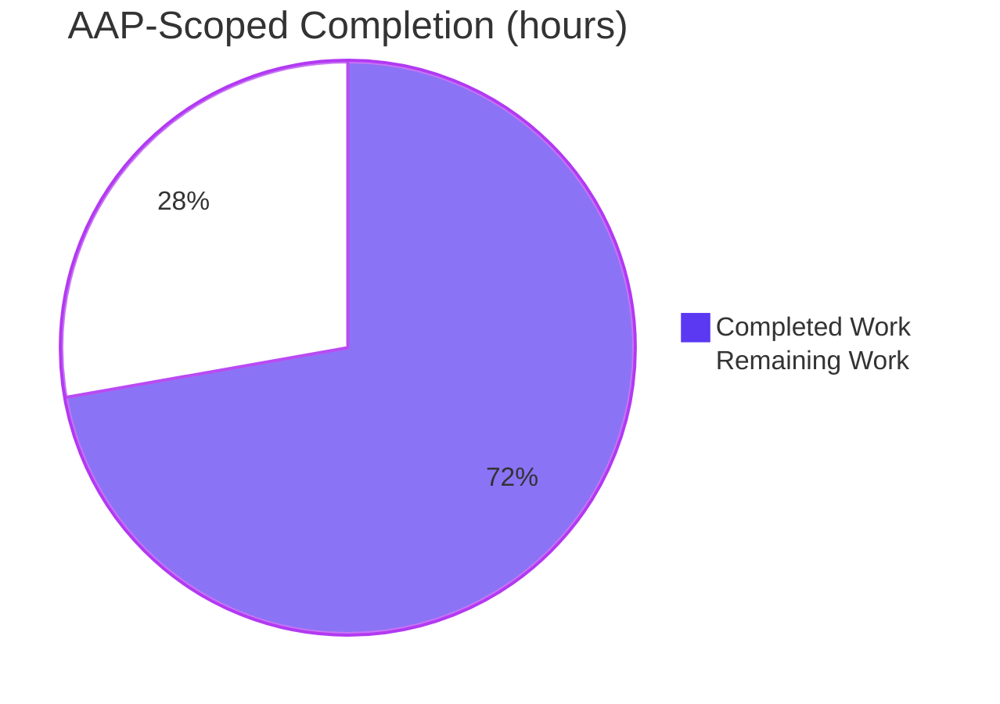
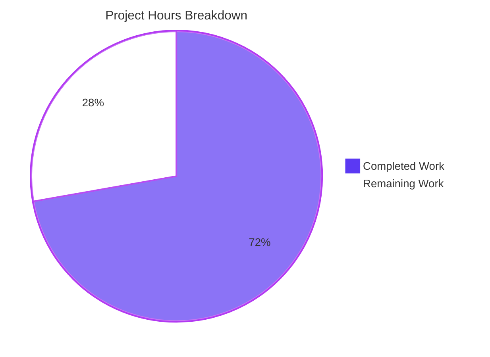

# 1. Executive Summary

## 1.1 Project Overview

This project adds one HTTP route to an existing single-file Node.js service, served through Express, without disturbing what the service already returns. `GET /` returns `Hello, World!\n` and the new `GET /good-evening` returns `Good evening\n`, both at status 200 with the media type `text/plain` and no charset parameter. Express replaces the bare `http` module and becomes the only dependency; no new module, configuration or user interface is added.

## 1.2 Completion Status



| Metric | Hours |
|---|---|
| Total Hours | 18.0 |
| Completed Hours (Baseline: Human with agentic-assist) | 13.0 |
| Remaining Hours | 5.0 |

**Completion: 72%** — 13.0 of 18.0 hours. Completed Work = Dark Blue `#5B39F3`; Remaining Work = White `#FFFFFF`. All 18 deliverable requirements are met; the 5.0 remaining hours are the gates in 1.4, costed in 2.2.

## 1.3 Key Accomplishments

- `GET /good-evening` serves `Good evening\n` at 200, `text/plain` with no charset, `Content-Length: 13`, body `476f6f64206576656e696e670a`.
- `GET /` still serves `Hello, World!\n` byte-for-byte: 200, parameter-free `text/plain`, `Content-Length: 14`, body `48656c6c6f2c20576f726c64210a`.
- `express` is the only dependency, declared once as `"^5"`, resolving to 5.3.0 with no advisory across its 65 packages.
- Routing moved to one Express application that owns the listener; the loopback bind `127.0.0.1:3000` and the readiness line are unchanged.
- Change discipline: two files, 7 lines out and 5 in plus the dependency entry, no file created, the lockfile and project notice byte-identical.
- Exercised at runtime: both routes, the framework 404, conditional requests, 50 concurrent requests, a 1 MB body, a clean `SIGTERM` and loopback-only exposure.

## 1.4 Critical Unresolved Issues

**Four of the 22 items scoped remain open** — 18 deliverable requirements and 4 production gates. No requirement is unmet; each open item is a production gate or an accepted caveat.

| Issue | Impact | Owner | ETA |
|---|---|---|---|
| A bind conflict reports a successful start: the second process prints the readiness line, writes nothing to stderr and exits 0 with nothing bound | A supervisor or orchestrator can record the service as up when it is not listening | Backend / operations | 0.5 day (1.5 h) |
| `package-lock.json` carries no dependency entry, so `npm ci` fails with `Missing: express@5.3.0 from lock file` and the version floats on `^5` | A lockfile-driven pipeline cannot install; two installs on different dates can resolve different 5.x versions | Backend | 0.5 day (1.5 h) |
| No automated regression gate: `npm test` is the upstream placeholder that prints `Error: no test specified` and exits 1 | The five-element route contract is protected by manual probing only | Backend | 1 day (2 h) |
| The parameter-free `text/plain` depends on pairing a raw `setHeader` with a `Buffer` body, and nothing in the file records that constraint (`server.js:7-8`) | An idiomatic rewrite to `res.set(...).send('<string>')` silently adds `; charset=utf-8` and breaks the contract | Reviewer | with the gate above |

## 1.5 Access Issues

No access issues identified. The service needs no credential, database, broker or environment variable, and the public npm registry answered every dependency resolution.

## 1.6 Recommended Next Steps

1. **[High]** Make a failed bind visible: log readiness only when `app.listen`'s callback reports no error, and exit non-zero on `EADDRINUSE`.
2. **[High]** Commit a refreshed `package-lock.json` so `npm ci` installs `express` and the version is pinned.
3. **[Medium]** Add a pipeline gate asserting both routes' status, media type, `Content-Length` and body bytes, plus the readiness line.
4. **[Medium]** Decide the deployment model for the fixed loopback port: one instance per host behind a proxy, or a configurable host and port.
5. **[Low]** Note that the service installs with `npm install` and starts with `npm start`.

# 2. Project Hours Breakdown

## 2.1 Completed Work Detail

| Component | Hours | Description |
|---|---|---|
| Express dependency declaration | 1.5 | `dependencies.express` declared once as `"^5"` after `license` in `package.json`; the seven pre-existing keys keep their bytes, order and four-space indentation, and no other field is added. |
| Express application and route registrations | 2.5 | `server.js` imports Express on line 1, constructs one application object, registers `GET /` and `GET /good-evening` as one statement each, and hands the bind to the application; the file lands at 12 lines with the specified 7-deletion / 5-insertion shape. |
| Parameter-free `text/plain` contract established and proven | 2.5 | Establishing that Express 5 appends `; charset=utf-8` on both idiomatic paths, then selecting and proving over HTTP a mechanism that holds the media type at exactly `text/plain` on both routes. |
| Preserved bind, port, loopback listener and readiness output | 1.0 | `127.0.0.1`, `3000`, the blank-line structure and the readiness `console.log` left byte-identical; startup confirmed to print one line on stdout with empty stderr. |
| Diff minimality and scope discipline | 1.5 | The change is exactly the forced edit: no new file, no comment, no reformatting; `package-lock.json` and `README.md` byte-identical to the base revision. |
| Verification of the delivered service | 4.0 | Syntax and manifest gates, both route contracts, the method and path matrix, conditional requests, edge-case inputs, concurrency, lifecycle, exposure and dependency-advisory checks. |
| **Total** | **13.0** | Matches the Completed Hours figure in Section 1.2. |

## 2.2 Remaining Work Detail

| Category | Hours | Priority |
|---|---|---|
| Startup-failure signalling: a bind conflict must fail visibly instead of printing the readiness line and exiting 0 (path-to-production: service supervision) | 1.5 | High |
| Committed dependency resolution: refresh and commit `package-lock.json` with `express`, verify `npm ci` on a clean checkout, then re-verify both routes (path-to-production: reproducible install) | 1.5 | High |
| Automated contract gate: a test asserting both routes' status, parameter-free media type, `Content-Length` and body bytes plus the once-only readiness line, wired into a pipeline job (path-to-production: release gate; also the guard for the handler mechanism) | 2.0 | Medium |
| **Total** | **5.0** | Matches the Remaining Hours figure in Section 1.2 and the pie chart in Section 7. |

Completed 13.0 + Remaining 5.0 = 18.0 total project hours.

# 3. Test Results

The repository ships no test framework, so the project's gate is the runtime probe: the service is started and every published response is asserted byte for byte. The table records exactly the assertions executed against the delivered service — **36 assertions and a 50-request concurrency pass, 36 of 36 passing, 0 failing, no 5xx and no crash anywhere.**

| Area / Category | Framework | Tests | Passed | Failed | Coverage | What This Proves |
|---|---|---|---|---|---|---|
| Syntax and manifest gates | `node --check`, `JSON.parse` | 3 | 3 | 0 | n/a | `server.js` parses as JavaScript and both JSON files are well formed |
| Route contract — `GET /` and `GET /good-evening` | `curl` + HTTP assertion script | 12 | 12 | 0 | n/a | both routes answer 200 with a single parameter-free `text/plain`, `Content-Length` 14/13 and the exact body bytes, with `X-Powered-By` and weak `ETag` retained |
| Method and path matrix | `curl` | 11 | 11 | 0 | n/a | only the two declared `GET` routes serve a body; unmatched paths, wrong methods, query strings, case variants and trailing slashes are answered exactly as the framework dictates |
| Conditional requests | `curl` | 2 | 2 | 0 | n/a | a matching `If-None-Match` returns 304 and a non-matching one returns 200 with the exact body |
| Edge-case inputs | `curl` | 3 | 3 | 0 | n/a | a 2000-character path and a traversal-shaped path return 404, and a 1 MB body sent to a `GET` route is discarded with the exact 13-byte response |
| Startup, lifecycle and exposure | process and socket observation | 5 | 5 | 0 | n/a | the readiness line appears once on stdout with empty stderr, stays the only line after traffic, `SIGTERM` releases the port, and a non-loopback address is refused |
| Concurrency | `curl` (50 parallel requests) | 50 | 50 | 0 | n/a | 50 simultaneous requests all return the exact body with no 5xx and no added output on either stream |
| Project test suite | `npm test` | 0 | 0 | 0 | n/a | there is no automated suite: the script is the upstream placeholder that prints `Error: no test specified` and exits 1, so every number above comes from direct HTTP probing |

**Not Covered** — the following capabilities were delivered but are not exercised by any committed test, and should be covered before relying on them as protected behaviour:

- **Automated regression protection.** No unit or integration test file exists, so a change to the handler chain or to either body literal would not be caught by anything committed; the contract is verified only by probing the running service.
- **The media type's stability across a dependency change.** The parameter-free `text/plain` was measured on the resolved Express 5.3.0 only; nothing would detect a future Express release that begins normalising an explicitly set media type when a `Buffer` body is sent.
- **Install reproducibility.** `npm ci` cannot install the dependency from the committed lockfile, so the install path a pipeline would use is untested by design — only `npm install` was exercised.
- **Deployment conditions.** No test covers a reverse proxy, TLS, a container or supervisor lifecycle, a second instance on the default port, or any interface other than loopback.
- **Dependency advisories beyond the registry's database.** The resolved tree reports no advisory, but no static analysis of the transitive packages was performed.

# 4. Runtime Validation & UI Verification

The service was started both ways it ships — `npm start` and `node server.js` — and driven over HTTP on `127.0.0.1:3000`; a relocated copy on port 31000 carried the traffic bursts so the default port stayed free for the plain-start check.

- ✅ **Startup and readiness** — one stdout line `Server running at http://127.0.0.1:3000/` after the socket accepts connections, stderr empty, and still the only line after all traffic.
- ✅ **`GET /`** — 200, `Content-Type: text/plain` (no charset), `Content-Length: 14`, body `48656c6c6f2c20576f726c64210a`; headers carry `X-Powered-By: Express` and a weak `ETag`.
- ✅ **`GET /good-evening`** — 200, `text/plain`, `Content-Length: 13`, body `476f6f64206576656e696e670a`.
- ✅ **Unmatched paths and non-GET methods** — `/nope`, `/health`, `POST /` and `DELETE /good-evening` return the framework's 404 (`<pre>Cannot GET …</pre>`, `Content-Security-Policy: default-src 'none'`, `nosniff`). This is the accepted consequence of replacing the former catch-all with a router: requests the old handler answered with `Hello, World!\n` now receive a 404.
- ✅ **Conditional requests** — a matching `If-None-Match` returns 304; a non-matching one returns 200 with the exact body.
- ✅ **Framework routing defaults** — `HEAD` returns headers with no body, `OPTIONS` returns 200 with `Allow: GET, HEAD`, and `/Good-Evening` and `/good-evening/` resolve to the same declared route.
- ✅ **Concurrency and stability** — 50 simultaneous requests returned 50 × 200 with identical bodies and no growth in either output stream.
- ✅ **Process lifecycle** — `SIGTERM` terminates the process and releases the port immediately, with nothing further written to either stream.
- ✅ **Network exposure** — the listener answers on loopback only; a request to the host's non-loopback address was refused while the same request over `127.0.0.1` succeeded.
- ⚠ **Startup failure mode** — a second instance started while the port was already held printed the readiness line, wrote nothing to stderr and exited 0 with nothing bound, while the first instance kept serving. Supervision keyed on that line would record a failed start as a success (open item in 1.4).

The project defines no user interface: its entire client-facing output is the two `text/plain` bodies, so there is no rendered surface, no browser flow and no design-system conformance to verify. The only HTML the service emits is the framework's own 404 document.

**Never exercised at runtime:** access from any address other than loopback, operation behind a reverse proxy or under TLS, a supervisor or container lifecycle, two instances sharing the default port, and any Express version other than the resolved 5.3.0.

# 5. Compliance & Quality Review

## 5.1 Compliance Matrix

| # | Deliverable | Benchmark | Status | Progress |
|---|---|---|---|---|
| 1 | `express` declared as the sole dependency, range `^5` | Dependency hygiene | ✅ PASS | ██████████ 100% |
| 2 | CommonJS module form retained, single import on line 1, dead `http` import removed | Module integrity | ✅ PASS | ██████████ 100% |
| 3 | `GET /good-evening` returns `Good evening\n` at 200, `text/plain`, `Content-Length: 13` | Functional correctness | ✅ PASS | ██████████ 100% |
| 4 | `GET /` unchanged: `Hello, World!\n` at 200, `text/plain`, `Content-Length: 14` | Backward compatibility | ✅ PASS | ██████████ 100% |
| 5 | Media type exactly `text/plain`, no charset parameter, on both routes | Contract exactness | ✅ PASS | ██████████ 100% |
| 6 | Router replaces the catch-all; unmatched paths and methods follow framework defaults | Behavioural clarity | ✅ PASS | ██████████ 100% |
| 7 | Loopback bind, port literal and readiness line byte-identical; one line on stdout, empty stderr | Operational continuity | ✅ PASS | ██████████ 100% |
| 8 | Diff limited to the forced edit; no file created, no comment, no reformatting | Change discipline | ✅ PASS | ██████████ 100% |
| 9 | `package-lock.json` and `README.md` byte-identical; no ignore file or new path | Repository continuity | ✅ PASS | ██████████ 100% |
| 10 | No health/status route, 404 handler, error handler, environment configuration, logging or hardening added | Scope conformity | ✅ PASS | ██████████ 100% |
| 11 | User-specified rules observed (four ticket-label annotations, none engaged by code) | Rule compliance | ✅ PASS | ██████████ 100% |
| 12 | Resolved 65-package dependency tree free of known advisories; loopback-only listener; no request input read | Security baseline | ✅ PASS | ██████████ 100% |

## 5.2 AAP & Rule Divergences and Gaps

| What the AAP/Rule Required | What Was Delivered Instead | Why It Diverged | Impact | Remediation |
|---|---|---|---|---|
| The route handlers written as `res.status(200).set('Content-Type','text/plain').send('<string literal>')` | `res.status(200).setHeader('Content-Type','text/plain').send(Buffer.from('<string literal>'))` (`server.js:7-8`) | Express 5.3.0 appends `; charset=utf-8` on both prescribed paths — `res.set` normalises the value through `mime.contentType()` and a string body goes through the charset helper — while the same specification fixes the media type as exactly `text/plain` with no parameter. The observable contract outranks the mechanism restatement, so the mechanism was substituted to satisfy the stronger clause. | None on the wire: status, media type, `Content-Length` and body bytes are as specified on both routes, and the preserved route's media type is identical to the pre-change service. Maintainability cost: the idiom is non-obvious and no comment is permitted by the same specification. | None in code. Guard it with the contract gate in 2.2 so any simplification that reintroduces the charset fails a check. |
| The request said "modify only `server.js`" | Two files changed: `server.js` and `package.json` | **Sanctioned** — the same request requires Express added as the sole new dependency, which is unsatisfiable without a manifest declaration; the specification resolves the conflict explicitly and limits the manifest change to that one entry. | None: no other file moved, and the manifest's pre-existing keys, values and order are untouched. | None. |
| `package.json` described as growing from 11 to 12 lines | 14 printed lines / 13 newlines / 304 bytes (`package.json:1-14`) | The specification's own diff hunk changes one line and adds three, which yields 11 → 14; the delivered file is byte-identical to that hunk and its target block, so the prose count is internally inconsistent. | Documentation only — no behavioural or structural effect. | None. |

No user-specified rule was departed from. All four rules — `Test ABK-4958`, `Test ABK-4958 -2`, `Test ABK-4598 - 1 Admin Role`, `Clone-Test ABK-4958 Member Role` — are ticket-label annotations recording who created and shared a ticket and in which role; none carries an obligation on code, files, tooling or process, and neither changed file holds an identity, role, session or permission surface for a rule clause to act on.

**The handler mechanism (first row) needs one human decision.** The delivered chain is the reason both routes keep a parameter-free `text/plain`: any rewrite to the idiomatic `res.set(...)` with a string body appends `; charset=utf-8`, which changes the documented contract for both routes — including the one that was not supposed to change at all. The evidence is in `server.js:7-8` plus the measured responses (single `Content-Type: text/plain`, `Content-Length` 14 and 13, bodies `48656c6c6f2c20576f726c64210a` and `476f6f64206576656e696e670a`). Because no comment is permitted at that line, decide to protect the contract with the automated gate scheduled in 2.2 rather than with documentation, and treat any future "cleanup" of those two lines as a contract change requiring a re-measure.

**The two-file scope (second row) is the intended reading of the request.** The instruction to modify only `server.js` sits beside the instruction to add Express as a dependency, and a `require('express')` cannot resolve until the manifest declares it. The delivery resolved this the only way both clauses can hold: `server.js` carries all application code, and `package.json` carries exactly `"dependencies": { "express": "^5" }`. If a stricter single-file rule is ever required — for example a vendored dependency — that is a new decision with its own trade-offs; it does not change anything about the shipped responses.

# 6. Risk Assessment

| Risk | Category | Severity | Probability | Mitigation | Status |
|---|---|---|---|---|---|
| A bind conflict is reported as a successful start: readiness prints, stderr stays empty and the process exits 0 with nothing listening | Operational | High | Medium — any port collision or restart overlap | Log readiness only when `app.listen`'s callback receives no error and exit non-zero on `EADDRINUSE`; alternatively supervise the socket rather than the log line | Open |
| `npm ci` cannot install the dependency from the committed lockfile, and `"^5"` floats with no committed resolution | Integration | Medium | High — any lockfile-driven build | Commit a refreshed `package-lock.json` carrying express and its transitive set, then pin future bumps through it | Open |
| No automated regression net: `npm test` is the placeholder that exits 1 and no pipeline runs the service | Technical | Medium | High — every change | Add a contract test for both routes plus the readiness line and run it in a pipeline job | Open |
| The parameter-free media type rests on an undocumented pairing of raw `setHeader` with a `Buffer` body (`server.js:7-8`) | Technical | Medium | Medium — an idiomatic refactor triggers it | The same contract test fails if `; charset=utf-8` appears; treat those two lines as contract-bearing in review | Open (accepted caveat) |
| The loopback bind is the only trust boundary: neither route authenticates and the 200 responses carry no security headers (`X-Powered-By` is disclosed) | Security | Medium | Low while bound to `127.0.0.1` | Keep the loopback bind; add authentication, TLS termination and header hardening before any wider exposure | Accepted by design |
| The framework's 404 reflects the request path back to the caller | Security | Low | Low — the path is percent-encoded and HTML-escaped (verified with script, CRLF and 8 KB payloads) | Keep the framework default; escape any custom 404 or error page added later | Accepted |
| Fixed `127.0.0.1:3000` with no configuration path: unreachable off-host and one instance per host | Operational / Integration | Medium | High if remote access or horizontal scale is expected | Decide the deployment model — proxy a single instance per host, or make host and port configurable with loopback as the default | Accepted (deployment decision) |
| The resolved tree carries no advisory today, but nothing pins it | Security | Low | Low | Pin through the committed lockfile (second row) and re-run `npm audit` on every dependency change | Open |

# 7. Visual Project Status



**Completion: 72%** (13.0 of 18.0 hours). Completed Work is Dark Blue `#5B39F3`; Remaining Work is White `#FFFFFF`.

| Status | Hours | Share |
|---|---|---|
| Completed Work | 13.0 | 72% |
| Remaining Work | 5.0 | 28% |
| **Total** | **18.0** | **100%** |

Remaining hours by priority, matching Section 2.2:

| Priority | Work | Hours |
|---|---|---|
| High | Startup-failure signalling | 1.5 |
| High | Committed dependency resolution | 1.5 |
| Medium | Automated contract gate | 2.0 |
| **Total** | | **5.0** |

# 8. Summary & Recommendations

**What was delivered.** The service now serves two routes from a single Express application instead of one catch-all handler: `GET /good-evening` returns `Good evening\n` and `GET /` still returns `Hello, World!\n`, both at status 200 with the media type exactly `text/plain`, no charset parameter, and the exact `Content-Length` and body bytes the requirement fixes. Express is the only dependency, declared once in `package.json`; `server.js` holds all application code at 12 lines with 7 deletions and 5 insertions against the previous revision; the lockfile and project notice are untouched. The project stands at **72% completion against its scoped work (13.0 of 18.0 hours)** — every deliverable requirement is met, and the outstanding 5.0 hours are production gates rather than missing functionality.

**What was verified.** Both routes were driven over HTTP and asserted byte for byte, in both ways the service ships (`npm start` and `node server.js`). 36 assertions and a 50-request concurrency pass produced no failure, no 5xx and no crash: the two bodies are stable across query strings, request headers, repeats and a 1 MB request body; the framework's 404 handles everything else; a conditional request returns 304 without disturbing the body; `SIGTERM` releases the port; and the listener refuses connections on any address but loopback. The resolved 65-package dependency tree reports no advisory at any severity. Nothing about the preserved route changed — status, media type and body bytes match a replay of the previous revision, with only Express's own default headers added.

**The critical path to production** is short and specific: make a failed bind visible instead of reporting success, commit a lockfile resolution so `npm ci` works and the dependency is pinned, and add an automated contract gate. The first is the one place where the running service can mislead an operator; the second blocks any lockfile-driven pipeline (`npm ci` fails with `Missing: express@5.3.0 from lock file`); the third is what keeps the five-element contract from silently changing, given that the parameter-free media type depends on a non-obvious handler idiom that deliberately carries no comment.

**Success metrics.** Route correctness: 100% of asserted response elements match (status, single parameter-free `Content-Type`, `Content-Length`, body bytes) on both routes. Scope discipline: 2 files changed, 0 files created or deleted, 2 continuity artefacts byte-identical. Operational stability: 1 readiness line per start, 0 bytes on stderr across all runs, 50 of 50 concurrent requests answered, clean signal termination with the port released. Dependency posture: 0 advisories across 65 installed packages.

**Production readiness assessment: conditionally ready.** As a loopback-bound, two-route plain-text service the code is correct, minimal and demonstrably stable, and it can be operated today with `npm install && npm start`. It is not yet ready for an automated release pipeline: a collided port is reported as a successful start, `npm ci` cannot install the declared dependency, and no committed check protects the contract. Closing the open gates in Section 2.2 — 5.0 hours — removes each of those conditions without touching a served byte.

# 9. Development Guide

### 9.1 System prerequisites

- **Node.js 18 or later** — the service runs on Node 22.23.5 here, and `express@5` declares `engines.node >= 18`.
- **npm** — 11.21.3 here; any npm that ships with Node 18+ is sufficient.
- No database, message broker, environment variable, secret or container runtime is needed. Network access to `https://registry.npmjs.org/` is required once, to install the dependency.

Check the runtime before starting:

```bash
node --version    # v22.23.5
npm --version     # 11.21.3
```

### 9.2 Install dependencies

From the project root:

```bash
npm install
```

Expected: `added 65 packages` and exit code 0, resolving `express` 5.3.0. Confirm the version:

```bash
node -e "console.log(require('express/package.json').version)"    # 5.3.0
```

Use `npm install`, **not** `npm ci`: the committed `package-lock.json` carries no dependency entry, so `npm ci` stops with `EUSAGE … Missing: express@5.3.0 from lock file`. `npm install` rewrites the lockfile as a side effect; that rewrite is not part of the change, so leave it out of any commit until the lockfile refresh is scheduled.

### 9.3 Start the service

Either command works; both bind `127.0.0.1:3000` from the literals in `server.js:3-4`:

```bash
npm start          # npm supplies the implicit "node server.js" start script
# or
node server.js
```

Expected stdout, once, after the socket is listening:

```
Server running at http://127.0.0.1:3000/
```

stderr stays empty. To stop it, send `SIGTERM` (`Ctrl-C` also works); the process exits and the port is released immediately.

### 9.4 Verify the responses

```bash
curl -sS -D - http://127.0.0.1:3000/
curl -sS http://127.0.0.1:3000/ | od -An -tx1
curl -sS -D - http://127.0.0.1:3000/good-evening
curl -sS http://127.0.0.1:3000/good-evening | od -An -tx1
```

Expected:

```
HTTP/1.1 200 OK
X-Powered-By: Express
Content-Type: text/plain
Content-Length: 14
ETag: W/"e-YP3pwjELDUytTauNEmsEOH77ook"
```

```
48 65 6c 6c 6f 2c 20 57 6f 72 6c 64 21 0a        # "Hello, World!\n", 14 bytes
```

```
HTTP/1.1 200 OK
Content-Type: text/plain
Content-Length: 13
```

```
47 6f 6f 64 20 65 76 65 6e 69 6e 67 0a            # "Good evening\n", 13 bytes
```

`Content-Type` must read exactly `text/plain` — if a `; charset=utf-8` parameter ever appears, the handler chain in `server.js:7-8` has been rewritten and the contract has changed. An unmatched path returns the framework's 404 (`Cannot GET /nope`), which is expected.

Static gates, when you have changed a file:

```bash
node --check server.js
node -e "JSON.parse(require('fs').readFileSync('package.json','utf8')); console.log('ok')"
```

### 9.5 Run a second instance or use another port

The port is a literal, so relocate the file rather than the environment — `PORT` and `HOST` are inert:

```bash
cp server.js /path/outside/the/repo/server-31000.js
sed -i "s/const port = 3000;/const port = 31000;/" /path/outside/the/repo/server-31000.js
diff server.js /path/outside/the/repo/server-31000.js    # exactly one changed line
node /path/outside/the/repo/server-31000.js              # readies on http://127.0.0.1:31000/
```

To test whether a port is free without `lsof`/`ss` (not installed on every host):

```bash
node -e "const s=require('net').createServer();s.once('error',e=>{console.log('BUSY',e.code);process.exit(0)});s.once('listening',()=>{console.log('FREE');s.close()});s.listen(3000,'127.0.0.1')"
```

### 9.6 Troubleshooting

| Symptom | Cause | Resolution |
|---|---|---|
| `Error: Cannot find module 'express'` at startup | The process started from a directory without `node_modules` | Run `npm install` in the project root, or start the process from that root |
| A second instance prints the readiness line, nothing on stderr, and exits 0, yet nothing answers | The port is already held; `app.listen` passes the bind error to the readiness callback, which ignores it | Verify the port is free before starting (see 9.5); schedule the startup-signalling fix in 2.2 |
| `npm ci` fails: `Missing: express@5.3.0 from lock file` | The committed lockfile has no dependency entry | Use `npm install`; a committed lockfile refresh is the open item in 2.2 |
| `npm test` exits 1: `Error: no test specified` | The upstream placeholder script was never replaced | Expected — the project ships no test suite; use the probes in 9.4 |
| `curl` to the host's LAN address fails, `127.0.0.1` works | The listener is bound to loopback only | Intended; front it with a proxy or change the bind deliberately |
| Every path including `/good-evening` returns 404 | The process runs an older copy of the file, or a different port | Confirm the readiness line's port and re-copy the current `server.js` |

# 10. Appendices

## A. Command Reference

| Purpose | Command |
|---|---|
| Install dependencies | `npm install` |
| Start the service | `npm start` or `node server.js` |
| Syntax check | `node --check server.js` |
| Manifest check | `node -e "JSON.parse(require('fs').readFileSync('package.json','utf8'))"` |
| Lockfile check | `node -e "JSON.parse(require('fs').readFileSync('package-lock.json','utf8'))"` |
| Install from lockfile (currently fails) | `npm ci` |
| Project test script (placeholder) | `npm test` |
| Fetch a route's headers | `curl -sS -D - http://127.0.0.1:3000/good-evening` |
| Fetch a route's body as bytes | `curl -sS http://127.0.0.1:3000/good-evening \| od -An -tx1` |
| Conditional request | `curl -sS -o /dev/null -w '%{http_code}\n' -H 'If-None-Match: W/"d-7fFyiNLFhmJrNT+BforqesSHNow"' http://127.0.0.1:3000/good-evening` |
| Port availability | `node -e "const s=require('net').createServer();s.once('error',e=>{console.log('BUSY',e.code);process.exit(0)});s.once('listening',()=>{console.log('FREE');s.close()});s.listen(3000,'127.0.0.1')"` |
| Stop a running instance | `kill -TERM <pid>` (or `Ctrl-C` in the foreground) |
| Dependency advisory check (after an install) | `npm audit` |

## B. Port Reference

| Port | Purpose | Notes |
|---|---|---|
| 3000 | The service's listen port | Hardcoded literal `port = 3000` at `server.js:4`; bound on `127.0.0.1` only |
| 31000 | Relocated copy used for the traffic bursts during verification | Produced by copying `server.js` and changing only the port literal |
| 3000+ | Any alternative | Requires editing the literal in a copy; `PORT` is not read |

No other port is opened by the service, and it makes no outbound connections.

## C. Key File Locations

| Path | Role |
|---|---|
| `server.js` | The whole service: Express import, application object, both route registrations, the listener and the readiness line (12 lines) |
| `package.json` | Manifest: one dependency, `express ^5`; pre-existing scripts, `main` and metadata unchanged |
| `package-lock.json` | Lockfile stub (`lockfileVersion` 3) with no dependency entry — the reason `npm ci` fails |
| `README.md` | Two-line project notice; not modified by this work |

## D. Technology Versions

| Component | Version | Notes |
|---|---|---|
| Node.js | 22.23.5 | Meets `express@5`'s `>= 18` floor |
| npm | 11.21.3 | Supplies the implicit `node server.js` start script when none is declared |
| express | 5.3.0 | Resolved from `"^5"`; 65 packages installed in total |
| Module system | CommonJS | No `"type"` field, so `require` is the correct form |

## E. Environment Variable Reference

The service reads no environment variable. `PORT`, `HOST` and `NODE_ENV` were all set to hostile values during verification and had no effect: the bind stayed on the `127.0.0.1:3000` literals.

| Variable | Read by the service? | Effect |
|---|---|---|
| `PORT`, `HOST` | No | Ignored; the literals in `server.js:3-4` govern |
| `NODE_PATH` | Only the Node loader | Can point `require('express')` at an install outside the project directory |
| `CI` | npm only | Makes npm non-interactive during installs |

## F. Developer Tools Guide

| Tool | Use here |
|---|---|
| `curl` | Header dumps (`-D -`), status-only probes (`-o /dev/null -w '%{http_code}'`), conditional requests (`-H 'If-None-Match: …'`) |
| `od -An -tx1` | Byte-exact body verification; the portable substitute for `xxd`, which is not present on every host |
| `node --check` | The only static gate the project has — there is no compiler, linter or build step |
| Node's `net` module | Confirms whether a port is free and which socket the process holds, where socket-listing tools are absent |
| `lsof`, `ss`, `netstat` | May be absent; use the `node` port probe in Appendix A instead |

## G. Glossary

| Term | Meaning |
|---|---|
| Media type | The value of `Content-Type`. Here it must be exactly `text/plain`, with no `charset` parameter. |
| Charset parameter | The `; charset=utf-8` suffix Express appends to a string body or a value set through `res.set`. Its absence is part of the contract. |
| Readiness line | The single line printed to stdout after the socket is listening: `Server running at http://127.0.0.1:3000/`. |
| Loopback bind | Listening on `127.0.0.1` only, so the service is reachable from the local host and nowhere else. |
| Weak ETag / 304 | Express's default validator; a conditional request carrying a matching value gets `304 Not Modified` with no body. |
| Framework defaults | Behaviour Express supplies for inputs the requirements do not specify: the 404 page, `X-Powered-By`, case-insensitive and trailing-slash-tolerant routing, automatic `OPTIONS`. |
| Lockfile | `package-lock.json`. It pins the exact resolved dependency tree; the committed copy here pins nothing, so `npm ci` cannot install. |
