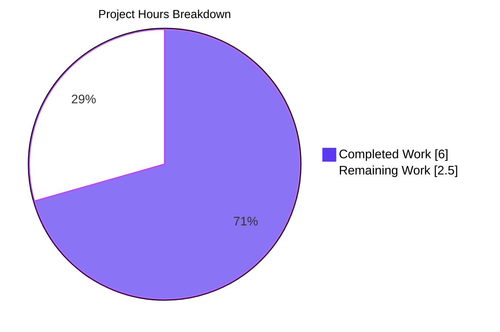

# 1. Executive Summary

A single catch-all HTTP handler became a two-route Express application, complete against the Agent Action Plan. This report measures that work, records what was exercised to verify it, and states what stands between the code as committed and production.

## 1.1 Project Overview

This project converts the repository's single catch-all HTTP handler into a small Express application. `server.js` answers two named routes — `GET /` with `Hello, World!` and the new `GET /good-evening` with `Good evening` — both as bare `text/plain` with fixed byte-exact bodies, while the listen address, port and startup banner stay unchanged; `package.json` declares `express` as the only dependency.

Its consumers are the HTTP harnesses that exercise the fixture on `127.0.0.1:3000`. The value is a second addressable route on a framework base that further routes can extend, with the root response preserved byte for byte and no new file or tooling.

## 1.2 Completion Status

**6.0 hours completed out of 8.5 total hours = 71% complete** (6.0 ÷ (6.0 + 2.5) × 100).


| Metric | Hours |
|---|---|
| Total Hours | 8.5 |
| Completed Hours (Baseline: Human with agentic-assist) | 6.0 |
| Remaining Hours | 2.5 |

## 1.3 Key Accomplishments

- `GET /` keeps 200, bare `text/plain` and its 14-byte body, byte-identical to before.
- `GET /good-evening` answers 200, bare `text/plain`, 13-byte body.
- One `setHeader` → `end` form on both routes: no charset, no `ETag`.
- `express` is the only declared dependency and the module the process loads.
- Startup is unchanged: one banner line, loopback-only bind, clean SIGTERM shutdown.
- Unregistered paths and methods get the built-in 404, not a catch-all 200.
- The change is confined to `server.js` and `package.json`; no new file.
- Both routes and the 404 page render correctly in a browser.

## 1.4 Critical Unresolved Issues

Open items: **0 of 4** requested capabilities. Three gaps remain against production readiness; none invalidates the delivered scope.

| Issue | Impact | Owner | ETA |
|---|---|---|---|
| `package-lock.json` lists no `express`, so `npm ci` rejects the tree with `EUSAGE` | Pipelines that install with `npm ci` fail; the resolved Express version is unpinned | Repository owner | 0.5 h |
| A start that cannot bind prints the success banner and exits 0 | A process supervisor cannot distinguish a failed start from a healthy one | Repository owner | 1.0 h |
| No automated test or CI check exists for either route contract | Nothing guards the status, media type or body bytes against a future edit | Repository owner | 1.0 h |

## 1.5 Access Issues

No access issues identified. The registry was reachable for installation, and the service needs no credential, secret or external service.

## 1.6 Recommended Next Steps

1. [High] Run `npm install` once and commit the regenerated `package-lock.json` so `npm ci` works and the Express version is pinned.
2. [Medium] Make a failed bind observable once the no-error-handling term is relaxed.
3. [Low] Add a pipeline check for both route contracts, the 404 and the startup banner.
4. [Low] Decide the exposure posture before leaving loopback: TLS, security headers, rate limiting, configurable host and port.

# 2. Project Hours Breakdown

Hours are scoped to the Agent Action Plan's deliverables plus the path-to-production work that deployment of those deliverables requires. Completed hours measure the delivered and verified work; remaining hours measure only the gaps recorded in Section 5.2.

## 2.1 Completed Work Detail

| Component | Hours | Description |
|---|---|---|
| Express application conversion (`server.js`) | 1.5 | Import swapped to `express`, app instance created, `GET /` and `GET /good-evening` registered with the exact status, media type and body contract, legacy catch-all removed |
| Dependency declaration (`package.json`) | 0.5 | `dependencies` block holding the single `express` entry, the licence-line comma, no other field touched |
| Startup, bind and banner continuity | 0.5 | Host and port constants and the listen callback preserved, one banner line, one listener, no competing handler |
| Route contract verification | 2.0 | Both routes' status, bare media type, runtime `Content-Length`, byte-exact bodies, absence of `ETag` and charset, unmatched path and method, matching defaults, HEAD/OPTIONS, browser rendering |
| Lifecycle, concurrency and robustness verification | 1.0 | 50-way concurrency, keep-alive reuse, SIGTERM and restart, injection, traversal and reflection probes, environment inertness, occupied-port behaviour |
| Dependency and install validation | 0.5 | Resolution to `express` 5.3.0, fail-fast when the module is absent, install from the manifest alone |
| **Total** | **6.0** | |

## 2.2 Remaining Work Detail

| Category | Hours | Priority |
|---|---|---|
| Install-path reproducibility — regenerate and commit `package-lock.json` so `npm ci` resolves the declared dependency | 0.5 | Medium |
| Bind-failure signalling — report a listen failure and exit non-zero, which requires deliberately relaxing the current no-error-handling term | 1.0 | Medium |
| Automated contract check — a repeatable check of both routes' status, media type and body bytes plus the 404 surface, wired into a pipeline | 1.0 | Low |
| **Total** | **2.5** | |

Reconciliation: Section 2.1 (6.0 h) + Section 2.2 (2.5 h) = 8.5 h, the Total Project Hours stated in Section 1.2; the remaining 2.5 h is the same figure in Section 1.2 and in the Section 7 pie chart.

# 3. Test Results

Every figure below was produced by running the service and its checks directly against the tree as committed. The project ships no test suite, so the verification vehicle is a set of executable probes: the service is started on a port other than the hardcoded 3000 (the checked-in file's only difference in those runs is the port literal), driven over HTTP, and its responses asserted at byte level.

| Area / Category | Framework | Tests | Passed | Failed | Coverage | What This Proves |
|---|---|---|---|---|---|---|
| Build and manifest gates | `node --check`, `JSON.parse` | 3 | 3 | 0 | n/a — no coverage tooling exists | The single module parses and both manifests are valid JSON after the change |
| `GET /` contract | curl + `od` byte assertions | 8 | 8 | 0 | n/a | The root route answers 200 with bare `text/plain`, a 14-byte body, a runtime `Content-Length` and no `ETag` |
| `GET /good-evening` contract | curl + `od` byte assertions | 8 | 8 | 0 | n/a | The new route answers 200 with bare `text/plain` and the 13-byte `Good evening\n` body |
| Unregistered paths and methods | curl | 7 | 7 | 0 | n/a | Everything not registered reaches the framework's built-in 404, while HEAD and OPTIONS answer from the `GET` registration |
| Route-matching defaults | curl | 4 | 4 | 0 | n/a | Query strings do not disturb matching, trailing-slash and case variants resolve, and a percent-encoded path name does not |
| Concurrency, keep-alive and shutdown | curl, `xargs`, SIGTERM | 7 | 7 | 0 | n/a | 50 concurrent requests all succeed, one connection serves three requests, one banner and empty stderr persist, and SIGTERM frees the port |
| Browser rendering | headless Chrome | 3 | 3 | 0 | n/a | Both routes render as plain text with their exact bodies, and an unmatched path renders the framework's `Error` page without script execution |
| Automated test suite | npm scripts | 0 | 0 | 0 | none exists | Nothing — the only script is the upstream placeholder, which exits 1 and asserts nothing |
| **Total** | | **40** | **40** | **0** | | |

**Not Covered**

- **No automated test exists for either route or the startup path.** The sole npm script is the upstream placeholder (`echo "Error: no test specified" && exit 1`), so the contracts rest on the probes above. Adding a repeatable check is the Low-priority item in Section 2.2.
- **No CI pipeline, container or deployment descriptor exists**, so no build-and-deploy path has been exercised end to end.
- **The process has never been run under a supervisor** (systemd, pm2, a container restart policy), so restart-on-failure behaviour is unverified — and a failed bind reports success, which is the second gap in Section 5.2.
- **No TLS and no non-loopback exposure was exercised**; the listener is loopback-only by design.
- **No load beyond 50 concurrent requests and no soak run** was performed.
- **No authentication, session or data-store path was tested** because none exists in this service.
- **Dependency version currency and advisories were not researched**, as the delivery terms exclude registry lookups and installs for research.

# 4. Runtime Validation & UI Verification

The service has no screens, forms or client-side code: both routes return plain text and unregistered paths return the framework's error page. What follows is the HTTP surface as actually driven, with the observed result of each flow.

- ✅ **Startup and bind** — one banner line (`Server running at http://127.0.0.1:<port>/`), 0 bytes on stderr, a single loopback-only listener, and no per-request logging after traffic.
- ✅ **`GET /`** — 200, `X-Powered-By: Express`, `Content-Type: text/plain` with no charset, `Content-Length: 14`, body hex `48656c6c6f2c20576f726c64210a`, no `ETag`.
- ✅ **`GET /good-evening`** — 200, identical header set, `Content-Length: 13`, body hex `476f6f64206576656e696e670a`, no `ETag`.
- ✅ **Unregistered paths and methods** — `GET /nope`, `POST /` and `POST /good-evening` all return 404 from the framework's built-in handler with no application text in the page; `HEAD /` returns 200 with no body and `OPTIONS /good-evening` returns 200 with `Allow: GET, HEAD`.
- ✅ **Route matching** — `?a=1` query strings leave both bodies byte-identical; `/good-evening/` and `/GOOD-EVENING` are served; `/good%2Devening` returns 404.
- ✅ **Concurrency and keep-alive** — 50 parallel requests all returned 200; three requests over one connection returned 200, 200 and 404.
- ✅ **Shutdown and restart** — SIGTERM exits 143, the port is released and a restart serves both routes again.
- ✅ **Browser rendering** — `/` renders `Hello, World!` and `/good-evening` renders `Good evening` as plain text; `/no-such-path` renders the framework's `Error` page with the text `Cannot GET /no-such-path`. No dialogs, no uncaught errors; the only failed request is the browser's automatic `/favicon.ico` probe, which the built-in 404 answers.
- ⚠ **Second instance on an occupied port** — the process prints the success banner, writes nothing to stderr, exits 0 and holds no socket, so the banner alone does not prove the port was bound (Section 5.2, gap 2).
- ❌ **None** — no flow or endpoint failed at runtime.

**Never exercised at runtime:** TLS or any non-loopback access path (the listener is loopback-only); a supervisor-managed start or restart policy; sustained load beyond 50 concurrent requests; an authentication or session flow and a data-store or outbound integration, neither of which exists in this service.

# 5. Compliance & Quality Review

Each row states where a deliverable stands now, as verified against the committed tree and a running instance.

## 5.1 Compliance Matrix

| Deliverable | Status | Evidence |
|---|---|---|
| `GET /` preserved — 200, bare `text/plain`, 14-byte body | ✅ Pass | `server.js:8`; probe returned the exact hex `48656c6c6f2c20576f726c64210a`, `Content-Length: 14`, no charset |
| `GET /good-evening` delivered — 200, bare `text/plain`, 13-byte body | ✅ Pass | `server.js:9`; probe returned hex `476f6f64206576656e696e670a`, `Content-Length: 13` |
| Express mounted, and `express` the only declared dependency | ✅ Pass | One app instance with two registrations; `package.json:11-13` holds the single entry; the require↔declaration closure is one-to-one |
| Smallest-diff discipline — only the three named regions changed | ✅ Pass | Diff is +6/−7 in `server.js` and +4/−1 in `package.json`; none of the untouched lines moved |
| Scope containment — no new file, document, test, lockfile change or config | ✅ Pass | Tracked tree is still four files; no add/delete/rename; `package-lock.json` and `README.md` byte-identical to base |
| Framework defaults unsuppressed; no 404 handler, error handler or hardening | ✅ Pass | `X-Powered-By: Express` on every response; the built-in 404 answers unregistered requests; no middleware, no environment read |
| Legacy catch-all replaced, with no competing listener | ✅ Pass | One `app.listen`; no `http.createServer` or `server.listen` remains; `POST /` now 404s where the catch-all answered 200 |
| Startup banner, loopback bind and constants preserved | ✅ Pass | Host and port lines and the callback are byte-identical to base; one banner line, single `127.0.0.1` listener |
| Build integrity | ✅ Pass | `node --check server.js` exit 0; both manifests parse as JSON |
| Security baseline | ✅ Pass | No secret or credential in either file; no request input is read; the 404 page percent-encodes and escapes the reflected path; 89 traversal and disclosure vectors return 404; listener bound to loopback only |
| Reproducible install | ⚠ Gap | `npm ci` fails (`EUSAGE`, manifests out of sync) because the lockfile lists no `express` — gap 1 below |
| Automated regression protection | ⚠ Gap | No test suite or CI check exists; the sole npm script is the upstream placeholder that exits 1 — gap 3 below |

## 5.2 AAP & Rule Divergences and Gaps

No requirement of the Agent Action Plan was skipped, reworded or deferred, and the delivered `server.js` is byte-identical to the file the plan specifies. The four user rules carry a name and an empty body, so no code can depart from them and none was overridden. The three items below are gaps between the delivered state and a production deployment; each follows from a term the plan itself set, and each needs a decision or a small change from a human.

| What the AAP/Rule Required | What Was Delivered Instead | Why It Diverged | Impact | Remediation |
|---|---|---|---|---|
| The lockfile is neither edited nor regenerated, an accepted consequence recorded in the plan | `package-lock.json` is byte-identical to base and lists no `express`; `npm ci` rejects the tree with `EUSAGE` | The delivery terms forbade creating or committing a lockfile, so regenerating it would have been an unrequested change | Pipelines that install with `npm ci` fail; the resolved Express version is unpinned within `^5.1.0` | Run `npm install` once, verify both routes, commit the regenerated `package-lock.json` (0.5 h) |
| The single banner line and a listener bound to `127.0.0.1:3000` are one startup fact, and the listen callback stays character-unchanged | A start on an already-bound port prints the banner, writes nothing to stderr, exits 0 and holds no socket | The only code that would report the failure is the error branch that the listener-form requirement and the prohibition on error handling exclude | A supervisor cannot distinguish a failed start from a healthy one | Deliberately relax that term, then branch on the listen error, exit non-zero with an `EADDRINUSE` diagnostic, and probe both outcomes (1.0 h) |
| The delivery terms forbid a test suite, test file or harness, and the acceptance evidence takes their place | No test or CI check exists; the sole npm script is the upstream placeholder that exits 1 | The exclusion was explicit, so the verification was performed as runtime probes instead | Nothing guards either route's status, media type or body bytes against a future edit | Add a repeatable contract check to a pipeline (1.0 h) |

**Gap 1 — install reproducibility.** `package-lock.json` still describes a dependency-free package, so it lists no `express` and `npm ci` stops with `npm error code EUSAGE` before installing anything (reproduced on a throwaway copy of the two manifests, leaving the repository untouched). `npm install` reconciles it: on that copy it added 65 packages, wrote the `express` entry into the lockfile, and `npm ci` then completed cleanly on the reconciled tree. The consequence today is that any pipeline or onboarding step must use `npm install`, and two installs months apart can resolve different 5.x releases. Running `npm install` in the repository and committing the regenerated lockfile closes both the pipeline failure and the unpinned-version exposure in one 0.5-hour change; nothing in the application code needs to move with it.

**Gap 2 — a failed bind reports success.** Starting a second instance while the port is held prints `Server running at http://127.0.0.1:3000/`, writes 0 bytes to stderr, holds no socket and exits 0. The cause is the framework's own wiring: `app.listen` registers the caller's callback as the server's `error` listener, so a bind failure invokes it rather than skipping it, and the delivered zero-argument callback ignores the argument. Express's default handling then takes over, which is exactly what the plan requires when it keeps framework defaults unsuppressed and keeps the callback character-unchanged. An operator therefore cannot use the banner as proof the port was bound: verify with a request, a socket probe, or the port's listener row. Settling it needs the owner to relax that term and accept a startup guard of roughly five lines with a non-zero exit; the probe to re-run is the same occupied-port start.

**Gap 3 — no automated regression protection.** Neither route's contract is guarded by anything but an ad-hoc probe, and the sole npm script is the upstream placeholder that prints `Error: no test specified` and exits 1. The risk is concrete: a later edit that swapped `setHeader`+`end` for a content-type helper would silently add `charset=utf-8` and an `ETag`, changing both responses without failing anything. A pipeline check of four assertions — `GET /` is 200 with bare `text/plain` and 14 bytes, `GET /good-evening` is 200 with 13 bytes, an unregistered path is 404, and a start writes one banner line with empty stderr — closes it for about an hour, and reuses the probe commands in Section 9.

# 6. Risk Assessment

Risks below are forward-looking: what could still go wrong once this service is operated. Issues settled during delivery do not appear.

| Risk | Category | Severity | Probability | Mitigation | Status |
|---|---|---|---|---|---|
| A start that cannot bind is indistinguishable from a healthy start (banner, exit 0, no socket) | Operational | Medium | High when a second instance starts | Probe the port or a route rather than trusting the banner; add the listen-error guard once the current term is relaxed | Accepted |
| `npm ci` fails on this tree until the lockfile is regenerated | Technical | Medium | Certain for any `npm ci` pipeline | Run `npm install` and commit the regenerated lockfile; use `npm install` until then | Open |
| Resolved Express version is unpinned (`^5.1.0` resolves to 5.3.0 today) | Technical | Low | Medium over time | Commit the regenerated lockfile, or narrow the range | Open |
| No automated protection of either route's status, media type or body bytes | Technical | Medium | Medium | Add the four-assertion contract check to a pipeline (Section 5.2, gap 3) | Open |
| Framework name disclosed on every response, and no hardening headers on the two routes | Security | Low | Certain | Acceptable for two static literals on loopback; suppress the header and add the header set at a proxy if exposure widens | Accepted |
| Plain HTTP with no TLS, no rate limiting and no CORS policy | Security | Low | Low | Terminate TLS and add rate limiting at a proxy if the service is exposed beyond the host | Accepted |
| Host and port hardcoded, so only one instance per host and no relocation without a code change | Operational | Low | Medium | Make host and port configurable only if a second instance or a different port is required | Accepted |
| `node_modules/` is untracked with no `.gitignore`, so a careless `git add -A` would commit the dependency tree | Operational | Low | Medium | Stage files by path; add a `.gitignore` in a follow-up change | Open |

No integration risk exists: the service has no data store, outbound call, message queue, third-party API or authentication provider, so there is no integration surface that can fail.

# 7. Visual Project Status



**Remaining hours by category** (from Section 2.2)

| Category | Hours | Priority |
|---|---|---|
| Install-path reproducibility | 0.5 | Medium |
| Bind-failure signalling | 1.0 | Medium |
| Automated contract check | 1.0 | Low |
| **Total** | **2.5** | |

# 8. Summary & Recommendations

The delivery is **71% complete** against the Agent Action Plan's scope and the path-to-production work it implies: 6.0 hours of the 8.5 total are delivered and verified, and 2.5 hours remain, all of it productionisation rather than missing functionality. The code change itself is finished and matches the plan byte for byte — `server.js` is identical to the specified file, `package.json` differs only by the licence-line comma and the `dependencies` block, and neither untouched file moved.

What a reader can rely on now is narrow and exact. `GET /` returns 200 with bare `text/plain`, a 14-byte body and no `ETag`; `GET /good-evening` returns 200 with the 13-byte `Good evening\n` body; both are served by one Express application that loads `express` from a single declared dependency; and anything not registered gets the framework's built-in 404 instead of the old catch-all. Startup still prints one banner line and binds loopback only, SIGTERM still exits 143 and releases the port, and 50 concurrent requests all succeed. Forty first-hand checks across those surfaces passed, and both routes and the error page render correctly in a browser.

The remaining 2.5 hours are three discrete, independent items. The first is mandatory before any pipeline runs: the lockfile lists no `express`, so `npm ci` fails with `EUSAGE` and `npm install` must be used until the lockfile is regenerated and committed — a 0.5-hour change that also pins the resolved version. The second is operational: a start that cannot bind prints the success banner and exits 0, so a supervisor would treat a failed start as healthy; fixing it needs the current no-error-handling term relaxed and a five-line guard added. The third is protection against future drift: nothing guards the two contracts, so a later refactor could silently add a charset suffix or an `ETag` without failing anything.

Success for the next stage is measurable in four ways: `npm ci` completes on a clean checkout; a second instance on a held port exits non-zero with an `EADDRINUSE` diagnostic; a pipeline asserts the four contract facts (200 with bare `text/plain` and 14 bytes, 200 with 13 bytes, 404 for an unregistered path, one banner line with empty stderr); and both routes continue to reproduce their byte-exact bodies on x86 Linux with Node 18 or newer.

Production readiness: **ready for its stated purpose** — a two-route, read-only plain-text service bound to `127.0.0.1:3000`, which is exactly what the plan specifies. It is **not ready to be exposed beyond the loopback interface**, where TLS termination, security headers, rate limiting, a configurable host and port, and the startup-failure signal would all become prerequisites. The accepted exposures — framework name disclosure, absent hardening headers, plain HTTP, hardcoded host and port — are conscious consequences of the plan's terms rather than oversights, and none of them is reachable from outside the host today.

# 9. Development Guide

**Prerequisites**

- **Node.js 18 or newer** — Express 5 declares `>= 18`; the verified environment is Node **v22.23.5** with npm **11.21.3**. `package.json` carries no `engines` field, so that floor is not enforced by the manifest.
- **No database, message broker, container, credential or environment variable** is required. The only network dependency is the npm registry, for the single package install.

**Install**

Run from the repository root. `npm install` is the working path: it resolves `express` from the manifest and reconciles the stale lockfile.

```bash
cd <repository-root>
npm install --no-audit --no-fund
```

Expected: `added 65 packages` and exit status 0. Confirm the dependency resolved:

```bash
node -p "require('express/package.json').version"   # -> 5.3.0
```

Do **not** use `npm ci` on the repository as committed — it exits 1 with `npm error code EUSAGE` because `package-lock.json` lists no `express`. Once `npm install` has regenerated the lockfile and it is committed, `npm ci` works and is the preferred command in a pipeline.

**Run**

```bash
node server.js
```

Expected: exactly one line on stdout — `Server running at http://127.0.0.1:3000/` — and nothing on stderr. Host and port are module constants in `server.js`; no environment variable overrides them (`PORT`, `HOST` and `NODE_ENV` have no effect). Stop it with `Ctrl-C` (exit 130) or `kill -TERM <pid>` (exit 143); the port is released either way.

To run on a different port — for a second instance, or when 3000 is already held — copy the file inside the repository and change the constant:

```bash
mkdir -p run
sed 's/^const port = 3000;$/const port = 3100;/' server.js > run/server-3100.js
node run/server-3100.js
```

If the copy lives outside the repository, point module resolution at the installed tree:

```bash
NODE_PATH=<repository-root>/node_modules node <path-to-copy>/server-3100.js
```

**Verify**

```bash
# Root route: 200, bare text/plain, 14-byte body
curl -sS -D - http://127.0.0.1:3000/
curl -sS http://127.0.0.1:3000/ | od -An -tx1
```

Expected headers include `HTTP/1.1 200 OK`, `X-Powered-By: Express`, `Content-Type: text/plain` (no charset) and `Content-Length: 14`; expected body bytes `48 65 6c 6c 6f 2c 20 57 6f 72 6c 64 21 0a`.

```bash
# New route: 200, bare text/plain, 13-byte body
curl -sS -D - http://127.0.0.1:3000/good-evening
curl -sS http://127.0.0.1:3000/good-evening | od -An -tx1
```

Expected `Content-Length: 13` and body bytes `47 6f 6f 64 20 65 76 65 6e 69 6e 67 0a`.

```bash
# Unregistered request: the framework's built-in 404
curl -sS -o /dev/null -w '%{http_code}\n' http://127.0.0.1:3000/nope      # -> 404
curl -sS -o /dev/null -w '%{http_code}\n' -X POST http://127.0.0.1:3000/  # -> 404
```

**Example usage**

```bash
# One status line per route, for a quick smoke check
for p in / /good-evening /nope; do
  printf '%s -> %s (%s bytes)\n' "$p" \
    "$(curl -sS -o /dev/null -w '%{http_code}' "http://127.0.0.1:3000$p")" \
    "$(curl -sS "http://127.0.0.1:3000$p" | wc -c)"
done
```

Expected: `/ -> 200 (14 bytes)`, `/good-evening -> 200 (13 bytes)`, `/nope -> 404 (151 bytes)`.

**Troubleshooting**

| Symptom | Cause | Resolution |
|---|---|---|
| `npm error code EUSAGE … can only install packages when your package.json and package-lock.json … are in sync` | `npm ci` against the stale lockfile, which lists no `express` | Use `npm install`, or commit the regenerated `package-lock.json` first |
| `Error: Cannot find module 'express'`, exit 1, no banner | Dependencies not installed, or `node_modules` absent where the file runs | Run `npm install` in the repository root; for a copy outside it, set `NODE_PATH=<repository-root>/node_modules` |
| Banner printed but requests to the port fail | Another process already holds the port: the process prints the banner, exits 0 and holds no socket | Check the port with `curl -sS -o /dev/null -w '%{http_code}' http://127.0.0.1:3000/` or a Node `net` bind probe, then stop the holder or run on another port |
| `PORT=… node server.js` has no effect | Host and port are hardcoded constants and nothing reads the environment | Change the constant in a copy of `server.js`; there is no configuration layer to set |
| `ss: command not found`, or `lsof`/`netstat`/`nc` missing | Not installed on this host | Confirm port state with `curl` or `node -e "require('net').createServer().listen(3000,'127.0.0.1').once('listening',function(){console.log('free');this.close()}).once('error',function(){console.log('busy')})"` |
| `npm test` exits 1 | The script is the upstream placeholder (`echo "Error: no test specified" && exit 1`) | Expected — there is no test suite; use the probes above |
| `EADDRINUSE` in a log, but the process exited 0 | A failed bind is handled by the framework's default, not by the application | Treat the port probe, not the exit status, as the readiness signal |

# 10. Appendices

Reference material for operating and maintaining this service. Only the subsections with content for this project are included.

## A. Command Reference

| Purpose | Command |
|---|---|
| Install dependencies | `npm install --no-audit --no-fund` |
| Install reproducibly (after the lockfile is regenerated) | `npm ci` |
| Start the service | `node server.js` |
| Syntax-check the application file | `node --check server.js` |
| Resolve the declared dependency version | `node -p "require('express/package.json').version"` |
| Probe the root route | `curl -sS -D - http://127.0.0.1:3000/` |
| Probe the new route | `curl -sS -D - http://127.0.0.1:3000/good-evening` |
| Byte-dump a body | `curl -sS http://127.0.0.1:3000/ | od -An -tx1` |
| Check only the status code | `curl -sS -o /dev/null -w '%{http_code}\n' http://127.0.0.1:3000/nope` |
| Confirm a port is free | `node -e "require('net').createServer().listen(3000,'127.0.0.1').once('listening',function(){console.log('free');this.close()}).once('error',function(){console.log('busy')})"` |
| Stop the service | `kill -TERM <pid>` (exit 143) or `Ctrl-C` (exit 130) |
| Run on another port | `sed 's/^const port = 3000;$/const port = 3100;/' server.js > server-3100.js && node server-3100.js` |

## B. Port Reference

| Port | Owner | Notes |
|---|---|---|
| 3000 | The application | Hardcoded as `const port = 3000;` in `server.js`, bound to `127.0.0.1` only — never to a wildcard address. Not configurable from the environment |
| Any other port | Copies of `server.js` | Only reachable by changing the port constant in a copy; use one port per concurrent instance |
| npm registry (443, outbound) | Dependency install | Needed only for `npm install` / `npm ci` |

## C. Key File Locations

| Path | Role | State |
|---|---|---|
| `server.js` | The whole application: dependency import, app instance, the two route registrations, the listener and the startup banner | Modified (+6/−7) |
| `package.json` | Manifest: name, version, description, `main`, the placeholder test script, author, licence, and the single `express` dependency | Modified (+4/−1) |
| `package-lock.json` | Lockfile (lockfileVersion 3, root entry only) | Unchanged; lists no `express`, so `npm ci` fails |
| `README.md` | Repository notice ("Do not touch!") | Unchanged |
| `node_modules/` | Installed dependency tree (65 packages) | Untracked; must never be committed |

## D. Technology Versions

| Component | Version | Notes |
|---|---|---|
| Node.js | v22.23.5 | Express 5 requires `>= 18`; the manifest pins no runtime |
| npm | 11.21.3 | Used for the single dependency install |
| express | 5.3.0 resolved from `^5.1.0` | The only dependency; adds its default `X-Powered-By` header and the built-in 404 |
| curl | 8.18.0 | Used for all HTTP verification |
| HTTP module | Node core `http` | Still the transport beneath Express; no longer imported directly by the application |

## E. Environment Variable Reference

| Variable | Effect on this service |
|---|---|
| `PORT` | None — the port is a code constant; injected values are ignored (verified with explicit, empty and non-numeric values) |
| `HOST` | None — the bind host is a code constant, and the listener stays on `127.0.0.1` even with `HOST=0.0.0.0` |
| `NODE_ENV` | None — no code path reads it |
| `NODE_PATH` | Only for a copy of `server.js` run from outside the repository: point it at `<repository-root>/node_modules` so `express` resolves |

No environment variable or secret is required to run the service, and no configuration file is read.

## F. Developer Tools Guide

| Tool | Availability | Use |
|---|---|---|
| `node`, `npm`, `npx` | Present | Run the service, install the dependency, run probes |
| `curl` | Present | All route and status verification |
| `od`, `wc`, `cmp`, `grep` | Present | Byte-level assertions on response bodies and headers |
| `git` | Present | Diff against the base commit to confirm the change set |
| `ss`, `lsof`, `netstat`, `nc`, `fuser`, `ip`, `ifconfig` | **Absent** | Use `curl` or Node's `net` module to determine port state |
| Chrome (headless) | Present | Optional visual confirmation that both routes render as plain text |

## G. Glossary

| Term | Meaning in this project |
|---|---|
| **Bare media type** | `Content-Type: text/plain` with no `charset` parameter — the value the original handler sent and both routes preserve |
| **Catch-all handler** | The pre-change `http.createServer` callback that answered every path and method with `Hello, World!\n`; replaced by two explicit route registrations |
| **Content-Length** | Computed by the runtime from the single `end(<string>)` call: 14 bytes for `/`, 13 for `/good-evening` |
| **Framework default** | Express behaviour left unsuppressed: the `X-Powered-By` header, the built-in 404 page, and the treatment of a failed bind |
| **Lockfile reconciliation** | Running `npm install` so `package-lock.json` records the declared `express` range and `npm ci` can install from it |
| **Loopback-only bind** | The listener accepts connections on `127.0.0.1` only; a connection to the host's external address is refused |
| **Runtime default status** | 200 applied by the runtime because no handler sets a status explicitly |
| **Startup banner** | The single stdout line `Server running at http://<host>:<port>/` emitted from the listen callback |
