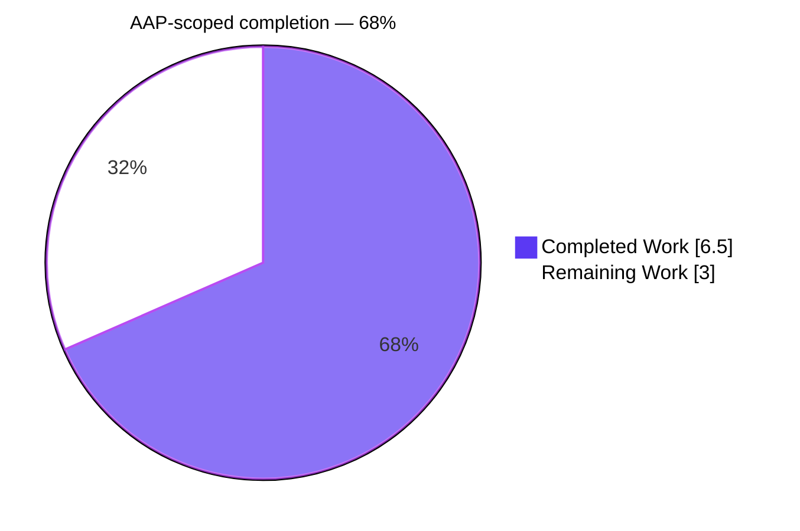

# 1. Executive Summary

A single catch-all HTTP handler became a two-route Express application, and that application's response write is now single-sourced in one helper. This assessment measures the work, records what was exercised to verify it, and states what stands between the code as committed and production.

## 1.1 Project Overview

This project converts the repository's single catch-all HTTP handler into a small Express application. `server.js` answers two named routes — `GET /` with `Hello, World!` and the new `GET /good-evening` with `Good evening` — both as bare `text/plain` with fixed byte-exact bodies, while the listen address, port and banner stay unchanged; `package.json` declares `express` as the only dependency, and both routes write through one `sendText` helper.

Its consumers are the HTTP harnesses that exercise the fixture on `127.0.0.1:3000`. The value is a second addressable route on a framework base further routes can extend, with the root response preserved byte for byte and one place to change the response write.

## 1.2 Completion Status

**6.5 hours completed out of 9.5 total hours = 68% complete** (6.5 ÷ (6.5 + 3.0) × 100).



| Metric | Hours |
|---|---|
| Total Hours | 9.5 |
| Completed Hours (Baseline: Human with agentic-assist) | 6.5 |
| Remaining Hours | 3.0 |

## 1.3 Key Accomplishments

- `GET /` keeps 200, bare `text/plain` and its 14-byte body, byte-identical to before.
- `GET /good-evening` answers 200, bare `text/plain`, 13-byte body.
- Both routes write through one `sendText` helper: one `setHeader` → `end` chain, no charset, no `ETag`.
- One comment records why the media type is not written with `res.type`/`res.send`.
- `express` is the only declared dependency and the module the process loads.
- Startup is unchanged: one banner line, loopback-only bind, clean SIGTERM shutdown.
- Unregistered paths and methods get the built-in 404, not a catch-all 200.
- The change set is `server.js` and `package.json`; no new application file.

## 1.4 Critical Unresolved Issues

Open items: **4**, measured against the 4 production-readiness areas this work was scoped to; none of the four requested refinement directives remains open.

| Issue | Impact | Owner | ETA |
|---|---|---|---|
| The two documents under `blitzy/documentation/` still describe the earlier 14-line catch-all `server.js`, a `+6/−7` diff and a file with no comments | Anyone reading them is misled about the delivered shape | Repository owner | 0.5 h |
| `package-lock.json` lists no `express`, so `npm ci` rejects the tree with `EUSAGE` and the resolved Express version is unpinned | Pipelines that install with `npm ci` fail; two installs can resolve different 5.x releases | Repository owner | 0.5 h |
| A start that cannot bind prints the success banner and exits 0 | A process supervisor cannot distinguish a failed start from a healthy one | Repository owner | 1.0 h |
| No automated test or CI check exists for either route contract | Nothing guards the status, media type or body bytes against a future edit | Repository owner | 1.0 h |

## 1.5 Access Issues

No access issues identified. The registry was reachable for installation, and the service needs no credential, secret or external service.

## 1.6 Recommended Next Steps

1. [Medium] Refresh `blitzy/documentation/Project Guide - bc2e7a9e-1751-42cb-b2c2-b32a775da33a.md` and `blitzy/documentation/Technical Specifications.md` so they describe the 15-line helper-based `server.js`.
2. [Medium] Run `npm install` once and commit the regenerated `package-lock.json` so `npm ci` works and the Express version is pinned.
3. [Medium] Make a failed bind observable once the character-identical-listener term is relaxed.
4. [Low] Add a pipeline check for both route contracts, the 404 and the startup banner.
5. [Low] Decide the exposure posture before leaving loopback: TLS, security headers, rate limiting, configurable host and port.

# 2. Project Hours Breakdown

Hours are scoped to the Agent Action Plan's deliverables plus the path-to-production work that deployment of those deliverables requires. Completed hours measure the delivered and verified work, including the single-sourcing of the response write; remaining hours measure only the gaps recorded in Section 5.2.

## 2.1 Completed Work Detail

| Component | Hours | Description |
|---|---|---|
| Express application conversion (`server.js`) | 1.5 | Import swapped to `express`, app instance created, `GET /` and `GET /good-evening` registered with the exact status, media type and body contract, legacy catch-all removed |
| Dependency declaration (`package.json`) | 0.5 | `dependencies` block holding the single `express` entry, the licence-line comma, no other field touched |
| Single-sourced response write (`server.js:7-11`) | 0.5 | The `setHeader` → `end` chain that both handlers duplicated collapsed into one module-level `sendText(res, body)` helper with one explanatory comment above it; both registrations rewritten as single expressions calling it, every other line left character-identical |
| Startup, bind and banner continuity | 0.5 | Host and port constants and the listen callback preserved, one banner line, one listener, no competing handler |
| Route contract verification | 2.0 | Both routes' status, bare media type, runtime `Content-Length`, byte-exact bodies, absence of `ETag` and charset, unmatched path and method, matching defaults, HEAD/OPTIONS, browser rendering |
| Lifecycle, concurrency and robustness verification | 1.0 | 50-way concurrency per route, keep-alive reuse, SIGTERM and restart, injection, traversal and reflection probes, environment inertness, occupied-port behaviour |
| Dependency and install validation | 0.5 | Resolution to `express` 5.3.0, fail-fast when the module is absent, install from the manifest alone |
| **Total** | **6.5** | |

## 2.2 Remaining Work Detail

| Category | Hours | Priority |
|---|---|---|
| Documentation refresh — bring both files under `blitzy/documentation/` in line with the delivered 15-line helper-based `server.js`, its one comment and its `+4/−2` refinement diff | 0.5 | Medium |
| Install-path reproducibility — regenerate and commit `package-lock.json` so `npm ci` resolves the declared dependency and pins the version | 0.5 | Medium |
| Bind-failure signalling — report a listen failure and exit non-zero, which requires deliberately relaxing the current character-identical-listener term | 1.0 | Medium |
| Automated contract check — a repeatable check of both routes' status, media type and body bytes plus the 404 surface and the startup banner, wired into a pipeline | 1.0 | Low |
| **Total** | **3.0** | |

Reconciliation: Section 2.1 (6.5 h) + Section 2.2 (3.0 h) = 9.5 h, the Total Project Hours stated in Section 1.2; the remaining 3.0 h is the same figure in Section 1.2 and in the Section 7 pie chart.

# 3. Test Results

Every figure below was produced by running the service and its checks directly against the tree as committed. The project ships no test suite, so the verification vehicle is a set of executable probes: the service is started from a scratch copy of `server.js` whose only difference is the port literal, driven over HTTP, and its responses asserted at header and byte level; a second instance built from the pre-refinement file was probed with the same requests for a behavioural differential.

| Area / Category | Framework | Tests | Passed | Failed | Coverage | What This Proves |
|---|---|---|---|---|---|---|
| Build, manifest and dependency gates | `node --check`, `JSON.parse`, `node -p` | 3 | 3 | 0 | n/a — no coverage tooling exists | The module parses, both manifests are valid JSON, and the declared range resolves to `express` 5.3.0 |
| Static contract inspection of `server.js` | grep and node over the file | 6 | 6 | 0 | n/a | One `setHeader`, one comment, the helper defined once and called twice, no environment read, `express` the sole declared dependency |
| `GET /` contract | curl + `od` byte assertions | 5 | 5 | 0 | n/a | The root route answers 200 with bare `text/plain`, `Content-Length: 14`, no `ETag` and the exact 14-byte body |
| `GET /good-evening` contract | curl + `od` byte assertions | 5 | 5 | 0 | n/a | The new route answers 200 with bare `text/plain`, `Content-Length: 13` and the exact 13-byte body |
| Unmatched paths, methods and matching defaults | curl status and body probes | 20 | 20 | 0 | n/a | Everything unregistered reaches the framework's built-in 404, including `/health`, `/metrics`, `/server.js`, `/.env` and `/favicon.ico`; query strings leave both bodies unchanged; trailing-slash, case, HEAD and OPTIONS behaviour is the framework's own |
| Concurrency, startup, lifecycle and failure modes | `xargs`, process capture, SIGTERM, `net` probes | 14 | 14 | 0 | n/a | 50 parallel requests per route all return 200 with the exact byte count; one banner line and empty stderr; SIGTERM exits 143 and frees the port; environment variables are inert; a start on a held port prints the banner and exits 0 |
| Safety probes | curl | 4 | 4 | 0 | n/a | No `Set-Cookie` on any response, a traversal path returns 404 with no file content, and a script payload is reflected percent-encoded with no raw markup |
| Behavioural parity against the pre-refinement build | Python HTTP client differential | 17 | 17 | 0 | n/a | The helper extraction changed nothing observable: 17 request cases identical on status, every header except `Date`, and body bytes |
| **Total** | | **74** | **74** | **0** | | |

**Not Covered**

- **No automated test exists in the repository.** The sole npm script is the upstream placeholder that prints `Error: no test specified` and exits 1, so every figure above is a probe run by hand and nothing re-runs automatically. Adding a repeatable check is the Low-priority item in Section 2.2.
- **No install path other than `npm install` has been exercised.** `npm ci` was run only as a dry run against a throwaway copy of the two manifests, where it stops with `EUSAGE` because the lockfile lists no `express`; it has never completed on this tree.
- **No CI pipeline, container or deployment descriptor exists**, so no build-and-deploy path has been exercised end to end.
- **The process has never been run under a supervisor** (systemd, pm2, a container restart policy), so restart-on-failure behaviour is unverified — and a failed bind reports success, which is the third gap in Section 5.2.
- **No TLS and no non-loopback exposure was exercised**; the listener is loopback-only by design and a connection to the host's external address is refused.
- **No load beyond 50 concurrent requests per route and no soak run** was performed.
- **Graceful shutdown of in-flight requests is neither implemented nor tested**; SIGTERM terminates the process immediately with no drain.
- **No authentication, session or data-store path was tested** because none exists in this service.
- **Dependency version currency and advisories were not researched**, as the delivery terms exclude registry lookups and installs for research.

# 4. Runtime Validation & UI Verification

The service has no screens, forms or client-side code: both routes return plain text and unregistered paths return the framework's error page. What follows is the HTTP surface as actually driven, with the observed result of each flow.

- ✅ **Startup and bind** — one banner line (`Server running at http://127.0.0.1:<port>/`), 0 bytes on stderr, a single loopback-only listener, and no per-request logging after traffic; a connection to the host's external address is refused.
- ✅ **`GET /`** — 200, `X-Powered-By: Express`, `Content-Type: text/plain` with no charset, `Content-Length: 14`, body hex `48656c6c6f2c20576f726c64210a`, no `ETag`.
- ✅ **`GET /good-evening`** — 200, identical header set, `Content-Length: 13`, body hex `476f6f64206576656e696e670a`, no `ETag`.
- ✅ **Shared response write** — both routes produce that header set through the one `sendText` helper, so the media type and the single `end` call exist in exactly one place.
- ✅ **Unregistered paths and methods** — `GET /nope`, `POST /`, `PUT /good-evening`, `DELETE /` and the probe paths `/health`, `/metrics`, `/server.js`, `/package.json`, `/.env`, `/favicon.ico` all return 404 from the framework's built-in handler with no application text in the page; `HEAD /` returns 200 with no body and `OPTIONS /good-evening` returns 200 with `Allow: GET, HEAD`.
- ✅ **Route matching** — `?a=1` and `?x=1` query strings leave both bodies byte-identical; `/good-evening/` and `/GOOD-EVENING` are served; `/good%2Devening` returns 404.
- ✅ **Concurrency** — 50 parallel requests to each route all returned 200 with the exact byte count, with no interleaving, truncation or dropped connection.
- ✅ **Shutdown and restart** — SIGTERM exits 143, the port is released and a restart serves both routes again.
- ⚠ **Second instance on an occupied port** — the process prints the success banner, writes nothing to stderr, exits 0 and holds no socket, so the banner alone does not prove the port was bound (Section 5.2, gap 3).
- ❌ **None** — no flow or endpoint failed at runtime.

A behavioural differential ran the same 17 request cases against this build and against the pre-refinement build: status, every header apart from `Date`, and body bytes were identical in all 17, so the single-sourcing of the response write is invisible on the wire. Browser rendering of both routes and of the framework's error page was exercised in headless Chrome: `/` renders `Hello, World!` and `/good-evening` renders `Good evening` as plain text in Chrome's own viewer, `/no-such-path` renders the framework's `Error` page with the text `Cannot GET /no-such-path`, and no page produced an uncaught error; the only failed request is the browser's automatic `/favicon.ico` probe, which the built-in 404 answers.

**Never exercised at runtime:** TLS or any non-loopback access path (the listener is loopback-only); a supervisor-managed start or restart policy; sustained load beyond 50 concurrent requests per route and any soak run; graceful shutdown with requests in flight; and an authentication or session flow or a data-store or outbound integration, neither of which exists in this service.

# 5. Compliance & Quality Review

Each row states where a deliverable stands now, as verified against the committed tree and a running instance.

## 5.1 Compliance Matrix

| Deliverable | Status | Evidence |
|---|---|---|
| `GET /` preserved — 200, bare `text/plain`, 14-byte body | ✅ Pass | `server.js:10` through the helper at `server.js:8`; probe returned `Content-Length: 14`, no charset, hex `48656c6c6f2c20576f726c64210a` |
| `GET /good-evening` delivered — 200, bare `text/plain`, 13-byte body | ✅ Pass | `server.js:11`; probe returned `Content-Length: 13`, hex `476f6f64206576656e696e670a` |
| Response write single-sourced | ✅ Pass | `server.js:7-8`: one `setHeader`, one comment, both registrations call `sendText`; 17/17 differential cases identical to the pre-refinement build |
| Express mounted, and `express` the only declared dependency | ✅ Pass | One app instance with two registrations and one listener; `package.json:11-13` holds the single entry; the require↔declaration closure is one-to-one |
| Diff discipline and scope containment | ✅ Pass | Refinement diff is `+4/−2` in `server.js` in a single hunk (comment and helper added, the two registrations rewritten); untouched lines character-identical; tracked tree unchanged at six files, no add/delete/rename; lockfile, `README.md` and both documents byte-identical |
| Framework defaults unsuppressed; no 404 handler, error handler, middleware, hardening or environment read | ✅ Pass | `X-Powered-By: Express` on every response; the built-in 404 answers unregistered requests; no `app.use`, `app.set` or `app.disable`; `process.env` occurrences zero |
| Legacy catch-all replaced, single listener, banner preserved | ✅ Pass | One `app.listen`; no `http.createServer` remains; `POST /` now 404s where the catch-all answered 200; one banner line from a loopback-only listener |
| Build integrity | ✅ Pass | `node --check server.js` exit 0; both manifests parse as JSON |
| Security baseline | ✅ Pass | No secret or credential in either file; no request input is read; the 404 page percent-encodes and escapes the reflected path; 58 traversal and disclosure vectors return 404; listener bound to loopback only |
| Documentation accuracy | ⚠ Gap | Both files under `blitzy/documentation/` still describe the earlier 14-line catch-all file, a `+6/−7` diff and a file with no comments — gap 1 below |
| Reproducible install | ⚠ Gap | `npm ci` fails (`EUSAGE`, "Missing: express@5.3.0 from lock file") because the lockfile lists no `express` — gap 2 below |
| Automated regression protection | ⚠ Gap | No test suite or CI check exists; the sole npm script is the upstream placeholder that exits 1 — gap 4 below |

## 5.2 AAP & Rule Divergences and Gaps

Two of the six entries below are departures the human's refinement request required, and they outrank the Agent Action Plan and are recorded as sanctioned rather than as defects. The other four are consequences of terms the plan itself set, and each needs a decision or a small change from a human. No user rule was departed from: all four rules carry a name and an empty body, so none states an obligation any code could satisfy or violate.

| What the AAP/Rule Required | What Was Delivered Instead | Why It Diverged | Impact | Remediation |
|---|---|---|---|---|
| Smallest possible diff; "nothing is extracted into a helper, renamed or reindented"; no expansion into separate statements (`AAP 0.1.2`, `0.5.2`, `0.6.2`, `0.7`) | The response write is one module-level `sendText(res, body)` helper at `server.js:8`, with one comment at `server.js:7`; both registrations are single expressions calling it | **Sanctioned** — the refinement request asked for the highest-value maintenance improvement available inside unchanged behaviour, and outranks the plan's frozen diff form; the authorization was held to that helper and that comment | None to behaviour: 17/17 differential cases identical; the media type now exists in one place; file 13 → 15 lines | Nothing to close — keep the helper and the comment verbatim |
| The change is two files, `server.js` and `package.json` in UPDATE mode (`AAP 0.5.1`, `0.6.1`) | The refinement's change set is `server.js` alone; `package.json` is byte-identical at md5 `7836e60404fa9d8224de6307e0607108` | **Sanctioned** — the refinement request named the root-level `server.js` as its only target, and the manifest already declared `express` from the earlier change | None: the require↔declaration pair is intact and installs resolve `express` 5.3.0 | Nothing to close |
| Documentation files are not created or modified (`AAP 0.6.2`), and the deliverable is the code change | Both files under `blitzy/documentation/` still state that `server.js` is "byte-identical to the file the plan specifies", report its diff as `+6/−7` and say it "carries no comments across its 14 lines" | The refinement was confined to `server.js` and the plan forbids editing documentation, so the drift is the required outcome of that scope | A reader of those documents is misled about the file's shape, its diff size and the absence of comments | Refresh both documents to describe the 15-line helper-based file (0.5 h) |
| The lockfile is neither edited nor regenerated, and `npm ci`'s mismatch is an accepted consequence (`AAP 0.3.1`) | `package-lock.json` is byte-identical to the repository's and lists no `express`; `npm ci` rejects the tree with `EUSAGE` | The delivery terms forbade creating, editing or regenerating a lockfile, so reconciling it would have been an unrequested change | Pipelines that install with `npm ci` fail; the resolved Express version is unpinned within `^5.1.0` | Run `npm install` once, verify both routes, commit the regenerated lockfile (0.5 h) |
| The single banner line and a listener bound to `127.0.0.1:3000` are one startup fact, the listen callback stays character-unchanged, and no error handler is added (`AAP 0.4`, `0.6.2`) | A start on an already-bound port prints the banner, writes nothing to stderr, exits 0 and holds no socket | Express registers the listen callback as the server's `error` listener, so a bind failure invokes it and the zero-argument callback discards the error; the only code that would report the failure is the handler those terms exclude | A supervisor cannot distinguish a failed start from a healthy one and can loop while a stale process keeps serving | Relax that term, branch on the listen error, exit non-zero with an `EADDRINUSE` diagnostic, and probe both outcomes (1.0 h) |
| No test suite, test file or harness; the acceptance evidence takes their place (`AAP 0.1.2`, `0.6.2`) | No test or CI check exists; the sole npm script is the upstream placeholder that exits 1 | The exclusion was explicit, so the verification was performed as runtime probes and a behavioural differential instead | Nothing guards either route's status, media type or body bytes against a future edit | Add a repeatable contract check to a pipeline (1.0 h) |

**Gap 1 — the repository's own documentation describes a superseded shape.** `blitzy/documentation/Project Guide - bc2e7a9e-1751-42cb-b2c2-b32a775da33a.md` states at line 153 that the delivered `server.js` is byte-identical to the file the plan specifies, reports a `+6/−7` diff at lines 141 and 342, and `blitzy/documentation/Technical Specifications.md` says at line 3400 that the file "carries no comments across its 14 lines". The delivered file is a 15-line Express application in which the response write is one helper with one comment above it. Both documents are byte-identical to their earlier state, because this work was confined to `server.js`. Anyone onboarding from those documents will expect a two-handler duplicated write that no longer exists; refreshing the two files for 0.5 hours closes it, and no code moves with them.

**Gap 2 — install reproducibility.** `package-lock.json` still describes a dependency-free package, so it lists no `express` and `npm ci` stops with `npm error code EUSAGE` before installing anything; a dry run on a throwaway copy of the two manifests reproduces it. `npm install` reconciles it, resolving `express` 5.3.0 from the declared `^5.1.0`. The consequence today is that every pipeline and onboarding step must use `npm install`, and two installs months apart can resolve different 5.x releases. Committing the regenerated lockfile closes both the pipeline failure and the unpinned-version exposure in one 0.5-hour change; no application code needs to move with it.

**Gap 3 — a failed bind reports success.** Starting a second instance while the port is held prints `Server running at http://127.0.0.1:3000/`, writes 0 bytes to stderr, holds no socket and exits 0. The cause is the framework's own wiring: `app.listen` registers the caller's callback as the server's `error` listener, so a bind failure invokes it rather than skipping it, and the delivered zero-argument callback ignores the argument — which is exactly the shape the current terms require, since the callback must stay character-unchanged and no error handler may be added. An operator therefore cannot use the banner as proof the port was bound: verify with a request, a socket probe, or the port's listener row. Settling it needs the owner to relax that term and accept a startup guard of roughly five lines with a non-zero exit; the probe to re-run is the same occupied-port start.

**Gap 4 — no automated regression protection.** Neither route's contract is guarded by anything but an ad-hoc probe, and the sole npm script is the upstream placeholder that prints `Error: no test specified` and exits 1. The risk is concrete: the media type is now written in exactly one place, but a later edit inside `sendText` that swapped `setHeader`+`end` for a content-type helper would silently add `charset=utf-8` and an `ETag`, changing both responses without failing anything. A pipeline check of four assertions — `GET /` is 200 with bare `text/plain` and 14 bytes, `GET /good-evening` is 200 with 13 bytes, an unregistered path is 404, and a start writes one banner line with empty stderr — closes it for about an hour, and reuses the probe commands in Section 9.

# 6. Risk Assessment

Risks below are forward-looking: what could still go wrong once this service is operated. Issues settled during delivery do not appear.

| Risk | Category | Severity | Probability | Mitigation | Status |
|---|---|---|---|---|---|
| A start that cannot bind is indistinguishable from a healthy start (banner, exit 0, no socket) | Operational | Medium | High when a second instance starts | Probe the port or a route rather than trusting the banner; add the listen-error guard once the current term is relaxed | Accepted |
| `npm ci` fails on this tree until the lockfile is regenerated, and the resolved Express version stays unpinned within `^5.1.0` | Technical | Medium | Certain for any `npm ci` pipeline | Run `npm install` and commit the regenerated lockfile; use `npm install` until then | Open |
| Nothing automated guards either route's status, media type or body bytes, so a later edit to `sendText` could silently add `charset=utf-8` or an `ETag` | Technical | Medium | Medium | Add the four-assertion contract check to a pipeline (Section 5.2, gap 4) | Open |
| The repository's own documentation still describes the earlier 14-line catch-all file and a `+6/−7` diff | Operational | Low | Certain until refreshed | Refresh the two documents under `blitzy/documentation/` (0.5 h) | Open |
| Framework name disclosed on every response, and no hardening headers on the two routes | Security | Low | Certain | Acceptable for two static literals on loopback; add the header set at a proxy and suppress the framework header if exposure widens | Accepted |
| Plain HTTP with no TLS, no rate limiting and no CORS policy | Security | Low | Low | Terminate TLS and add rate limiting at a proxy if the service is exposed beyond the host | Accepted |
| Host and port hardcoded, so only one instance per host and no relocation without a code change | Operational | Low | Medium | Make host and port configurable only if a second instance or a different port is required | Accepted |
| `node_modules/` is untracked with no `.gitignore`, so a careless `git add -A` would commit the dependency tree | Operational | Low | Medium | Stage files by path; add a `.gitignore` in a follow-up change | Open |

No integration risk exists: the service has no data store, outbound call, message queue, third-party API or authentication provider, so there is no integration surface that can fail.

# 7. Visual Project Status


**Remaining hours by category** (from Section 2.2)

| Category | Hours | Priority |
|---|---|---|
| Documentation refresh | 0.5 | Medium |
| Install-path reproducibility | 0.5 | Medium |
| Bind-failure signalling | 1.0 | Medium |
| Automated contract check | 1.0 | Low |
| **Total** | **3.0** | |

# 8. Summary & Recommendations

The delivery is **68% complete** against the Agent Action Plan's scope and the path-to-production work it implies: 6.5 hours of the 9.5 total are delivered and verified, and 3.0 hours remain, all of it productionisation and documentation rather than missing functionality. The application change itself is finished: `server.js` is a 15-line Express application whose two routes write through one `sendText` helper with a single comment recording why the media type is set with `setHeader` + `end`, and `package.json` declares `express` as its only dependency.

What a reader can rely on now is narrow and exact. `GET /` returns 200 with bare `text/plain`, a 14-byte body and no `ETag`; `GET /good-evening` returns 200 with the 13-byte `Good evening\n` body; both are served through that one helper by a single Express application that loads `express` from a single declared dependency; and anything not registered gets the framework's built-in 404 instead of the old catch-all. Startup still prints one banner line and binds loopback only, SIGTERM still exits 143 and releases the port, 50 concurrent requests per route all succeed, and a 17-case differential against the pre-refinement build returned identical status, headers and bodies.

The remaining 3.0 hours are four discrete, independent items. Two are prerequisites for operating the service elsewhere: the lockfile lists no `express`, so `npm ci` fails with `EUSAGE` and `npm install` must be used until a regenerated lockfile is committed, which also pins the resolved version; and a start that cannot bind prints the success banner and exits 0, so a supervisor would treat a failed start as healthy, which needs the current character-identical-listener term relaxed and a five-line guard added. The other two protect the repository itself: the two documents under `blitzy/documentation/` still describe the earlier 14-line catch-all file and must be refreshed to match the code, and nothing guards the two contracts, so a later edit inside the helper could silently add a charset suffix or an `ETag` without failing anything.

Success for the next stage is measurable four ways: a refreshed document set that matches the 15-line file; `npm ci` completing on a clean checkout; a second instance on a held port exiting non-zero with an `EADDRINUSE` diagnostic; and a pipeline asserting the four contract facts (200 with bare `text/plain` and 14 bytes, 200 with 13 bytes, 404 for an unregistered path, one banner line with empty stderr).

Production readiness: **ready for its stated purpose** — a two-route, read-only plain-text service bound to `127.0.0.1:3000`, which is exactly what the plan specifies. It is **not ready to be exposed beyond the loopback interface**, where TLS termination, security headers, rate limiting, a configurable host and port, and the startup-failure signal would all become prerequisites. The accepted exposures — framework name disclosure, absent hardening headers, plain HTTP, hardcoded host and port — are conscious consequences of the plan's terms rather than oversights, and none of them is reachable from outside the host today.

# 9. Development Guide

**Prerequisites**

- **Node.js 18 or newer** — Express 5 declares `>= 18`; the verified environment is Node **v22.23.5** with npm **11.21.3**. `package.json` carries no `engines` field, so that floor is not enforced by the manifest.
- **No database, message broker, container, credential or environment variable** is required. The only network dependency is the npm registry, for the single package install.
- `curl` is the only client used by the checks below; `od` (or any byte dumper) is useful for the body assertions.

**Install**

Run from the repository root. This form resolves `express` without rewriting the committed lockfile:

```bash
cd <repository-root>
CI=true npm install --no-save --no-package-lock --no-audit --no-fund
```

Expected: `added 65 packages` (or `changed 65 packages` on a repeat run) and exit status 0, with `package.json` and `package-lock.json` unchanged. Confirm the dependency resolved:

```bash
node -p "require('express/package.json').version"   # -> 5.3.0
```

Do **not** use `npm ci` on the repository as committed — it exits 1 with `npm error code EUSAGE` because `package-lock.json` lists no `express`. A plain `npm install` works but rewrites the lockfile; do that only when you intend to commit the reconciled lockfile, which is the 0.5-hour task recorded in Section 2.2, and then `npm ci` becomes the preferred command in a pipeline.

**Run**

```bash
node server.js
```

Expected: exactly one line on stdout — `Server running at http://127.0.0.1:3000/` — and nothing on stderr. Host and port are module constants in `server.js`; no environment variable overrides them (`PORT`, `HOST` and `NODE_ENV` have no effect). Stop it with `Ctrl-C` (exit 130) or `kill -TERM <pid>` (exit 143); the port is released either way.

To run on a different port — for a second instance, or when 3000 is already held — work on a copy outside the repository so the checkout stays clean:

```bash
mkdir -p <scratch-dir>
sed 's/^const port = 3000;$/const port = 3100;/' <repository-root>/server.js > <scratch-dir>/server-3100.js
NODE_PATH=<repository-root>/node_modules node <scratch-dir>/server-3100.js
```

`NODE_PATH` is required because the copy lives outside the checkout and would otherwise not find `express`.

**Verify**

```bash
# Root route: 200, bare text/plain, 14-byte body
curl -sS -D - http://127.0.0.1:3000/
curl -sS http://127.0.0.1:3000/ | od -An -tx1
```

Expected headers include `HTTP/1.1 200 OK`, `X-Powered-By: Express`, `Content-Type: text/plain` (no charset) and `Content-Length: 14`; expected body bytes `48 65 6c 6c 6f 2c 20 57 6f 72 6c 64 21 0a`, and no `ETag`.

```bash
# New route: 200, bare text/plain, 13-byte body
curl -sS -D - http://127.0.0.1:3000/good-evening
curl -sS http://127.0.0.1:3000/good-evening | od -An -tx1
```

Expected `Content-Length: 13` and body bytes `47 6f 6f 64 20 65 76 65 6e 69 6e 67 0a`, and no `ETag`.

```bash
# Unregistered request: the framework's built-in 404
curl -sS -o /dev/null -w '%{http_code}\n' http://127.0.0.1:3000/nope      # -> 404
curl -sS -o /dev/null -w '%{http_code}\n' -X POST http://127.0.0.1:3000/  # -> 404
```

Both routes write through one module-level helper, `const sendText = (res, body) => res.setHeader('Content-Type', 'text/plain').end(body);` at `server.js:8`, with one comment above it at `server.js:7`. If the media type ever has to change, change it there once — the two registrations only pass their body literals.

**Example usage**

```bash
# One status line per route, for a quick smoke check
for p in / /good-evening /nope; do
  printf '%s -> %s (%s bytes)\n' "$p" \
    "$(curl -sS -o /dev/null -w '%{http_code}' "http://127.0.0.1:3000$p")" \
    "$(curl -sS "http://127.0.0.1:3000$p" | wc -c)"
done
```

Expected: `/ -> 200 (14 bytes)`, `/good-evening -> 200 (13 bytes)`, `/nope -> 404 (151 bytes)`.

**Troubleshooting**

| Symptom | Cause | Resolution |
|---|---|---|
| `npm error code EUSAGE … can only install packages when your package.json and package-lock.json … are in sync` | `npm ci` against the lockfile, which lists no `express` | Use the `npm install --no-save --no-package-lock` form above, or commit a regenerated lockfile first |
| `Error: Cannot find module 'express'`, exit 1, no banner | Dependencies not installed, or `node_modules` absent where the file runs | Run the install command in the repository root; for a copy outside it, set `NODE_PATH=<repository-root>/node_modules` |
| Banner printed but requests to the port fail | Another process already holds the port: the process prints the banner, exits 0 and holds no socket | Check the port with `curl -sS -o /dev/null -w '%{http_code}' http://127.0.0.1:3000/` or a Node `net` bind probe, then stop the holder or run on another port |
| `PORT=… node server.js` has no effect | Host and port are hardcoded constants and nothing reads the environment | Change the constant in a copy of `server.js`; there is no configuration layer to set |
| `ss: command not found`, or `lsof`/`netstat`/`nc` missing | Not installed on this host | Confirm port state with `curl` or `node -e "require('net').createServer().listen(3000,'127.0.0.1').once('listening',function(){console.log('free');this.close()}).once('error',function(){console.log('busy')})"` |
| `npm test` exits 1 | The script is the upstream placeholder (`echo "Error: no test specified" && exit 1`) | Expected — there is no test suite; use the probes above |
| `EADDRINUSE` in a log, but the process exited 0 | A failed bind is handled by the framework's default, not by the application | Treat the port probe, not the exit status, as the readiness signal |
| `git status` shows `node_modules/` or `blitzy/screenshots/` | There is no `.gitignore`, and both are untracked tooling output | Stage files by path; never `git add -A` |

# 10. Appendices

Reference material for operating and maintaining this service. Only the subsections with content for this project are included.

## A. Command Reference

| Purpose | Command |
|---|---|
| Install dependencies without touching the manifests | `CI=true npm install --no-save --no-package-lock --no-audit --no-fund` |
| Install reproducibly (after the lockfile is regenerated and committed) | `npm ci` |
| Start the service | `node server.js` |
| Syntax-check the application file | `node --check server.js` |
| Validate the manifests | `node -e "JSON.parse(require('fs').readFileSync('package.json','utf8'))"` |
| Resolve the declared dependency version | `node -p "require('express/package.json').version"` |
| Probe the root route | `curl -sS -D - http://127.0.0.1:3000/` |
| Probe the new route | `curl -sS -D - http://127.0.0.1:3000/good-evening` |
| Byte-dump a body | `curl -sS http://127.0.0.1:3000/ | od -An -tx1` |
| Check only the status code | `curl -sS -o /dev/null -w '%{http_code}\n' http://127.0.0.1:3000/nope` |
| Confirm a port is free | `node -e "require('net').createServer().listen(3000,'127.0.0.1').once('listening',function(){console.log('free');this.close()}).once('error',function(){console.log('busy')})"` |
| Stop the service | `kill -TERM <pid>` (exit 143) or `Ctrl-C` (exit 130) |
| Run on another port without touching the checkout | `sed 's/^const port = 3000;$/const port = 3100;/' server.js > <scratch>/server-3100.js && NODE_PATH=$PWD/node_modules node <scratch>/server-3100.js` |

## B. Port Reference

| Port | Owner | Notes |
|---|---|---|
| 3000 | The application | Hardcoded as `const port = 3000;` in `server.js`, bound to `127.0.0.1` only — never to a wildcard address. Not configurable from the environment |
| Any other port | Copies of `server.js` | Only reachable by changing the port constant in a copy; use one port per concurrent instance |
| npm registry (443, outbound) | Dependency install | Needed only for `npm install` / `npm ci` |

## C. Key File Locations

| Path | Role | State |
|---|---|---|
| `server.js` | The whole application: dependency import, app instance, the `sendText` helper with its comment, the two route registrations, the listener and the startup banner | 15 lines / 548 bytes; rewritten from the `http` catch-all (`+8/−7` against the repository base), of which the single-sourcing of the response write is `+4/−2` at lines 7-11 |
| `package.json` | Manifest: name, version, description, `main`, the placeholder test script, author, licence, and the single `express` dependency | Modified (`+4/−1`); `express: ^5.1.0` is the only dependency |
| `package-lock.json` | Lockfile (lockfileVersion 3, root entry only) | Unchanged; lists no `express`, so `npm ci` fails |
| `README.md` | Repository notice ("Do not touch!") | Unchanged |
| `blitzy/documentation/Project Guide - bc2e7a9e-….md` | Delivery documentation, 391 lines | Present, unchanged since it was written; describes the earlier 14-line shape and needs the refresh in Section 2.2 |
| `blitzy/documentation/Technical Specifications.md` | Technical specification, 6386 lines | Present, unchanged since it was written; describes the earlier shape and needs the same refresh |
| `node_modules/` | Installed dependency tree (65 packages) | Untracked; must never be committed |

## D. Technology Versions

| Component | Version | Notes |
|---|---|---|
| Node.js | v22.23.5 | Express 5 requires `>= 18`; the manifest pins no runtime |
| npm | 11.21.3 | Used for the single dependency install |
| express | 5.3.0 resolved from `^5.1.0` | The only dependency; adds its default `X-Powered-By` header and the built-in 404 |
| curl | 8.18.0 | Used for all HTTP verification |
| od | 0.10.0 (uutils coreutils) | Used for the byte-level body assertions |
| HTTP module | Node core `http` | Still the transport beneath Express; no longer imported directly by the application |

## E. Environment Variable Reference

| Variable | Effect on this service |
|---|---|
| `PORT` | None — the port is a code constant; injected values are ignored (verified with explicit, empty and non-numeric values) |
| `HOST` | None — the bind host is a code constant, and the listener stays on `127.0.0.1` even with `HOST=0.0.0.0` |
| `NODE_ENV` | None — no code path reads it |
| `NODE_PATH` | Only for a copy of `server.js` run from outside the repository: point it at `<repository-root>/node_modules` so `express` resolves |

No environment variable or secret is required to run the service, and no configuration file is read.

## F. Developer Tools Guide

| Tool | Availability | Use |
|---|---|---|
| `node`, `npm`, `npx` | Present | Run the service, install the dependency, run probes |
| `curl` | Present | All route and status verification |
| `od`, `wc`, `cmp`, `grep` | Present | Byte-level assertions on response bodies and headers |
| `git` | Present | Diff against the base commit to confirm the change set |
| `ss`, `lsof`, `netstat`, `nc`, `fuser`, `ip`, `ifconfig` | **Absent** | Use `curl` or Node's `net` module to determine port state |
| Chrome (headless) | Present | Optional visual confirmation that both routes render as plain text |

## G. Glossary

| Term | Meaning in this project |
|---|---|
| **Bare media type** | `Content-Type: text/plain` with no `charset` parameter — the value the original handler sent and both routes preserve |
| **Catch-all handler** | The pre-change `http.createServer` callback that answered every path and method with `Hello, World!\n`; replaced by two explicit route registrations |
| **`sendText` helper** | `const sendText = (res, body) => res.setHeader('Content-Type', 'text/plain').end(body);` at `server.js:8` — the single place the media type is written, called by both registrations |
| **Single-sourced response write** | Both routes obtain their media type, `Content-Length` and body from that one helper, so a change to the write happens once |
| **Content-Length** | Computed by the runtime from the single `end(<string>)` call: 14 bytes for `/`, 13 for `/good-evening` |
| **Framework default** | Express behaviour left unsuppressed: the `X-Powered-By` header, the built-in 404 page, HEAD/OPTIONS handling and the treatment of a failed bind |
| **Lockfile reconciliation** | Running `npm install` so `package-lock.json` records the declared `express` range and `npm ci` can install from it |
| **Loopback-only bind** | The listener accepts connections on `127.0.0.1` only; a connection to the host's external address is refused |
| **Runtime default status** | 200 applied by the runtime because no handler sets a status explicitly |
| **Startup banner** | The single stdout line `Server running at http://<host>:<port>/` emitted from the listen callback |
