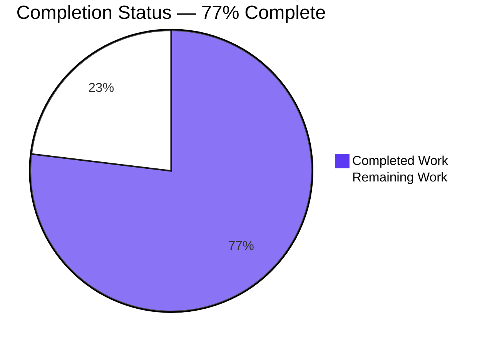
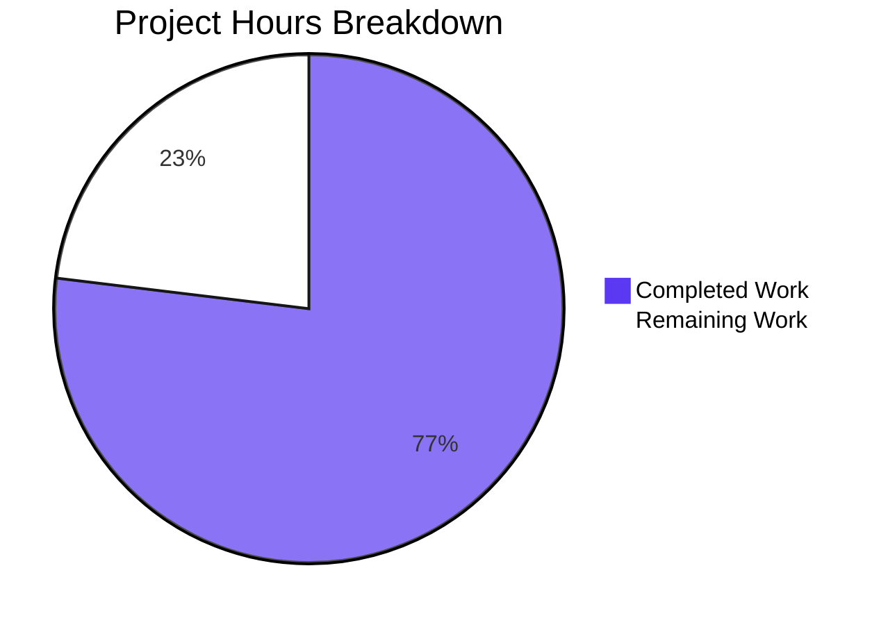

# 1. Executive Summary

## 1.1 Project Overview

`hao-backprop-test` is a single-file Node.js HTTP service: `server.js` answers every request with status `200` and the 14-byte body `Hello, World!\n` on `127.0.0.1:3000`, ignores its request argument and exports nothing. It shipped with no tests — `npm test` ran a placeholder that failed unconditionally. This project adds an automated contract suite on the runtime's own `node:test` runner and assertion module, two cases (`GET /` and `POST /`), and rewires `npm test` to run it and report its real result. It is for the service's maintainers and anyone needing a regression signal on its response contract; its code, dependencies and configuration are untouched.

## 1.2 Completion Status



Completed work is Dark Blue (#5B39F3); remaining work is White (#FFFFFF).

| Metric | Hours |
| --- | --- |
| Total Hours | 6.5 |
| Completed Hours (Baseline: Human with agentic-assist) | 5.0 |
| Remaining Hours | 1.5 |

`5.0 ÷ 6.5 = 77%`. All twenty scoped requirements are delivered; the 1.5 hours open are operational.

## 1.3 Key Accomplishments

- ✅ A two-case `node:test` suite at `test/server.test.js` asserts status `200` and the exact 14-byte body for `GET /` and `POST /` (`:42`, `:54`).
- ✅ `npm test` runs that suite and returns `0` when green, `1` on any failure (`package.json:7`).
- ✅ Comparisons use `node:assert/strict`, so `200` is not satisfied by `'200'` and a one-byte body change fails (`test/server.test.js:1`).
- ✅ The suite starts the service by requiring it and ends the process explicitly, so no export, guard or shutdown hook was added (`:5`, `:66`).
- ✅ `server.js` is byte-identical, and no dependency, lockfile entry or configuration file was introduced.
- ✅ Repeated runs are deterministic and self-terminating at about 55 ms.
- ✅ A peer that never answers, a connection torn down after its headers, and an occupied port all fail loudly — the suite cannot report a false pass.

## 1.4 Critical Unresolved Issues

Three of the twenty-three items in scope remain open: 0 of 20 scoped requirements, 3 of 3 path-to-production items.

| Issue | Impact | Owner | ETA |
| --- | --- | --- | --- |
| The suite is not executed by any continuous-integration job (P1) | No automatic regression signal: drift in status or body reaches the default branch unnoticed, and two concurrent runs on one host collide on port 3000 | CI owner | Next sprint |
| No runtime floor is declared in the manifest (P2) | On Node older than 20 the suite fails with a module/API error instead of a clear version message | Repository owner | Next change to the manifest |
| `main` points at `index.js`, which does not exist (P3) | `require('hello_world')` fails and the published metadata misdescribes the package | Repository owner | When convenient |

## 1.5 Access Issues

No access issues identified. Everything was built, run and inspected locally with no credentials and no external service.

## 1.6 Recommended Next Steps

1. **[High]** Add a continuous-integration job running `npm test` with exclusive use of its host (1.0 h).
2. **[Medium]** Declare `"engines": { "node": ">=20" }` so an unsupported runtime fails clearly (0.25 h).
3. **[Low]** Repoint `main` at `server.js` or remove the field (0.25 h).
4. **[Medium]** Decide whether the contract should also cover `Content-Type` and `Content-Length` — advisory, outside the scoped work.

# 2. Project Hours Breakdown

## 2.1 Completed Work Detail

| Component | Hours | Description |
| --- | --- | --- |
| Test suite implementation | 2.5 | `test/server.test.js` (66 lines): the three built-in imports and the `require` that starts the service, the expected-body constant and failure flag, one request helper that bounds each request and funnels every settlement through a single guard, the two cases asserting status then the exact body, the deferred explicit exit, and three one-line comments. |
| `npm test` entry point | 0.5 | `package.json` `scripts.test` replaced with `node --test test/server.test.js`; the named path resolves; the runner's exit code reaches `npm` unchanged, so a failing case makes the command fail. |
| Suite execution verification | 2.0 | Green path and determinism repeats, per-case selection by name pattern, red-run sensitivity to a changed body byte and a changed status, the stalled-peer deadline path, the post-header stream-error path, occupied-port behaviour, and a wire-contract comparison of the asserted constant against the service's real response. |
| **Total** | **5.0** | Matches Completed Hours in Section 1.2. |

## 2.2 Remaining Work Detail

| Category | Hours | Priority |
| --- | --- | --- |
| Continuous-integration execution of the suite, serialized per host because the suite binds the fixed `127.0.0.1:3000` literal (P1) | 1.0 | High |
| Declared runtime floor in the manifest, matching what `node:test` and its `after` hook require (P2) | 0.25 | Medium |
| Corrected or removed `main` entry, which currently names a file that does not exist (P3) | 0.25 | Low |
| **Total** | **1.5** | Matches Remaining Hours in Section 1.2 and the Remaining Work slice in Section 7. |

## 2.3 Hours Calculation and Confidence

Completed hours are the engineering effort behind the three delivered components above: writing the suite, wiring the command, and exercising the passing and failing paths until each behaved as specified. Remaining hours are the three operational items a human must close; nothing in the scoped feature work is outstanding.

- Total project hours = completed 5.0 h + remaining 1.5 h = **6.5 h**.
- Completion = completed ÷ total = `5.0 ÷ 6.5` = **76.92%, reported as 77%**.
- Confidence: **High** for the completed hours — every component exists in the tree and was executed against it. **High** for the 1.0 h continuous-integration item, which is a single job definition on an unchanged command. **Medium** for the two 0.25 h manifest items, which are one-line edits whose review may surface a wider packaging decision.

# 3. Test Results

All rows below were executed against this checkout on Node.js v22.23.5 with npm 11.21.3. The project's suite is `npm test`; the additional runs listed drive the same suite against deliberately altered copies of the service and of its own expectations, built outside the repository, to establish that the assertions actually fail when the contract moves. Every run listed was observed directly.

| Area / Category | Framework | Tests | Passed | Failed | Coverage | What This Proves |
| --- | --- | --- | --- | --- | --- | --- |
| HTTP contract assertions (`GET /`, `POST /`) | `node:test` via `npm test` and direct runner | 2 | 2 | 0 | Not measured — no coverage tool exists; both cases execute all three handler statements (`server.js:7-9`) | The service answers status `200` with the exact 14-byte body on both a normal and a different method |
| Determinism and self-termination | `node:test` | 7 full runs | 7 | 0 | — | Repeated runs give identical counts and both case results, and the process ends by itself in 54-58 ms |
| Per-case isolation | `node:test --test-name-pattern` | 2 single-case runs | 2 | 0 | — | Each case runs and passes on its own, so neither depends on the other's result |
| Contract drift — body byte | `node:test` against an altered expected body | 2 | 0 | 2 (by design) | — | A one-byte body difference, the trailing newline removed, fails both cases and the command exits 1 |
| Contract drift — status | `node:test` against an altered asserted status | 2 | 0 | 2 (by design) | — | A status change is caught as `expected: 201 / actual: 200` and the command exits 1 |
| Stalled peer | `node:test` against a peer that accepts and never answers | 2 | 0 | 2 (by design) | — | A request with no response becomes a reported failure, `request timed out after 2000 ms`, instead of a run that never ends |
| Post-header stream teardown | `node:test` against a peer that destroys the socket after its headers | 2 | 0 | 2 (by design) | — | A connection lost mid-response is reported as a failed case, `socket hang up` / `ECONNRESET`, in 89 ms |
| Startup precondition — port held | `node:test` with the target port occupied | 1 | 0 | 1 (by design) | — | A busy port fails loudly with `EADDRINUSE`; the suite cannot report a false pass |

Static gates alongside the suite: `node --check` exits 0 on both `server.js` and `test/server.test.js`, and both `package.json` and `package-lock.json` parse as JSON. No linter, type-checker, compiler or coverage tool exists in this project, and none may be added.

## Not Covered

No test exercises the following, and a human should decide whether any of it needs coverage before release:

- **The `Content-Type` header.** `server.js:8` sets `text/plain`, and both cases transmit it, but neither asserts it — a header regression would pass silently. The same applies to `Content-Length`, which happens to be correct at 14 bytes.
- **Startup and shutdown behaviour** of the service: when the listener binds, and what happens when it closes. The suite depends on the bind happening synchronously at require time but never asserts it.
- **Any path or method other than `GET /` and `POST /`.** The handler answers everything identically, and a by-hand probe of `PUT /nope` returned `200`, but no test covers an unmatched route, a `HEAD`, or a method matrix.
- **Malformed, oversized or concurrent requests**, and behaviour under load. No performance or concurrency test exists.
- **Environment or port configuration.** The service reads no environment variable and hardcodes its port, so no configuration path exists to test.
- **Code coverage.** There is no coverage tool, flag, threshold or artifact, and the scoped design deliberately excludes all three, so no coverage figure can be reported.

# 4. Runtime Validation & UI Verification

Driven directly on this checkout, on Node.js v22.23.5 with npm 11.21.3:

- ✅ **Suite via `npm test`** — exit 0, `# tests 2 / # pass 2 / # fail 0` in 55.77 ms, both case names printed verbatim; the placeholder that always failed is gone.
- ✅ **Suite via the runner directly** — `node --test test/server.test.js`, exit 0, identical counts, 56.80 ms.
- ✅ **Per-case selection** — each `--test-name-pattern` run reports `# tests 1 / # pass 1`, exit 0, so either case can be exercised alone.
- ✅ **Service start-up** — a copy of `server.js` whose only difference is the port literal printed `Server running at http://127.0.0.1:31890/`, answered the first request immediately with nothing on stderr, and stopped cleanly with its port released.
- ✅ **Response contract on the wire** — `HTTP/1.1 200 OK`, `Content-Type: text/plain` with no charset, `Content-Length: 14`, body `48 65 6c 6c 6f 2c 20 57 6f 72 6c 64 21 0a`; the `GET /` and `POST /` bodies are byte-identical, and `PUT /nope` is answered the same way.
- ✅ **Failure paths** — stalled peer, connection torn down after its headers, altered expected body, altered asserted status and occupied port: all five produced a reported failed case and a non-zero exit, none hung and none reported a false pass.
- ⚠ **Concurrent execution** — a second run while the port is held fails with `listen EADDRINUSE: address already in use 127.0.0.1:3000`. Correctly loud, but it means one run at a time per host.
- ❌ **Failing flows** — none. No flow or integration in this project is failing.

## Never Exercised at Runtime

- **No user interface or browser surface exists** — there is no HTML, no client asset and no route that renders anything, so no screen or flow was driven and none could be.
- **No authentication, database, message broker, third-party API or scheduled job exists**, so no such integration was exercised and none was stubbed in its place.
- **The `Content-Type` and `Content-Length` headers are transmitted but never verified** by an automated check; the values above come from a by-hand read, not from the suite.
- **No load, concurrency or malformed-input run was performed** against the service; the suite issues two well-formed loopback requests per run and nothing else.
- **Packaging was never exercised** — no `npm pack`, `npm publish` or `require('hello_world')` was run, so the stale `main` entry has not been observed failing at runtime.

# 5. Compliance & Quality Review

## 5.1 Compliance Matrix

| Deliverable | Quality / Compliance Benchmark | Status | Evidence |
| --- | --- | --- | --- |
| Test suite at the path the command names | The test entry point resolves to a real, runnable suite | ✅ PASS | `package.json:7` names `test/server.test.js`; the run executes it |
| Runtime built-ins only | No package, lockfile entry, runner config or coverage config added | ✅ PASS | `npm ls --depth=0` empty; no `node_modules`; lockfile diff 0 lines; no config file in the tree |
| Two cases, specified names, assertion order | Test inventory matches the specification exactly | ✅ PASS | `test/server.test.js:42`, `:54`; `# tests 2` in every run, no third case |
| Exact body and numeric status | Contract exactness under type-strict comparison | ✅ PASS | 14-byte body, `0a`-terminated; `strictEqual` rejects `'200'` for `200` |
| Explicit process lifecycle | Start by requiring the service; end the process with 0/1 | ✅ PASS | `test/server.test.js:5`, `:66`; runs end unaided with both results |
| Source under test unmodified | Minimal-diff guarantee for `server.js` | ✅ PASS | `git diff --exit-code 46cc595 -- server.js` exits 0; 14 lines, no export, no port override |
| Change-set shape | One created file and one manifest field | ✅ PASS | `M package.json`, `A test/server.test.js`; nothing else |
| No behaviour added by the suite | No handlers, header assertions, environment or port configuration | ✅ PASS | Absence scan clean; 0 of 4 assertions touch a header |
| Comment discipline | One-line comments only, no header block, banner or JSDoc | ✅ PASS | `test/server.test.js:41`, `:53`, `:65`; count 3 |
| `npm test` reports the real result | The project's test command executes the suite and propagates its status | ✅ PASS | Exit 0 green; exit 1 on every altered body, status, stalled peer and teardown run |
| Determinism and isolation | Repeated runs identical; cases order-independent; no retry | ✅ PASS | Seven full runs identical; both cases pass alone |
| Security baseline | No secret, no external input path, no injection surface | ✅ PASS | Static literals only; no `process.env`, `argv`, stdin, eval or shell; zero dependencies |

## 5.2 AAP & Rule Divergences and Gaps

Three divergences were identified. None blocks release. Two are sanctioned — one by the explicit authorisation to change this repository, one by the requirement that the suite fail rather than hang — and the third needs an owner's decision.

| What the AAP/Rule Required | What Was Delivered Instead | Why It Diverged | Impact | Remediation |
| --- | --- | --- | --- | --- |
| `README.md:2` states "test project for backprop integration. Do not touch!", which forbids any change in this repository | The suite was added at `test/server.test.js` and `package.json`'s test script was rewritten in place; `README.md` itself is byte-unchanged | **Sanctioned.** The request explicitly authorises exactly one test file and one manifest field; that authorisation outranks repository prose, and no user rule is departed from | The repository's own note now contradicts its contents and can mislead a later reader | None required. Editing the note would itself sit outside the authorised change set |
| The request helper is specified as resolving `{ status, body }` on the response's `end` event and rejecting on the request's `error` event | Exactly that, plus one guarded settlement funnel, a 2000 ms request deadline that rejects with `request timed out after 2000 ms` and then destroys the request, and a listener on the response stream's `error` event (`test/server.test.js:13-36`) | **Sanctioned.** A peer that accepts and never answers would otherwise leave both cases pending and the run with no result at all, which the requirement that a bad response fail deterministically excludes | 25 additional lines and a hard 2 s ceiling per request; per-case response times observed at 2.6-7.4 ms leave roughly 250× headroom | None required. No case, assertion or service behaviour was added |
| The manifest's `main` entry was not authorised to change | `main` still names `index.js`, which does not exist in the tree | The change set was limited to the test file and the test script, so the stale entry was left exactly as found | `require('hello_world')` fails, and the published metadata misdescribes the package; nothing in the test path depends on it | **0.25 h** — repoint `main` at `server.js` or drop the field (Section 2.2, P3) |

**The bounded request helper (D2).** `send()` at `test/server.test.js:11-39` arms a 2000 ms timer, routes every settlement — response `end`, request `error`, response `error` and the deadline itself — through one guarded `settle()` that waits for the first settlement and clears the timer, and destroys the request after rejecting with a descriptive error. The reason this matters is the only teardown in the file: `server.js` exports nothing, so the process is ended by a deferred `process.exit` in a `test.after` hook, and a request that never settles would leave the run with no result at all rather than a red case. Two harness peers confirm the behaviour: one that accepts and never answers fails both cases with `request timed out after 2000 ms` in 4.8 s, and one that destroys its socket after the headers fails both with `socket hang up` / `ECONNRESET` in 89 ms. The cost is a hard 2 s ceiling; observed per-case times of 2.6 ms and 7.4 ms leave ample margin.

**The stale manifest entry (D3).** `package.json:5` still declares `"main": "index.js"`. The file does not exist, so any consumer that does `require('hello_world')` fails at resolution, and tooling that reads the manifest describes the package inaccurately. The change set was confined to the test file and the `scripts.test` value, so the field was correctly left untouched; closing it is a metadata decision rather than a test concern. Repointing it at `server.js` is the smaller change; removing it is the more honest one for a package that is not intended to be imported. Either way it takes about a quarter of an hour and no test changes.

**The repository note (D1).** `README.md` still reads "Do not touch!" while the suite now lives in the repository beside it. The change was authorised explicitly and the note was left byte-unchanged, so nothing is inconsistent in the code — only in the prose a newcomer reads first. No action is required; if the note is ever revised, that revision is a separate, separately-authorised change.

# 6. Risk Assessment

| Risk | Category | Severity | Probability | Mitigation | Status |
| --- | --- | --- | --- | --- | --- |
| A contract regression reaches the default branch because nothing executes the suite automatically | Operational | High | High until wired | Add a continuous-integration job that runs `npm test` with exclusive use of its host (Section 2.2, P1) | Open |
| The exit code comes from a module-scope flag set inside each case's own `catch`, so a future case added without that wrapper would exit 0 despite failing | Technical | High | Low today — both cases wrap | Keep the wrapper on every case added, or derive the status from the runner's own result if the file grows beyond two cases | Open |
| Two runs on one host collide on the fixed `127.0.0.1:3000` literal; the loser fails with `EADDRINUSE` rather than a regression | Operational | Medium | High on a parallel host | Serialize runs per host; the port cannot be relocated without unpicking the suite's address and the service's bind | Open |
| The deferred forced exit hides leaked handles and removes the runner's natural hang detection | Technical | Medium | Low | Keep the suite to one listener; revisit the exit design if the service ever gains a timer or a second listener | Open |
| An unsupported Node runtime fails with a module or API error instead of a clear version message | Operational | Medium | Medium for an environment the project does not control | Declare `engines.node >= 20` (Section 2.2, P2) | Open |
| Drift outside the asserted surface — `Content-Type`, `Content-Length`, unmatched routes, any new handler branch — passes unnoticed, and no coverage is measured | Technical | Medium | Medium over the service's lifetime | Widen the asserted surface deliberately if the contract matters; the two-case cap is a scope decision, not an oversight | Accepted with caveat |
| The 2000 ms deadline reds a slow-but-correct response on a heavily contended host | Technical | Low | Low — observed per-case times are 2.6-7.4 ms | None needed today; raise the bound only if a pipeline demonstrates contention | Accepted |
| Security and integration exposure | Security / Integration | None identified | — | No credential, external input path, dependency, route or network egress exists; the only seam is the loopback request, exercised on its passing and failing paths | Closed |

# 7. Visual Project Status



Completed work is Dark Blue (#5B39F3); remaining work is White (#FFFFFF). Total project hours are 6.5, of which 5.0 are complete — 77%.

Remaining work by priority: 1 High (1.0 h — continuous-integration execution), 1 Medium (0.25 h — declared runtime floor), 1 Low (0.25 h — corrected package entry point). All three are operational; none is a scoped feature.

# 8. Summary & Recommendations

The scoped deliverable is complete: a two-case `node:test` suite at `test/server.test.js` that asserts status `200` and the exact 14-byte `Hello, World!\n` body for `GET /` and `POST /`, wired into `npm test` so the command executes the suite and returns its real result. `server.js` is byte-identical to the version that shipped, and the change set is one created file plus one manifest field. Against 6.5 total hours, 5.0 are complete and 1.5 remain — **77% complete** — and every hour still open is operational rather than a missing feature.

What was exercised to prove it works: seven full runs with identical counts and self-termination in about 55 ms; each case passing alone by name pattern; and five deliberately broken conditions that all produced a reported failure and a non-zero exit rather than a false pass — an altered body byte, an altered status, a peer that accepts and never answers (failing at the 2000 ms deadline in 4.8 s), a connection torn down after its headers (`ECONNRESET`, 89 ms), and an occupied port (`EADDRINUSE`). The asserted constant was also compared against the service's real response — `HTTP/1.1 200 OK`, `Content-Type: text/plain`, `Content-Length: 14`, body hex `48 65 6c 6c 6f 2c 20 57 6f 72 6c 64 21 0a` — so the suite compares the service's real values, not a mirror of its own assumption. The project still declares zero packages and needs no install, no configuration and no network access beyond loopback.

The critical path to production is short and lies outside the suite: run it automatically. Three items take 1.5 hours in total — a continuous-integration job that executes `npm test` with exclusive use of its host (1.0 h), a declared Node floor in the manifest (0.25 h), and a corrected `main` entry (0.25 h). Until the first is done, the suite is a tool a developer must remember, not a guard; until the second, an unsupported runtime fails with a confusing error; until the third, the package metadata remains inaccurate. None of the three changes any test.

Success looks like this: `npm test` exits 0 with `# tests 2 / # pass 2` in roughly 55 ms on every change; any drift in the response status or body turns it red with the expected and actual values printed; a stalled or half-closed connection fails within the deadline instead of stalling the pipeline; and no run leaves a listener behind on port 3000.

Production readiness, within the scope this project set, is **ready for delivery**: the app's runtime behaviour is unchanged, the suite is deterministic and dependency-free, and it catches every drift in the two properties the service actually contracts. It is not yet a complete contract test — `Content-Type`, `Content-Length`, unmatched routes, startup and shutdown are unasserted by design — and it is not yet a branch guard until it runs in a pipeline. Treat it as a reliable regression signal on status and body, and extend it deliberately if the contract widens.

# 9. Development Guide

## 9.1 System Prerequisites

| Requirement | Value observed | Why |
| --- | --- | --- |
| Node.js | v22.23.5 | `node:test`, its `after` hook and the `--test` runner must exist; stable from Node 20 |
| npm | 11.21.3 | Runs the manifest script |
| Anything else | None | There is no compiler, bundler, type-checker, linter, framework, database or service |

```bash
node -v                 # v22.23.5
npm -v                  # 11.21.3
node -e "console.log(typeof require('node:test').after)"   # function
```

## 9.2 Repository Layout

```text
.
├── README.md            # 2 lines
├── package.json         # 10 lines; the only script is "test"
├── package-lock.json    # lockfileVersion 3, zero packages
├── server.js            # 14 lines; the service under test
└── test/
    └── server.test.js   # 66 lines; the suite
```

## 9.3 Environment Setup

Nothing to configure. The suite reads no environment variable, requires no secrets and needs no `.env` file, database, cache or message broker. Port `127.0.0.1:3000` must be free for the duration of a run, because `server.js` binds that literal and reads no override.

## 9.4 Dependency Installation

The tree declares zero packages, so there is nothing to install. Do not create `node_modules`, do not add a test framework or coverage tool, and do not regenerate `package-lock.json`.

```bash
npm install --dry-run    # "up to date" — exits 0, changes nothing
npm ls --depth=0         # hello_world@1.0.0 └── (empty)
```

## 9.5 Running the Tests

```bash
# the project's command — this is the one that matters
npm test

# the same run without npm in the way
node --test test/server.test.js

# one case at a time, by exact name
node --test --test-name-pattern="GET / returns 200 and the exact body" test/server.test.js
node --test --test-name-pattern="POST / is answered identically" test/server.test.js
```

Expected output of `npm test`:

```text
> hello_world@1.0.0 test
> node --test test/server.test.js

TAP version 13
# Server running at http://127.0.0.1:3000/
# Subtest: GET / returns 200 and the exact body
ok 1 - GET / returns 200 and the exact body
# Subtest: POST / is answered identically
ok 2 - POST / is answered identically
1..2
# tests 2
# pass 2
# fail 0
# duration_ms 55.77
```

Exit code `0` means both cases passed; `1` means at least one failed. A failing case still prints both results, with `expected:` and `actual:` values.

## 9.6 Running the Service

`server.js` hardcodes `const port = 3000` and reads no environment variable, so run a copy with the port substituted rather than the checked-in file — that keeps one run from stealing the port another needs. Keep the copy outside the repository so it is never committed.

```bash
# 1. make a working directory and write a copy with the single port literal substituted
WORKDIR="$(mktemp -d)"
sed 's/^const port = 3000;$/const port = 31890;/' server.js > "$WORKDIR/server-31890.js"
diff server.js "$WORKDIR/server-31890.js"        # shows exactly one changed line

# 2. start it in the background
node "$WORKDIR/server-31890.js" &
# Server running at http://127.0.0.1:31890/

# 3. probe it
curl -sS -D - -o /dev/null http://127.0.0.1:31890/
curl -sS http://127.0.0.1:31890/ | od -An -tx1

# 4. stop it and confirm the port is free
kill %1
node -e "const n=require('node:net'),s=n.createServer();s.once('error',e=>{console.log(e.code);process.exit(0)});s.listen(31890,'127.0.0.1',()=>{console.log('free');s.close()})"
```

Expected: one banner line on stdout, nothing on stderr, `HTTP/1.1 200 OK`, `Content-Type: text/plain`, `Content-Length: 14`, and body bytes `48 65 6c 6c 6f 2c 20 57 6f 72 6c 64 21 0a`.

## 9.7 Example Usage

```bash
curl -sS http://127.0.0.1:31890/                     # Hello, World!
curl -sS -X POST http://127.0.0.1:31890/            # Hello, World!
curl -sS -X PUT  http://127.0.0.1:31890/anything    # Hello, World! — the handler ignores method and path
curl -sS -o /dev/null -w '%{http_code}\n' http://127.0.0.1:31890/   # 200
```

## 9.8 Troubleshooting

| Symptom | Cause | Resolution |
| --- | --- | --- |
| `listen EADDRINUSE: address already in use 127.0.0.1:3000`, `# tests 1 / # fail 1` | Another process, or a second copy of the suite, holds the port | Free it and rerun; on a shared host run one suite at a time per host. Do not change the port in `server.js` — the suite dials the address the service binds |
| `Could not find 'test/server.test.js'` and exit 1 | The command was run from outside the repository root, or the file is missing | `cd` to the repository root; run `npm test` from there |
| `SyntaxError` or `require is not defined` at load | A Node release too old for `node:test`, or a `.mjs`/ESM context | Use Node 20 or newer; the project is CommonJS by design |
| A run that never returns | Something is listening but never answers, and no deadline is reached | The suite bounds each request at 2000 ms and reports a failure; if a manual `curl` hangs the same way, the peer is at fault, not the suite |
| `node --check` passes but nothing runs | The runner was invoked with no file argument | Pass the path explicitly: `node --test test/server.test.js` |
| Cannot tell whether a port is in use | `lsof`, `ss`, `netstat`, `nc`, `ip` and `ifconfig` may be absent on a minimal host | Probe with Node's `net` module, as in step 4 of Section 9.6 |
| A test run appears to sit in watch mode | There is no watch script and no `--watch` flag in this project | If a shell alias adds one, invoke `node --test test/server.test.js` directly |

# 10. Appendices

## A. Command Reference

| Command | Purpose | Expected outcome |
| --- | --- | --- |
| `npm test` | The project's test command | Exit 0, `# tests 2 / # pass 2 / # fail 0`, about 55 ms |
| `node --test test/server.test.js` | Same suite without npm | Identical counts and status |
| `node --test --test-name-pattern="<case name>" test/server.test.js` | Run one case | `# tests 1 / # pass 1`, exit 0 |
| `node --check server.js` | Syntax check the service | Exit 0, no output |
| `node --check test/server.test.js` | Syntax check the suite | Exit 0, no output |
| `npm ls --depth=0` | Confirm the tree declares no packages | `hello_world@1.0.0 └── (empty)`, exit 0 |
| `npm install --dry-run` | Confirm nothing needs installing | "up to date", exit 0, no changes |
| `node -e "JSON.parse(require('fs').readFileSync('package.json','utf8'))"` | Validate the manifest | Exit 0 when the JSON parses |
| `curl -sS -D - -o /dev/null http://127.0.0.1:<port>/` | Read the response headers | `HTTP/1.1 200 OK`, `Content-Type: text/plain`, `Content-Length: 14` |
| `curl -sS http://127.0.0.1:<port>/ \| od -An -tx1` | Read the body bytes | `48 65 6c 6c 6f 2c 20 57 6f 72 6c 64 21 0a` |
| `git diff --exit-code 46cc595 -- server.js` | Prove the service is unmodified | Exit 0, empty diff |

## B. Port Reference

| Port | Used by | Notes |
| --- | --- | --- |
| `3000` | `server.js` bind address and the suite's request target (`server.js:4`, `test/server.test.js:23`) | Host-global and not configurable; one run at a time per host |
| `31890` | The by-hand service copy in Section 9.6 | Example value substituted for the 3000 literal; choose any free port |
| Any free port | Ad-hoc probes of a stalled or half-closed peer | Used only to demonstrate failures outside the repository |

## C. Key File Locations

| Path | Role |
| --- | --- |
| `server.js` | The service under test: 14 lines, a catch-all handler, bind at module scope, no exports |
| `test/server.test.js` | The suite: 66 lines, one request helper, two cases, the deferred exit, three comments |
| `package.json:7` | The `scripts.test` entry point: `node --test test/server.test.js` |
| `package.json:5` | The stale `main` entry (Section 2.2, P3) |
| `package-lock.json` | lockfileVersion 3 with one root entry and no packages |
| `README.md` | The repository's own note (Section 5.2, D1) |

## D. Technology Versions

| Component | Version | Source |
| --- | --- | --- |
| Node.js | v22.23.5 | Host runtime |
| npm | 11.21.3 | Host runtime |
| Test runner | `node:test`, built in | `test/server.test.js:3` |
| Assertions | `node:assert/strict`, built in | `test/server.test.js:1` |
| HTTP client | `node:http`, built in | `test/server.test.js:2` |
| Declared packages | 0 | `package.json`; `package-lock.json` |
| lockfileVersion | 3 | `package-lock.json` |

## E. Environment Variable Reference

None. Neither `server.js` nor `test/server.test.js` reads `process.env`, and no `.env` file, secret or configuration value is required. The service's address and the suite's target are literals; the only precondition is that port `3000` is free when the suite runs.

## F. Developer Tools Guide

- **Run one case while iterating:** `node --test --test-name-pattern="POST / is answered identically" test/server.test.js`. A name pattern supplied through `npm test --` is not applied, because the flag lands after the pinned file path.
- **Debug the run in one process:** `node test/server.test.js` executes both cases in a single process, so a debugger flag can be attached to the process under test.
- **Prove an assertion is live:** change `EXPECTED_BODY` in a copy of the suite (or the body in a copy of the service) and confirm both cases go red with `expected:`/`actual:`. Restore the copy afterwards.
- **Reproduce a stalled peer:** start a listener that accepts and never answers on a free port, point a copy of the suite's helper at it, and confirm the cases fail at the deadline rather than hanging.
- **Check port state without tooling:** probe with Node's `net` module — `lsof`, `ss`, `netstat`, `nc`, `ip` and `ifconfig` are not guaranteed to exist.

## G. Glossary

| Term | Meaning here |
| --- | --- |
| TAP | The text report format `node --test` prints: `ok`/`not ok` lines plus `# tests`, `# pass`, `# fail` counters |
| `node:test` | The test runner built into Node.js, with `test()`, `test.after()` and the `--test` flag |
| `strictEqual` | `assert.equal` from `node:assert/strict`: type- and value-identical comparison, so `200` never equals `'200'` |
| Deferred exit | `test.after(() => setTimeout(() => process.exit(failed ? 1 : 0), 0))` — ends the process after both results are reported |
| Settlement | The single point at which the request helper resolves or rejects, guarded so it can only happen once |
| Deadline | The helper's 2000 ms bound on a request, after which the case fails with `request timed out after 2000 ms` |
| `EADDRINUSE` | The error a second listener on the same address receives; here it means two suite runs collided on port 3000 |
| `ECONNRESET` | The error a connection torn down mid-response produces; here it appears as `socket hang up` on a failed case |
| Path-to-production | Work needed to operate the delivered suite (execution wiring, declared runtime floor) rather than to build it |
