# Technical Specification

# 1. Introduction

## 1.1 Executive Summary

**What the system is.** The repository is a single npm package, `hello_world` version 1.0.0 (license MIT, author `hxu`), containing one executable artifact: `server.js`, a 14-line CommonJS script. It binds a Node.js `http` server to `127.0.0.1:3000` and answers every request — regardless of method, path, query string or body — with status `200`, `Content-Type: text/plain`, and the fixed body `Hello, World!\n`. The repository holds four files totalling 39 lines and 913 bytes across a single directory level, with no sub-folders anywhere.

**Core problem being solved.** `README.md` states the project's purpose verbatim: *"test project for backprop integration. Do not touch!"* The repository therefore does not deliver business functionality; it supplies a deliberately trivial, controlled workload against which an external integration process named only as "backprop" can be exercised end to end — retrieval of the code, installation (`npm install`, a no-op), launch, TCP reachability, and comparison of the returned payload. Because the response is a literal constant and the request handler never inspects its input, any divergence in observed output points at the integration path rather than at the fixture. The repository contains no code or configuration describing that external integration, so its contract is the only thing it asserts.

**Key stakeholders and users.**

| Stakeholder | Interest in this system | Evidence |
|---|---|---|
| Integration and QA engineers | Launch the server and assert the fixed response survives the integration path; work is branch-based (`QA-19-nov-branch`, `QA-23-nov-branch`) | Git branches; `README.md` |
| Backprop integration pipeline | Consumes the repository as an immutable input workload; expects byte-stable output | `README.md` ("Do not touch!") |
| Package maintainers | Ownership of the `hello_world` package, its version and MIT license | `package.json`, `package-lock.json` |
| End users / business operators | None — no consumer-facing surface exists and the listener is loopback-only | `server.js` `hostname = '127.0.0.1'` |

**Expected business impact and value proposition.** The value is entirely diagnostic and is best expressed as properties of the fixture rather than of a product: zero third-party dependencies, so the workload installs and runs in any Node.js environment without network access; determinism, since every request yields the same 14-byte body; an attack surface limited to accepting and answering inbound loopback connections; and a maintenance cost near zero, since the whole system is four files that the README asks reviewers not to change. New branches can be created from it to validate pipeline behaviour without carrying application complexity.

**What stakeholders must know up front.** Four properties of the current state bound any expectation of it:

- There is no automated verification. The only npm script is the placeholder `test`, which prints `Error: no test specified` and exits with status 1; no test framework, linter, CI definition or container manifest exists in the repository.
- `package.json` declares `"main": "index.js"`, a file that is not present. `require('./')` and `node .` therefore do not resolve to runnable code; the service starts only as `node server.js`.
- Host and port are hard-coded literals with no environment-variable override (`process.env` appears nowhere), so exactly one instance can listen per host and a second instance terminates with an unhandled `EADDRINUSE` error and exit status 1.
- The service is unreachable from other machines by design of the loopback bind, and it exposes no routes, authentication, storage, logging or metrics.

The remainder of this section expands the context, capabilities, success criteria and boundaries that these facts imply.


## 1.2 System Overview

The system is one process, one file and one port. This sub-section describes the context in which that minimal footprint is intentional, the components it comprises, and the criteria by which its success is judged.

### 1.2.1 Project Context

**Business context and market positioning.** The repository is not a commercial product and carries no market position. `README.md` — titled `# hao-backprop-test` — declares it a "test project for backprop integration" and instructs readers not to modify it. The git history corroborates a single, disposable origin: one commit, `46cc595` "Add files via upload" by Sandeep01Kumar on 2026-11-19, with branches `main`, `QA-19-nov-branch` and `QA-23-nov-branch` all pointing at that same commit and an otherwise clean working tree. Its position is structural: a fixed, byte-stable workload that an external integration pipeline consumes and can re-run on demand.

The two identity surfaces do not agree, and both are authoritative for their purpose. `package.json` names the artifact `hello_world` with description "Hello world in Node.js", while `README.md` titles it `hao-backprop-test`. The manifest describes what the code is; the README describes why the repository exists.

**Current system limitations.** No replacement or upgrade of an existing system is documented, so nothing is being migrated. The limitations below are properties of the fixture that any integrating party must plan around rather than defects awaiting repair:

| Limitation | Mechanism | Consequence |
|---|---|---|
| Hard-coded network binding | `hostname = '127.0.0.1'`, `port = 3000` literals in `server.js`; no `process.env` use anywhere | No port or host override; one instance per host; second instance dies with unhandled `EADDRINUSE` |
| Non-functional package entry point | `package.json` sets `"main": "index.js"`; no such file exists | `node .` and `require('./')` fail; only `node server.js` runs the service |
| No verification | Sole script is `test`: `echo "Error: no test specified" && exit 1` | `npm test` always fails by design; no regression guard exists |
| No observability or error handling | Handler has no `try`/`catch`; the server has no `'error'` listener; no logging beyond one startup `console.log` | Port conflicts and any future fault terminate the process silently apart from the Node stack trace |
| No request interpretation | Handler signature `(req, res)` but `req` is never read | No routing, content negotiation, parsing, validation or error responses |

**Integration with existing enterprise landscape.** The system's entire integration surface is inbound HTTP on the loopback interface. It requires no outbound access: the only import is Node's built-in `http` module, the lockfile resolves zero external packages, and `npm install` reports "up to date" without fetching anything, so the service also installs in air-gapped or network-restricted environments.

| Integration point | Direction | Detail |
|---|---|---|
| HTTP client on the same host | Inbound | Any method, path, query or body to `http://127.0.0.1:3000/` returns the same fixed response |
| Process supervisor / pipeline step | Inbound (process) | Launched as `node server.js`; readiness signalled by the stdout line `Server running at http://127.0.0.1:3000/` |
| npm registry, databases, brokers, secret stores | None | Zero dependencies, zero configuration, zero credentials in the repository |

Because the listener is bound to loopback, a consumer in the integration pipeline must run on the same host as the process; reaching it across hosts would require a code change the README forbids.

### 1.2.2 High-Level Description

**Primary system capabilities.** The system performs four things, all of them unconditional:

1. **Bind a TCP listener** on `127.0.0.1:3000` at startup via `server.listen(port, hostname, callback)`.
2. **Signal readiness** by logging `Server running at http://127.0.0.1:3000/` to stdout through the listen callback.
3. **Answer every HTTP request identically** — status `200`, `Content-Type: text/plain`, body `Hello, World!\n` (14 bytes) — without inspecting the request.
4. **Remain resident**, since the listening socket keeps the Node.js event loop alive until the process is killed.

**Major system components.**

| Component | Path | Responsibility |
|---|---|---|
| HTTP service | `server.js` | Declares `http`, `hostname`, `port`, `server`; creates the handler; binds the port; logs readiness. Exports nothing |
| Package manifest | `package.json` | Name `hello_world`, version 1.0.0, MIT license, author `hxu`, `main: index.js`, placeholder `test` script; no dependencies |
| Lockfile | `package-lock.json` | `lockfileVersion` 3 with a single `""` package entry echoing the root name, version and license; resolves no external package |
| Project notice | `README.md` | Title `hao-backprop-test` and the purpose statement "test project for backprop integration. Do not touch!" |
| Node.js runtime (external) | n/a | Supplies the built-in `http` module; observed at v22.23.5 with npm 11.21.0, and no `engines` field constrains the version |

Request handling and startup share one flow:

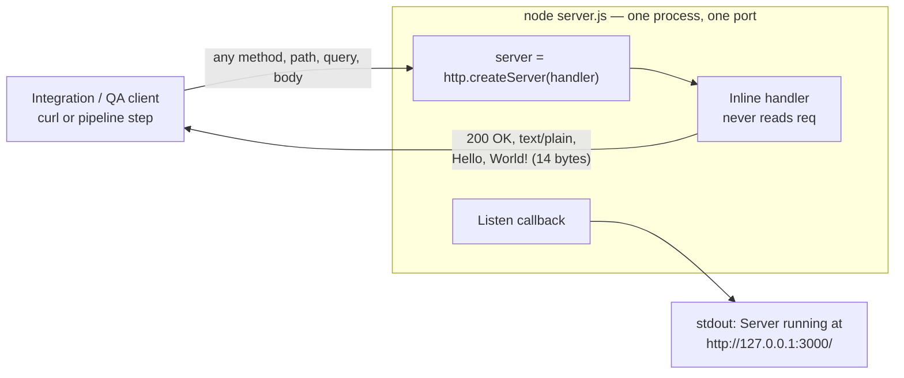

**Core technical approach.** The implementation is deliberately plain: CommonJS with a single `require('http')`, no framework, no middleware chain, no configuration layer and no state. Configuration lives in module-scoped `const` declarations, so behaviour is fixed at author time rather than at deploy time. The handler is a stateless, side-effect-free arrow function that writes a constant, which means the request/response cycle is idempotent across every verb and path — verified behaviourally: `GET /`, `POST /anything?x=1` with a body, and `HEAD /missing` each returned `200` with `Content-Type: text/plain`, and the two non-`HEAD` responses each carried `Content-Length: 14` and the body `Hello, World!`.

### 1.2.3 Success Criteria

**Measurable objectives.** Success for this system is byte-exact conformance to a fixed contract after traversing an integration path. Each objective below is directly observable from outside the process.

| Objective | Measurable target | Observed evidence |
|---|---|---|
| Fixed response body | Response body equals `Hello, World!\n`; `Content-Length` is 14 | GET and POST probes returned exactly that 14-byte body |
| Fixed status and media type | Status `200`; `Content-Type: text/plain` on every request | Identical headers observed for GET, POST and HEAD |
| Request insensitivity | Method, path, query string and body do not alter the response | `POST /anything?x=1` with `payload=1` returned the same response as `GET /` |
| Dependency-free installation | `npm install` succeeds resolving zero external packages | Command reported "up to date"; lockfile contains only the root `""` entry |
| Startup signal | stdout contains `Server running at http://127.0.0.1:3000/` within the startup window | Printed on every launch during verification |

**Critical success factors.** Three conditions must hold for the fixture to serve its purpose. First, the constants in `server.js` — `127.0.0.1`, `3000`, `Hello, World!`, status `200`, `text/plain` — must remain exactly as written, because the pipeline compares against them. Second, the repository must stay unmodified, per the README's "Do not touch!", so the workload the pipeline consumes is the same on every branch. Third, the consumer must run on the same host as the process, since the loopback bind admits no remote client.

**Key performance indicators.** The system emits no metrics, logs no request records and exposes no health or readiness endpoint; the only runtime output is the single startup line. Any KPI is therefore measured by the consuming pipeline, not reported by this repository. The indicators that its contract makes measurable are: startup success rate, response conformance rate (exact body, status and media type), and time from process launch to the readiness line becoming visible in stdout.

The repository states no latency, throughput, availability or retention target, and none should be inferred from it.


## 1.3 Scope

Scope is defined by the four tracked files and the single listening socket; everything outside them is out of scope.

### 1.3.1 In-Scope

#### 1.3.1.1 Core Features and Functionalities

**Must-have capabilities.** These are the capabilities the repository actually implements, each present unconditionally in `server.js`:

| Capability | Behaviour | Where implemented | Verified by |
|---|---|---|---|
| Start and bind | Creates an HTTP server and binds `127.0.0.1:3000` synchronously at startup | `server.js` — `http.createServer`, `server.listen` | Process binds and stays resident |
| Signal readiness | Logs `Server running at http://127.0.0.1:3000/` from the listen callback | `server.js` listen callback | stdout on every launch |
| Uniform response | Sets `statusCode = 200`, `Content-Type: text/plain`, ends with `Hello, World!\n` | `server.js` request handler | GET, POST and HEAD probes returned identical status and media type |
| Request-agnostic handling | Never reads `req`; no branching on method, path, query or body | `server.js` handler signature | `POST /anything?x=1` with a body returned the same 14-byte body as `GET /` |
| Zero-dependency packaging | Manifest and lockfile resolve no external package | `package.json`, `package-lock.json` | `npm install` reported "up to date" |

**Primary user workflows.**

| Workflow | Actor | Steps |
|---|---|---|
| Bring the fixture up | Integration / QA engineer | `npm install` (no-op) → `node server.js` → wait for the readiness line on stdout |
| Verify the integration path | Pipeline step or engineer | Issue a request to `http://127.0.0.1:3000/` with any method and path → compare status, `Content-Type` and the exact 14-byte body |
| Compare across branches | QA engineer | Repeat the launch-and-probe workflow on `main`, `QA-19-nov-branch` or `QA-23-nov-branch`, all of which currently carry the identical commit `46cc595` |

**Essential integrations.** One inbound same-host HTTP client, and one process-level integration with whatever launches `node server.js` and waits for the readiness banner. No outbound integration exists: `server.js` imports only Node's built-in `http` module, and no HTTP client, socket, subprocess or file access appears in it.

**Key technical requirements.**

- Runtime must provide the Node.js `http` module and CommonJS `require`; no `engines` field constrains the version, and verification ran on Node.js v22.23.5 with npm 11.21.0.
- The process must be launched explicitly as `node server.js`, because `main` points at the absent `index.js`.
- The client must execute on the same host, since the listener is bound to loopback.
- Port `3000` on `127.0.0.1` must be free; there is no override mechanism and no `'error'` listener, so a conflict terminates the process with an unhandled `EADDRINUSE` and exit status 1.
- The recognised readiness signal is the single stdout line; no health, readiness or status endpoint exists to poll.

#### 1.3.1.2 Implementation Boundaries

**System boundaries.** The boundary is sharp and small, which is precisely what makes the fixture usable as a constant in a comparison.

| Inside the boundary | Outside the boundary |
|---|---|
| `server.js` process, its handler and its `127.0.0.1:3000` socket | Any client or network path beyond loopback |
| The constant payload `Hello, World!\n` and the two response headers set in code | Request data of any kind — nothing is read, echoed, stored or logged |
| `package.json` and `package-lock.json` as packaging metadata | Build, transpile, bundle, lint, test and container toolchains — none configured |
| `README.md` as the purpose statement | Any external service, datastore, broker or credential store |

**User groups covered.** Integration and QA engineers who launch and probe the fixture; pipeline automation that consumes it as a workload; and package maintainers who own the manifest metadata. No other user group is addressed, and the repository describes no personas, roles or permission model.

**Geographic and market coverage.** None. Coverage is a single loopback interface on a single host; the bind address `127.0.0.1` makes the service reachable only from that host, and no deployment, region or locality concept appears anywhere in the repository.

**Data domains included.** Exactly one data value crosses the boundary: the literal response body `Hello, World!\n`. There is no persistence, no schema, no file or database access, and no request data retained in memory beyond the lifetime of the socket write. Consequently the repository holds no personal, financial, regulated or tenant data, and no data-retention or residency requirement applies.

### 1.3.2 Out-of-Scope

**Explicitly excluded features and capabilities.** Each item below is absent from all four tracked files, confirmed by a text search of every tracked file for the relevant identifier:

| Excluded capability | Status | Evidence |
|---|---|---|
| Application routing and endpoint semantics | Absent — all paths return the same body | Handler ignores `req`; no path or method comparison in `server.js` |
| Authentication, authorisation, sessions, tokens | Absent | Zero matches for auth/token logic; "auth" appears only as the package `author` field |
| Persistence and data access | Absent | No database, SQL, ORM or file read/write code; no connection string or schema |
| Observability | Absent | No request logging, metrics, tracing or health endpoint; one startup `console.log` only |
| Configuration management | Absent | No `process.env`, no `.env`, no config file; `hostname` and `port` are literals |
| TLS and transport security policy | Absent | Plain `http` only; no certificates, key material or security headers |
| Error handling and resilience | Absent | No `try`/`catch`, no `'error'` listener, no graceful shutdown, no clustering or restart logic |
| Framework, dependencies and middleware | Absent by design | No `dependencies` block; only `require('http')`; lockfile resolves zero packages |

**Future phase considerations.** The repository records no roadmap, backlog, milestone or version history beyond the single upload commit `46cc595`. `README.md` states "Do not touch!", so extension is not contemplated here at all: any additional capability is by definition a separate effort outside this repository's stated purpose, and this specification does not infer one.

**Integration points not covered.**

- Remote or cross-host clients, since the loopback bind admits none.
- HTTPS/TLS termination, reverse proxies and load balancers — no such configuration exists.
- Outbound calls to any external system, including the "backprop" integration named in the README; the repository contains neither its address nor its protocol.
- Registry publication and release automation: `package.json` omits `repository`, `files`, `private` and `bin`, and no publish workflow exists.
- CI/CD, containerisation and deployment targets: no workflow definition, Dockerfile, manifest or infrastructure code is tracked.

**Unsupported use cases.**

- Serving any content that varies by request, such as routing, content negotiation, query handling, form or JSON parsing, or file delivery.
- Production or shared-environment traffic, which would require a non-loopback bind, TLS, authentication and observability — none of which exist.
- Running more than one instance per host, or choosing a different port, without editing the constants in `server.js`.
- Automated regression testing of the service itself: `npm test` is the npm placeholder, prints `Error: no test specified` and exits with status 1 by design.
- Consuming the package as a library, since `server.js` exports nothing and the declared entry point `index.js` is not present.


## 1.4 References

- `server.js` — the repository's only executable artifact (14 lines): declares `http`, `hostname = '127.0.0.1'`, `port = 3000`, creates the server with an inline handler that ignores `req`, sets `statusCode = 200` and `Content-Type: text/plain`, ends with `'Hello, World!\n'`, binds the port and logs the readiness banner. Established the entire runtime contract, the absence of routing, configuration, error handling and exports.
- `package.json` — package identity and metadata: name `hello_world`, version `1.0.0`, description "Hello world in Node.js", `main: index.js` (not present in the repository), author `hxu`, MIT license, sole script `test` = `echo "Error: no test specified" && exit 1`, and no dependency block of any kind.
- `package-lock.json` — `lockfileVersion` 3 with a single root `""` entry restating name, version and license; confirmed that zero external packages are resolved and that installation is a no-op.
- `README.md` — the project's stated purpose, verbatim: title `# hao-backprop-test` and "test project for backprop integration. Do not touch!"; established that the system is an integration test fixture and that modification is forbidden.
- Repository root (`""`) — enumerated the complete contents: exactly four files (`package.json`, `package-lock.json`, `README.md`, `server.js`) and zero sub-folders, totalling 39 lines and 913 bytes; established the system boundary and confirmed the absence of tests, CI, container and configuration files.
- Git history of the repository — commit `46cc595` "Add files via upload" by Sandeep01Kumar (2026-11-19), with branches `main`, `QA-19-nov-branch` and `QA-23-nov-branch` all at that commit; established project provenance and the branch structure used for integration testing.
- No web sources were consulted; every statement in this section derives from the repository files and from running `node server.js`, `curl`, `npm install` and `npm test` locally against the code above.


# 2. Product Requirements

## 2.1 Feature Catalog

The product decomposes into six features. Each one is implemented, not proposed: every behavioural claim below was exercised against commit `46cc595` on Node.js v22.23.5, and every static claim cites a line in the four tracked files. Features are identified `F-001` … `F-006` in dependency order, and each maps to a capability row in [Section 1.3.1.1](#1311-core-features-and-functionalities).

Two conventions apply throughout Section 2. **Status** is `Completed` for every feature because the code exists and its acceptance criteria pass against the current branch. **Priority** expresses how strongly the fixture's purpose — a byte-stable workload for the backprop integration pipeline (`README.md`) — depends on the feature, not commercial value, which the repository does not have.

The features cluster in three tiers. The runtime tier (`F-001`, `F-002`) makes the process exist and announce itself. The contract tier (`F-003`, `F-004`) is what the pipeline actually compares. The packaging and governance tier (`F-005`, `F-006`) makes the workload installable and identical on every run and every branch.

### 2.1.1 Catalog Summary

| Feature ID | Feature Name | Category | Priority / Status |
|---|---|---|---|
| F-001 | Service Bootstrap and Port Binding | Lifecycle & Availability | Critical / Completed |
| F-002 | Startup Readiness Signal | Operability & Diagnostics | High / Completed |
| F-003 | Uniform Response Contract | API & Response Contract | Critical / Completed |
| F-004 | Request-Agnostic Handling | Request Handling | High / Completed |
| F-005 | Dependency-Free Installation and Packaging | Packaging & Distribution | High / Completed |
| F-006 | Fixture Immutability and Branch Reproducibility | Governance & Reproducibility | Medium / Completed |

Three capability gaps are deliberately absent from this catalog rather than listed as low-priority features, because no code stands behind them: routing, authentication, persistence, configuration, TLS, structured logging and automated tests (see [Section 1.3.2](#132-out-of-scope)).

### 2.1.2 F-001 — Service Bootstrap and Port Binding

| Attribute | Value |
|---|---|
| Feature ID | F-001 |
| Category | Lifecycle & Availability |
| Priority / Status | Critical / Completed |
| Implementation | `server.js` lines 1–14 (constants at 3–4, creation at 6, binding at 12) |

**Overview.** Launching `node server.js` loads the CommonJS module, creates an HTTP server around an inline request handler, and binds a TCP listener to `127.0.0.1:3000` through `server.listen(port, hostname, callback)`. The process then stays resident: the listening socket keeps the Node.js event loop alive, so the service accepts connections until the process is killed. Binding is synchronous and unconditional at module scope — there is no initialization hook, no async setup, and no configuration read.

**Business Value.** The feature is the precondition for every observable of the fixture. Without a bound socket the integration pipeline has nothing to probe, so the diagnostic value of the repository — confirming that an integration path delivers a known request to a known place and returns a known answer — collapses to zero.

**User Benefits.** Integration and QA engineers get a single, memorized endpoint (`http://127.0.0.1:3000/`) that requires no port discovery, no service registry and no startup arguments. A supervisor gets a deterministic one-step launch command. Because the bind is loopback-only, an engineer cannot accidentally expose the fixture to a network.

**Technical Context.** The whole feature is four statements. `const http = require('http')` (`server.js`:1) is the only import in the repository; `hostname` and `port` are module-scoped `const` literals (`server.js`:3–4); `server.listen(port, hostname, callback)` (`server.js`:12) performs the bind. `server.js` exports nothing, so the server cannot be embedded as a library, and `package.json` `main` points at `index.js`, a file the repository does not contain — the launch contract is therefore literally `node server.js`.

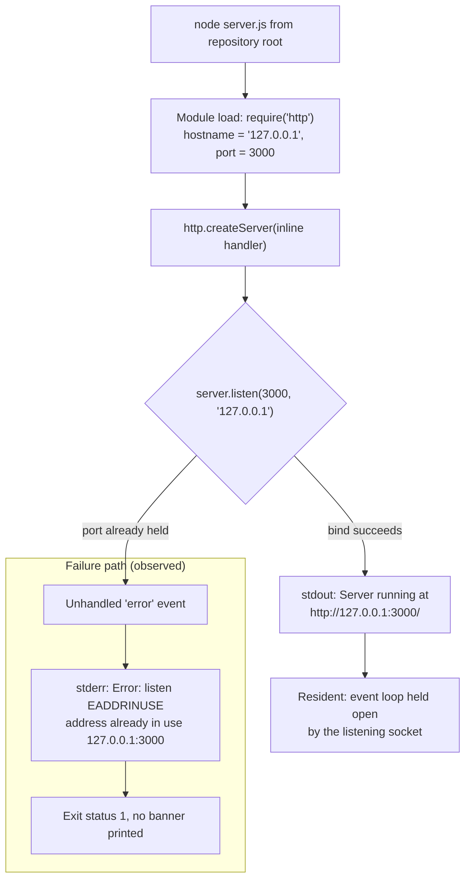

| Dependency Kind | Detail |
|---|---|
| Prerequisite Features | None — F-001 is the root of the dependency graph |
| System Dependencies | Node.js runtime supplying built-in `http` and `net`/TCP layers plus CommonJS `require`; port `3000` free on `127.0.0.1`; the loopback interface present |
| External Dependencies | None — zero npm packages resolve (`package-lock.json` holds only the root `""` entry); no network egress, no credentials, no configuration file |
| Integration Requirements | Process must be started as `node server.js` (not `node .`); must run on the same host as the HTTP client because of the loopback bind; a second instance on the same host cannot start |

### 2.1.3 F-002 — Startup Readiness Signal

| Attribute | Value |
|---|---|
| Feature ID | F-002 |
| Category | Operability & Diagnostics |
| Priority / Status | High / Completed |
| Implementation | `server.js` lines 12–14 (listen callback, single `console.log`) |

**Overview.** When the bind succeeds, the `server.listen` callback writes exactly one line to stdout: `Server running at http://127.0.0.1:3000/`. The string is built by template interpolation of the same `hostname` and `port` constants used to bind (`server.js`:13), so the message cannot drift from the actual binding. Nothing else is written to stdout or stderr during normal operation: request handling performs no logging, and there is no access log, metrics emitter or health endpoint.

**Business Value.** The line is the fixture's only externally observable success signal, and the only way a pipeline can distinguish "server up" from "server still starting" without polling the socket. Because it is printed inside the listen callback, it is emitted only after the socket is accepting connections, which removes the race that a fixed `sleep`-then-probe step would introduce.

**User Benefits.** An engineer sees immediate confirmation of the address in use. Automation can gate on a single substring match rather than a retry loop. When the port is unavailable, the absence of the line is itself diagnostic — verified: a second instance produced no banner and exited with status 1.

**Technical Context.** One statement, one output stream: `console.log(\`Server running at http://${hostname}:${port}/\`)`. The line is human-readable, not structured — there is no JSON, timestamp, log level or request ID. The Banner → stdout edge in the F-001 flowchart is this feature; [Section 1.2.3](#123-success-criteria) names "Startup signal" as a success objective measured against it.

| Dependency Kind | Detail |
|---|---|
| Prerequisite Features | F-001 — the callback runs only after a successful bind, and the interpolated values come from F-001's constants |
| System Dependencies | Node.js stdout stream attached to a reader (terminal, pipe or supervisor capture); `console.log` formatting |
| External Dependencies | None |
| Integration Requirements | Supervisor must match the literal substring `Server running at http://127.0.0.1:3000/`; it must treat a non-zero exit with no banner as a bind failure |

### 2.1.4 F-003 — Uniform Response Contract

| Attribute | Value |
|---|---|
| Feature ID | F-003 |
| Category | API & Response Contract |
| Priority / Status | Critical / Completed |
| Implementation | `server.js` lines 7–9 (`statusCode`, `setHeader`, `end`) |

**Overview.** Every HTTP response carries status `200`, header `Content-Type: text/plain`, and the 14-byte body `Hello, World!\n`. Those three values are set explicitly, in that order, by the handler. Node.js adds only transport-level defaults — `Date`, `Connection: keep-alive`, `Keep-Alive: timeout=5`, and a computed `Content-Length: 14` derived from the single-chunk body. A `HEAD` request receives the same headers with the body suppressed by the HTTP layer.

**Business Value.** This byte-exact triple is the artefact the fixture exists to compare. Because the values are constants rather than computed output, any deviation observed downstream isolates a fault in the integration path — transport, proxying, buffering or client — rather than in application logic.

**User Benefits.** A verifier needs three assertions (status, media type, exact body) and no request crafting. The trailing newline and the fixed 14-byte length make the comparison robust to line-oriented tools such as `curl`, `diff` and `grep`.

**Technical Context.** `res.statusCode = 200` (`server.js`:7), `res.setHeader('Content-Type', 'text/plain')` (`server.js`:8), `res.end('Hello, World!\n')` (`server.js`:9). The media type carries no `charset` parameter, which matters for strict header comparisons. The body is written in a single `end` call, so no chunked transfer encoding appears. Observed response headers for `GET /`:

```text
HTTP/1.1 200 OK
Content-Type: text/plain
Content-Length: 14
```

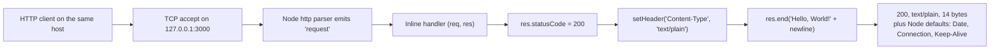

| Dependency Kind | Detail |
|---|---|
| Prerequisite Features | F-001 (a live listener is required to emit a response); F-004 supplies the mechanism that keeps the contract identical for every request |
| System Dependencies | Node.js `http` `ServerResponse`, which computes `Content-Length` and suppresses the body for `HEAD`; HTTP/1.1 keep-alive defaults |
| External Dependencies | None — the body is a literal in source, not read from disk, network or environment |
| Integration Requirements | Clients must compare all three values exactly, including the trailing newline; verifiers must tolerate Node's default `Date`, `Connection` and `Keep-Alive` headers when comparing header sets |

### 2.1.5 F-004 — Request-Agnostic Handling

| Attribute | Value |
|---|---|
| Feature ID | F-004 |
| Category | Request Handling |
| Priority / Status | High / Completed |
| Implementation | `server.js` lines 6–10 (handler signature `(req, res)`, `req` never referenced) |

**Overview.** The handler accepts `(req, res)` and never reads `req`. No method, path, query string, header, cookie or body is inspected, buffered or echoed. Consequently there is no branch that could produce a different status, no routing table, no 404/405 path, and no error path — `200` is the only status the application can emit.

**Business Value.** Insensitivity is what makes the fixture a valid control: a probe with an unexpected verb, a deep path or a large body still exercises the full integration path while returning the identical expected payload. Test authors need not know the "correct" request shape because none exists.

**User Benefits.** Any method (`GET`, `POST`, `PUT`, `DELETE`, `PATCH`, `HEAD`, and verbs Node accepts but the application never names) works; any path and query works; a mistyped URL still yields the canonical response instead of a confusing 404.

**Technical Context.** Verified behaviours on the running process: `GET /`, `POST /anything?x=1` with body `a=1`, `PUT /x` and `HEAD /missing` each returned `200` with `Content-Type: text/plain`; a 1 MB `POST` body returned the 14-byte body in 0.000566 s, showing the request body is answered without being consumed; requests carrying `X-Auth: token` and `Cookie: a=b` were answered identically. Because the handler is stateless and side-effect free, responses are idempotent across the process lifetime.

| Dependency Kind | Detail |
|---|---|
| Prerequisite Features | F-001 — a bound socket is required to receive requests; F-004 and F-003 are realized by the same five statements in `server.js`:6–10 |
| System Dependencies | Node.js HTTP parser must accept the request line and headers before the `'request'` event fires; unread request bodies are discarded by the runtime rather than by application code |
| External Dependencies | None |
| Integration Requirements | Clients may send any method, path, query, header set or body; no client-side schema, content type or authentication header is expected or validated |

### 2.1.6 F-005 — Dependency-Free Installation and Packaging

| Attribute | Value |
|---|---|
| Feature ID | F-005 |
| Category | Packaging & Distribution |
| Priority / Status | High / Completed |
| Implementation | `package.json` (10 lines), `package-lock.json` (13 lines) |

**Overview.** The package declares no runtime, development, peer or optional dependencies, and the lockfile records a single root entry at `lockfileVersion` 3 with no resolved packages. `npm install` therefore completes as a no-op ("up to date, audited 1 package"), and the service runs with nothing but a Node.js runtime. The manifest also fixes package identity: name `hello_world`, version `1.0.0`, description "Hello world in Node.js", author `hxu`, license `MIT`.

**Business Value.** A zero-dependency workload installs in air-gapped or registry-restricted environments, carries no supply-chain risk from transitive packages, and cannot drift through a caret range. For an integration pipeline this removes an entire class of environmental variance from the comparison.

**User Benefits.** Engineers skip dependency troubleshooting entirely; the only prerequisite to satisfy is the Node.js runtime. Setup is one command that changes nothing on disk.

**Technical Context.** `package.json` contains only `name`, `version`, `description`, `main`, `scripts`, `author` and `license`. `main` is `index.js`, which is absent, so `node .` fails with `Cannot find module .../index.js` (exit 1) and the documented launch path remains `node server.js`. The sole script is the npm placeholder `test`, which prints `Error: no test specified` and exits 1 — it is a packaging artefact, not a verification mechanism, so no automated check of this product exists anywhere in the repository.

| Dependency Kind | Detail |
|---|---|
| Prerequisite Features | None — packaging is independent of runtime behaviour |
| System Dependencies | npm capable of reading `lockfileVersion` 3 (npm 7 or later; observed with npm 11.21.0) and a Node.js runtime able to execute CommonJS |
| External Dependencies | No registry package is required; the observed `npm install` resolved zero packages and reported `found 0 vulnerabilities` |
| Integration Requirements | Pipeline setup step runs `npm install` before `node server.js`; the launch command must be stated explicitly because the `main` entry point does not resolve |

### 2.1.7 F-006 — Fixture Immutability and Branch Reproducibility

| Attribute | Value |
|---|---|
| Feature ID | F-006 |
| Category | Governance & Reproducibility |
| Priority / Status | Medium / Completed |
| Implementation | `README.md` (2 lines); git state of the repository |

**Overview.** `README.md` states the repository's purpose and its constraint verbatim: "test project for backprop integration. Do not touch!". The tracked content is a single commit, `46cc595` "Add files via upload" (2026-11-19), and the branches `main` and `QA-23-nov-branch` both point at it; `origin/QA-19-nov-branch` exists as a remote ref for the same workload family. Any branch therefore provides the identical four files and the identical response contract.

**Business Value.** A comparison workload is only meaningful if it is the same workload on both sides of the comparison. Immutability guarantees that a difference observed by the pipeline originates in the integration path, and branch equality lets the same assertions run repeatedly without re-baselining.

**User Benefits.** QA engineers can check out any branch and know the expected payload without reading the code, and a diff of the five contract constants (host, port, status, media type, body) is a sufficient regression gate.

**Technical Context.** The contract is carried by five literals — `'127.0.0.1'`, `3000`, `200`, `'text/plain'`, `'Hello, World!\n'` — in a 342-byte `server.js`. There is no build, transpile, bundle or minify step, so the tracked source is exactly what the runtime executes. No lockfile-integrity or checksum gate exists beyond npm's own root entry.

| Dependency Kind | Detail |
|---|---|
| Prerequisite Features | F-001 and F-003 — the constraint protects their constants, so it presupposes them |
| System Dependencies | Git for branch selection and diffs |
| External Dependencies | None |
| Integration Requirements | Consumers must pin a branch or commit; any change to the five contract literals invalidates previously recorded expected results |


## 2.2 Functional Requirements Table

Requirements are numbered `F-XXX-RQ-YYY`, where `XXX` is the owning feature and `YYY` a sequence within it. Every requirement is stated so that it can be verified from outside the process — by a captured stdout stream, an HTTP probe, a file read or a git command — because the repository ships no test harness (`package.json` `test` is the npm placeholder that exits 1). **Priority** uses Must-Have / Should-Have / Could-Have. **Complexity** uses High / Medium / Low and is Low throughout: the entire implementation is 342 bytes of `server.js` plus two manifest files, so no requirement involves more than a few statements.

Each feature is presented as three tables — requirement details, technical specifications, and validation rules — keyed by the same requirement IDs.

### 2.2.1 F-001 — Service Bootstrap and Port Binding Requirements

| Requirement ID | Description | Acceptance Criteria | Priority / Complexity |
|---|---|---|---|
| F-001-RQ-001 | Bind an HTTP listener to `127.0.0.1:3000` at process start | `node server.js` creates a listening socket; `curl -sS -o /dev/null -w '%{http_code}' http://127.0.0.1:3000/` prints `200` | Must-Have / Low |
| F-001-RQ-002 | Restrict the listener to the loopback interface | A connection attempt from any non-loopback address of the host is refused; `server.js`:3 reads `const hostname = '127.0.0.1'` | Must-Have / Low |
| F-001-RQ-003 | Fix host and port at author time, with no runtime override | A text search of all tracked files for `process.env` returns zero matches; changing the port requires editing `server.js`:4 | Must-Have / Low |
| F-001-RQ-004 | Fail fast and observably when the port is occupied | With `3000` already held, a second `node server.js` writes `EADDRINUSE: address already in use 127.0.0.1:3000` to stderr, prints no banner, and exits with status 1 | Should-Have / Low |
| F-001-RQ-005 | Remain resident and serve until the process is killed | The process is still alive after request handling; 20 concurrent `GET /` probes returned `200` twenty times | Must-Have / Low |

| Requirement ID | Input Parameters | Output / Response | Performance & Data Criteria |
|---|---|---|---|
| F-001-RQ-001 | Process launch `node server.js`; no arguments, no flags, no configuration input | Listening TCP socket on `127.0.0.1:3000`; readiness banner on stdout | Bind completes before the banner is written; measured on the verification host, a probe issued one second after launch succeeded |
| F-001-RQ-002 | Inbound connection attempts from any interface | Accept through loopback only | No data crosses a non-loopback interface at any point |
| F-001-RQ-003 | None — constants are compiled into the module | Behaviour is identical for every launch environment | No state is read from files, environment variables or command-line arguments |
| F-001-RQ-004 | Launch attempt while port `3000` is held on `127.0.0.1` | Unhandled `'error'` event: stderr stack trace, exit status 1, empty stdout | Failure is immediate — observed within the same second as launch |
| F-001-RQ-005 | Any number of sequential or concurrent requests | Continued `200` responses for the process lifetime | Held-open listening socket keeps the event loop alive; no idle timeout or self-shutdown exists |

| Requirement ID | Business Rule | Data Validation | Security & Compliance |
|---|---|---|---|
| F-001-RQ-001 | Exactly one listener per process; it is created unconditionally at module load | No validation of host or port exists; correctness rests on the literals at `server.js`:3–4 | Loopback bind confines exposure to the local host |
| F-001-RQ-002 | Fixture must not be reachable off-host | Bind address is a loopback literal, so no interface other than `lo` can accept traffic | Attack surface limited to same-host clients; no authentication layer is needed at that boundary |
| F-001-RQ-003 | Determinism takes precedence over deployability | No configuration surface exists to validate | No secret, certificate or credential is present in the repository |
| F-001-RQ-004 | A bind failure must never be silent | Absence of the readiness banner is the failure indicator | Stack trace contains only local paths and the port number; no sensitive value is disclosed |
| F-001-RQ-005 | Service continuity until external termination | None applicable | No graceful-shutdown, clustering or restart logic exists, so termination is always abrupt |

### 2.2.2 F-002 — Startup Readiness Signal Requirements

| Requirement ID | Description | Acceptance Criteria | Priority / Complexity |
|---|---|---|---|
| F-002-RQ-001 | Emit the exact readiness line on a successful bind | Captured stdout contains `Server running at http://127.0.0.1:3000/` | Must-Have / Low |
| F-002-RQ-002 | Emit the line only once the socket accepts connections | The line originates in the `server.listen` callback (`server.js`:12–14); a probe issued after the line is observed returns `200` | Must-Have / Low |
| F-002-RQ-003 | Suppress the line when the bind fails | The `EADDRINUSE` run produced empty stdout and exit status 1 | Should-Have / Low |
| F-002-RQ-004 | Emit no other runtime output during operation | After many requests the captured log still holds only the single banner line | Could-Have / Low |

| Requirement ID | Input Parameters | Output / Response | Performance & Data Criteria |
|---|---|---|---|
| F-002-RQ-001 | Successful `server.listen` callback invocation | One line to stdout through `console.log`, values interpolated from the bind constants | Written once per process; human-readable text, not structured JSON |
| F-002-RQ-002 | Bind callback timing | Line printed after `listen` succeeds | No fixed sleep is needed by a supervisor; the line is emitted at bind, not at first request |
| F-002-RQ-003 | Failed bind | Empty stdout; stderr carries the Node stack trace instead | Banner and failure output never appear together |
| F-002-RQ-004 | Any received request | No stdout or stderr writes | No access log, no per-request metrics, no request identifiers |

| Requirement ID | Business Rule | Data Validation | Security & Compliance |
|---|---|---|---|
| F-002-RQ-001 | The advertised address must equal the bound address, since both derive from the same constants | Literal string comparison by the consumer | Discloses only host and port, both local |
| F-002-RQ-002 | Readiness must mean reachable | None — the callback is the only signal | None applicable |
| F-002-RQ-003 | A missing banner is the documented failure signal | Supervisors must distinguish "not yet" from "failed" via process exit status | None applicable |
| F-002-RQ-004 | The fixture must not produce log noise that could pollute pipeline output | No logging configuration exists because no logger exists | No request data is logged, so no personal data can leak through logs |

### 2.2.3 F-003 — Uniform Response Contract Requirements

| Requirement ID | Description | Acceptance Criteria | Priority / Complexity |
|---|---|---|---|
| F-003-RQ-001 | Answer every request with status `200` | `GET`, `POST`, `PUT` and `HEAD` probes all returned status `200` | Must-Have / Low |
| F-003-RQ-002 | Set `Content-Type: text/plain` exactly, with no `charset` parameter | Header value compares equal to `text/plain` | Must-Have / Low |
| F-003-RQ-003 | Return the body `Hello, World!\n` with length 14 | Downloaded size is 14 bytes; hex dump ends with `0a`; `Content-Length: 14` present | Must-Have / Low |
| F-003-RQ-004 | Set no application header beyond status and media type | Observed headers are `Content-Type` plus Node defaults `Date`, `Connection`, `Keep-Alive`, `Content-Length` | Should-Have / Low |
| F-003-RQ-005 | Answer `HEAD` with the headers and no body | `curl -I` returns `200` and `Content-Type: text/plain` with an empty body and no `Content-Length` | Should-Have / Low |
| F-003-RQ-006 | Honour HTTP/1.1 persistent connections | Response includes `Connection: keep-alive` and `Keep-Alive: timeout=5` | Could-Have / Low |

| Requirement ID | Input Parameters | Output / Response | Performance & Data Criteria |
|---|---|---|---|
| F-003-RQ-001 | Any HTTP request line and headers | Status line `HTTP/1.1 200 OK` | Constant-time path: one assignment, no computation |
| F-003-RQ-002 | None — value is a literal at `server.js`:8 | `Content-Type: text/plain` | Header count stays at two application-set headers, so comparisons are stable |
| F-003-RQ-003 | None — body is a literal at `server.js`:9 | 14 bytes: `Hello, World!` followed by a newline | Single `res.end` call, so no chunked transfer encoding and a deterministic `Content-Length` |
| F-003-RQ-004 | None | Header set as listed in F-003-RQ-004 | Node injects `Date`; consumers must exclude it from strict comparison |
| F-003-RQ-005 | Request method `HEAD` | `200` plus `Content-Type`, body suppressed by the runtime | Body suppression is performed by Node, not by application logic |
| F-003-RQ-006 | HTTP/1.1 request without `Connection: close` | `Connection: keep-alive`, `Keep-Alive: timeout=5` | Server keep-alive timeout of five seconds, as reported by Node |

| Requirement ID | Business Rule | Data Validation | Security & Compliance |
|---|---|---|---|
| F-003-RQ-001 | `200` is the only status the application may emit | No status other than `200` is assigned anywhere in `server.js` | No error surface exists that could disclose stack traces to a client |
| F-003-RQ-002 | The media type must be byte-identical to the expected value | Strict equality on the header value, including absence of `charset` | Plain text with a fixed body cannot be interpreted as script or markup by a browser |
| F-003-RQ-003 | The body must be byte-identical on every request and every run | 14-byte comparison including the trailing newline | The payload carries no data derived from the request, so no injection path exists |
| F-003-RQ-004 | Header set must remain minimal and stable | Consumers compare only application-set headers | No CORS, CSP, HSTS or cookie headers are set; none are needed on a loopback, plaintext endpoint |
| F-003-RQ-005 | `HEAD` must not diverge from `GET` semantics | Response headers match `GET` except for the absent length | None applicable |
| F-003-RQ-006 | Connections may be reused | None | Keep-alive is a Node default; no connection limit, rate limit or quota is configured |

### 2.2.4 F-004 — Request-Agnostic Handling Requirements

| Requirement ID | Description | Acceptance Criteria | Priority / Complexity |
|---|---|---|---|
| F-004-RQ-001 | Treat every HTTP method identically | `GET /`, `POST /anything?x=1`, `PUT /x` and `HEAD /missing` each returned the F-003 contract; no `405` is reachable | Must-Have / Low |
| F-004-RQ-002 | Treat every path and query string identically | `/`, `/anything?x=1`, `/missing`, `/x` and `/big` all returned `200` with the same body | Must-Have / Low |
| F-004-RQ-003 | Answer without consuming the request body | A 1 MB `POST` body returned the 14-byte response in 0.000566 s; `req` is never referenced in `server.js` | Must-Have / Low |
| F-004-RQ-004 | Ignore request headers and cookies | Requests carrying `X-Auth: token` and `Cookie: a=b` returned `200` and `text/plain` | Must-Have / Low |
| F-004-RQ-005 | Make no other status reachable | `statusCode` is assigned exactly once, at `server.js`:7; no conditional branch exists in the handler | Must-Have / Low |

| Requirement ID | Input Parameters | Output / Response | Performance & Data Criteria |
|---|---|---|---|
| F-004-RQ-001 | Any HTTP method accepted by Node's parser | The F-003 contract, unchanged | Per-request work is independent of the verb |
| F-004-RQ-002 | Any request target, including unknown paths and arbitrary query strings | The F-003 contract, unchanged | No lookup, no route table, no filesystem access |
| F-004-RQ-003 | Request body of any size and content type, including a 1 MB payload | The F-003 contract, unchanged; body discarded by the runtime | Response issued without waiting for or buffering the body; no memory proportional to body size in application code |
| F-004-RQ-004 | Arbitrary headers, including authorization-shaped and cookie headers | The F-003 contract, unchanged | Header parsing is performed by Node; the application reads none |
| F-004-RQ-005 | Any input that could otherwise trigger an error path | Always `200` | No validation, no exception handling, no fallback branch |

| Requirement ID | Business Rule | Data Validation | Security & Compliance |
|---|---|---|---|
| F-004-RQ-001 | The fixture must accept any verb so a probe author cannot choose wrongly | None | No method-based access control exists; the endpoint is unauthenticated by design |
| F-004-RQ-002 | Unknown paths must not produce `404` | None | No path traversal surface, since no path is read |
| F-004-RQ-003 | Request payloads must never influence the response | None — request data is never parsed | No deserialization, no `eval`, no command or query construction from input |
| F-004-RQ-004 | Credentials-shaped headers must be ignored, not validated | None | No token, session, cookie or secret handling exists; nothing authentication-related can be bypassed |
| F-004-RQ-005 | Only `200` may leave the process | None | No error handler, so a client can never receive an internal stack trace |

### 2.2.5 F-005 — Dependency-Free Installation and Packaging Requirements

| Requirement ID | Description | Acceptance Criteria | Priority / Complexity |
|---|---|---|---|
| F-005-RQ-001 | Install without fetching any external package | `npm install` prints `up to date, audited 1 package`, reports `found 0 vulnerabilities`, and adds nothing to the lockfile | Must-Have / Low |
| F-005-RQ-002 | Declare no dependency block in the manifest | `package.json` contains no `dependencies`, `devDependencies`, `peerDependencies` or `optionalDependencies` key | Must-Have / Low |
| F-005-RQ-003 | Record a root-only lockfile | `package-lock.json` declares `lockfileVersion: 3` and its `packages` map holds a single `""` entry | Must-Have / Low |
| F-005-RQ-004 | Publish consistent package identity | Name `hello_world`, version `1.0.0`, description "Hello world in Node.js", author `hxu`, license `MIT` in `package.json`, echoed by the lockfile | Should-Have / Low |
| F-005-RQ-005 | Provide a launch command that actually resolves | `node server.js` starts the service; `node .` exits 1 with `Cannot find module .../index.js` because `main` names an absent file | Should-Have / Low |
| F-005-RQ-006 | Reproduce the npm placeholder test behaviour | `npm test` prints `Error: no test specified` and exits with status 1 | Could-Have / Low |

| Requirement ID | Input Parameters | Output / Response | Performance & Data Criteria |
|---|---|---|---|
| F-005-RQ-001 | Command `npm install` in the repository root | No files fetched; "up to date" output; exit status 0 | Observed completion in 180 ms; requires no network access to a registry |
| F-005-RQ-002 | Manifest read by npm or any packaging consumer | No dependency section present | No transitive tree exists to audit |
| F-005-RQ-003 | Lockfile read by npm 7 or later | Root `""` entry with name, version and license only | No `resolved` or `integrity` hashes are recorded, because no package is resolved |
| F-005-RQ-004 | Manifest fields read by a consumer or registry | Identity metadata as listed | Consistent between `package.json` and the lockfile root entry |
| F-005-RQ-005 | `node server.js` versus `node .` | First binds the port; second fails at module resolution | Module resolution failure occurs before any socket is opened |
| F-005-RQ-006 | `npm test` | Placeholder message on stdout; exit status 1 | No framework is invoked and no test file exists |

| Requirement ID | Business Rule | Data Validation | Security & Compliance |
|---|---|---|---|
| F-005-RQ-001 | The workload must install in a registry-restricted environment | No dependency specification exists to validate | Zero third-party code means zero supply-chain exposure |
| F-005-RQ-002 | The fixture must not drift through version ranges | None | No caret or tilde range can silently change the artefact |
| F-005-RQ-003 | Lockfile must shadow the dependency-free manifest | Root entry must match manifest name, version and license | No integrity hash to verify, because no package is downloaded |
| F-005-RQ-004 | Package identity must stay stable so consumers can reference it | None enforced by tooling; review only | MIT license declared; no `private` flag, so nothing prevents publication |
| F-005-RQ-005 | Documentation must name `node server.js` as the only valid launch | None | None applicable |
| F-005-RQ-006 | `npm test` must not be mistaken for a passing check | Placeholder exits non-zero by construction, so a green build cannot be claimed | None applicable |

### 2.2.6 F-006 — Fixture Immutability and Branch Reproducibility Requirements

| Requirement ID | Description | Acceptance Criteria | Priority / Complexity |
|---|---|---|---|
| F-006-RQ-001 | Preserve the five contract literals | `server.js` lines 3, 4, 7, 8 and 9 still read `'127.0.0.1'`, `3000`, `200`, `'text/plain'` and `'Hello, World!\n'` | Must-Have / Low |
| F-006-RQ-002 | Keep all tracked files unmodified | Working tree is clean (`git status --porcelain` empty) on a fresh checkout of a listed branch, honouring the README's "Do not touch!" | Must-Have / Low |
| F-006-RQ-003 | Keep the workload identical across branches | `main` and `QA-23-nov-branch` both resolve to commit `46cc595`, with the same four blobs | Should-Have / Low |
| F-006-RQ-004 | Ship source that the runtime executes directly | `package.json` defines no build script; `node server.js` runs the tracked file unmodified | Must-Have / Low |

| Requirement ID | Input Parameters | Output / Response | Performance & Data Criteria |
|---|---|---|---|
| F-006-RQ-001 | Source diff against `46cc595` | No change to the five literals | Constants are declared once each, so a single-line diff is a complete check |
| F-006-RQ-002 | Checkout of any listed branch | Four files, 39 lines, 913 bytes in total (73 + 251 + 247 + 342) | Repository has no generated artefacts to exclude |
| F-006-RQ-003 | `git rev-parse` on `main` and `QA-23-nov-branch` | Both print `46cc595` | Single commit of history; no merge or rebase divergence exists |
| F-006-RQ-004 | `node server.js` against the working tree | Service behaviour identical to the tracked source | No transpile, bundle, minify or type-check step to reproduce |

| Requirement ID | Business Rule | Data Validation | Security & Compliance |
|---|---|---|---|
| F-006-RQ-001 | A change to any contract literal invalidates recorded expected results | Review or diff of five lines | None applicable |
| F-006-RQ-002 | The repository is a comparison control and must stay constant | Clean working tree verified with git | No dependency-upgrade or patch process exists, and none is wanted |
| F-006-RQ-003 | Every branch must yield the same expected payload | Branch-to-commit equality verified with git | None applicable |
| F-006-RQ-004 | No toolchain drift may alter the executed artefact | No build configuration to validate | Nothing is fetched or generated at build time, so no build-time compromise is possible |

### 2.2.7 Requirement Traceability Matrix

Every requirement traces to an acceptance evidence source and to the specification section that describes the corresponding system property. No requirement is covered by an automated test, because the repository contains no test framework and `npm test` is the failing npm placeholder.

| Requirement ID | Acceptance Evidence | Specification Cross-Reference | Automated Test |
|---|---|---|---|
| F-001-RQ-001 | Live `curl` probe returned `200` after `node server.js` | [1.2.3](#123-success-criteria) | None — manual |
| F-001-RQ-002 | `server.js`:3 loopback literal; no non-loopback listener observed | [1.3.1.2](#1312-implementation-boundaries) | None — manual |
| F-001-RQ-003 | Zero `process.env` matches across tracked files | [1.2.1](#121-project-context) | None — manual |
| F-001-RQ-004 | Second instance: stderr `EADDRINUSE`, empty stdout, exit 1 | [1.3.1.1](#1311-core-features-and-functionalities) | None — manual |
| F-001-RQ-005 | 20 concurrent `GET /` probes all `200`; process still resident | [1.2.2](#122-high-level-description) | None — manual |
| F-002-RQ-001 | Captured stdout: `Server running at http://127.0.0.1:3000/` | [1.2.3](#123-success-criteria) | None — manual |
| F-002-RQ-002 | Banner originates in the `listen` callback at `server.js`:12–14 | [1.2.2](#122-high-level-description) | None — manual |
| F-002-RQ-003 | Failed-bind run produced empty stdout | [1.3.2](#132-out-of-scope) | None — manual |
| F-002-RQ-004 | Log file held only the banner after repeated requests | [1.2.3](#123-success-criteria) | None — manual |
| F-003-RQ-001 | `GET`, `POST`, `PUT`, `HEAD` probes all `200` | [1.3.1.1](#1311-core-features-and-functionalities) | None — manual |
| F-003-RQ-002 | Response header `Content-Type: text/plain`, no `charset` | [1.2.3](#123-success-criteria) | None — manual |
| F-003-RQ-003 | Downloaded size 14; `Content-Length: 14` | [1.2.3](#123-success-criteria) | None — manual |
| F-003-RQ-004 | Header dump showed only `Content-Type` plus Node defaults | [1.3.1.2](#1312-implementation-boundaries) | None — manual |
| F-003-RQ-005 | `curl -I /missing` returned `200`, media type, empty body | [1.3.1.1](#1311-core-features-and-functionalities) | None — manual |
| F-003-RQ-006 | `Connection: keep-alive` and `Keep-Alive: timeout=5` observed | [1.2.2](#122-high-level-description) | None — manual |
| F-004-RQ-001 | Four methods probed, identical contract, no `405` | [1.3.1.1](#1311-core-features-and-functionalities) | None — manual |
| F-004-RQ-002 | Five distinct paths including query strings answered identically | [1.3.1.1](#1311-core-features-and-functionalities) | None — manual |
| F-004-RQ-003 | 1 MB `POST` returned 14 bytes in 0.000566 s | [1.2.2](#122-high-level-description) | None — manual |
| F-004-RQ-004 | `X-Auth` and `Cookie` requests answered identically | [1.3.2](#132-out-of-scope) | None — manual |
| F-004-RQ-005 | Single `statusCode` assignment at `server.js`:7 | [1.3.1.2](#1312-implementation-boundaries) | None — manual |
| F-005-RQ-001 | `npm install` printed "up to date, audited 1 package, found 0 vulnerabilities" | [1.2.1](#121-project-context) | None — manual |
| F-005-RQ-002 | No dependency key present in `package.json` | [1.3.1.2](#1312-implementation-boundaries) | None — manual |
| F-005-RQ-003 | Lockfile: `lockfileVersion` 3, single `""` entry | [1.2.2](#122-high-level-description) | None — manual |
| F-005-RQ-004 | Manifest fields read directly from `package.json` and lockfile root | [1.1](#11-executive-summary) | None — manual |
| F-005-RQ-005 | `node .` exited 1 with `Cannot find module .../index.js` | [1.3.1.1](#1311-core-features-and-functionalities) | None — manual |
| F-005-RQ-006 | `npm test` printed `Error: no test specified`, exit 1 | [1.3.2](#132-out-of-scope) | None — manual |
| F-006-RQ-001 | Five literals read at `server.js`:3, 4, 7, 8, 9 | [1.2.3](#123-success-criteria) | None — manual |
| F-006-RQ-002 | Clean working tree; README states "Do not touch!" | [1.3.1.2](#1312-implementation-boundaries) | None — manual |
| F-006-RQ-003 | `main` and `QA-23-nov-branch` both at `46cc595` | [1.2.1](#121-project-context) | None — manual |
| F-006-RQ-004 | No build script in `package.json`; `server.js` executed as tracked | [1.3.1.1](#1311-core-features-and-functionalities) | None — manual |


## 2.3 Feature Relationships

The six features are a conceptual decomposition of a single module scope, not code modules. `server.js` declares four symbols — `http`, `hostname`, `port`, `server` — and exports none, so no interface, contract or import boundary separates one feature from another. Every relationship below is therefore either a statement-level coupling inside `server.js` or a coupling through packaging metadata.

### 2.3.1 Feature Dependency Map

Solid arrows run from prerequisite to dependent. Dotted arrows mark a constraint or a co-realization that is not a build-order dependency.

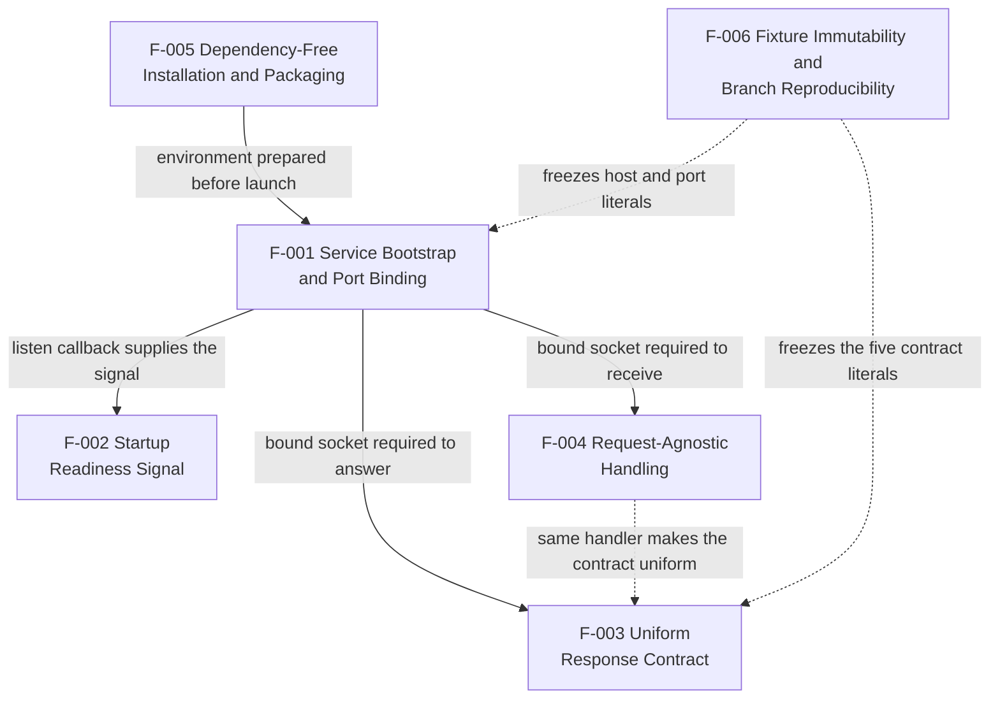

Each edge is observable in the source:

- **F-005 → F-001.** `npm install` resolves zero packages, so the launch environment is prepared by a no-op; `node server.js` then needs nothing beyond the runtime. The dependency is environmental, not code-level — verified by an install that added no packages and a launch that succeeded immediately afterwards.
- **F-001 → F-002.** The banner is written from the `server.listen` callback (`server.js`:12–14) and interpolates `hostname` and `port` from F-001's constants. When binding fails, the callback never runs and no banner appears — the observed `EADDRINUSE` run had empty stdout.
- **F-001 → F-003, F-001 → F-004.** With no listener there is no response path. Both features are unreachable without the bind at `server.js`:12.
- **F-004 ⇢ F-003.** One five-statement handler (`server.js`:6–10) produces both properties: it ignores `req` (F-004) and writes the fixed triple (F-003). F-004 is the mechanism by which F-003 holds for every method, path and body; neither can be changed without changing the other.
- **F-006 ⇢ F-003, F-006 ⇢ F-001.** The "Do not touch!" rule in `README.md` freezes the five literals that F-001 and F-003 set. This is a governance constraint, not a runtime one: nothing in the code enforces it.

### 2.3.2 Integration Points

| Integration Point | Direction | Contract | Evidence |
|---|---|---|---|
| HTTP client on the same host | Inbound | Any method, path, query, header set or body to `http://127.0.0.1:3000/` returns `200`, `Content-Type: text/plain`, body `Hello, World!\n` (14 bytes) | `server.js`:6–10; probes with `GET`, `POST`, `PUT`, `HEAD` |
| Process supervisor or pipeline step | Inbound (process) | Launch `node server.js`; treat the stdout line `Server running at http://127.0.0.1:3000/` as readiness; treat exit status 1 with no banner as a bind failure | `server.js`:12–14; observed `EADDRINUSE` run |
| npm CLI, setup phase | Inbound (tooling) | `npm install` is a no-op that exits 0; `npm test` prints its placeholder and exits 1 | `package.json` `scripts`, `package-lock.json` |
| Git branch or commit selection | Inbound (tooling) | Workload is pinned by branch; `main` and `QA-23-nov-branch` both resolve to `46cc595` with identical blobs | `git rev-parse`, `git ls-tree` |

There is no outbound integration of any kind. `server.js` contains one `require` — Node's built-in `http` — and no HTTP client, raw socket, subprocess, file read or write. The "backprop" integration named in `README.md` has no address, protocol or client code anywhere in the repository, so it crosses the system boundary only as an external consumer.

### 2.3.3 Shared Components

| Shared Component | Features | How It Is Shared |
|---|---|---|
| Inline request handler, `server.js`:6–10 | F-003, F-004 | The same five statements write the fixed response and ignore `req`; the two features are two views of one function |
| Module constants `hostname`, `port`, `server.js`:3–4 | F-001, F-002 | Used as `listen` arguments and interpolated into the readiness banner, so the advertised address cannot diverge from the bound one |
| Server instance `server`, `server.js`:6, 12 | F-001, F-002 | Created once and bound once; its `listen` callback carries the only runtime log statement |
| Contract literals (`200`, `'text/plain'`, `'Hello, World!\n'`) | F-003, F-006 | Set by F-003 and frozen by the immutability rule of F-006 |
| Package identity (name, version, license) | F-005, F-006 | Declared in `package.json` and restated in the `package-lock.json` root entry; consumers reference it when selecting the workload |

No shared library, helper module or utility function exists — the repository has no sub-folders, so reuse happens only inside one module scope or through manifest duplication.

### 2.3.4 Common Services

| Common Service | Provider | Consumed By | Notes |
|---|---|---|---|
| HTTP server and request parser | Node.js built-in `http` | F-001, F-003, F-004 | Only import in the repository (`server.js`:1); supplies `createServer`, `ServerResponse`, status/header writing and `Content-Length` computation |
| TCP and loopback networking | Node.js `net` layer and OS stack | F-001, F-002 | The loopback interface carries all traffic; no other interface is bound |
| Standard output stream | Node.js `console` | F-002 | Exactly one write per successful start; nothing on stdout during request handling |
| npm package lifecycle | External npm CLI (observed 11.21.0) | F-005 | Reads the manifest and lockfile, resolves zero packages, executes the placeholder `test` script |

The services an enterprise system normally shares — identity and authentication, configuration, persistence, caching, messaging, logging and metrics — are wholly absent. Consequently no feature consumes a common service beyond Node's own runtime facilities, and none depends on a credential, connection string or endpoint configuration.


## 2.4 Implementation Considerations

The repository states no latency, throughput, availability or capacity target, and none is inferred here. Where a number appears below it is an observation from the verification host (Node.js v22.23.5, loopback interface, single process), reported as measured behaviour rather than as a commitment. The constraints that do bind are structural: one file, no dependencies, no configuration, no tests, and a README instruction not to change anything.

### 2.4.1 F-001 — Service Bootstrap and Port Binding

| Concern | Consideration |
|---|---|
| Technical constraints | Host and port are `const` literals at `server.js`:3–4, so binding cannot be parameterised at run time; `server.js` exports nothing, so the server cannot be started programmatically by another module; `package.json` `main` points at the absent `index.js`, so `node .` and `require('./')` fail and `node server.js` is the only launch path |
| Performance requirements | None stated. Binding occurs synchronously at module load and completed well within the one-second probe window used during verification; no warm-up, connection pool or pre-allocation step exists |
| Scalability considerations | Hard-limited to one instance per host: the fixed port means a second process exits on `EADDRINUSE`, and there is no `cluster`, `SO_REUSEPORT` or load-balancing arrangement in the code. Capacity is whatever one Node event loop on one loopback socket provides — 20 concurrent probes were answered 200 twenty times |
| Security implications | The loopback bind (`127.0.0.1`) is the sole access control; traffic is plaintext HTTP with no TLS, authentication or rate limiting. No `'error'` listener exists, so bind failures surface as a Node stack trace on stderr to the local operator only |
| Maintenance requirements | Changing the port requires editing source, which the README's "Do not touch!" forbids; any such change must be made on a new branch and invalidates recorded expected results. No graceful-shutdown handler exists, so termination is always abrupt |

### 2.4.2 F-002 — Startup Readiness Signal

| Concern | Consideration |
|---|---|
| Technical constraints | The signal is a single unstructured `console.log` line (`server.js`:13); there is no health, readiness or status endpoint to poll, and no JSON, timestamp or log level to parse |
| Performance requirements | The line is written once, inside the bind callback, so it appears only after the socket is accepting connections; it adds a single synchronous stdout write to startup |
| Scalability considerations | Not applicable in the usual sense: the signal is per-process, and since only one process can bind the port, there is never more than one banner per host |
| Security implications | Discloses only host and port, both local. Nothing authentication-, configuration- or environment-related is printed, so log capture cannot leak secrets |
| Maintenance requirements | Consumers couple to the exact string, so any change to the message — even a typo fix — is a breaking change for supervisors. Because no access log exists, the presence of additional stdout during operation would indicate unintended modification |

### 2.4.3 F-003 — Uniform Response Contract

| Concern | Consideration |
|---|---|
| Technical constraints | The three response values are literals at `server.js`:7–9; the body is written in one `res.end` call, so the runtime computes `Content-Length: 14` and never uses chunked encoding; the media type omits `charset`, which strict header comparisons depend on |
| Performance requirements | None stated. Each request performs one status assignment, one header write and one body write, with no I/O, allocation of request-derived data or computation; observed loopback round trips over 20 sequential requests were 0.38 ms minimum and 4.5 ms median on the verification host |
| Scalability considerations | The handler is stateless and side-effect free, so responses are identical regardless of concurrent load; Node's default keep-alive timeout of 5 s bounds idle connection retention, and no connection limit (`server.maxConnections`) is configured |
| Security implications | The fixed plain-text payload cannot be interpreted as script or markup, and no header that implies security policy (CORS, CSP, HSTS, cookies) is set. There is no application error path, so a client can never receive an internal stack trace |
| Maintenance requirements | The five contract literals are the regression surface: a one-line diff of `server.js` is a complete contract check. Any future header addition would break consumers that compare header sets strictly, so header minimalism must be preserved |

### 2.4.4 F-004 — Request-Agnostic Handling

| Concern | Consideration |
|---|---|
| Technical constraints | The handler signature is `(req, res)` but `req` is never referenced; there is no parser, router, validation layer or error handler, so request data cannot reach application logic even indirectly |
| Performance requirements | None stated. A 1 MB `POST` was answered in 0.000566 s because the body is never consumed by application code; response time is therefore independent of body size and content type |
| Scalability considerations | Unread request bodies are discarded by the Node runtime rather than buffered by the application, so application memory does not grow with payload size. Because no connection or request limit is configured, resource consumption under sustained or hostile load is governed entirely by Node defaults and the operating system |
| Security implications | No deserialization, `eval`, query construction, command execution or filesystem access exists, so the usual injection classes have no surface. Credentials-shaped headers are ignored rather than validated — there is no authentication to bypass because none exists. Exposure remains limited to same-host clients by the loopback bind |
| Maintenance requirements | Insensitivity must be preserved deliberately: adding a single `req.url` or `req.method` comparison would break the fixture's premise that any probe elicits the same response. The absence of `req` usage is therefore a maintenance invariant, checkable by a one-line text search |

### 2.4.5 F-005 — Dependency-Free Installation and Packaging

| Concern | Consideration |
|---|---|
| Technical constraints | The manifest omits dependency blocks, `engines`, `repository`, `files`, `private`, `bin` and `type`, so nothing pins a Node.js version or prevents publication; the lockfile is `lockfileVersion` 3 (npm 7 or later) with a root-only entry; the `test` script is the npm placeholder that always exits 1 |
| Performance requirements | `npm install` was observed to complete in 180 ms with no package fetched, so environment preparation adds no measurable setup latency and needs no registry access |
| Scalability considerations | Not applicable: the package is a single workload, not a distributable library; no publication, versioning or release pipeline exists |
| Security implications | Zero third-party code removes the transitive supply-chain surface and the possibility of a compromised or typosquatted dependency; no credentials, tokens or `.npmrc` files are present. The absent `private` flag means the package could be published if someone chose to, which is the only packaging-related exposure |
| Maintenance requirements | Updates are limited to metadata (version, description); a dependency introduction would break the air-gapped run guarantee and the lockfile's root-only invariant. `npm test` failing by design must not be misread as a build failure |

### 2.4.6 F-006 — Fixture Immutability and Branch Reproducibility

| Concern | Consideration |
|---|---|
| Technical constraints | The contract rests on five literals in a 342-byte file, with no build, transpile, bundle or minify step, so tracked source is exactly what executes; git history is a single commit `46cc595`, and branch selection is the only workload-selection mechanism |
| Performance requirements | None stated; immutability has no runtime cost, and the absence of a build step removes a setup stage from the pipeline |
| Scalability considerations | Reproducibility scales by branch rather than by instance: the same assertions apply to `main`, `QA-19-nov-branch` and `QA-23-nov-branch` because they carry identical content, so test suites can fan out without re-baselining |
| Security implications | A constant artefact cannot drift into unreviewed behaviour, and no dependency patch or toolchain update can alter what executes. There is no automated guard — the constraint is enforced by review only, so an unnoticed edit to `server.js` would silently invalidate every recorded expected result |
| Maintenance requirements | Every change requires a new branch and re-baselining of expected output; the README's "Do not touch!" instruction stands in place of a change-control policy, and no CHANGELOG, policy document or CODEOWNERS file exists to enforce one |


## 2.5 References

All requirements in this section are versioned against the single shipped baseline, commit `46cc595` ("Add files via upload", 2026-11-19), on branches `main` and `QA-23-nov-branch`; a change to any contract literal creates a new baseline and invalidates the acceptance evidence recorded above. Three assumptions underlie the section: the workload remains unmodified as `README.md` instructs, the consumer of the fixture runs on the same host because of the loopback bind, and a Node.js runtime supplying the built-in `http` module is available (observed at v22.23.5 with npm 11.21.0, with no `engines` field constraining the version).

- `server.js` — the only executable artefact (14 lines, 342 bytes): module load and `require('http')` at line 1, `hostname = '127.0.0.1'` at line 3, `port = 3000` at line 4, `http.createServer` at line 6, `statusCode = 200` at line 7, `setHeader('Content-Type', 'text/plain')` at line 8, `res.end('Hello, World!\n')` at line 9, `server.listen(port, hostname, callback)` at line 12 and the readiness banner at line 13. Established the whole runtime contract behind F-001 to F-004 and proved the absence of routing, configuration, error handling, exports and request inspection.
- `package.json` — 10 lines, 251 bytes: name `hello_world`, version `1.0.0`, description "Hello world in Node.js", `main: index.js` (absent), placeholder `test` script, author `hxu`, MIT licence, and no dependency, `engines`, `files`, `private` or `bin` field. Established F-005 and the launch constraint behind F-001.
- `package-lock.json` — 13 lines, 247 bytes: `lockfileVersion` 3 and a single `""` root entry restating name, version and licence, resolving zero packages. Established the zero-dependency guarantee and the root-only lockfile requirement.
- `README.md` — 2 lines, 73 bytes: `# hao-backprop-test` and "test project for backprop integration. Do not touch!" Established the repository's purpose and the immutability rule behind F-006.
- Repository root (`""`) — enumerated four files and zero sub-folders, totalling 39 lines and 913 bytes; established that no test, CI, container, linter or configuration file exists anywhere in the system.
- Git history and branches — commit `46cc595` authored by Sandeep01Kumar on 2026-11-19, with `main` and `QA-23-nov-branch` at that commit and `origin/QA-19-nov-branch` as a remote ref; established the reproducibility requirement F-006-RQ-003.
- No web sources were consulted. Every figure in this section was obtained by reading the four tracked files and by running `node server.js`, `curl`, `npm install`, `npm test` and `node .` against commit `46cc595` on Node.js v22.23.5.


# 3. Technology Stack

## 3.1 Programming Languages

The repository is written in exactly one programming language. Everything that executes at run time is JavaScript, and all of it lives in a single CommonJS module of 14 lines and 342 bytes (`server.js`). There is no compiled language, no second runtime, no transpiled source and no generated code anywhere in the four tracked files.

### 3.1.1 Languages by Component

| Component | Path | Language / format | Executed by |
|---|---|---|---|
| HTTP service | `server.js` | JavaScript (ES2015 features, Node.js dialect), CommonJS | Node.js runtime |
| Package manifest | `package.json` | JSON (npm manifest) | npm, and Node.js `require` |
| Lockfile | `package-lock.json` | JSON, `"lockfileVersion": 3` | npm |
| Project notice | `README.md` | Markdown | readers only |

Only `server.js` is a program. `package.json` and `package-lock.json` are declarative data consumed by npm, and `README.md` is two lines of Markdown (`# hao-backprop-test` plus the purpose sentence). The runtime that executes the JavaScript — Node.js — is not part of the repository: no `engines` field, `.nvmrc`, `Dockerfile` or build manifest pins it, so the language floor is whatever the host provides.

**Language features actually used.** The source relies on a narrow, long-stable slice of the language:

| Feature | Occurrence | ECMAScript baseline |
|---|---|---|
| CommonJS `require` | `server.js`:1 (`require('http')`) | Node.js-specific, not ECMAScript |
| `const` declaration | `server.js`:3, 4, 6 | ES2015 |
| Arrow function | `server.js`:6 (the request handler) | ES2015 |
| Template literal | `server.js`:13 (readiness message) | ES2015 |
| Absent entirely | `let`/`var`, `class`, `async`/`await`, `Promise`, generators, destructuring, spread, optional chaining | — |

The effective language baseline is therefore ES2015, and the ES2015 features appear only as syntax conveniences in four statements; no modern language capability is load-bearing. Nothing in the file depends on a recent Node.js release, which is why the absent version pin has no observable consequence.

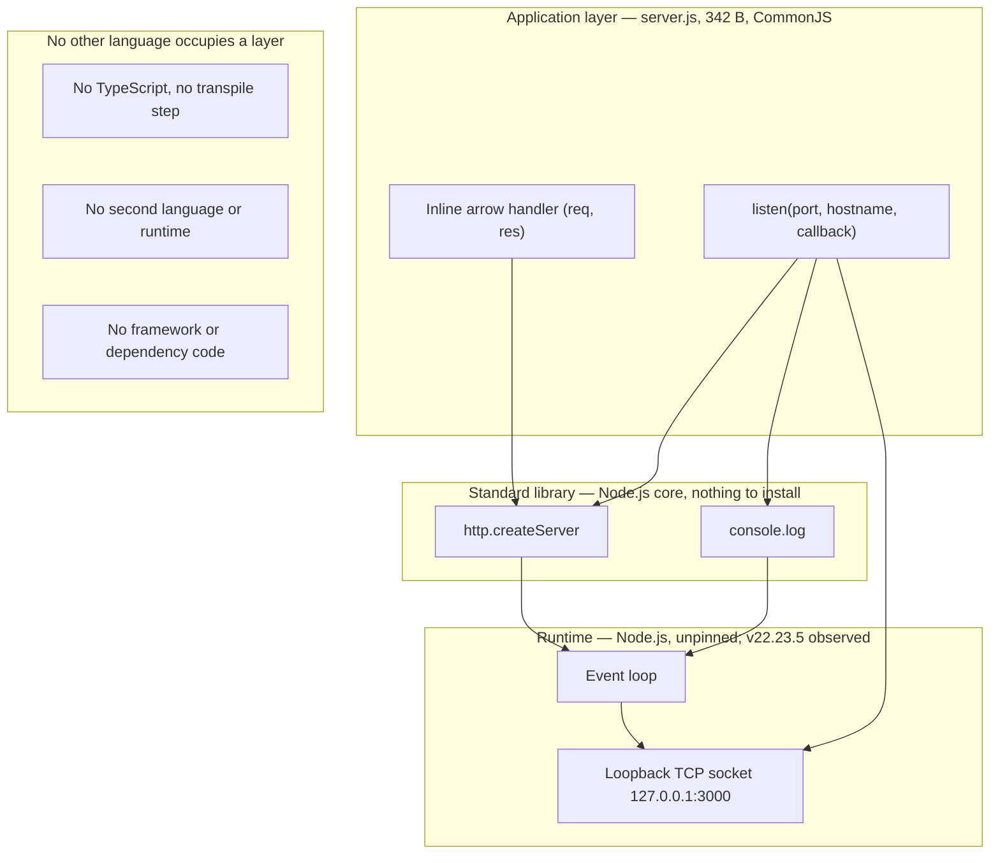

### 3.1.2 Selection Criteria and Justification

The repository records no decision record, commit body, ADR or comment explaining why JavaScript was chosen — the single commit `46cc595` is titled "Add files via upload". The choice is therefore justified here from the properties the artefact demonstrably has, each of which a single-script JavaScript implementation satisfies and a polyglot or compiled stack would not:

| Criterion | How the observed choice satisfies it |
|---|---|
| Zero-install execution | JavaScript on Node.js needs only a runtime; the HTTP server capability ships in the standard library, so no compiler, package fetch or linker is involved |
| Source equals artefact | No transpile, bundle or minify stage exists, so the 342-byte tracked file is byte-for-byte what executes — the property `F-006` relies on |
| One-file reviewability | The entire behavioural contract is five literals in one file, making a one-line diff a complete regression check |
| Air-gapped reproducibility | A single runtime binary is the only host prerequisite, matching `F-005`'s zero-dependency packaging |
| Request-agnostic contract | JavaScript's single-threaded handler can return a constant without parsing machinery, which is exactly `F-004` |

The corollary is that no language other than JavaScript is justified in this repository: the deliverable has no browser bundle, no mobile client, no native shell and no data-processing job that would call for TypeScript, Swift, Kotlin, Objective-C or Python. A text search of all four tracked files returns zero matches for `typescript`, `python`, `swift`, `kotlin` and `objective-c`.

### 3.1.3 Constraints and Dependencies

| Constraint | Evidence | Consequence |
|---|---|---|
| No declared runtime version | `engines` absent from `package.json`; no `.nvmrc` | Any Node.js release providing `http` and CommonJS runs it; version drift is possible but currently harmless because no API is version-sensitive |
| CommonJS only | No `"type": "module"` field; `require` at `server.js`:1 | `.js` files resolve as CommonJS; ESM `import` is neither used nor configured, so `--experimental-*` flags and `import.meta` are irrelevant |
| Single event-loop thread | Handler is a synchronous arrow function with no I/O | JavaScript concurrency never arises; no worker threads, `cluster` or async plumbing exists |
| No static typing or type checking | No `tsconfig.json`, no JSDoc annotations, no `checkJs` | Nothing validates value shapes at build or run time; the only type discipline is review |
| No configuration input | `process.env` appears nowhere; `hostname` and `port` are literals at `server.js`:3–4 | Language-level configuration is impossible without editing source |

**Runtime context.** The verification host reports Node.js `v22.23.5` at `/usr/bin/node` with npm `11.21.0`, and both were used to launch and probe the service described in [Section 1.2.3](#123-success-criteria). As of November 2026 the Node.js release lines stand as follows, which matters only because the repository pins none of them:

| Release line | Codename | Status (Nov 2026) | End of life |
|---|---|---|---|
| Node.js 22 | Jod | Maintenance LTS (since 2025-10-21) — the observed host version | 2027-04-30 |
| Node.js 24 | Krypton | Maintenance LTS (since 2026-10-20) | 2028-04-30 |
| Node.js 26 | Lithium | Active LTS (since 2026-10-28) | 2029-04-30 |

Because the host runs a Maintenance LTS line while a newer Active LTS exists, and because nothing in the repository constrains the version, the effective policy is "whichever Node.js the consumer's environment provides". That is acceptable for a fixture whose contract is a constant, but it does mean the runtime is the one component of this stack whose version is neither declared nor verified.


## 3.2 Frameworks & Libraries

The repository uses no application framework and no third-party library. The framework role is filled entirely by the Node.js standard library: `server.js`:1 imports `http`, and every subsequent statement calls into that module or into the global `console`. The manifest's key set — `name`, `version`, `description`, `main`, `scripts`, `author`, `license` — contains no dependency block of any kind.

### 3.2.1 Core Framework Role: The Node.js `http` Module

| Item | Detail |
|---|---|
| Module and version | `http` — built into Node.js, so its version tracks the runtime (v22.23.5 observed); no separate package version exists |
| Stability | Documented as Stability 2 – Stable; requires no flag and no experimental opt-in |
| APIs used | `http.createServer` (`server.js`:6); `ServerResponse.statusCode` (7), `.setHeader` (8), `.end` (9); `server.listen` (12) |
| Also relied on implicitly | The HTTP parser and TCP socket inside `http`; the global `console.log` (13); Node-generated `Date`, `Connection`, `Keep-Alive` and `Content-Length` headers |

No other core module is imported: `fs`, `path`, `https`, `net`, `dns`, `url`, `crypto`, `child_process` and `os` are all absent, confirmed by a text search of every tracked file for `require(`. That single import is the whole of the framework surface, and it accounts for the entire request/response behaviour specified by `F-001` and `F-003` in [Section 2.1](#21-feature-catalog).

### 3.2.2 Frameworks and Libraries Absent from the Stack

Each row below was checked by a case-insensitive text search across `README.md`, `package.json`, `package-lock.json` and `server.js`, and by the absence of the corresponding manifest field:

| Category | Candidates checked | Result |
|---|---|---|
| Web / API framework | Express, Fastify, Koa, Flask, Django, FastAPI | 0 matches for every name; no `dependencies` block; no `src/` tree exists |
| Front end and styling | React, Angular, Vue, TailwindCSS, React-Native | 0 matches; no `.jsx`/`.tsx`/`.css` file, no bundler config, no `public/` folder |
| Desktop and native shells | Electron, Swift, Kotlin, Objective-C | 0 matches; no mobile, desktop or native project of any kind |
| AI / integration framework | LangChain | 0 matches |
| Build, lint and test tooling | webpack, Babel, ESLint, Jest, Mocha, TypeScript | 0 matches; no `tsconfig.json`, `webpack.config.js`, `.eslintrc` or test directory |
| Persistence libraries | Mongoose, any database driver or ORM | 0 matches; no connection string anywhere |

The default reference stack supplied for this specification lists Python/Flask, LangChain, React with TypeScript, TailwindCSS, React-Native, Swift, Kotlin, Objective-C and ElectronJS. None of them is present, and none is applicable: the repository has no HTTP routing to hand to a web framework, no model or prompt pipeline for an AI framework, and no user interface — web, mobile or desktop — to render.

### 3.2.3 Compatibility Requirements

| Requirement | Precise expectation |
|---|---|
| Runtime | A Node.js build that provides the core `http` module and CommonJS `require`, with ES2015 syntax support (arrow functions, `const`, template literals). No `engines` field narrows this further |
| Module system | CommonJS resolution for `.js`; `package.json` omits `"type"`, so the file is not interpreted as an ES module |
| HTTP semantics | An HTTP/1.1 client. Node computes `Content-Length: 14` from the single-chunk body, applies a 5 s keep-alive timeout by default, and suppresses the body for `HEAD` |
| Packaging | npm 9 or later to produce `"lockfileVersion": 3`, and npm 7 or later to read it; verified with npm 11.21.0 |
| Hooks and native code | None — no `preinstall`/`postinstall` script, no native addon, so no compiler toolchain or ABI compatibility concern arises |

### 3.2.4 Justification and Consequences

Using no framework is the correct choice for this artefact, not an omission. A framework would introduce routing and middleware, which `F-004` deliberately excludes; it would introduce resolved packages and a registry fetch, which would break `F-005`'s air-gapped, zero-dependency guarantee; and it would emit its own headers, default 404 handling and error responses, injecting variance into a contract whose entire value is byte-exactness. The `http` module supplies precisely the pieces the contract needs — a listener, a status code, one header and a body — with no behaviour beyond them.

| Consequence of the choice | Effect on the system |
|---|---|
| No middleware chain or body parser | Request data cannot reach application logic; the 1 MB `POST` probe is answered without consuming the body |
| No framework error handling | No `try`/`catch`, no `'error'` listener and no error-response path; a bind failure surfaces as an unhandled `EADDRINUSE` and exit status 1 |
| No security-header middleware | No CORS, CSP, HSTS or cookie handling exists; exposure is bounded only by the loopback bind |
| No framework upgrade surface | No version ranges to track and no breaking-change risk from a major framework release; the only upgrade vector is the Node.js runtime itself |


## 3.3 Open Source Dependencies

The repository has no open source dependencies. It resolves zero packages, direct or transitive, at every declared level — runtime, development, peer and optional — and the lockfile records nothing but the root project itself.

### 3.3.1 Dependency Inventory

| Manifest field | Present | Value |
|---|---|---|
| `dependencies`, `devDependencies` | No | Absent from `package.json` |
| `peerDependencies`, `optionalDependencies` | No | Absent from `package.json` |
| `bundledDependencies`, `overrides`, `resolutions` | No | Absent from `package.json` |

`package-lock.json` corroborates the manifest rather than merely echoing it: it declares `"lockfileVersion": 3` and `"requires": true`, and its `packages` map holds exactly one key — the empty string `""`, npm's convention for the root project — carrying only `name: hello_world`, `version: 1.0.0` and `license: MIT`. There are no `node_modules/<package>` keys, no `resolved` URLs, no `integrity` hashes and no nested `dependencies` map. A text search of the lockfile for `"resolved"`, `"integrity"` and `"node_modules/` returns zero matches, and no `node_modules` directory exists in the working tree.

**Identity and licensing of the package itself.** `package.json` declares name `hello_world`, version `1.0.0`, description "Hello world in Node.js", author `hxu` and license `MIT`; the lockfile restates the same three identity fields. The licence is declared as a manifest field only — no `LICENSE` file and no `NOTICE` file exists among the four tracked files, so the MIT terms are asserted but not shipped as text.

### 3.3.2 Registry, Resolution and Versioning

| Aspect | Observed state |
|---|---|
| Registry used | None in practice. No `.npmrc` exists, so npm's default public registry configuration would apply, but it is never exercised because nothing is fetched |
| Resolution result | `npm install` reports `up to date, audited 1 package` and `found 0 vulnerabilities` on the verification host (npm 11.21.0), completing in about 0.15 s; the single audited "package" is the root project |
| Version ranges | None exist, so no caret, tilde, tag or `latest` range can drift; the only versions in the repository are `1.0.0` for the package and `3` for the lockfile format |
| Lockfile format | `lockfileVersion` 3, the default written by npm 9 and later and readable back to npm 7; because no dependency entry exists, the format carries no integrity metadata to verify |

This is what makes the install step a no-op rather than a fast install: there is no HTTP request to a registry, no tarball to unpack and no tree to deduplicate. It is also what allows the workload to be prepared in an air-gapped or registry-restricted environment, a property recorded for `F-005` in [Section 2.1.6](#216-f005--dependency-free-installation-and-packaging).

### 3.3.3 Supply-Chain and Licence Posture

With zero third-party code the usual dependency risks have no surface: there is no transitive tree to compromise, no typosquatting target, no caret range to drift, no abandoned package to inherit, and no third-party licence to attribute or reconcile with the MIT declaration. `npm audit` has nothing to report beyond the root package, which is why the observed install prints `found 0 vulnerabilities`.

| Consideration | Consequence for this system |
|---|---|
| Supply-chain attack surface | The only externally sourced components are the Node.js runtime and the npm CLI, both outside the repository and unversioned by it |
| Licence obligations | MIT only, self-declared; no attribution set, no copyleft exposure, no licence-scanning step required |
| Patch and vulnerability response | No dependency can receive a security patch; remediation would necessarily be a runtime upgrade on the host, not a change to the repository |
| Cost of introducing a dependency | Any added package would break the air-gapped guarantee for `F-005`, add `resolved`/`integrity` entries to the lockfile, and contradict the README's "Do not touch!" instruction — so the empty dependency set must be treated as an invariant, not an accident |


## 3.4 Third-Party Services

The system integrates with no third-party service. It makes no outbound network call of any kind, holds no credential, and exposes no hook for a monitoring, identity or cloud provider. The only connection the code can create is an inbound one, on the loopback interface, from a client running on the same host.

### 3.4.1 Confirmed Absences by Service Category

| Category | Default-stack candidate checked | Evidence of absence |
|---|---|---|
| External APIs | Any outbound REST/GraphQL client | No `http.request`, `https`, `fetch`, socket or DNS usage; `http` is used only as a server (`createServer`, `listen`) |
| Authentication services | Auth0, OAuth 2.0, JWT | 0 matches for `auth0`, `oauth`, `jwt`, `token` logic; the string "auth" appears only as the manifest's `author` field |
| Monitoring and APM | Any telemetry, metrics or tracing SDK | No metrics endpoint, no request log, no error reporter; the single `console.log` at `server.js`:13 is the only diagnostic output |
| Cloud services and IaC | AWS, Terraform | 0 matches for `aws`, `amazon`, `terraform`; no cloud SDK, ARN, region or credential reference |
| CI/CD platforms | GitHub Actions, Jenkins | No `.github` directory, no workflow file, no `Jenkinsfile` |
| Secret and configuration stores | Vault, SSM, `.env` | No `dotenv`, no `process.env`, no `.npmrc` or `.env` file; `hostname` and `port` are literals at `server.js`:3–4 |
| TLS termination / CDN / proxy | Reverse proxy or certificate provider | Plain `http` only; no certificate, key or proxy header handling in the source |

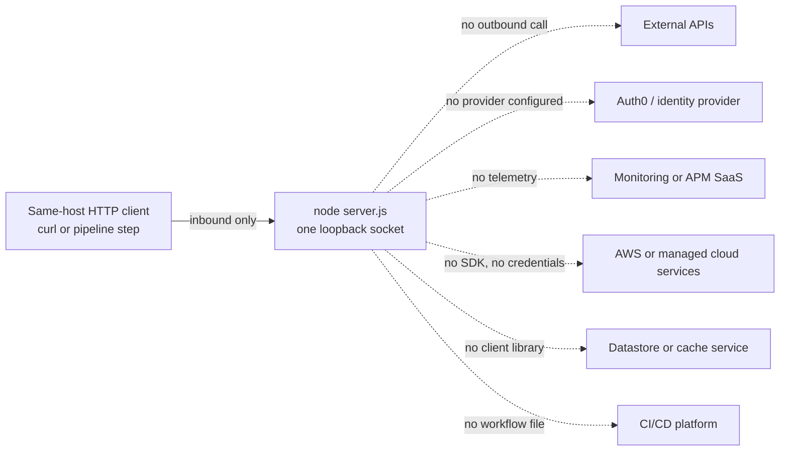

### 3.4.2 The Only Integration Surface

Two relationships exist, and neither is a third-party service in the contractual sense:

- **A same-host HTTP client.** Any method, path, query or body sent to `http://127.0.0.1:3000/` receives the fixed `200`, `text/plain`, `Hello, World!\n` response. The loopback bind means the client must execute on the same host; no remote client can reach the listener.
- **A process supervisor or pipeline step.** It launches `node server.js` and gates on the stdout line `Server running at http://127.0.0.1:3000/`, treating a non-zero exit with no banner as a bind failure.

The "backprop" integration named in `README.md` is described there in one phrase and nowhere else: the repository contains no address, protocol, credential, payload schema or client for it. Its role is to consume this repository as a workload, not to be called by it, so it is documented as an external consumer rather than as a service dependency of the system.

### 3.4.3 Requirements Implied by the Absence

| Requirement | Detail |
|---|---|
| No provisioning work | Nothing to register, authorise, rotate or pay for; a consumer needs only a host with Node.js and a free loopback port |
| No egress controls needed | The process opens no outbound connection, so firewall, NAT and proxy configuration are irrelevant to it |
| Readiness and failure signalling | Must be derived from stdout and the exit code, since no health endpoint, metric or alert channel exists to consult |
| Operational blindness | A failure after startup is invisible to any external system; the only trace is a Node.js stack trace on stderr. Any monitoring must be built into the consuming pipeline |


## 3.5 Databases & Storage

The system has no database, no cache and no storage service. It reads no file, writes no file, and holds no state between requests or across restarts. The only data in the system is a 14-byte literal embedded in the source.

### 3.5.1 Databases: None

No database of any kind is configured or implied:

| Check | Result |
|---|---|
| Client libraries and ORMs | No driver, ORM or query builder in the manifest; 0 matches for `mongodb`, `mongoose`, `postgres`, `sql`, `mysql`, `sqlite`, `redis` in any tracked file |
| Connection configuration | No connection string, host, port, credential, pool size or timeout anywhere; the only network address in the repository is the loopback listener at `server.js`:3–4 |
| Schema and migrations | No schema, model, migration, seed script or DDL; `package.json` has no migration script |

The default reference stack's MongoDB has no counterpart here. The service cannot read or write a record, and no code path could reach a datastore even if one were provisioned, because the single import is `http` (`server.js`:1).

### 3.5.2 Caching and In-Memory State: None

The handler is stateless: `req` is never read, nothing is computed, and the response is three literals (`server.js`:7–9). The module scope holds only immutable bindings — `http`, `hostname`, `port` and `server` are all `const` — so there is no counter, buffer, session, map or cache that a request could mutate. Every request is therefore answered from constants, which is the mechanism behind the idempotence recorded for `F-004` in [Section 2.1.5](#215-f004--request-agnostic-handling).

The only retained resource is transport-level and belongs to Node.js rather than to the application: an idle keep-alive connection is held for the runtime's default 5 s timeout. That is a socket, not cached data, and it cannot change a response.

### 3.5.3 Storage Services and Data at Rest

| Data artefact | Where it lives | Persistence |
|---|---|---|
| Response body `Hello, World!\n` | Literal in `server.js`:9 | As long as the source file, and as long as the process image in memory |
| Bind address and port | Literals in `server.js`:3–4 | Source only; no environment or config file can override them |
| Readiness message | stdout via `console.log` (`server.js`:13) | Not persisted by the process; capture is entirely the consumer's decision |
| Request data | Nowhere | Discarded by the runtime without being read |

No filesystem API is called — `fs` is never imported — so the process neither has nor needs a writable volume, an object store, a mounted secret or a temporary directory. There is no log file, no cache directory and no state file to back up.

### 3.5.4 Persistence Strategy and Its Implications

The persistence strategy is deliberate amnesia: the process derives its entire output from compiled-in constants, so a restart is indistinguishable from a warm start. That is what allows the fixture to be re-run on any branch and produce the same bytes, as required by `F-006` in [Section 2.1.7](#217-f006--fixture-immutability-and-branch-reproducibility).

| Implication | Effect |
|---|---|
| No migrations or schema versions | Nothing to sequence at deploy time; no version skew between code and data can occur |
| No backup, restore or retention policy | There is no data of record, so no recovery objective applies; terminating the process loses nothing but the socket |
| No data residency, privacy or tenancy concerns | No personal, financial or regulated data enters the system, and no request data is retained |
| Storage is a future cost, not a present one | Any capability that needed to remember something would require a datastore, a schema and a lifecycle that this repository does not have and the README does not contemplate |


## 3.6 Development & Deployment

Development and deployment are both manual and minimal: the toolchain is the Node.js and npm command-line interfaces, the build step does not exist, and the deployment step is a process launch. Nothing in the repository is generated, containerised or automated.

### 3.6.1 Development Tooling and Build System

| Tool / stage | Status | Evidence |
|---|---|---|
| Node.js CLI | Used, required | Executes `server.js`; observed at runtime `v22.23.5` (`/usr/bin/node`) |
| npm CLI | Used, optional | Reads the manifest and lockfile; `npm install` is a no-op. Observed at `11.21.0` |
| Build, transpile, bundle, minify | Absent | No `build` script, no webpack/Babel/Rollup/tsconfig configuration; the 342-byte source is what executes |
| Lint and format | Absent | No ESLint, Prettier or EditorConfig file, and no `lint`/`format` script |
| Automated tests | Absent | The only script is the npm placeholder `test`: `echo "Error: no test specified" && exit 1` (`package.json`:7–8). `npm test` prints `Error: no test specified` and exits 1 by design |
| Local development server with reload | Absent | No watcher, `nodemon` or `--watch` usage; a change requires restarting the process |

The full setup and run sequence is two commands, of which the first changes nothing on disk:

```bash
npm install     # reports "up to date, audited 1 package" — zero packages fetched
node server.js  # binds 127.0.0.1:3000 and prints the readiness line
```

`node .` and `require('./')` do not work, because `package.json` declares `"main": "index.js"` while no `index.js` exists; the launch command must name `server.js` explicitly.

### 3.6.2 Source Control, Branching and Hosting

| Aspect | Detail |
|---|---|
| Version control | Git; repository root is a single working directory with no sub-folders and no `.gitignore` |
| Hosting | GitHub — origin `https://github.com/Sandeep01Kumar/existing-projects-qa-19-nov.git` |
| History | One commit, `46cc595` "Add files via upload", authored 2026-11-19; no tags, no releases, no pull-request history |
| Branches | `main`, `QA-19-nov-branch` and `QA-23-nov-branch` all carry the identical four files; branch selection is the only workload-selection mechanism |

There is no `CODEOWNERS`, `CONTRIBUTING.md`, `CHANGELOG.md` or licence text file. Change control is the README's instruction — "test project for backprop integration. Do not touch!" — reinforced by review, not by automation; `F-006` depends on that discipline because no automated guard compares the tracked files against a baseline.

### 3.6.3 Containerization

No container artefact exists: no `Dockerfile`, no `docker-compose.yml`, no `.dockerignore`, no Kubernetes or ECS manifest, and no container-related script or dependency. The deployment unit is therefore the repository checkout plus a Node.js runtime on the host.

Were the service containerised, the code would impose two constraints that a container spec would have to respect: the listener is hard-coded to `127.0.0.1:3000`, so a port mapping to the container would not by itself make the service reachable from outside it — the loopback bind is inside the container's network namespace — and the readiness line would have to be captured from the container's stdout rather than polled from an endpoint. Both constraints follow from `server.js`:3–4 and :13 and would require editing the source to relax, which the README forbids.

### 3.6.4 CI/CD and Deployment Requirements

No continuous-integration or continuous-deployment arrangement exists in the repository: there is no `.github` directory, no workflow file, no `Jenkinsfile`, no pipeline definition, no infrastructure code (Terraform and other IaC are absent), and no deployment target, registry or environment declaration. Deployment is a human or pipeline action performed outside the repository.

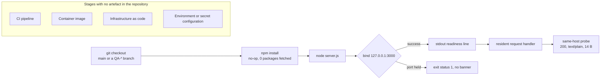

| Deployment prerequisite | Requirement implied by the code |
|---|---|
| Runtime | A Node.js installation on the target host; no version is declared, and `v22.23.5` (Maintenance LTS) is what verification used |
| Network | The loopback interface available, and port `3000` free; a second instance on the same host fails with an unhandled `EADDRINUSE` and exit status 1 |
| Client locality | The verifying client must run on the same host, because the bind address is `127.0.0.1` |
| Configuration | None — no environment variable, `.env` file, secret or mount is read; `process.env` appears nowhere |
| Observability | stdout must be captured to observe the readiness line; there is no endpoint, metric or log sink in the process |
| Lifecycle | Start with `node server.js`; stop only by terminating the process, since no `SIGTERM` handler or graceful shutdown exists |

The default reference stack's deployment components — AWS as the cloud platform, Terraform for infrastructure, GitHub Actions for CI/CD and Docker for containerisation — are all absent, and none is reachable from the current code: there is no artefact for them to build, ship or provision beyond a single script whose contract a reviewer is asked not to change.


## 3.7 References

- `server.js` — the sole executable artefact: CommonJS `require('http')` (line 1), literal `hostname`/`port` (3–4), `http.createServer` with the inline handler (6), `statusCode`/`setHeader`/`end` (7–9), `server.listen` and the readiness `console.log` (12–13); 14 lines, 342 bytes, exports nothing.
- `package.json` — package identity (`hello_world` 1.0.0, MIT, author `hxu`), absence of every dependency block, `engines`, `type`, `bin`, `repository`, `private` and `files`, the `main: index.js` pointer that does not resolve, and the placeholder `test` script.
- `package-lock.json` — `"lockfileVersion": 3`, `"requires": true`, and a `packages` map with only the root `""` entry, establishing that zero packages resolve and no `resolved`/`integrity` record exists.
- `README.md` — title `# hao-backprop-test` and the purpose/constraint statement "test project for backprop integration. Do not touch!".
- `/` (repository root) — exactly four files and no sub-folders; no `Dockerfile`, `docker-compose.yml`, `.github`, `.gitignore`, `.npmrc`, `.nvmrc`, `tsconfig.json`, `Makefile` or `webpack.config.js`.
- `.git/config` and git history — origin `https://github.com/Sandeep01Kumar/existing-projects-qa-19-nov.git`, the single commit `46cc595` "Add files via upload" (2026-11-19), zero tags, and the identical content of `main`, `QA-19-nov-branch` and `QA-23-nov-branch`.
- [web] Node.js Release schedule (nodejs/Release) and Node.js previous releases (nodejs.org) — confirmed Node.js 22 "Jod" is Maintenance LTS since 2025-10-21 with end of life 2027-04-30, Node.js 24 "Krypton" is Maintenance LTS, and Node.js 26 "Lithium" is the only Active LTS in November 2026.
- [web] npm documentation, `package-lock.json` (v9 and v11) and `config`/`lockfile-version` (v8–v11) — confirmed `lockfileVersion` 3 is the default written by npm 9 and later, is backwards compatible to npm 7, and that npm maintains an existing lockfile's version rather than renumbering it.
- [web] Node.js `http` module documentation (v22.x and current) — confirmed the module carries Stability index 2 – Stable, requires no flag, and that only its optional built-in proxy support is Active development.


# 4. Process Flowchart

## 4.1 High-Level System Workflow

The system has exactly one runtime workflow. It begins with a process launch, passes through a single bind attempt, announces readiness, then loops forever over one unconditional response write until the process is signalled to stop. There are two decision points in the whole system — whether the bind succeeds and whether Node.js's HTTP parser accepts the incoming request — and both belong to the runtime rather than to the application. The application layer branches zero times: across the four tracked files there are no matches for `if`, `else`, `switch`, `try`, `catch`, `throw`, `async`, `await`, `setTimeout`, `setInterval` or `process.on`.

That shape is the defining property to hold in mind while reading the rest of this section. `server.js` is 14 lines and 342 bytes, declares four symbols (`http`, `hostname`, `port`, `server`) and exports none; the entire repository is 39 lines and 913 bytes. Every flow described below is therefore either a straight line of statements or a boundary condition enforced by Node.js on the application's behalf. The feature identifiers used throughout (`F-001` … `F-006`) come from [Section 2.1 Feature Catalog](#21-feature-catalog), and the deployment sequence this workflow mirrors is detailed in [Section 3.6.4](#364-cicd-and-deployment-requirements).

### 4.1.1 End-to-End System Workflow

The diagram uses swim lanes for the three parties that actually execute steps: the human or pipeline that launches and probes the system, the `node server.js` process, and the Node.js runtime boundary that owns both decision points.

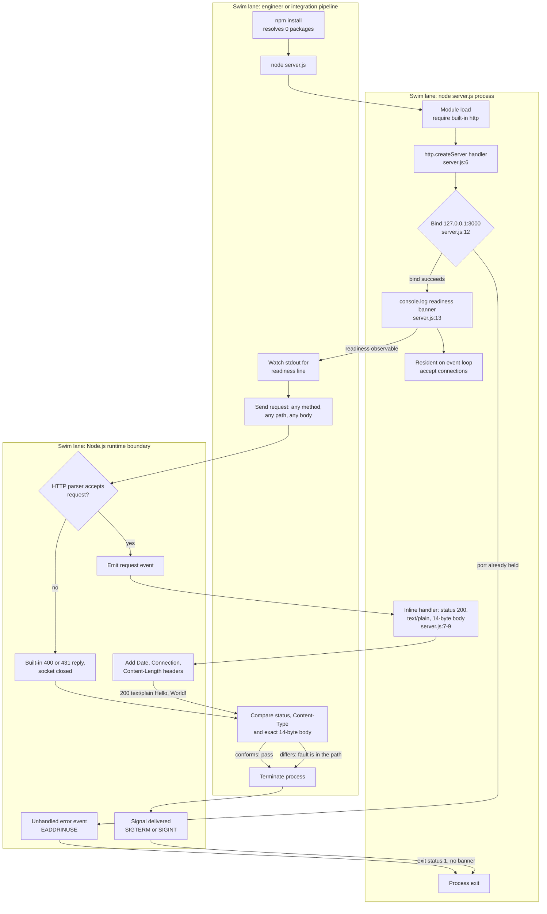

### 4.1.2 Stage Definitions

| Stage | Executed by | Entered when | Statements executed | Exit condition and observable | Failure path |
|---|---|---|---|---|---|
| S1 Environment preparation | Engineer or pipeline | Repository checkout complete | `npm install` reads `package.json` and `package-lock.json`; resolves zero packages | Command exits 0 with nothing on disk changed | No registry call is required, so there is no package-resolution failure mode |
| S2 Module load | `node server.js` | Launch command issued | `require('http')` (`server.js`:1); `hostname` and `port` constants (`server.js`:3–4); `http.createServer` with the inline handler (`server.js`:6) | Handler registered against a new server instance | `node .` fails before this stage because `main` names the absent `index.js`; only `node server.js` runs the service |
| S3 Bind decision | Runtime, on behalf of the application | `server.listen(port, hostname, callback)` (`server.js`:12) | One synchronous bind attempt to `127.0.0.1:3000` | Success advances to S4; failure emits `'error'` on the server instance | `EADDRINUSE` reaches an unhandled `'error'` event: stack trace on stderr, exit status 1, no banner |
| S4 Readiness announcement | Listen callback | Bind succeeded | `console.log` of `` `Server running at http://${hostname}:${port}/` `` (`server.js`:13) | Exactly one line on stdout, then the event loop stays open | None — the line cannot fail to report the real address because it interpolates the same two constants |
| S5 Serving | Inline handler, once per accepted request | HTTP parser emits `'request'` | `res.statusCode = 200` (`:7`), `setHeader('Content-Type', 'text/plain')` (`:8`), `res.end('Hello, World!\n')` (`:9`) | 200 response with a 14-byte body; connection reused or closed per the client's `Connection` header | No application-level failure path exists; parser rejections are answered before the handler runs |
| S6 Termination | Runtime | `SIGTERM` or `SIGINT` delivered | No handler registered | Process ends by signal; no cleanup, no drain, no final log | None to report — an abrupt stop is the only stop |

### 4.1.3 Decision Points

Only two conditions alter the path, and neither is expressed in the application source:

| ID | Decision | Owner | True branch | False branch | Evidence |
|---|---|---|---|---|---|
| D-1 | Does the bind to `127.0.0.1:3000` succeed? | `net` layer under `server.listen` | Banner printed, listener resident | Unhandled `'error'` event, exit 1 | Second instance produced `Error: listen EADDRINUSE: address already in use 127.0.0.1:3000` and printed no banner |
| D-2 | Does the HTTP parser accept the request? | Node.js `http` parser and its default `'clientError'` handler | `'request'` event fires, handler writes the constant | Built-in `400 Bad Request`, or `431 Request Header Fields Too Large` on header overflow, then socket close | Malformed request line and `HTTP/9.9` returned 400; a 20 KB header returned 431 |

A third decision — whether the observed response matches the expected one — is made by the consumer, not by this system, and is documented in the validation rules of [Section 4.5](#45-validation-rules).

### 4.1.4 System Interactions and Touchpoints

The system has four interaction surfaces and no others. Every one of them is exercised by the stages above.

| Interaction | Direction | Mechanism | Touchpoint a reader can observe |
|---|---|---|---|
| HTTP request/response | Inbound on loopback | TCP connection to `127.0.0.1:3000`, one response per request | The response itself: `200`, `text/plain`, body `Hello, World!\n` |
| Process launch | Inbound to the process | `node server.js` from the repository root | Exit status and stderr if the launch fails; the service if it succeeds |
| Readiness | Outbound to the supervisor | Single `console.log` write on stdout | The literal line `Server running at http://127.0.0.1:3000/` |
| Package metadata | Inbound tooling | npm reading `package.json` and `package-lock.json` | `npm install` no-op; `npm test` exiting 1 by design |

There is no outbound interaction of any kind: no HTTP client, no socket client, no subprocess spawn, no file read or write, and no name resolution appear in the source. The "backprop" integration named in `README.md` therefore crosses the boundary only as an external consumer that the repository never calls. Because the listener binds `127.0.0.1`, that consumer must run on the same host as the process — a constraint set in [Section 1.3.1.2](#1312-implementation-boundaries) and restated here because it decides which workflows are possible at all.


## 4.2 Core Business Processes

Three end-to-end journeys make up the entire business surface of this repository. Each one maps to a workflow named in [Section 1.3.1.1](#1311-core-features-and-functionalities), and each is a single actor's path through the stages defined in [Section 4.1.2](#412-stage-definitions). No journey contains a loop, a queue, a wait state or a compensating action, because the application has no such constructs.

| Journey | Actor | Goal | Stages traversed | Terminal outcomes |
|---|---|---|---|---|
| W-1 Bring the fixture up | Integration or QA engineer, or pipeline setup step | A resident listener on `127.0.0.1:3000` with a readiness line already on stdout | S1 → S2 → S3 → S4 → S5 | Resident and ready; or exit 1 with no banner |
| W-2 Verify the integration path | Pipeline probe step or engineer | Proof that a request traversing the path returns the exact contract | S5 only | Conformance proven; or a deviation localised to a layer |
| W-3 Compare across branches | QA engineer | Confidence that the workload, and therefore the expected payload, is unchanged | S1 → S2 → S3 → S4 → S5, per branch | Identical workload; or re-baselining required |

### 4.2.1 W-1 Bring the Fixture Up

The journey has four steps and one decision. Preparation is a no-op that leaves the filesystem unchanged; launch loads one module and makes one synchronous bind attempt; readiness is signalled from inside the listen callback, so the banner cannot precede the ability to accept connections.

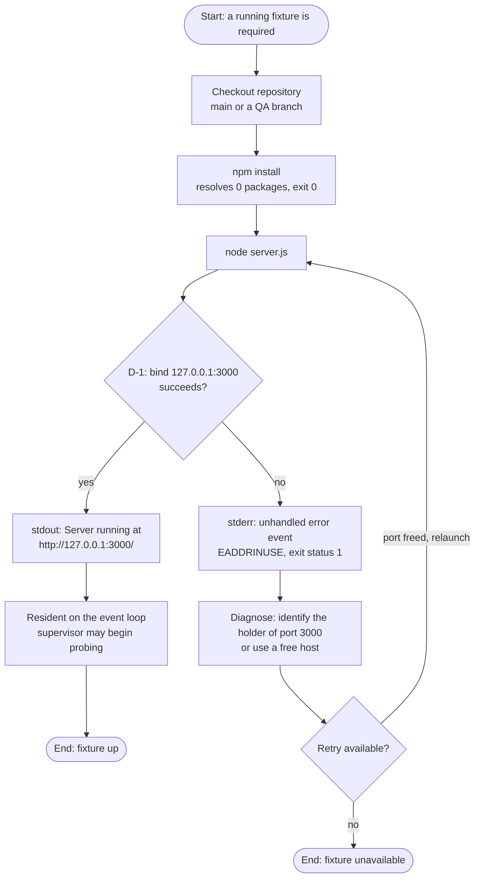

| Step | Actor | Action | Validation applied | Failure and recovery |
|---|---|---|---|---|
| Prepare | Engineer or pipeline | `npm install` | npm reads `lockfileVersion` 3 and finds no packages to resolve | None possible: zero packages means no registry dependency, so the step also succeeds offline |
| Launch | Engineer or pipeline | `node server.js` | The launch command must name `server.js`; `node .` fails because `main` points at the absent `index.js` | Fix the command; nothing else can fail at this point |
| Bind | Runtime, via `server.listen` (`server.js`:12) | Single synchronous bind to `127.0.0.1:3000` | Port availability on the loopback interface | Unhandled `'error'` event ends the process with status 1 and an empty stdout — recovery is to free the port and relaunch, since no override exists |
| Announce | Listen callback (`server.js`:13) | One `console.log` write | None; the address is interpolated from the same constants that were bound | Not applicable |

**Timing.** The banner appeared within the first second of launch in every observed run, and it is emitted from the listen callback rather than on a timer, so it is a true readiness signal rather than a heuristic. No retry, backoff or startup probe exists in the repository; any repetition is the consumer's.

### 4.2.2 W-2 Verify the Integration Path

This journey performs no work inside the system beyond one response write. Its value lies entirely in the comparison the consumer makes afterwards, which is why the flowchart's second half belongs to the client.

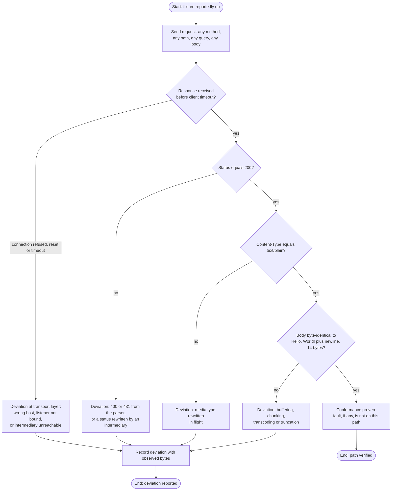

| Element | Detail |
|---|---|
| Start point | A listener already resident at `127.0.0.1:3000`, established by W-1 |
| Request construction | Unconstrained: the handler never reads `req`, so `GET /`, `POST /anything?x=1` with a body, `PUT /x`, `HEAD /missing` and `TRACE /` all returned 200 with `text/plain` |
| Decision points | Four, all on the client side: response received, status 200, media type exact, body byte-exact |
| User touchpoints | The probe command the engineer issues, and the pass/fail report the pipeline emits |
| Error states | The four deviation branches above; none is produced by the application, since it cannot emit any status other than 200 |
| Recovery | Not applicable to the system — the fixture keeps serving. Recovery, if any, belongs to the path under test |
| Timing observed | A 1 MB `POST` body was answered in 1.4 ms with the 14-byte body, proving the request body is never consumed; 200 concurrent `GET` requests all returned the exact body in 87 ms total |

A subtlety worth recording because it affects what a verifier may assert: on `HEAD`, Node.js suppresses the body and — as observed — also omits `Content-Length`, so a comparison that requires that header must use a method that carries a body. The headers the application sets are only two; `Date`, `Connection`, `Keep-Alive` and `Content-Length` are added by the runtime.

### 4.2.3 W-3 Compare Across Branches

Comparability is the fixture's reason to exist, and it depends on branch equality rather than on any code path. `main` and `QA-23-nov-branch` both resolve to commit `46cc595`, and the remote ref `origin/QA-19-nov-branch` carries the same single commit, so the four tracked blobs are identical everywhere.

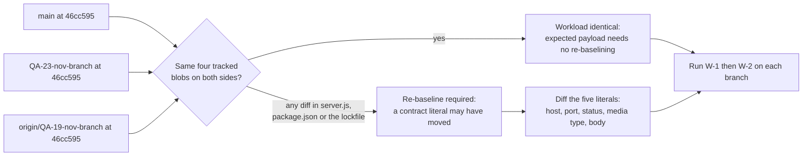

| Element | Detail |
|---|---|
| Start point | Two or more branch checkouts of the same repository |
| Decision point | Blob equality, which is the only branch-level branch |
| Business rule enforced | The five contract literals — `'127.0.0.1'`, `3000`, `200`, `'text/plain'`, `'Hello, World!\n'` — must not move; `README.md` states the constraint as "Do not touch!" |
| Error state | A moved literal invalidates every previously recorded expectation; nothing in the repository detects the change automatically, so the check is a manual diff |
| Timing | No constraint, and no automated gate — `npm test` exits 1 by design |


## 4.3 Integration Workflows

This system has one integration direction. Everything enters through a TCP socket on the loopback interface or through the process boundary that launches it; nothing leaves the process except response bytes, one stdout line and an exit status. There is no client of any external service, no message broker, no database and no filesystem access: `server.js` contains a single `require`, for Node's built-in `http` module, and searching all four tracked files for `fetch(`, `http.request`, `https`, `fs.`, `readFile` and `writeFile` returns zero matches.

| Integration point | Direction | Protocol / mechanism | Contract | Where defined |
|---|---|---|---|---|
| HTTP consumer on the same host | Inbound | HTTP/1.1 over TCP to `127.0.0.1:3000` | Any method, path, query, header set or body returns `200`, `Content-Type: text/plain`, body `Hello, World!\n` | `server.js`:6–10 |
| Process supervisor or pipeline step | Inbound to the process | `spawn`/`exec` of `node server.js`, stdio capture, signal delivery | Readiness is the stdout banner; exit status 1 with no banner means startup failure | `server.js`:12–14 |
| npm CLI at setup | Inbound tooling | Reads `package.json`, `package-lock.json` | Zero packages resolved; `test` script exits 1 by design | `package.json`:6–8, `package-lock.json` |
| Git checkout | Inbound tooling | Branch or commit selection | Identical four files on `main` and both QA branches | repository state at `46cc595` |

### 4.3.1 Inbound HTTP Request Sequence

The sequence below is the complete lifecycle of one request. The application contributes three statements inside it; every other step belongs to Node.js.

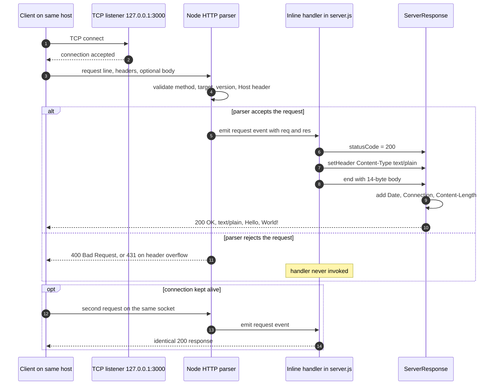

Three properties of this sequence matter to any consumer. First, the handler is invoked after the request head has been parsed, so a request that fails structural validation never reaches application code — the two observed 400s and the 431 came from the parser, not from `server.js`. Second, the request body is never read: a 1 MB `POST` returned its 14-byte answer in 1.4 ms, and the unread body is discarded by the runtime. Third, one socket can carry consecutive requests; two pipelined requests on a single connection each received the exact contract, the first tagged `Connection: keep-alive` and the second honoured the client's `Connection: close`.

### 4.3.2 Process-Level Integration Sequence

The supervisor contract is narrower than the HTTP contract but just as strict, and it has no fallback: the banner is the only positive readiness signal, and its absence is the only negative one.

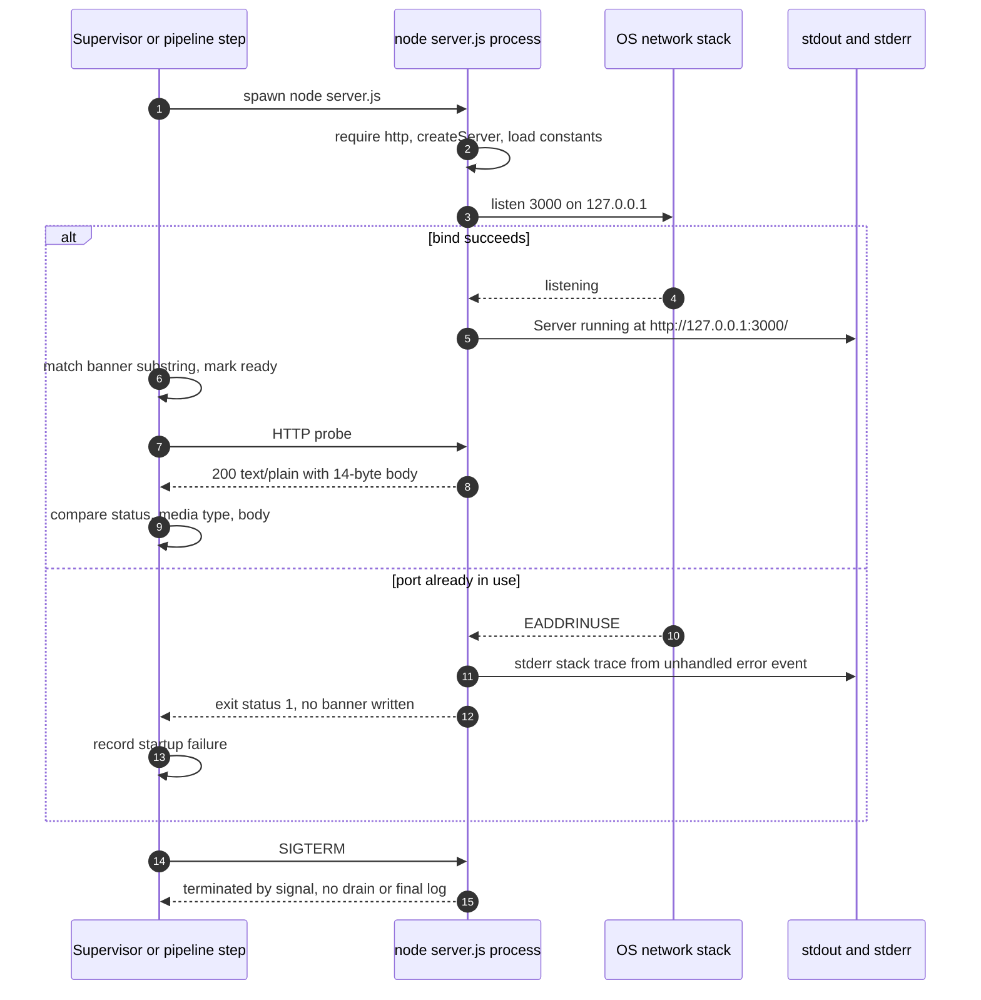

| Element | Value observed or implied by the source |
|---|---|
| Positive readiness signal | The literal stdout line `Server running at http://127.0.0.1:3000/`, written from the listen callback (`server.js`:13) |
| Negative readiness signal | Non-zero exit with an empty stdout, as in the second-instance run |
| Health endpoint | None; there is nothing to poll, so a supervisor must read stdout or probe the socket |
| Stop procedure | Deliver `SIGTERM` or `SIGINT`; the process ends by signal (`code: null`, `signal: SIGTERM`) with no handler to drain, close or log |
| Restart behaviour | Nothing internal; a restart is the supervisor's decision, and it is safe because the process holds no state |

### 4.3.3 Event Processing Flows

Node.js runs this system on events, but the application registers only two of them. Every other event is left to the runtime's default, which is where the observed non-200 responses and the crash on port conflict come from.

| Node.js event | Registered by the application | What happens when it fires | Evidence |
|---|---|---|---|
| `'request'` | Yes — the handler passed to `http.createServer` (`server.js`:6) | The three response statements run; no branch is taken | Any probe returns the fixed triple |
| `'listening'` (via the `listen` callback) | Yes (`server.js`:12) | One banner line on stdout | Banner on every successful launch |
| `'error'` | No | Unhandled `'error'` event terminates the process with a stack trace and exit status 1 | `EADDRINUSE` on a second instance |
| `'clientError'` | No | Runtime answers `400 Bad Request` on a malformed request line or missing `Host`, and `431` when headers exceed 16 KB, then closes | Malformed line, `HTTP/9.9` and a 20 KB header each returned the built-in response |
| `'connect'` (HTTP `CONNECT` method) | No | Socket closed with an empty reply; the handler never runs | `CONNECT example.com:443` produced no bytes |
| `'upgrade'` | No | Request treated as ordinary: 200 with the fixed body, connection left open | `Connection: Upgrade` plus `Upgrade: websocket` returned 200 |
| `'connection'`, `'close'`, `'timeout'` | No | Runtime defaults only: keep-alive idle timeout 5 s, announced in the `Keep-Alive: timeout=5` header | Response headers |

Because no listener exists for `'error'`, a failure that any well-formed enterprise service would log and recover from — a busy port — is fatal here. That is the single most consequential event-processing gap in the system and is treated as the primary error branch in [Section 4.7](#47-error-handling).

### 4.3.4 Batch and Scheduled Sequences

There are none. The source contains no `setInterval`, `setTimeout`, `cron` entry, queue, worker, child process or `cluster` usage, so the process performs work only in reaction to a request or a signal. The request loop is the system's entire repetition model: the event loop stays alive because the listening socket is referenced, and it exits only when the process is terminated. Any scheduled or batch behaviour — periodic probing, nightly comparison, branch sweeps — lives in the consumer pipeline, not here.

### 4.3.5 Data Flow Across the System Boundary

Exactly one payload crosses outbound: a 14-byte constant. Everything inbound is parsed, validated for HTTP conformance and discarded.

| Data element | Direction | Handled by | Transformation applied | Persisted or cached |
|---|---|---|---|---|
| Request line (method, target, version) | Inbound | Node HTTP parser | Validated for conformance; never exposed to the application | No |
| Request headers | Inbound | Node HTTP parser | Counted (limit 2000) and size-limited (16 KB); never read by the application | No |
| Request body | Inbound | Node read buffer | Never consumed by the application; discarded by the runtime | No |
| Response status and media type | Outbound | `server.js`:7–8 | None — literals | No |
| Response body | Outbound | `server.js`:9 | None — the literal `Hello, World!\n`, 14 bytes | No |
| `Date`, `Connection`, `Keep-Alive`, `Content-Length` | Outbound | Node `ServerResponse` | Computed per response | No |
| Readiness banner | Outbound to stdout | `server.js`:13 | None | No |
| Exit status and stderr trace | Outbound to the supervisor | Node process host | None | No |

Nothing is cached at any layer: the response carries no `Cache-Control`, `ETag` or `Last-Modified`, and the source contains no cache, memo or store of any kind. No data is written to disk, so there is no retention surface and no cleanup obligation.


## 4.4 Flowchart Requirements

The diagrams in this section follow one convention because the system has so few moving parts that any ambiguity would misrepresent it. Every flowchart marks a start and an end explicitly, uses diamonds only for the two runtime-owned decisions plus the consumer-side comparison, and puts each actor in its own swim lane so that the boundary between application statements and runtime behaviour stays visible. Process steps that execute inside `server.js` are labelled with their line numbers; steps that execute inside Node.js are labelled with the event or mechanism that triggers them.

### 4.4.1 Start and End Points

| Diagram | Start point | End points |
|---|---|---|
| System workflow ([Section 4.1.1](#411-end-to-end-system-workflow)) | Launch command issued by an engineer or pipeline | Process exit after a delivered signal |
| W-1 bring-up ([Section 4.2.1](#421-w-1-bring-the-fixture-up)) | Need for a running fixture | Resident and ready, or fixture unavailable with exit 1 and no banner |
| W-2 verification ([Section 4.2.2](#422-w-2-verify-the-integration-path)) | A listener established by W-1 | Conformance proven, or a deviation reported with the observed bytes |
| W-3 comparison ([Section 4.2.3](#423-w-3-compare-across-branches)) | Two or more branch checkouts | Identical workload, or re-baselining required |
| Error handling ([Section 4.7.2](#472-error-handling-flowchart)) | Any error condition, at startup or per request | Served correctly, responded with a built-in 400/431, or process terminated with exit 1 |

Every end point is terminal: the system has no loop back to a prior state, no retry edge and no compensating step. The only repeated execution is the per-request handler, which is re-entered for each event the parser emits, not re-driven by any code in the repository.

### 4.4.2 Process Steps

| Step ID | Step | Executed by | Duration class | Reversible |
|---|---|---|---|---|
| P-01 | `npm install` resolves zero packages | npm CLI | Sub-second, no network fetch | Yes — nothing changes on disk |
| P-02 | Module load and constant initialization | `node` (`server.js`:1–4) | Sub-second | n/a |
| P-03 | `http.createServer(handler)` | Node `http` (`server.js`:6) | Immediate | n/a |
| P-04 | Bind `127.0.0.1:3000` | Node `net` (`server.js`:12) | Immediate | No — a second bind on the same host fails |
| P-05 | Print readiness banner | Node stdout (`server.js`:13) | Immediate | n/a |
| P-06 | Stay resident on the event loop | Node runtime | Indefinite | n/a |
| P-07 | Parse the request head | Node `http` parser | Microseconds | n/a — the request is discarded |
| P-08 | Write status, header and body | `server.js`:7–9 | Microseconds | No — bytes are on the wire once written |
| P-09 | Terminate on signal | Node runtime | Immediate | No |

### 4.4.3 Decision Diamonds

| ID | Question | Owner | True edge | False edge | Where drawn |
|---|---|---|---|---|---|
| D-1 | Does the bind to `127.0.0.1:3000` succeed? | Runtime `net` layer | Banner, resident listener | Unhandled `'error'` event, exit 1, no banner | 4.1.1, 4.2.1, 4.7.2, 4.8.1 |
| D-2 | Does the HTTP parser accept the request? | Node `http` parser | `'request'` event, handler runs | Built-in 400 or 431, socket closed | 4.1.1, 4.3.1, 4.7.2 |
| D-3 | Does the observed response match the contract? | Consumer, not this system | Pass | Deviation classified by layer | 4.2.2 |
| D-4 | Are the four tracked blobs identical across branches? | Consumer, not this system | No re-baselining | Re-baselining required | 4.2.3 |

The application contains no decision of its own. A reader looking for a routing diamond, an authentication gate, a retry boundary or a data-validation branch will not find one, because the search for `if`, `else` and `switch` across all four tracked files returns no match.

### 4.4.4 System Boundaries and Swim Lanes

| Boundary | Inside | Outside | How the diagram shows it |
|---|---|---|---|
| Process boundary | `server.js` module scope, its handler, the `server` instance | Supervisor, pipeline, npm CLI, git | Swim lane "node server.js process" |
| HTTP parser boundary | Request head, conformance checks, built-in error replies | Application handler | Swim lane "Node.js runtime boundary"; D-2 sits on it |
| Network boundary | Loopback interface and port 3000 | Any off-host client, proxy or load balancer | The only inbound edge into the TCP listener carries the label "any method, any path, any body" |
| Data boundary | Request head and the 14-byte response literal | Any datastore, file, cache or broker | No edge leaves the process except response bytes and stdout |
| Orchestration boundary | Nothing — the repository has no CI, container or infrastructure artefact | Pipeline, hosting, runtime installation | Drawn as absent stages in [Section 3.6.4](#364-cicd-and-deployment-requirements) |

### 4.4.5 User Touchpoints

Four touchpoints exist, and each is the only observation channel for one of the system's properties.

| Touchpoint | Type | Property it reveals | Failure visibility |
|---|---|---|---|
| `node server.js` launch command | Interactive or scripted input | Whether the process starts at all | Exit 1 with a stack trace and no banner |
| stdout banner | One-line text stream | Whether the listener is bound and where | Absence is the signal of a failed bind |
| `http://127.0.0.1:3000/` endpoint | HTTP | The full response contract | Built-in 400/431 for malformed requests; otherwise always 200 |
| Process exit status and stderr | Process metadata | Whether the run ended normally or by fault | Non-zero status distinguishes startup failure from a signal-driven stop |

No other channel exists: no health endpoint, no metrics port, no log file, no admin interface and no configuration surface. An operator therefore cannot inspect internal state, only these four surfaces.

### 4.4.6 Error States and Recovery Paths

| Error state | Trigger | System response | Recovery path | Recovery owner |
|---|---|---|---|---|
| E-1 Port unavailable | Another process holds `127.0.0.1:3000` | Unhandled `'error'` event; stderr stack trace; exit status 1; no banner | Free the port, or move to a host where it is free, then relaunch | Engineer or supervisor |
| E-2 Launch path wrong | `node .` or `require('./')` used | `MODULE_NOT_FOUND` for the absent `index.js`; exit 1 | Use `node server.js` | Engineer |
| E-3 Malformed request head | Invalid request line, unsupported version, missing `Host` on HTTP/1.1 | `400 Bad Request` from the parser with `Connection: close`; handler never invoked | Client corrects the request; the fixture keeps serving | Client |
| E-4 Header overflow | Headers beyond 16 KB | `431 Request Header Fields Too Large`; socket closed | Client reduces header size | Client |
| E-5 Client abandons the exchange | Socket closed mid-response | No application effect; nothing logged, no state to clean | None needed — the next request is served identically | n/a |
| E-6 Signal-driven stop | `SIGTERM`, `SIGINT` or `SIGKILL` delivered | Process ends by signal; no drain, no final log, no in-flight completion guarantee | Supervisor restarts, which is safe because no state exists | Supervisor |
| E-7 Unknown `CONNECT` tunnel | HTTP `CONNECT` method received | Socket closed with an empty reply; no handler invocation | Not supported by design; the client must use a plain request | Client |

Every recovery path above is external to the system. The repository contains no `try`/`catch`, no retry loop, no fallback port, no restart supervisor and no `process.on` handler, so no error is recovered from inside the process.

### 4.4.7 Timing and SLA Considerations

No latency, throughput, availability or retention target is declared anywhere in the repository — `README.md` is two lines long and mentions none. The timing that does apply is imposed by Node.js defaults that the application never overrides, plus the observed cost of the single response write.

| Timing window | Value | Imposed by | Behaviour on expiry | Verified |
|---|---|---|---|---|
| Startup to readiness banner | Sub-second; the bind is synchronous and the log follows immediately | Application | No banner, hence no readiness | Banner visible well within 1 s of launch in every run |
| Keep-alive idle between requests | 5000 ms, announced as `Keep-Alive: timeout=5` | Node default `keepAliveTimeout` (socket destroyed shortly after, with the 1000 ms buffer added in v22.19.0) | Idle socket closed | Header present on every response |
| Incomplete request headers | 60000 ms | Node default `headersTimeout` | `408` without invoking the handler, then close | A header block left incomplete for 7 s was still open, consistent with a 60 s limit |
| Whole-request duration | 300000 ms | Node default `requestTimeout` | `408`, connection closed | Not exercised; no override exists in the source |
| Header block size | 16384 bytes | Node default `maxHeaderSize` | `431 Request Header Fields Too Large` | A 20 000-byte header returned 431 |
| Header count | 2000 | Node default `maxHeadersCount` | Not specified by the runtime documentation | Not exercised |
| Response write | Single `res.end` call; 1.4 ms observed for a 1 MB `POST`, 200 concurrent `GET`s in 87 ms | Application plus Node `ServerResponse` | Partial write only if the socket fails | Measured on the running process |

Two consequences follow for anyone drawing this process into a larger pipeline. First, a supervisor must gate on the banner or on a successful probe rather than on elapsed time, because the only startup timing guarantee is that the banner follows a completed bind. Second, a consumer that holds an idle keep-alive connection for longer than five seconds will find it closed by the runtime, not by application logic — the correct response is to reconnect, since the process is still listening. The success indicators that a pipeline can compute from outside — startup success rate, response conformance rate, and time from launch to banner — are described in [Section 1.2.3](#123-success-criteria); the repository itself reports none of them.


## 4.5 Validation Rules

Validation in this system happens at exactly one layer: HTTP message conformance, enforced by Node.js before the handler is reached. The application validates nothing, because it reads nothing. There is no schema, no field-level check, no authorization gate and no compliance control; what remains is a set of invariants — the five contract literals — that the workflow depends on holding, and a set of comparison rules the consumer must apply to decide whether a run passed.

### 4.5.1 Business Rules at Each Step

| Step | Business rule | Enforced by | Consequence of violation |
|---|---|---|---|
| Prepare | The dependency set stays empty | Nothing automated — `README.md` "Do not touch!" is a review convention | An added package changes install behaviour and introduces supply-chain surface that no test would catch |
| Launch | The process must be started as `node server.js` | `package.json` `main` names the absent `index.js`, so `node .` fails | `MODULE_NOT_FOUND`, exit 1 |
| Bind | One instance per host, on `127.0.0.1` port `3000` | OS bind through `server.listen` (`server.js`:12) | Second instance dies with an unhandled `EADDRINUSE` and exit 1; there is no override |
| Announce | The advertised address must equal the bound address | Structural — the banner interpolates the same `hostname` and `port` constants (`server.js`:3–4, 13) | Cannot occur without editing the constants |
| Serve | Status must be exactly `200` | Literal at `server.js`:7 | Any other status would come from the runtime or an intermediary, not the application |
| Serve | Media type must be exactly `text/plain`, with no `charset` parameter | Literal at `server.js`:8 | A proxy that appends `; charset=utf-8` breaks a strict header comparison |
| Serve | Body must be exactly `Hello, World!` followed by one newline — 14 bytes | Literal at `server.js`:9 | Any transformation, truncation or re-chunking is immediately visible in a byte comparison |
| Serve | Request identity must not influence the response | Structural — `req` is never referenced in the handler (`server.js`:6–10) | Cannot occur without new code |
| Compare | A recorded expectation stays valid only while the branch commit is unchanged | Consumer discipline plus git history | A moved contract literal invalidates previous results, with no automated detector |
| Govern | Tracked files stay identical on every branch | Review convention, not automation | Divergent branches silently destroy the comparability the fixture exists for |

### 4.5.2 Data Validation Requirements

**Validation the system performs.** All of it belongs to the Node.js HTTP parser; none is written in `server.js`.

| Check | Layer | Result on failure |
|---|---|---|
| Request-line grammar: method token, single space, request-target, single space, `HTTP/x.y` | Parser | `400 Bad Request`, socket closed — observed for `BADREQLINE` |
| Supported protocol version | Parser | `400` — observed for `HTTP/9.9` |
| `Host` header present on HTTP/1.1 | Parser | `400` with an empty chunked body — observed; the same request at HTTP/1.0 succeeded, since `Host` is not required there |
| Header field syntax and folding | Parser | `400` |
| Header block size ≤ 16 384 bytes | Parser | `431 Request Header Fields Too Large` — observed with a 20 000-byte header |
| Header count ≤ 2000 | Parser | The runtime documents the limit but not the response produced on breach |
| Message framing (`Content-Length` versus `Transfer-Encoding`) | Parser | `400` on an ambiguous or invalid framing |

**Validation the system does not perform.** Each absence below was confirmed by a probe that returned the canonical `200`, `text/plain`, 14-byte response.

| Not validated | Probe that confirms it |
|---|---|
| Route or path semantics, including traversal sequences | `GET /../../etc/passwd` returned the fixed body; no filesystem access exists |
| Path length | A 5000-character path returned the fixed body |
| HTTP method semantics | `TRACE /` and `OPTIONS *` both returned 200 with the body |
| Request `Content-Type` or body schema | `POST` with `Content-Type: application/json` and body `{"a":1}` returned the fixed body, the body never parsed |
| Query parameters | `POST /anything?x=1` behaved identically to `GET /` |
| Cookies and authentication headers | `Authorization: Bearer abc`, `Cookie: a=b` and `X-Forwarded-For: 10.0.0.1` were all ignored |
| Body size | A 1 MB body was answered in 1.4 ms without being read; the application applies no limit, and only parser framing plus the runtime's `requestTimeout` bound consumption |

**Validation the consumer must apply.** These rules are what turn a response into a pass or fail; they are the checks drawn as D-3 in [Section 4.2.2](#422-w-2-verify-the-integration-path).

| Comparison rule | Exact requirement |
|---|---|
| Status | Exactly `200` |
| Media type | Exactly `text/plain`, with no `charset` parameter |
| Body | Exactly 14 bytes: `Hello, World!` plus a single trailing newline |
| Runtime-added headers | Tolerate `Date`, `Connection`, `Keep-Alive` and `Content-Length`, which the application does not set |
| `HEAD` requests | Do not require `Content-Length`; the runtime suppresses both body and length on `HEAD`, as observed |
| Request construction | Nothing to validate — no method, path, header or body is expected by the server |

### 4.5.3 Authorization Checkpoints

There are none. The handler never inspects a credential, the process reads no secret, and the repository contains no authentication, session, token, role or permission code. No `401` or `403` response can be produced by the application; the only non-200 responses observed — `400` and `431` — come from the parser and reflect message conformance, not authorization.

| Control a reader might expect | Present | What actually limits access |
|---|---|---|
| Authentication | No | Nothing |
| Authorization or role check | No | Nothing |
| Session or token validation | No | Nothing |
| IP allow-list | No | The bind address `127.0.0.1` limits reachability to the host itself |
| Transport encryption | No | Plain HTTP; no certificate, no key material, no security headers |
| Rate limiting | No | Nothing in the application; only runtime timeouts apply |

The single effective control is the loopback bind at `server.js`:3. It means any process or user with a shell on the host — regardless of identity — can call the service and receive the contract, and that no client on another host can reach it at all. That is adequate for the fixture's purpose, since the payload is a public constant, and it is the reason a verifying client must run on the same host.

### 4.5.4 Regulatory Compliance Checks

No compliance control exists, and none is needed for the data the system handles: one non-personal constant string. There is no audit log, no access record, no retention policy, no data-residency mechanism, no encryption in transit and no consent or erasure pathway, because no personal, financial, health or tenant data is received, stored or emitted. Request data is parsed and discarded, so nothing about a caller is retained.

Two consequences should be stated plainly, since a reader may be evaluating this workload for a regulated environment. First, the absence of logging means no evidence trail of who called the service or when; the only artefacts are the consumer's own records. Second, the absence of TLS and authentication means the service cannot be exposed beyond the host without adding controls the README forbids — so it must remain a same-host test workload, which is also its documented purpose in [Section 1.3.2](#132-out-of-scope).


## 4.6 State Management

The application holds no state of its own. What exists is one module-scope binding — the `server` instance created at `server.js`:6 and bound at `server.js`:12 — plus whatever socket and event-loop state Node.js maintains beneath it. There is no variable that changes after startup, no counter, no session, no in-memory record and no store. Every request therefore begins from the same starting condition, which is why the system is idempotent across its entire lifetime.

### 4.6.1 Process State Transitions

Five states are reachable, two of them terminal. Nothing in the source moves the process between them; the transitions are the runtime's response to a successful bind, a failed bind, or a signal.

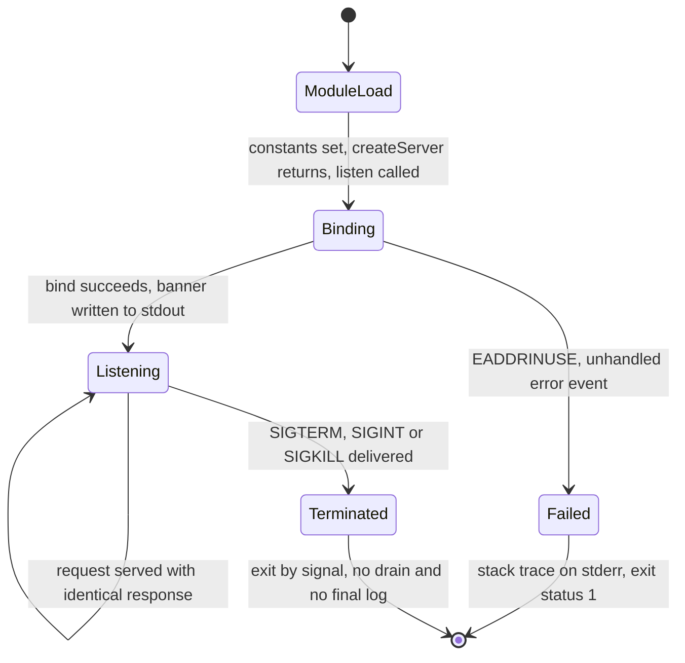

| State | Entry condition | Observable evidence | Exit transitions |
|---|---|---|---|
| Module load | `node server.js` begins | Nothing external yet | To binding, or out with `MODULE_NOT_FOUND` if the entry point is wrong |
| Binding | `server.listen(port, hostname, callback)` executes (`server.js`:12) | Nothing external yet; the bind is synchronous | To listening on success, to failed on `EADDRINUSE` |
| Listening | Bind completed and callback fired | Banner on stdout; socket accepts connections | Self-loop on each served request; to terminated on a signal |
| Failed | `'error'` event with no listener | stderr stack trace, exit status 1, empty stdout | Terminal |
| Terminated | Signal delivered | Exit reported as a signal rather than a code | Terminal |

There is no transitional, draining or shutting-down state, because no shutdown logic exists: the process goes directly from listening to terminated, and any in-flight response is abandoned with the process.

### 4.6.2 Connection-Level State Transitions

Each connection carries its own short-lived state machine, entirely inside Node.js. The application participates at one point only — writing the response — and contributes no state of its own to it.

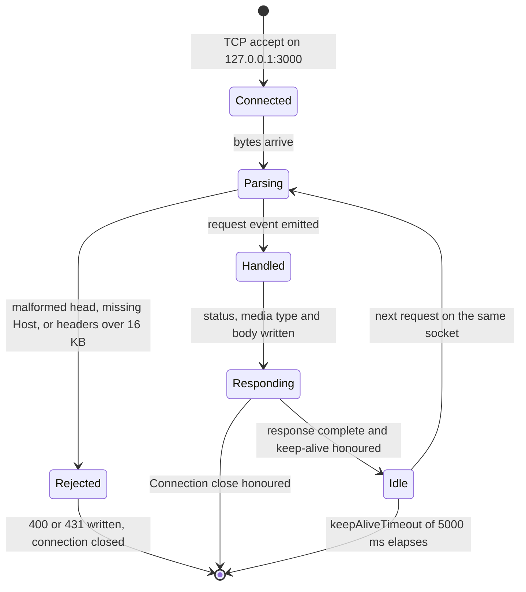

| Transition | Trigger | Observed behaviour |
|---|---|---|
| Connected → Parsing | Request bytes arrive | A second request pipelined on the same socket was also served |
| Parsing → Rejected | Head or header limits violated | `400` for `BADREQLINE` and `HTTP/9.9`; `431` for a 20 000-byte header |
| Parsing → Handled | Head is valid | Handler invoked with `(req, res)`; `req` untouched |
| Responding → Idle | Response complete, client keeps the connection | First of two pipelined responses carried `Connection: keep-alive` |
| Responding → end | Client sends `Connection: close` | Second pipelined response carried `Connection: close` and the socket closed |
| Idle → end | 5 s idle, announced as `Keep-Alive: timeout=5` | Runtime closes the idle socket; the listening process is unaffected |

Because no state survives a connection, a client may reconnect at any time — including after a keep-alive expiry — and expect the identical response.

### 4.6.3 Data Persistence Points

None. The source contains no `fs`, database, cache or object-store call, and no write of any kind; the process creates no file, no temporary directory and no log sink. The only values that outlive a request are the module constants themselves, which are write-once at load and never mutated.

| Candidate persistence point | Present | Where state actually lives |
|---|---|---|
| Response payload | No | The string literal at `server.js`:9, resident in memory only |
| Request data | No | Discarded by the runtime after parsing; never read by the application |
| Session or user state | No | No concept of a user exists |
| Application log | No | One `console.log` at startup; stdout only, nothing written to disk |
| Configuration | No | `const` literals at `server.js`:3–4 |
| Metrics or counters | No | None emitted or retained |

### 4.6.4 Caching Requirements

Nothing is cached at any layer, and the response advertises no cacheability: no `Cache-Control`, `ETag` or `Last-Modified` header is set or observed, and the source contains no memo, map or store. Two runtime behaviours are sometimes mistaken for caching and are worth separating.

| Behaviour | What it is | Why it is not caching |
|---|---|---|
| Keep-alive connection reuse for 5 s | A TCP socket held open for further requests | No response is stored; each request is parsed and answered afresh |
| `Content-Length` computed from the single-chunk body | Framing metadata added by `ServerResponse` | Describes the current response only |

Since there is no cache, there is no invalidation requirement and no staleness risk: a consumer never has to reason about whether it received a replica of an earlier answer, only whether the current answer matches the contract.

### 4.6.5 Transaction Boundaries

The only atomic unit in the system is one HTTP response. Its boundary is the single `res.end('Hello, World!\n')` call at `server.js`:9, which commits status and headers together with the 14-byte body; before that call nothing has been written to the socket, and after it the message is complete.

| Property | Behaviour |
|---|---|
| Unit of work | One request/response exchange; no larger unit spans requests |
| Commit point | `res.end(...)` at `server.js`:9 — the response is either the complete 14-byte message or, if the socket fails first, nothing the client can interpret as complete |
| Rollback | None exists and none is possible; bytes written to a socket cannot be withdrawn |
| Partial failure | If the peer disconnects mid-response, the runtime discards the remainder; the application has no compensating action and no record that it occurred |
| Cross-request consistency | Guaranteed trivially — no request observes or alters another's data |
| Idempotency | Every method, path and body produces the identical response, so a retry can never duplicate an effect; there is no effect to duplicate |


## 4.7 Error Handling

The application implements no error handling. There is no `try`/`catch`, no `throw`, no `'error'` listener, no `'clientError'` listener, no `'uncaughtException'` handler and no graceful-shutdown logic anywhere in the four tracked files. Every error in this system is therefore resolved one of three ways: it is prevented by structure (the handler cannot fail because it writes a constant), it is absorbed by a Node.js default (protocol conformance failures), or it terminates the process (a failed bind). Nothing is retried, degraded or compensated.

### 4.7.1 Error Taxonomy

| ID | Error class | Trigger | Detected by | System response | Blast radius |
|---|---|---|---|---|---|
| E-1 | Bind conflict | Another process holds `127.0.0.1:3000` | `net` layer, `'error'` event | Unhandled event: stderr stack trace `Error: listen EADDRINUSE: address already in use 127.0.0.1:3000`; exit status 1; no banner | Whole service — nothing is served |
| E-2 | Invalid entry point | `node .` or `require('./')` | Node module loader | `MODULE_NOT_FOUND` for the absent `index.js`; exit 1 | Whole service, at launch only |
| E-3 | Malformed request | Invalid request line, unsupported version, missing `Host` on HTTP/1.1, bad framing | HTTP parser | Built-in `400 Bad Request`, `Connection: close`, handler not invoked | One request |
| E-4 | Header overflow | Header block larger than 16 KB | HTTP parser | Built-in `431 Request Header Fields Too Large`, socket closed | One request |
| E-5 | Unsupported tunnel | `CONNECT` method received | Runtime, no `'connect'` listener | Socket closed with an empty reply | One connection |
| E-6 | Client abandonment | Peer closes the socket mid-exchange | Runtime socket layer | Nothing; no log, no state to unwind | One connection |
| E-7 | Signal-driven stop | `SIGTERM`, `SIGINT` or `SIGKILL` | Runtime | Process ends by signal; no drain, no final log | Whole service, by intent |
| E-8 | No test gate | `npm test` invoked | npm | Placeholder script prints `Error: no test specified` and exits 1 | None — deliberate, and the only reason a regression would go unnoticed |

The classes an enterprise service normally plans for — dependency timeouts, partial writes to a datastore, duplicate submissions, upstream 5xx responses, circuit breaking — have no counterpart here, because the system has no dependency, no datastore and no upstream.

### 4.7.2 Error Handling Flowchart

The three lanes below separate the paths that must not be confused: a startup failure removes the service, a request-level rejection removes one exchange, and a shutdown signal removes the process by design.

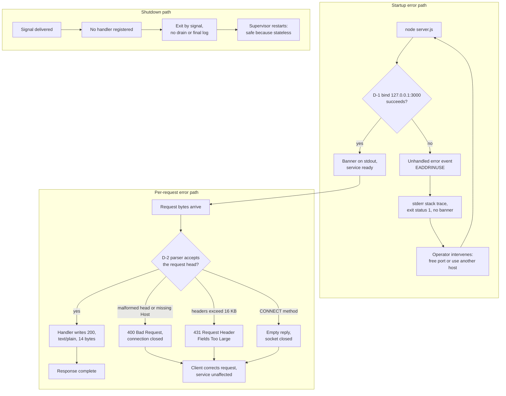

### 4.7.3 Retry Mechanisms

The system retries nothing. There is no loop, no backoff, no attempt counter and no `setTimeout`, so a failure is reported once and never re-attempted from inside the process.

| Failure | Retried by | Mechanism available | Retry safe |
|---|---|---|---|
| Startup bind failure | Supervisor or engineer | Relaunch after freeing the port; the process itself exits and cannot self-heal | Yes — nothing was initialised, so a relaunch repeats the same single bind attempt |
| Probe failure at the consumer | Pipeline step | Repeat the request | Yes — every method is idempotent, including `POST`, because no request has an effect |
| Protocol rejection (400/431) | Client | Correct the request and resend | Yes, once the request is well formed |
| Signal-driven stop | Supervisor | Restart the process | Yes — no state exists to reconcile, and the contract is available as soon as the banner reappears |
| Application exception | Nobody | None — and none is reachable, since the handler performs three assignments on a response object | Not applicable |

One caveat applies to any retry the consumer writes: because a bind failure is fatal and silent on stdout, a supervisor that restarts immediately without inspecting stderr and the exit status will loop without diagnosing the port conflict. The retry must be gated on the banner appearing, not on a fixed sleep, or the loop will mask E-1 indefinitely.

### 4.7.4 Fallback Processes

No fallback of any kind exists in the application: no alternate port, no alternate interface, no degraded mode, no static-file responder, no cached answer and no secondary process. The only substitute responder in the system is the runtime's own built-in error reply, which answers a request the application never sees.

| Scenario | Fallback available | What actually happens |
|---|---|---|
| `127.0.0.1:3000` unavailable | No | Process exits; no attempt at `3001`, `0` or an ephemeral port |
| Request not parseable | Partial — runtime replies | `400` or `431` from Node.js, not from application code, and never the contract body |
| Downstream dependency unavailable | Not applicable | No downstream dependency exists |
| Handler exception | No | No fallback path exists; the code cannot throw in practice |
| Configuration missing | Not applicable | There is no configuration to be missing |

### 4.7.5 Error Notification Flows

Notification is limited to the process's own streams and exit status. There is no alerting, no error tracker, no metrics emission and no notification endpoint.

| Channel | Content | Emitted when | Consumer of the signal |
|---|---|---|---|
| stderr | Full Node.js stack trace, including `EADDRINUSE`, `errno`, `syscall`, `address` and `port` | Startup bind failure | Engineer or supervisor log capture |
| Exit status `1` | Non-zero terminator | Startup bind failure, or a malformed launch command | Supervisor |
| Exit by signal | `signal: SIGTERM`, `SIGINT` or `SIGKILL`, `code: null` | Stop request | Supervisor |
| Absent banner | The negative readiness signal: stdout is empty | Every failed start | Supervisor gating on the banner |
| Built-in `400`/`431` body | Empty; no explanatory text, no correlation identifier | Protocol rejection | Client |
| `npm test` output | `Error: no test specified`, exit 1 | Whenever invoked | Engineer, as a reminder that no gate exists |

Two limitations follow directly. First, no request-level event is ever logged, so a rejected request leaves no trace on the server side — the client's own record is the only evidence. Second, because there is no correlation identifier, a stack trace cannot be tied to a probe; the only way to associate a failure with a cause is the timestamp and the reported address and port.

### 4.7.6 Recovery Procedures

Each procedure below is executable by one person, needs no tooling beyond a shell, and succeeds because the process holds no state.

| Procedure | Steps | Verification of recovery |
|---|---|---|
| Recover from E-1 (port held) | Identify the process listening on `127.0.0.1:3000`, stop it or choose a host where the port is free, then relaunch `node server.js` | Banner `Server running at http://127.0.0.1:3000/` appears on stdout; a probe returns `200` with a 14-byte body |
| Recover from E-2 (wrong entry point) | Reissue the launch as `node server.js` | Banner appears; exit status is not 1 |
| Recover from E-3/E-4 (rejected request) | Correct the request head or reduce header size; no server action is required | The corrected request returns `200`, `text/plain`, 14 bytes |
| Recover from E-6 (client abandoned) | Nothing; the next request is served identically | A fresh probe returns the contract |
| Recover from E-7 (process stopped) | Restart `node server.js`; nothing needs restoring | Banner, then a conforming probe |
| Recover from a suspected regression | Diff the five contract literals — `'127.0.0.1'`, `3000`, `200`, `'text/plain'`, `'Hello, World!\n'` — against the expected values | The diff is empty and a probe matches byte for byte |

Recovery time is bounded only by the process start, since there is no warm-up, no schema migration and no cache to fill: the service is ready when the banner is written, and every observed run reached that point within a second of launch. Recovery point is trivially the last request, because nothing is retained — a restart loses no data that any consumer could observe.


## 4.8 Detailed Process Flows for Core Features

One flowchart per feature catalogued in [Section 2.1 Feature Catalog](#21-feature-catalog). Each diagram keeps its own start and end points, shows the decisions it participates in, and stops where the next feature begins, so that the six flows can be read independently as well as in sequence.

### 4.8.1 F-001 Service Bootstrap and Port Binding

Four statements turn a launch command into a bound socket. The only branch is the bind itself.

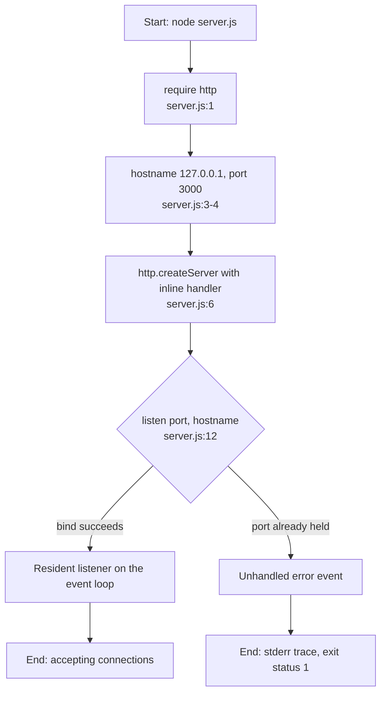

| Element | Value |
|---|---|
| Start point | Launch command issued |
| Decision point | D-1, the bind outcome |
| Error state | `EADDRINUSE` — fatal, no retry, no alternate port |
| End points | Bound and resident; or exited with status 1 |
| Cross-reference | [Section 2.1.2](#212-f-001--service-bootstrap-and-port-binding) |

### 4.8.2 F-002 Startup Readiness Signal

Readiness is one write from the listen callback, emitted only after the bind completes, which removes any race between the socket becoming available and the signal being observable.

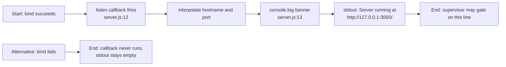

| Element | Value |
|---|---|
| Start point | A completed bind |
| Decision point | None; the callback runs if and only if the bind succeeded |
| Error state | Absence of the line is the negative signal — no error text is written to stdout |
| End points | Banner visible; or empty stdout |
| Cross-reference | [Section 2.1.3](#213-f-002--startup-readiness-signal) |

### 4.8.3 F-003 Uniform Response Contract

The contract is three assignments. Order matters only in that headers must be set before the body is ended.

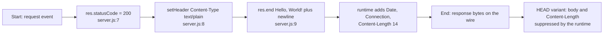

| Element | Value |
|---|---|
| Start point | `'request'` event emitted by the parser |
| Decision point | None — the same three values for every request |
| Error state | None reachable; the only variance is the runtime's method handling |
| End points | Response written, or a partial response if the peer disconnects mid-write |
| Cross-reference | [Section 2.1.4](#214-f-003--uniform-response-contract) |

### 4.8.4 F-004 Request-Agnostic Handling

Insensitivity is structural: the handler's first parameter is declared and never referenced, so no request attribute can reach a decision.

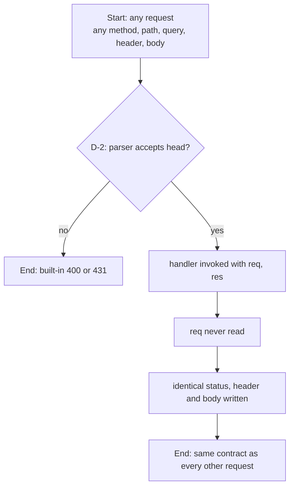

| Element | Value |
|---|---|
| Start point | Any well-formed or malformed request |
| Decision point | D-2 only — a runtime decision that precedes the handler |
| Error state | Rejections happen before the handler; the handler has none |
| End points | Identical contract, or a parser rejection |
| Cross-reference | [Section 2.1.5](#215-f-004--request-agnostic-handling) |

### 4.8.5 F-005 Dependency-Free Installation and Packaging

Setup has three entry commands and three different outcomes, only one of which leads to a running service.

```mermaid
flowchart TD
    A["Start: setup on a fresh host"] --> B{"Which command?"}
    B -->|"npm install"| C["read package.json and lockfile"]
    C --> D{"any package to resolve?"}
    D -->|no| E["no-op, exit 0,<br/>nothing written to disk"]
    E --> F["service launchable with node server.js"]
    B -->|"node ."| G["main names absent index.js"]
    G --> H["End: MODULE_NOT_FOUND, exit 1"]
    B -->|"npm test"| I["placeholder test script<br/>package.json:7-8"]
    I --> J["End: Error: no test specified, exit 1"]
    F --> K["End: environment prepared"]
```

| Element | Value |
|---|---|
| Start point | A host with a Node.js runtime and the checkout |
| Decision points | Command choice; whether any package resolves |
| Error states | Wrong launch command; the deliberate failing test script |
| End points | Prepared environment; or a failed command |
| Cross-reference | [Section 2.1.6](#216-f-005--dependency-free-installation-and-packaging), [Section 3.6.1](#361-development-tooling-and-build-system) |

### 4.8.6 F-006 Fixture Immutability and Branch Reproducibility

This flow is a governance check rather than a runtime path, and it is the only flow whose steps occur entirely outside the process.

```mermaid
flowchart TD
    A["Start: a change is proposed"] --> B{"targets one of the four<br/>tracked files?"}
    B -->|no| C["End: nothing in the contract is affected"]
    B -->|yes| D{"touches one of the five<br/>contract literals?"}
    D -->|"host, port, status, media type, body"| E["comparability broken"]
    E --> F["every previously recorded expectation is invalid"]
    F --> G["End: re-baseline on all consumers"]
    D -->|"no, e.g. a comment or metadata"| H["behaviour unchanged but the commit differs"]
    H --> I["branches no longer identical blob for blob"]
    I --> J["End: workload equality must be re-verified"]
```

| Element | Value |
|---|---|
| Start point | Any proposed change to the repository |
| Decision points | Whether a tracked file is involved; whether a contract literal moves |
| Error state | A moved literal destroys the fixture's purpose and nothing detects it automatically |
| End points | No effect; re-baselining required; or branch equality to be re-verified |
| Cross-reference | [Section 2.1.7](#217-f-006--fixture-immutability-and-branch-reproducibility) |


## 4.9 References

- `server.js` (14 lines, 342 bytes) — the whole runtime: `require('http')` at line 1, `hostname` and `port` constants at lines 3–4, `http.createServer` with the inline handler at line 6, `res.statusCode = 200` at line 7, `setHeader('Content-Type', 'text/plain')` at line 8, `res.end('Hello, World!\n')` at line 9, `server.listen(port, hostname, callback)` at line 12 and the readiness banner at line 13. Establishes every process step and decision point in this section.
- `package.json` (10 lines, 251 bytes) — name `hello_world`, version `1.0.0`, `main: index.js` (absent), placeholder `test` script at lines 7–8, author `hxu`, MIT licence, no dependency block. Establishes the launch contract and the absence of any test gate.
- `package-lock.json` (13 lines, 247 bytes) — `lockfileVersion` 3 with a single root `""` entry and zero resolved packages. Establishes that installation resolves nothing and that no supply-chain step exists in the setup flow.
- `README.md` (2 lines, 73 bytes) — title `hao-backprop-test` and the statement "test project for backprop integration. Do not touch!". Establishes the purpose of the fixture and the immutability rule behind workflow W-3 and feature F-006.
- Repository root `/` — contains exactly the four tracked files above, no sub-folders, no `.github` directory, no container or infrastructure artefact, and no `.blitzyignore`; git history is the single commit `46cc595` on `main`, `QA-23-nov-branch` and `origin/QA-19-nov-branch`.
- [web] Node.js v22 `http` documentation — https://nodejs.org/docs/latest-v22.x/api/http.html — confirmed the default values the application never overrides: `headersTimeout` 60 000 ms, `requestTimeout` 300 000 ms, `keepAliveTimeout` 5 000 ms (with the `keepAliveTimeoutBuffer` added in v22.19.0), `maxHeadersCount` 2 000 and `maxHeaderSize` 16 384 bytes; and that with no `'clientError'` listener the server answers `400 Bad Request`, or `431 Request Header Fields Too Large` on header overflow, then closes the socket.
- [web] Node.js v22 command-line documentation — https://nodejs.org/docs/latest-v22.x/api/cli.html — confirmed `--max-http-header-size` defaults to 16 KiB.
- [web] Node.js v22 error codes — https://nodejs.org/docs/latest-v22.x/api/errors.html — confirmed `HPE_HEADER_OVERFLOW` aborts parsing before a request object is created, which is why the handler never sees an oversized request.
- [web] Node.js v18.0.0 release notes — https://nodejs.org/en/blog/release/v18.0.0 — confirmed `requestTimeout` gained its 300 s default in that release, relevant because no `engines` field pins a version.


# 5. System Architecture

## 5.1 High-Level Architecture

### 5.1.1 System Overview

**Architecture style.** The system is a single-tier, single-process, stateless HTTP responder written as one CommonJS script. There is no application framework, no middleware chain, no routing table, no service layer, no data-access layer and no configuration layer. `server.js` performs five actions in sequence at module load: import the built-in `http` module, declare two module-scoped constants, create a server with an inline request handler, bind the port, and log a readiness line from the listen callback. Sixteen lines of source, one import statement and zero third-party packages constitute the entire runtime architecture; the four tracked files total 39 lines.

**Rationale.** The repository's stated purpose, in `README.md`, is to be a "test project for backprop integration" with the instruction "Do not touch!". That purpose selects the style. A fixture consumed by an external integration pipeline needs a byte-stable response, a dependency surface that cannot drift, a startup that needs no configuration, and no state that could make one run differ from the next. A monolith of one file satisfies all four at the lowest possible cost, and the alternative styles — layered application, microservices, serverless handlers — would each add artifacts (config, dependency graphs, deployment units) that change without any change in required behaviour. Evolvability, extensibility and separation of concerns were traded away deliberately; per `README.md` they are out of scope, and all four git refs (`main`, `QA-19-nov-branch`, `QA-23-nov-branch`, `origin/QA-19-nov-branch`) point at the identical commit `46cc595`, which confirms the code has never diverged.

**Architectural principles.** The following principles are observable in the code rather than declared:

- **Single built-in dependency.** `server.js` contains exactly one statement that reaches outside the file, `require('http')`, a Node.js core module. `package-lock.json` resolves no external package, so no install step can fetch, fail or drift.
- **Configuration as source literals.** `hostname = '127.0.0.1'` and `port = 3000` are module-scoped `const` declarations; no `process.env` access exists anywhere, so behaviour is fixed at author time, not at deploy time.
- **Request-agnostic handler.** The handler signature is `(req, res)` but `req` is never read. Method, path, query string, headers and body are all ignored, which makes the response contract idempotent and trivially verifiable.
- **No external state.** No database, cache, file read/write, message broker or outbound network call exists; all state is the resident listening socket plus in-memory transport buffers.
- **Loopback-only exposure.** Binding to `127.0.0.1` rather than `0.0.0.0` makes the listener unreachable from other hosts, which is the system's only access-control mechanism.
- **Homogeneous artifacts.** Packaging metadata declares the service `hello_world` 1.0.0 under MIT, and no build, transpile or bundle step stands between source and process.

**System boundaries and major interfaces.** The trust and process boundary is the operating-system process running `node server.js`. Four interfaces cross it:

| Interface | Direction | Contract |
|---|---|---|
| HTTP/1.1 over TCP on `127.0.0.1:3000` | Inbound, synchronous | Every request, whatever its method, path or body, returns `200` with `Content-Type: text/plain` and the 14-byte body `Hello, World!\n` |
| Process lifecycle (`node server.js`) | Inbound, operational | Started by a shell, supervisor or pipeline step; terminates on signal; exit status visible to the parent |
| Standard output | Outbound, operational | Exactly one line, `Server running at http://127.0.0.1:3000/`, emitted from the listen callback |
| npm package metadata | Inbound, packaging | `package.json` and `package-lock.json` describe identity, a non-existent `main` of `index.js`, and a placeholder `test` script |

There is no administrative interface: no health or readiness endpoint, no metrics endpoint, no shutdown hook, no configuration file, and no persistent log. Observability therefore exists only through the process's stdout and exit status.

The deployment and component boundary is small enough to state exhaustively:

```mermaid
flowchart TB
    Consumer["HTTP consumer<br/>QA probe or pipeline step<br/>must run on the same host"]
    subgraph Host["Host machine (loopback only)"]
        subgraph Proc["node server.js — one OS process"]
            Socket["Listening socket<br/>lib/net, 127.0.0.1:3000"]
            Parser["HTTP request parser<br/>lib/http"]
            Handler["Inline handler<br/>(req, res) =&gt; 200, text/plain,<br/>Hello, World! + LF"]
            Banner["Listen callback<br/>console.log readiness"]
        end
    end
    Runtime["Node.js runtime<br/>observed v22.23.5 / npm 11.21.0<br/>host-provided, no engines pin"]
    Consumer -->|"request bytes"| Socket
    Socket --> Parser
    Parser --> Handler
    Handler -->|"200, 14-byte body"| Consumer
    Runtime -.->|"supplies http + net"| Parser
    Banner -.->|"stdout line"| Consumer
```

### 5.1.2 Core Components Table

The component inventory contains four repository artifacts plus one external runtime. The five requested attributes are presented as two tables so that neither exceeds four columns.

| Component Name | Primary Responsibility | Key Dependencies | Integration Points |
|---|---|---|---|
| HTTP service (`server.js`) | Create the server, bind `127.0.0.1:3000`, answer every request with the fixed `200` / `text/plain` response, emit the readiness line | Node.js core `http` (and its transitive `net`); process stdout | Inbound TCP on loopback; launched as `node server.js`; stdout read by supervisor or pipeline |
| Package manifest (`package.json`) | Declare identity (`hello_world` 1.0.0, MIT, author `hxu`), entry point (`main: index.js`), script set (`test` only) and the empty dependency set | npm CLI conventions; no package resolution | Read by `node .` and by `npm run`; `main` failure path; `npm test` |
| Lockfile (`package-lock.json`) | Pin the dependency graph, which is a single root `""` entry resolving no external package | npm lockfile format v3 metadata | Consumed by `npm install` / `npm ci`; guarantees an empty install |
| Project notice (`README.md`) | State the repository's purpose (backprop integration fixture) and the do-not-modify directive | None; documentation only | Human and agent readers; not executed or parsed |
| Node.js runtime (external) | Supply the event loop, HTTP parser, socket I/O and CommonJS loader | Host-provided Node.js binary | Process invocation; behaviour of every HTTP detail below the application |

| Component Name | Critical Considerations |
|---|---|
| HTTP service (`server.js`) | The response literals are the integration contract and must not change. No `'error'` listener exists, so a bind failure such as `EADDRINUSE` becomes an unhandled `'error'` event that kills the process with exit code 1; only one instance per host can run. No `try`/`catch` around the handler. |
| Package manifest (`package.json`) | `main: index.js` points at a file that does not exist, so `node .` and `require('./')` fail and `node server.js` is the only working entry point. The `test` script ends in `exit 1`, so `npm test` can never pass. No `engines` field, so no runtime version is enforced. |
| Lockfile (`package-lock.json`) | An empty dependency graph eliminates supply-chain risk and network access at install time, but also means the system has no library capability to build on. |
| Project notice (`README.md`) | "Do not touch!" is an architectural change-control constraint: any redesign must be justified against a deliberately frozen workload. |
| Node.js runtime (external) | Wire-level details not set by the code — reason phrases, header casing and order, `Connection: keep-alive` with `Keep-Alive: timeout=5`, `Date`, and `Content-Length: 14` computed by the runtime — derive from Node.js defaults, so a runtime upgrade can alter observed response headers without any source change. |

### 5.1.3 Data Flow Description

**Startup flow.** Module load evaluates `require('http')`, the two constant declarations, and `http.createServer(handler)`, then `server.listen(port, hostname, callback)` claims the TCP port on the loopback interface and registers the callback; the callback writes one line to stdout. Nothing else executes during startup: there is no configuration parse, no dependency injection, no connection pool warm-up, no migration and no readiness gate beyond the appearance of that line. The listening socket keeps the event loop alive, so the process remains resident until it is signalled.

**Request flow.** A request is handled in one synchronous pass with no I/O of any kind:

1. **Transport ingress.** The client connects to `127.0.0.1:3000`. The OS loopback stack accepts the connection and Node's `net` layer presents the bytes to the HTTP server.
2. **Parse and dispatch.** The HTTP parser extracts the request line and headers, buffers any body, and calls the handler with `(req, res)`. The `req` object is discarded without inspection, which is the reason path, query string, headers, body and verb cannot influence the outcome.
3. **Handler execution.** Three assignments produce the response: `res.statusCode = 200`, `res.setHeader('Content-Type', 'text/plain')`, `res.end('Hello, World!\n')`.
4. **Serialization.** `res.end` causes the runtime to write the status line, the explicit `Content-Type`, a generated `Date`, a computed `Content-Length: 14`, and the connection-management headers. The 14-byte body follows.
5. **Connection reuse.** The socket stays open for a subsequent request until the client closes it or the keep-alive idle timeout elapses; the connection is never closed by application logic.

```mermaid
flowchart LR
    A["Request bytes<br/>any method, path, query, body"] --> B["TCP accept<br/>127.0.0.1:3000"]
    B --> C["HTTP parse<br/>request line + headers + body"]
    C --> D["Handler invocation<br/>req never read"]
    D --> E["Response assembly<br/>200 + Content-Type text/plain"]
    E --> F["Runtime serialization<br/>Date, Content-Length 14, keep-alive"]
    F --> G["14-byte body<br/>Hello, World! + LF"]
    G --> H["Socket retained<br/>keep-alive idle timeout"]
```

**Transformation points.** There is exactly one: the application writes three literal values and the runtime turns them into wire bytes. No validation, normalisation, enrichment, aggregation, encoding conversion, serialization format (JSON, XML, protobuf) or templating exists anywhere in the flow. Consequently there is no place where malformed input can be rejected, and equally no place where malformed input can corrupt state.

**Data stores and caches.** None. No database driver, no cache client, no file handles, no environment or secret store, and no in-process cache: the handler keeps no variables between requests, so the same response is recomputed from constants on every call. The only durable artifact in the system is source text held by git; the only runtime state is the socket buffer and the listening socket itself. Storage architecture, then, is an explicit "no persistence" decision rather than a deferred one.

### 5.1.4 External Integration Points

The system originates no outbound traffic; every integration point is either inbound to the process or a host-level dependency. Two tables separate the protocol view from the service-level expectations, keeping each within four columns.

| System Name | Integration Type | Data Exchange Pattern | Protocol / Format |
|---|---|---|---|
| QA probe or pipeline step (same host) | Inbound synchronous HTTP client | Request/response, one fixed reply per request; request content ignored | HTTP/1.1 over TCP on `127.0.0.1:3000`; `text/plain`; 14-byte body |
| Process supervisor or pipeline runner | Inbound process lifecycle | Spawn once, read stdout until the readiness line, terminate on completion | POSIX process model; stdout text; exit status |
| Node.js runtime | Host-level runtime dependency | In-process API call (`require('http')`), no network exchange | CommonJS module system; observed v22.23.5 |
| OS loopback network stack | Host-level network dependency | Local socket accept and buffering only; no routing or egress | TCP/IP on the `lo` interface |

| System Name | SLA Requirements |
|---|---|
| QA probe or pipeline step | None stated in the repository. Observable behaviour: responses are produced synchronously from constants, so per-request latency is bounded by socket and parser work alone. No timeout, rate limit or concurrency target is defined. |
| Process supervisor or pipeline runner | None stated. Readiness is the stdout line `Server running at http://127.0.0.1:3000/`; no restart policy, backoff or health-check interval is declared, and a second instance on the same host fails immediately with `EADDRINUSE`. |
| Node.js runtime | None stated. No `engines` field constrains the version, so the only guard on runtime behaviour is the host's provisioned image. |
| npm registry | Not used. Zero external packages are resolved, so `npm install` reports "up to date" without network access and the system is installable in air-gapped environments. |

**Scope of these guarantees.** No latency, throughput, availability, retention or recovery objective appears anywhere in the four tracked files. The integration contract is a correctness contract — exact body, status and media type — not a performance one, and it holds only for a consumer running on the same host as the process.


## 5.2 Component Details

### 5.2.1 HTTP Service Component (`server.js`)

**Purpose and responsibilities.** `server.js` is the application. It holds the entire runtime behaviour of the system: it imports `http`, declares the network identity (`hostname = '127.0.0.1'`, `port = 3000`), constructs the server around an inline arrow handler, binds the socket, and logs readiness. The handler assigns `res.statusCode = 200`, sets `Content-Type: text/plain`, and ends the response with `'Hello, World!\n'`. The component exports nothing — no module interface, no factory, no class — so it can only be used by executing it as a process entry point.

**Technologies and frameworks.** CommonJS on Node.js with a single core-module import. No web framework (Express, Fastify, Koa), no middleware, no logger, no configuration library, no template engine and no test harness. The handler is an arrow function with two parameters of which only `res` is used.

**Key interfaces and APIs.**

| Interface | Shape | Behaviour |
|---|---|---|
| Inbound HTTP | `http.createServer(handler)` bound via `server.listen(port, hostname, callback)` | Accepts any method, path, query and body; replies identically every time |
| Response contract | `statusCode = 200`; header `Content-Type: text/plain`; body `'Hello, World!\n'` | Verified live: `Content-Length: 14`, `Connection: keep-alive`, `Keep-Alive: timeout=5`, a runtime-generated `Date` |
| Process contract | Executed as `node server.js`; one stdout line on readiness | `Server running at http://127.0.0.1:3000/`; termination only by signal, with no shutdown or drain logic |
| Module surface | None | No `module.exports`; nothing can be imported from this file |

**Data persistence requirements.** None. The component opens no file, holds no request-scoped or application-scoped state, and writes nothing but stdout. Restarting it produces an identical process with no recovery or replay step, which is why the system has no durability concerns and equally no ability to remember anything.

**Scaling considerations.** The component is a single process bound to a fixed loopback address and fixed port, with no `cluster`, `worker_threads`, socket-option or backlog configuration. Consequences:

- **One instance per host.** A second launch fails on bind with `listen EADDRINUSE: address already in use 127.0.0.1:3000`, surfaced as an unhandled `'error'` event that terminates the process with exit code 1 while the first instance keeps serving.
- **No horizontal reach.** Because the bind address is a literal `127.0.0.1`, the service cannot be reached from another host even if a container or VM is scaled out; the address would have to change, which `README.md` forbids.
- **Vertical headroom is ample but unused.** Each request performs constant work with no I/O, so throughput is bounded by the single event loop, the kernel accept queue and the client's concurrency rather than by application logic. No benchmark, limit or capacity figure exists in the repository.

**Process state transitions.** The component's lifecycle has no application-defined states beyond those that the listen call creates, and no graceful path out of a bind failure:

```mermaid
stateDiagram-v2
    [*] --> ModuleEvaluation
    ModuleEvaluation --> ServerCreated: require http, constants declared
    ServerCreated --> Listening: server.listen 3000 on 127.0.0.1
    ServerCreated --> BindFailed: port already in use
    BindFailed --> [*]: unhandled error event, exit code 1
    Listening --> Listening: listen callback logs readiness line
    Listening --> Serving: request accepted
    Serving --> Listening: res.end completes, socket kept alive
    Listening --> Terminated: SIGTERM or SIGINT
    Terminated --> [*]
```

### 5.2.2 Packaging Components (`package.json`, `package-lock.json`)

**Purpose and responsibilities.** The two metadata files define the artifact's identity and dependency graph. `package.json` declares name `hello_world`, version `1.0.0`, description "Hello world in Node.js", license MIT, author `hxu`, `main: index.js`, and a `scripts.test` entry of `echo "Error: no test specified" && exit 1`. `package-lock.json` records `lockfileVersion` 3 with a single `""` package entry repeating the root name, version and license, and resolves no external package.

**Technologies and interfaces.** npm conventions only, consumed by the `node` and `npm` CLIs. Neither file is read at runtime by `server.js`.

**Behaviour and data persistence.** Both files are static text; they persist no state. Their behavioural effects were verified directly:

- `node .` fails because `main` names `index.js`, a file absent from every branch: `Error: Cannot find module '.../index.js'. Please verify that the package.json has a valid "main" entry`. `node server.js` is therefore the only working entry point.
- `npm test` always fails by design, printing `Error: no test specified` and exiting 1, so the project has no automated verification gate.
- `npm install --dry-run` reports `up to date`, and no `node_modules` directory exists, confirming an empty dependency graph and an install step that needs no network.

**Scaling and operability considerations.** There is no `engines` field, so no runtime version is pinned and the deployed Node.js version is whatever the host provides — a portability gain but a determinism loss, since the observed response headers derive from runtime defaults. There is no `exports`, `files`, `private` or `type` field: the package is not published-ready and its CommonJS default is relied upon implicitly. `README.md` sits outside both files and is not referenced by them, so the repository's stated purpose and do-not-modify constraint are documented but unenforced.

### 5.2.3 Node.js Runtime and Host Environment Component

**Purpose and responsibilities.** The runtime is the only external component the architecture depends on. It supplies the event loop, the HTTP parser, TCP socket handling, the CommonJS loader and the response serialization that produces `Content-Length`, `Date` and keep-alive headers. It is provisioned by the host, not the repository.

**Technologies and versions.** Observed toolchain in the working environment: Node.js v22.23.5, npm 11.21.0. No `engines` constraint, no `.nvmrc`, no Dockerfile, no CI workflow and no version manifest of any kind exists in the repository, so these versions describe a sample environment rather than a requirement.

**Key interfaces and persistence.** The runtime offers the process its single API surface: the `http` core module at line 1 of `server.js`. The runtime holds no durable state; it is replaced wholesale on each launch.

**Scaling considerations.** The host's network stack and Node.js defaults constrain the deployment: the loopback interface limits reachability to the same host, the OS demultiplexes the fixed port to one listener, and the runtime's default keep-alive idle timeout governs how long a client socket is reused (observed as `Keep-Alive: timeout=5`). Because the contract depends on those defaults rather than on explicit configuration, a runtime upgrade can change wire details without a source change — the principal compatibility risk in the whole architecture.

### 5.2.4 Component Interaction and Sequence Diagrams

**Component interaction.** The interaction graph is a single inbound path with one outbound side channel for readiness. No component calls another repository component; the packaging files influence the process only before it starts, and the README influences only readers.

```mermaid
flowchart LR
    Client["HTTP consumer<br/>same host"]
    subgraph Process["node server.js process"]
        Socket["Listening socket<br/>127.0.0.1:3000"]
        Server["http.Server<br/>request parser"]
        Handler["Inline handler<br/>statusCode, setHeader, end"]
        Banner["Listen callback"]
    end
    Stdout["stdout"]
    Runtime["Node.js runtime<br/>event loop, libuv"]
    Pkg["package.json / package-lock.json"]
    Client -->|"TCP connect + request bytes"| Socket
    Socket --> Server
    Server -->|"handler(req, res)"| Handler
    Handler -->|"res.end('Hello, World!')"| Server
    Server -->|"serialized response"| Socket
    Socket -->|"200, text/plain, 14 bytes"| Client
    Runtime -.->|"event loop, timers, I/O"| Server
    Banner -.->|"readiness line"| Stdout
    Pkg -.->|"entry point + scripts"| Process
```

**Sequence: startup and readiness.** The only observable startup signal is one stdout line, which is what a pipeline step or supervisor must wait for.

```mermaid
sequenceDiagram
    participant Runner as Pipeline runner / supervisor
    participant Node as node server.js
    participant Host as Host loopback stack
    participant Out as stdout
    Runner->>Node: spawn "node server.js"
    Node->>Node: require('http'), declare hostname and port
    Node->>Node: http.createServer(handler)
    Node->>Host: server.listen(3000, '127.0.0.1')
    Host-->>Node: socket bound
    Node->>Out: "Server running at http://127.0.0.1:3000/"
    Runner->>Runner: readiness inferred from stdout line
```

**Sequence: request handling with keep-alive.** Two consecutive requests on one socket demonstrate both idempotence and connection reuse; the handler never inspects `req`.

```mermaid
sequenceDiagram
    participant C as HTTP client (same host)
    participant N as Node.js process
    participant H as Inline handler
    C->>N: POST /any/path?x=1 with body
    N->>H: handler(req, res) - req unread
    H->>H: res.statusCode = 200
    H->>H: res.setHeader('Content-Type', 'text/plain')
    H->>N: res.end('Hello, World!\n')
    N-->>C: 200 OK, text/plain, Content-Length 14, keep-alive
    C->>N: GET /second on same socket
    N-->>C: identical 200 OK response
    Note over C,N: socket closes on client close or idle keep-alive timeout
```

**Sequence: bind conflict.** The failure mode is abrupt and leaves no cleanup path, which matters to any supervisor that assumes health checks.

```mermaid
sequenceDiagram
    participant R as Runner / supervisor
    participant A as Instance A (serving)
    participant B as Instance B (second launch)
    R->>A: node server.js
    A-->>R: readiness line, begins serving
    R->>B: node server.js
    B->>B: listen -> EADDRINUSE on 127.0.0.1:3000
    B-->>R: unhandled 'error' stack trace, exit code 1
    A-->>R: continues returning 200 throughout
```


## 5.3 Technical Decisions

### 5.3.1 Architecture Style Decisions and Tradeoffs

The repository contains no decision log, so every decision below is reconstructed from the code and from `README.md`; each is stated as the choice the code embodies, with the alternative it displaced and the tradeoff it accepted.

| Decision | Chosen Approach | Alternative Rejected | Tradeoff Accepted |
|---|---|---|---|
| Application structure | Single-file monolith: `server.js` holds import, configuration, server creation and handler | Layered application, module split, microservices | No separation of concerns, no unit-testable units, no reuse; in exchange, zero wiring, zero build step and a contract visible in sixteen lines |
| Dependency footprint | One core module (`http`); empty lockfile | Express or another framework for routing and middleware | No ecosystem leverage, no request parsing utilities, no middleware for logging or security headers; in exchange, no install step, no supply-chain surface and no version drift |
| Configuration source | Module-scoped `const` literals for host and port; no `process.env` | Environment variables, config file, CLI flags, secrets manager | No deployment-time flexibility and no way to run two instances or a second port without editing code; in exchange, byte-identical behaviour on every run and environment |
| Code evolution | Frozen by `README.md` ("Do not touch!"); all four git refs identical at commit `46cc595` | Active development with branching and review | No defect fixes, no tests, no refactoring; in exchange, the integration pipeline consumes an unchanging workload |

The style is therefore a deliberate fit-for-purpose choice rather than an unfinished design: the objective function is reproducibility of a fixed HTTP contract, and every traded-away attribute — modularity, configurability, extensibility — is one that would introduce variation without changing the required behaviour.

### 5.3.2 Communication Pattern Choices

**Synchronous request/response over HTTP/1.1.** The system exposes exactly one interaction pattern: an inbound request answered inline. There is no publish/subscribe, no queue, no webhook, no callback, no streaming, no long-polling and no server push. The handler completes within the same tick by calling `res.end`, so a response can never be partial or deferred.

**Request insensitivity as an integration strategy.** Choosing not to read `req` turns the HTTP surface into a constant function: any method, path, query string, header set or body produces the same reply, verified for `GET /`, `POST /` with a body, `GET /deep/path?x=1` and `HEAD /`. For an integration probe this removes an entire class of coupling — the caller need not know a route, a verb or a payload schema — at the cost of having no meaningful API semantics, no resource model and no error signalling.

**Plain text rather than a structured format.** The body `Hello, World!\n` with `Content-Type: text/plain` avoids any schema, serializer or version negotiation. JSON, XML or protobuf would each add a parsing dependency and a schema-evolution concern that a constant 14-byte payload does not need.

**Connection reuse by runtime default.** Persistent connections come free from Node.js: the observed `Connection: keep-alive` and `Keep-Alive: timeout=5` are runtime defaults, not code. The application sets no `Connection`, `Cache-Control`, `ETag`, `Vary` or `Server` header, so all connection and caching semantics are inherited rather than designed.

### 5.3.3 Data Storage Solution Rationale

There is no data store, and this is an architectural decision rather than an omission. The request path performs no reads or writes: no database driver is imported, no file is opened, no environment or secret store is consulted, and no in-memory collection survives a request. Three properties follow, and they are the reasons the decision is defensible here:

- **Determinism.** With no state to read, the response cannot depend on prior requests, on data volume, or on the order in which the pipeline reaches the service.
- **Zero operational surface.** No schema, migration, backup, credential, connection pool or replication concern exists, which is why the system can be launched with `node server.js` and nothing else.
- **Zero persistence requirement.** Restart is indistinguishable from first start. Nothing needs recovery, so no recovery objective can be missed.

The cost is proportional: the system cannot record anything, cannot answer anything but its one constant, and could not be extended to a stateful use case without introducing storage, configuration and lifecycle concerns that `README.md` forbids. Storage scope for this repository is treated alongside the broader technology inventory in section 3.5, Databases & Storage.

### 5.3.4 Caching Strategy Justification

No cache exists at any layer of the application. There is no in-process memoisation, no external cache client, no reverse proxy, no CDN and no cache-control header. The justification is economic rather than principled: the handler recomputes a constant from literals at negligible cost, so a cache would add a lookup and an invalidation concern to save work that costs nothing.

Two caching-adjacent behaviours do exist implicitly:

| Layer | Behaviour | Origin |
|---|---|---|
| Connection reuse | Sockets stay open and serve multiple requests until the client closes or the idle timeout (5s) elapses | Node.js `keepAliveTimeout` default; observed in the `Keep-Alive` header |
| Client-side caching | Unspecified. The response carries no `Cache-Control`, `Expires`, `ETag` or `Last-Modified`, so a client or intermediary may apply heuristic caching | Absence of any caching header in the handler |

Any consumer that requires a guaranteed fresh response must therefore send its own cache-busting header; the service makes no promise either way. For a conformance probe that compares a fixed body, heuristic caching is harmless because fresh and stale values are identical.

### 5.3.5 Security Mechanism Selection

Security in this system is achieved by topology and absence rather than by mechanism. The single control is the loopback bind: `server.listen(3000, '127.0.0.1')` makes the listener unreachable from any other host, confirmed by a connection refusal on `127.0.0.2:3000`. The trust boundary is therefore the host machine itself.

| Control Area | Implemented | Implication |
|---|---|---|
| Network exposure | Loopback-only bind; no `0.0.0.0`, no TLS, no reverse proxy | Remote exploitation requires host compromise first; equally, no remote consumer can ever be served |
| Authentication / authorization | None; no header, token, cookie or session inspection, since `req` is never read | Any local process, whatever its identity, receives the same response; there is no notion of a principal |
| Input handling | None; body and query are parsed by the runtime and discarded | No injection, deserialization or overflow risk in application code, and no validation obligation |
| Transport security | Plaintext HTTP/1.1 | Acceptable only because traffic never leaves the host's loopback interface |
| Secrets and configuration | None stored or read; no `.env`, no credentials in the repository | No secret-rotation or leakage surface |
| Supply chain | Zero external packages resolved by `package-lock.json` | No third-party vulnerability can reach the runtime; no dependency scanning is required |

The deliberate weakness is that the service is defenceless if the loopback boundary is ever removed: enabling remote access would require, in one change, a bind-address change plus authentication, authorization, transport encryption and request validation, none of which exist. Any such change also contradicts the do-not-modify directive in `README.md`.

### 5.3.6 Decision Tree and Architecture Decision Records

**Decision tree.** The tree below reconstructs how the observable architecture follows from the repository's stated purpose; each branch terminates in the choice the code actually makes.

```mermaid
flowchart TD
    Purpose{"Is the repository a fixed<br/>integration fixture per README?"}
    Purpose -->|"No"| OutOfScope["Out of scope for this system"]
    Purpose -->|"Yes"| Stable{"Must the workload stay<br/>identical on every run?"}
    Stable -->|"No"| Framework["A framework and config layer<br/>would be justified"]
    Stable -->|"Yes"| Deps["Zero third-party dependencies<br/>built-in http only"]
    Deps --> ConfigQ{"Is behaviour fixed<br/>at author time?"}
    ConfigQ -->|"No"| EnvConfig["Environment-driven configuration"]
    ConfigQ -->|"Yes"| Literals["Host and port as source literals<br/>127.0.0.1 and 3000"]
    Literals --> ReachQ{"Must any remote host<br/>connect?"}
    ReachQ -->|"Yes"| Public["Bind all interfaces plus<br/>TLS, authn and validation"]
    ReachQ -->|"No"| Loopback["Loopback-only bind,<br/>no authentication"]
    Loopback --> StateQ{"Does any request need<br/>prior state?"}
    StateQ -->|"Yes"| Persist["Add a database and a cache"]
    StateQ -->|"No"| Stateless["Stateless handler;<br/>no store, no cache"]
    Stateless --> OpsQ{"Is operational tooling<br/>part of the deliverable?"}
    OpsQ -->|"Yes"| Ops["Metrics, health endpoint,<br/>graceful shutdown"]
    OpsQ -->|"No"| Minimal["Single stdout readiness line,<br/>no error handling"]
```

**Architecture decision records.** These records are reconstructed from the code because no ADR files exist in the repository. All are treated as Accepted and frozen by the `README.md` directive.

| ID | Decision | Rationale | Consequence Accepted |
|---|---|---|---|
| ADR-001 | Single-file monolith with one core-module dependency | A fixed contract needs no abstraction; fewer moving parts means fewer ways for the workload to change | No modularity, no unit-testable units, no reuse |
| ADR-002 | Host and port as source literals instead of environment configuration | Eliminates deploy-time variation, so a run in one environment matches a run in another | One instance per host; no port override; no second environment |
| ADR-003 | Loopback-only bind with no authentication or TLS | Traffic never leaves the host, so transport and identity controls add cost without reducing exposure | No remote consumers; the service is defenceless if the bind address ever widens |
| ADR-004 | No data store and no cache | The response is a constant; state would only introduce nondeterminism and operational work | The system cannot record or vary anything |
| ADR-005 | Request-agnostic handler returning `text/plain` | Any caller can probe any path with any method, which is the simplest possible integration contract | No routing, no resource semantics, no structured representation, no error responses |
| ADR-006 | No `'error'` listener, no `try`/`catch`, no health endpoint, no shutdown hook | Nothing in the runtime can fail once the port is bound, so defensive scaffolding was judged unnecessary | A bind conflict kills the process with an unhandled `EADDRINUSE` and exit code 1; supervisors must infer health from the stdout line |


## 5.4 Cross-Cutting Concerns

### 5.4.1 Monitoring and Observability

Observability is limited to process-level signals. The application emits no metrics, exposes no health or readiness endpoint, and reports no request counts, latencies or error rates. Everything an operator can learn must come from outside the process.

| Signal | Available | Detail |
|---|---|---|
| Readiness announcement | Yes | One stdout line per launch: `Server running at http://127.0.0.1:3000/`, written from the listen callback |
| Process exit status | Yes | `0` on signal termination; `1` on a bind failure, printed with a Node.js stack trace on stderr |
| Request-level telemetry | No | No access log, no counters, no timers, no histogram; the handler records nothing |
| Health / readiness endpoint | No | Liveness can only be inferred by sending a real request and expecting `200` with the 14-byte body |
| Metrics or APM integration | No | No exporter, agent, OpenTelemetry SDK or profiling hook |

The practical consequence is that a supervisor's only reliable readiness test is the stdout line, and its only liveness test is an HTTP probe against the constant contract. Because the contract is a constant, a probe that returns `200` also cannot distinguish a healthy instance from a merely running one — there is no deeper state to be unhealthy.

### 5.4.2 Logging and Tracing

The system produces exactly one log record in its entire lifetime: the `console.log` in the `server.listen` callback. There is no logging library, no log level, no structured or JSON formatting, no timestamp beyond the runtime's, no correlation identifier, no request logging, and no log destination configuration — output goes to the process's stdout and persists only if a supervisor captures it.

Tracing is structurally unnecessary and also absent. The service makes no outbound call, so no trace context can be propagated, and it returns no trace or request identifier header. Diagnostic work therefore relies on reproducibility rather than on telemetry: given the same source, the same request produced from any caller yields the same 14-byte response, so a reported behaviour can be reproduced locally with a single `curl` and, if it involves startup, a single observation of the process's stdout and exit code.

### 5.4.3 Error Handling Patterns

The pattern is deliberate non-handling. `server.js` contains no `try`/`catch`, registers no `'error'` listener on the server or on sockets, defines no shutdown hook, and cannot return a non-`200` status: `res.statusCode = 200` is unconditional, so `4xx` and `5xx` are unreachable by any request, however malformed. Application-level errors therefore do not exist as a concept; only process-level failures do, and they follow Node.js defaults.

| Condition | Detection | Observed / Defined Behaviour | Recovery |
|---|---|---|---|
| Port 3000 already bound on the host | `listen` emits `'error'` (`EADDRINUSE`); no listener registered | Unhandled `'error'` event, stack trace on stderr, process exits with code 1; the existing instance keeps serving — verified live | None in-process; the operator must stop the conflicting instance. No retry or backoff exists |
| Invalid or unauthorised request content | Not detected; `req` is never read | Same `200` response as any other request | Not applicable |
| Exception inside the handler | No `try`/`catch` | Node.js default uncaught-exception path: stack trace, non-zero exit | Process restart by the supervisor |
| Client disconnects before the response is written | No socket or response error listener | Runtime default handling; no application cleanup or compensation | None required; the next request is unaffected |
| Resource exhaustion or dependency failure | Not possible in code — no files, no network egress, no external service | Not applicable | Not applicable |

```mermaid
flowchart TD
    Boot["Process start: node server.js"] --> Create["http.createServer(handler)"]
    Create --> Bind{"Port 127.0.0.1:3000 free?"}
    Bind -->|"No"| InUse["listen emits EADDRINUSE<br/>no error listener registered"]
    InUse --> Stack["Node.js default: stack trace to stderr"]
    Stack --> Exit1["Process exit code 1<br/>first instance unaffected"]
    Bind -->|"Yes"| Ready["Listening; readiness line to stdout"]
    Ready --> Req["Request received"]
    Req --> Handler["Handler runs: status 200,<br/>Content-Type text/plain, body"]
    Handler --> Flush["res.end flushes 14 bytes"]
    Flush --> Ready
    Req --> Abort{"Client disconnects early?"}
    Abort -->|"Yes, unhandled"| Default["Runtime default; no app cleanup"]
    Abort -->|"No"| Handler
    Default --> Ready
```

### 5.4.4 Authentication and Authorization

The system has no authentication and no authorization framework: no token, header, cookie, certificate, API key, session or client-identity check exists, because `req` is never inspected. There is no principal, no role model, no permission check, no audit record and no rate limit.

The sole access control is topological, established in 5.3.5: the bind address `127.0.0.1` restricts reachability to processes on the same host. Authorization is therefore all-or-nothing per host — any local process, whatever its user identity, receives the same response, and no remote client can reach the service at all. Adding an identity layer would be a redesign rather than a configuration change, since the handler would first have to begin reading the request.

### 5.4.5 Performance Requirements and SLAs

The repository states no latency, throughput, availability or concurrency target, and none is implied by its code. The measurable characteristics that do exist follow from the implementation and from Node.js defaults on the observed v22.23.5 runtime.

| Attribute | Repository Target | Observable Reality |
|---|---|---|
| Response latency | None stated | One synchronous pass with no I/O: parse, three assignments, `res.end`. Bounded by socket and parser work only |
| Throughput | None stated | Single event loop, constant per-request work; the ceiling is the host's accept rate, not application logic. No benchmark exists |
| Concurrency | None stated | `maxRequestsPerSocket` is unlimited (0); connections are limited only by host resources |
| Timeouts | None configured in code | Runtime defaults on v22.23.5: keep-alive idle 5000 ms (matches the observed `Keep-Alive: timeout=5`), header receipt 60000 ms, whole-request 300000 ms, socket inactivity timeout disabled |
| Availability | None stated | One process, one fixed port, one host, no restart policy and no second-instance capability; availability equals host and process availability |

Because the response is a constant, correctness SLAs are cheap to meet and easy to verify — exact status, media type and 14-byte body — while performance SLAs are simply undefined and should not be inferred from the repository.

### 5.4.6 Disaster Recovery and Operational Continuity

Continuity is trivial by construction, because there is nothing to lose. The system holds no state, so its recovery point objective is effectively zero and its recovery time objective is the time to launch the process and see the readiness line. Recovery is a restart: `node server.js`.

| Scenario | Impact | Recovery Procedure | Dependency |
|---|---|---|---|
| Process terminated (signal, crash, host reboot) | Service unavailable for the duration | Relaunch `node server.js` on the same host; readiness confirmed by the stdout line | Node.js runtime on the host |
| Port 3000 occupied by another instance | Second launch exits immediately with code 1 | No in-repo procedure; stop the occupying process or accept the first instance as the service | Host port allocation, which the code cannot override |
| Repository content lost | Source of the fixture lost | Re-clone from a git remote; all four refs are identical at commit `46cc595`, so any ref restores the same artifact | Git remote availability |
| Runtime upgraded on the host | Possible change in wire details (header defaults) | Re-run a conformance probe against the exact body, status and media type | Runtime version control, which the repository does not pin |
| Data loss | Not applicable | No durable state exists to restore, and no backup procedure is needed or defined | None |

There is no failover, no replica, no backup job, no DR runbook and no backup or restore test in the repository. Two structural constraints bound any recovery planning: the fixed loopback address and port prevent running a standby instance on the same host, and the `README.md` directive "Do not touch!" means recovery must be achieved operationally — relaunch, re-clone, pin the runtime on the host — rather than by changing the code.


## 5.5 References

- `server.js` - The entire application: `require('http')`, `hostname = '127.0.0.1'`, `port = 3000`, the inline `(req, res)` handler setting `statusCode = 200`, `Content-Type: text/plain` and `res.end('Hello, World!\n')`, and the `server.listen` callback that logs the readiness line. Established the single-dependency, stateless, loopback-only architecture, the absent error handling, and the source of every verbatim response literal.
- `package.json` - Identity `hello_world` 1.0.0, MIT license, author `hxu`, description "Hello world in Node.js"; `main: index.js` (a file that does not exist); `scripts.test` = `echo "Error: no test specified" && exit 1`; no `dependencies`, `devDependencies` or `engines` field. Established the broken `node .` entry point, the always-failing test gate, the empty dependency set and the unpinned runtime.
- `package-lock.json` - `lockfileVersion` 3 with a single root `""` entry and zero resolved packages. Established that the dependency graph is empty and that installation needs no network access.
- `README.md` - Title `# hao-backprop-test` and the statement "test project for backprop integration. Do not touch!". Established the repository's purpose, the do-not-modify constraint that underpins every architectural tradeoff in 5.3, and the fixture rationale for the architecture style.
- Repository root (working tree, git metadata) - Four tracked files totalling 39 lines; a single commit `46cc595` "Add files via upload"; refs `main`, `QA-19-nov-branch`, `QA-23-nov-branch` and their origin counterparts all identical, with empty diffs between them. Established the absence of CI, Docker, configuration, test or build artifacts of any kind, and the homogeneity of all branches.
- Runtime probes executed against `node server.js` on Node.js v22.23.5 / npm 11.21.0 - Verified `GET /`, `POST /` with a body, `GET /deep/path?x=1` and `HEAD /` all return `200` with `Content-Type: text/plain` (body `Hello, World!\n`, `Content-Length: 14`, `Connection: keep-alive`, `Keep-Alive: timeout=5`, generated `Date`); `127.0.0.2:3000` refused; a second instance died with unhandled `EADDRINUSE` and exit code 1 while the first kept serving; `node .` failed on the missing `index.js`; `npm test` exited 1; `npm install --dry-run` reported "up to date". Also established the untouched Node.js server defaults used in 5.4.5: keepAliveTimeout 5000 ms, headersTimeout 60000 ms, requestTimeout 300000 ms, socket timeout disabled, unlimited requests per socket.

No web sources were used; every statement in this section derives from the repository's four tracked files, its git metadata, or runtime observation of the code as committed.


# 6. SYSTEM COMPONENTS DESIGN

## 6.1 Core Services Architecture

### 6.1.1 Applicability Determination

**Core Services Architecture is not applicable for this system.**

The repository holds one CommonJS script executed as one operating-system process, listening on one loopback socket, answering every request with one constant byte string. Nothing in it can be deployed, scaled, versioned, discovered or failed independently of anything else, and it calls no other service. The three conditions that would make a core services architecture meaningful are each absent, and each absence is exhaustive rather than sampled: a text search of every one of the four tracked files (`server.js`, `package.json`, `package-lock.json`, `README.md` — 39 lines in total) returns zero matches for all 26 service-architecture terms searched, including `service`, `microservice`, `cluster`, `worker`, `load balanc`, `discovery`, `retry`, `fallback`, `circuit`, `health`, `metric`, `replica`, `failover`, `autoscal`, `queue`, `broker` and `cache`.

| Applicability condition | What it would require | What the repository contains | Verdict |
|---|---|---|---|
| Microservices | Two or more independently deployable units with separate ownership and release cadence | Exactly one deployable unit, `server.js`, run as `node server.js`; the repository has no sub-directories and no build, container or orchestration artifact | Not met |
| Distributed architecture | A network hop between components, with its own failure and consistency semantics | Zero outbound calls of any kind; a single inbound listener on `127.0.0.1:3000` (`server.js:3-4`, `server.js:12`); one import, `require('http')` (`server.js:1`) | Not met |
| Distinct service components | Separable responsibilities joined by interfaces | One inline arrow handler performs the entire request path — status, header, body (`server.js:6-10`); no module boundary exists, since the file exports nothing | Not met |

**What the architecture reduces to instead.** The only architectural boundary in the system is the process boundary itself. Inside it, Node.js supplies the HTTP parser, the TCP socket layer and response serialization; the application supplies three assignments and a 14-byte constant. `package.json` and `package-lock.json` influence the process only before it starts, and `README.md` influences only human readers (see 5.2.1–5.2.3). Consequently there is no seam along which the system could be divided: there is no distinct business domain, no independently owned data, and no component with a scaling profile different from any other.

**Why the absence is a design decision, not an omission.** `README.md` declares the repository a "test project for backprop integration" with the instruction "Do not touch!", and 5.1.1 records the rationale: a fixture consumed by an external pipeline needs a byte-stable response, a dependency surface that cannot drift, a startup that needs no configuration, and no state that makes one run differ from the next. Service decomposition would add artifacts — per-service manifests, ports, discovery records, health endpoints, deployment units — whose count grows while the required observable behaviour, one fixed `200` response, does not change. The negative finding is therefore permanent for this repository: extension is out of scope per `README.md` and 1.3.2.

**How the rest of this section reads.** Each requested area is documented below as an explicit negative record with its evidence, the mechanism that stands in its place, and the minimum change set that would make the area applicable. That format keeps the section authoritative for two readers at once: the operator who needs to know that no load balancer, retry policy or failover path exists to be configured, and the engineer who must judge what a redesign would cost. Related ground is owned elsewhere and cross-referenced rather than repeated: service structure and data flow in 5.1, component internals in 5.2, the error taxonomy, retry and fallback tables in 4.7, and observability, performance and continuity in 5.4.

The deployment boundary is small enough to state exhaustively. One host, one process, one socket, one outbound side channel for readiness:

**Figure 6.1-1 — Deployment boundary and the complete component topology.**

```mermaid
flowchart TB
    subgraph Host["Host machine — the entire deployment boundary"]
        Consumer["Consumer<br/>QA probe, curl or pipeline step<br/>must run on this host"]
        subgraph Proc["Single service process: node server.js"]
            Listener["TCP listener<br/>literal 127.0.0.1:3000"]
            Parser["HTTP parser<br/>supplied by Node.js"]
            Handler["Inline handler<br/>200, text/plain, constant body"]
            Banner["Listen callback<br/>one readiness line"]
        end
        Stdout["stdout stream"]
        Consumer -->|"HTTP/1.1 request, any method or path"| Listener
        Listener --> Parser
        Parser --> Handler
        Handler -->|"200, Content-Length 14, keep-alive"| Consumer
        Banner -.->|"Server running at http://127.0.0.1:3000/"| Stdout
    end
    Runtime["Node.js runtime, observed v22.23.5<br/>host-provisioned, not pinned by any engines field"]
    Runtime -.->|"supplies http, net, event loop"| Parser
```

There is no node in this topology with a peer. No second process, no sidecar, no proxy, no datastore, no broker and no external endpoint participates at runtime. That single fact is the reason every subsection below concludes with an absence.


### 6.1.2 Service Components

The system's service inventory has one row. That single row is the whole of the service-component model, so the requested component attributes — boundaries, communication, discovery, load balancing, circuit breaking, retry — are each answered against it.

| Service | Deployable unit | Bound address | Responsibility |
|---|---|---|---|
| `hello_world` HTTP responder | `server.js`, executed as `node server.js` | Literal `127.0.0.1:3000` (`server.js:3-4`) | Accept any request and reply `200`, `text/plain`, body `Hello, World!\n` (`server.js:6-10`); announce readiness once on stdout (`server.js:12-14`) |

Because the inventory holds one entry, there is no inter-service contract to version, no ownership split, no independent release cadence and no partial availability: the "service architecture" is the process lifecycle described in 5.2.1. The packaging metadata states a package identity (`hello_world` 1.0.0, MIT) but no service identity — no `main` that resolves, no `engines` pin, no deployment descriptor.

#### 6.1.2.1 Service Boundaries and Responsibilities

The service owns one responsibility and owns all of it: turn any inbound HTTP request into one fixed response, and signal readiness once. Responsibility for the request path is split three ways, and only the middle layer is application code:

| Layer | Responsibility | Provided by |
|---|---|---|
| Transport and protocol | Socket accept, request-line and header parsing, framing, keep-alive management, rejection of malformed requests (`400`, `431`) | Node.js `http`/`net` at runtime (5.2.3, 4.7.1) |
| Application | Set `statusCode = 200`, set `Content-Type: text/plain`, end the response with the constant body | The inline handler, `server.js:6-10` |
| Operational | Emit the readiness line; exit on signal or on a failed bind | The `listen` callback and Node.js defaults, `server.js:12-14` |

Cohesion is total and coupling to other repository components is zero: `server.js` imports only `http`, and no other tracked file is read at runtime. Two consequences follow for any decomposition attempt. First, there is no candidate split point — a boundary needs separable state or a separable scaling profile, and the service has neither. Second, the boundary that does exist is frozen by policy: `README.md` states "Do not touch!", so the component boundary is a change-control constraint rather than a design variable (1.3.2, 5.1.1).

The interface the boundary exposes is a correctness contract of four literals — `200`, `text/plain`, `Hello, World!\n`, and the address `127.0.0.1:3000`. Any of the five literals changing (including the hostname and port) is a breaking interface change, and no versioning mechanism exists to signal it.

#### 6.1.2.2 Inter-Service Communication Patterns

There is no inter-service communication, in either direction. The process originates nothing: no HTTP client, no outbound socket, no subprocess, no file and no DNS resolution appear in `server.js`, and the search for `queue`, `broker` and `message` across all tracked files returns zero matches. Every exchange the system participates in is inbound and initiated by a consumer on the same host.

| Pattern | Present | Evidence and substitute |
|---|---|---|
| Synchronous request/response over HTTP/1.1 on loopback | Yes — the only runtime exchange | `http.createServer` bound to `127.0.0.1:3000` (`server.js:6`, `server.js:12`) |
| Asynchronous messaging, events, pub/sub | No | Zero matches for `queue`, `broker`, `message`; no client library resolved by `package-lock.json` |
| RPC between services (gRPC, SOAP, custom) | No | No peer process exists to call |
| Outbound integration of any kind | No | Sole import is Node's `http` (`server.js:1`); no egress code path |
| Out-of-band one-way notification | Yes — stdout | One line, `Server running at http://127.0.0.1:3000/` (`server.js:13`); unacknowledged and unaddressed, consumed by whatever launched the process (5.4.1) |

The communication semantics are correspondingly thin: request content is never read, so no correlation, idempotency key, content negotiation, retry hint or back-pressure signal crosses the boundary in either direction. The response carries only what the runtime adds by default — `Content-Length: 14`, `Date`, and keep-alive headers (`Connection: keep-alive`, `Keep-Alive: timeout=5` on the observed v22.23.5 runtime, per 5.2.1 and 5.4.5). Those defaults, not application code, define the wire contract's edge cases, which is the principal compatibility risk of the whole system.

**Figure 6.1-2 — Service interaction diagram: one inbound path and one readiness side channel.**

```mermaid
flowchart LR
    subgraph Host["Host machine, loopback only"]
        Client["Consumer<br/>QA probe or pipeline step"]
        subgraph Svc["Single service process"]
            Sock["Listening socket<br/>127.0.0.1:3000"]
            Hdl["Inline handler<br/>three assignments, req unread"]
            Boot["Listen callback"]
        end
        Out["stdout"]
        Client -->|"request bytes, any method or path"| Sock
        Sock -->|"handler(req, res)"| Hdl
        Hdl -->|"200, text/plain, Hello World + LF"| Client
        Boot -.->|"readiness line at startup"| Out
    end
```

The diagram has no edge between two repository components, and no edge leaves the host: there is no inter-service interaction to draw.

#### 6.1.2.3 Service Discovery Mechanisms

No discovery mechanism exists. The role discovery normally plays — telling a consumer where a provider currently is — is performed by a source literal that both sides must be told out of band. `hostname = '127.0.0.1'` and `port = 3000` are module-scoped `const` declarations (`server.js:3-4`); neither is read from an environment variable, a config file, a registry or a DNS record, and no `process.env` access exists anywhere in the repository.

| Discovery concern | Conventional mechanism | What this system does |
|---|---|---|
| Provider address lookup | DNS, service registry, orchestrator API, sidecar | Compile-time literal in `server.js:3-4`; the consumer hardcodes `http://127.0.0.1:3000/` |
| Instance inventory | Registry watch, endpoints list, health-checked pool | One implicit instance per host; no list, no watch, no deregistration |
| Readiness detection | Health or readiness endpoint polled by the platform | One stdout line from the `listen` callback (`server.js:13`); no endpoint exists (5.4.1) |
| Runtime configuration | Environment injection, config map, flags | None; the address cannot be overridden without editing source |

Two operational properties follow. Relocation is impossible without a code change and a redeploy, because the address lives in source rather than in configuration. And the readiness signal is a log line rather than a probeable state, so a supervisor must gate on stdout appearance; a liveness test, in turn, can only be a real request against the constant contract, which cannot distinguish a healthy instance from a merely running one (5.4.1). Any discovery layer — DNS-based, registry-based or orchestrator-native — would have nothing to register and nothing to poll.

#### 6.1.2.4 Load Balancing Strategy

No load balancing exists at any layer: no reverse proxy, no L4/L7 distributor, no client-side balancer, no DNS round-robin, no `cluster` module, no `worker_threads`. What the system does provide is connection concurrency, not load distribution — the single event loop demultiplexes concurrent connections from the kernel accept queue, and the code sets no `backlog`, `maxConnections` or `maxRequestsPerSocket` value, so runtime and operating-system defaults apply.

| Balancing layer | Present | Consequence |
|---|---|---|
| L7 reverse proxy or API gateway | No | No routing, no TLS termination, no header policy, no upstream pool |
| L4 load balancer or VIP | No | Listener binds loopback (`server.js:3`), so no routable address exists for a balancer to target |
| Client-side balancing | No | The consumer addresses one literal endpoint |
| In-process distribution | No | Zero matches for `cluster` and `worker_threads`; one process, one event loop |

Two structural constraints make balancing unusable even if a balancer were introduced. The fixed port `3000` allows only one listener per host, so two instances on one host cannot coexist (the second exits with `EADDRINUSE`, per 5.2.1 and 4.7.1 E-1). The loopback bind makes instances on different hosts unreachable, so a balancer would have no healthy upstream to reach. Introducing balancing would therefore require a routable bind address, a parameterized port and a probeable readiness endpoint — three changes `README.md` expressly forbids.

#### 6.1.2.5 Circuit Breaker Patterns

No circuit breaker exists, and the pattern has no application surface here. Circuit breaking protects a caller from a failing callee by tripping after a failure threshold and short-circuiting further attempts; this process has zero callees, so no dependency failure can be observed, counted or tripped on.

| Circuit-breaker element | Present | Reason |
|---|---|---|
| Downstream call to protect | No | Sole import is `http` (`server.js:1`); no client, socket or subprocess is created |
| Failure counting or threshold | No | No counters, timers or state of any kind between requests; the handler holds no variables |
| Open / half-open state machine | No | No state machine exists; `res.statusCode = 200` is unconditional (`server.js:7`) |
| Timeout or fail-fast on a dependency | No | Zero matches for `setTimeout`; no `AbortController`, no request timeout configured in code |

The inbound side is equally unprotected: there is no admission control, rate limiting, concurrency cap, bulkhead or queue-length limit, so the only back-pressure is the kernel accept queue and TCP itself (see 6.1.4.5). Any breaker around this dependency must therefore live in the consumer — a pipeline step or probe — which is the only party that can observe failures and decide to stop calling (4.7.3).

#### 6.1.2.6 Retry and Fallback Mechanisms

Neither mechanism exists inside the process. `server.js` contains no loop, no attempt counter, no backoff, no `setTimeout` and no `try`/`catch`; a failure is reported once through the process's default path and never re-attempted from within. Fallback is likewise absent: there is a single response path, and the only alternate responder in the system is the runtime's built-in `400`/`431` reply, which answers requests the application never sees and is not application-controlled (4.7.4).

| Failure | Retry inside the process | Retry by the consumer or supervisor | Fallback available |
|---|---|---|---|
| Bind conflict, port 3000 held (E-1) | None — the process exits with code 1 | Relaunch after freeing the port; must be gated on the banner appearing, not on a fixed sleep (4.7.6) | No alternate port or interface is attempted |
| Malformed request rejected by the parser (E-3, E-4) | None | Correct the request and resend | Runtime `400`/`431` only; never the contract body |
| Probe returns an unexpected value | Not applicable — no request can fail at the application layer | Repeat the request | No cached or degraded answer exists |
| Signal-driven stop (E-7) | None; no shutdown hook or drain logic | Restart `node server.js` | Not needed; a restart loses nothing |
| Application exception | Unreachable — the handler performs three assignments on a response object | Not applicable | None defined |

Retry from outside is unusually safe here, and that safety is a property of the design rather than of a retry policy: because `req` is never read and no side effect exists, every request — including `POST` — is idempotent, so an arbitrary number of repeats produces the same 14-byte reply. The corresponding hazard is the opposite one: with no retry budget, no backoff and no failure counter inside the process, a supervisor that restarts blindly will loop forever on a port conflict without ever surfacing the cause on stdout.


### 6.1.3 Scalability Design

Scalability in this system is limited to what a single process on a single host can do, because the scale unit is the host itself: the address is a source literal, the port is fixed, and instance count is capped at one per host by the bind. The design is nevertheless built on the property that makes horizontal scaling easy — the process is stateless and side-effect free — so the constraint is configuration and topology, not correctness or data consistency. Each subsection below separates the property from the missing mechanism.

#### 6.1.3.1 Horizontal and Vertical Scaling

| Scaling axis | Available today | Blocking constraint (evidence) |
|---|---|---|
| Horizontal across hosts | No | Bind address is the literal `127.0.0.1` (`server.js:3`), so a replica on another host is unreachable from any other host; no balancer or discovery record could route to it |
| Horizontal within a host | No | Port `3000` is a literal (`server.js:4`); a second listener on the same host fails with `EADDRINUSE` and exits 1 (5.2.1, 4.7.1) |
| In-process parallelism | No | Zero matches for `cluster` and `worker_threads`; request handling runs on one event loop |
| Vertical, CPU | Wasted | JavaScript executes on a single thread, so additional cores do not raise throughput without one of the absent parallelism modules |
| Vertical, memory | Wasted | The handler holds no state between requests; per-response footprint is one constant string plus transport buffers |

The one fact worth carrying into any redesign is that replicas would be interchangeable: the handler reads nothing, writes nothing and mutates nothing, so there is no coordination, session affinity, cache-warming or replica-lag problem. Enabling horizontal scale would require exactly three changes — a routable bind address, a port supplied from configuration rather than source, and a probeable readiness endpoint — and all three are forbidden by the "Do not touch!" directive in `README.md` (1.3.2).

**Figure 6.1-3 — Scalability architecture: current capacity model, scale-out paths and their blockers.**

```mermaid
flowchart TB
    subgraph Current["Current capacity model"]
        C1["One OS process<br/>node server.js"]
        C2["One event loop<br/>JavaScript on a single core"]
        C3["Listener on literal 127.0.0.1:3000"]
        C4["Kernel accept queue<br/>demultiplexes concurrent connections"]
        C1 --> C2
        C2 --> C3
        C3 --> C4
    end
    subgraph ScaleOut["Scale-out paths available in the repository"]
        D1["Second process on the same host"]
        D2["Fails on bind: EADDRINUSE on fixed port 3000"]
        D3["Replica on a second host"]
        D4["Unreachable: loopback bind publishes no routable address"]
        D5["Distributor in front of replicas"]
        D6["No upstream to target: no balancer, no discovery record"]
        D1 --> D2
        D3 --> D4
        D5 --> D6
    end
    subgraph ScaleUp["Scale-up paths"]
        E1["Add CPU cores"]
        E2["Gains nothing: no cluster, no worker_threads"]
        E3["Add memory"]
        E4["Gains nothing: per-request state is constant"]
        E1 --> E2
        E3 --> E4
    end
    C3 --> D1
    C3 --> D3
    C3 --> D5
    C2 --> E1
    C2 --> E3
```

#### 6.1.3.2 Auto-Scaling Triggers and Rules

No auto-scaling mechanism exists, and none of the inputs one requires is produced or consumed anywhere in the repository:

| Input an auto-scaler needs | Available | Evidence |
|---|---|---|
| Load metric (CPU, memory, request rate, queue depth) | No | Zero matches for `metric`; no exporter, agent or profiling hook (5.4.1) |
| Probeable readiness or liveness endpoint | No | Readiness is one stdout line (`server.js:13`); liveness requires a real request against the constant contract |
| Declared desired capacity or replica bound | No | No deployment descriptor, container manifest or orchestration file exists |
| Controller able to add instances | No | No CI workflow, no infrastructure code, no supervisor configuration is tracked |

Even a host-level auto-scaler would be ineffective here. Scale-out cannot raise capacity, because new instances would fail to bind on the same host or be unreachable from another host; scale-in cannot help either, since there is no warm-up, cache or migration cost to avoid. Auto-scaling this workload would add churn and cost with no change in served capacity — the correct rule is a fixed single instance per host.

#### 6.1.3.3 Resource Allocation Strategy

Resource allocation is not expressed in the repository at all; it is inherited wholesale from the host.

| Resource | Declared in repository | What actually determines consumption |
|---|---|---|
| CPU | Nothing | One event loop on one core; per-request work is three assignments and a socket write |
| Memory | Nothing — no heap flag, no container limit | Node.js runtime baseline plus transport buffers; the handler allocates no request-scoped object |
| Runtime version | Nothing — no `engines`, no version file, no image | Whatever Node.js the host provides (observed v22.23.5, npm 11.21.0 per 5.2.3) |
| Concurrency limits | Nothing | Kernel accept queue and client concurrency; no `maxConnections` or `maxRequestsPerSocket` is set |

Two allocation risks follow. The first is sharing: because the listener is on loopback, producer and consumer necessarily run on the same host, so the client and the service compete for the same CPU and scheduler slots — a busy probe or a co-tenant process can delay responses without any change in the service. The second is determinism: since runtime defaults rather than code govern heap sizing, keep-alive timeouts and response header details, an unpinned host upgrade can alter resource behaviour and wire output together (5.2.3, 5.4.5).

#### 6.1.3.4 Performance Optimization Techniques

The service is fast by construction rather than by tuning, and every conventional tuning knob is untouched:

| Technique | Status | Detail |
|---|---|---|
| Eliminate per-request I/O | Present | No database, file, cache or outbound call exists; the response is written straight from constants |
| Eliminate per-request allocation and serialization | Present | No JSON, XML or template rendering; `res.end` writes a 14-byte literal |
| Connection reuse | Present, by runtime default | Keep-alive with an idle timeout of 5 s, observed as `Keep-Alive: timeout=5`; the application never closes a socket itself |
| Eliminate per-request logging cost | Present | No access log, no counters, no timers (5.4.2) |
| Timeout and limit tuning | Absent | `keepAliveTimeout`, `headersTimeout`, `requestTimeout`, `maxConnections`, `maxRequestsPerSocket` and `backlog` are all unset, so Node.js defaults govern (5.4.5) |
| Caching or precomputation | Not applicable | The response already is a constant; nothing can be precomputed further |

Headroom exists in the unset knobs — a longer keep-alive idle timeout, a bounded header timeout or a concurrency cap would each be a one-line change — but each would change an observable property of a fixture whose value lies in staying constant. Optimization is therefore out of scope by policy, not by oversight.

#### 6.1.3.5 Capacity Planning Guidelines

The repository states no throughput or latency target and contains no benchmark (5.4.5), so planning rests on the structure rather than on measurements:

| Planning question | Answer derived from the system |
|---|---|
| What is the ceiling? | One event loop serializing constant work, bounded by the kernel accept queue and the consumer's concurrency; loopback removes the network path from the equation entirely |
| What workload must be served? | The documented workflow — a no-op install, one launch, wait for the readiness line, then a contract check — is a handful of requests per pipeline run (1.3.1.1) |
| How many instances per host? | Exactly one; the fixed port makes a second launch exit with code 1 |
| What is the scarce resource? | The well-known port on the host, not CPU or memory: N concurrent pipeline runs on one host cannot each have the fixture up |
| When should capacity be revisited? | Never from inside this repository; any change in demand is a host or pipeline scheduling question, and code-level scaling is forbidden (1.3.2) |

The practical guidance is therefore inverted relative to a normal capacity plan: do not size compute, size port ownership. A single unreserved process is comfortably sufficient for the workload the repository defines, and the only planning failure mode worth guarding against is a second process — a stale instance, a parallel pipeline run, or an earlier launch left running — contending for `127.0.0.1:3000`.


### 6.1.4 Resilience Patterns

Resilience in this system is supplied by structure rather than by mechanism: the process holds no state, so restart is a complete repair; the response is a constant, so no request can fail at the application layer; and the runtime rejects malformed input before the application sees it. What is missing is everything that makes a service *stay* up — there is no error listener, no shutdown hook, no health endpoint, no second instance and no degraded mode. The sections that follow record both halves, and the error taxonomy itself lives in 4.7.

#### 6.1.4.1 Fault Tolerance Mechanisms

| Fault domain | Isolation mechanism | Blast radius |
|---|---|---|
| Request | Node.js HTTP parser rejects malformed heads and oversized headers before the handler runs | One exchange: `400` or `431`, connection closed; the service continues (4.7.1 E-3, E-4) |
| Connection | Runtime socket layer; no application state is bound to a connection | One connection; a client abort leaves nothing to unwind (E-6) |
| Handler execution | None needed: the handler performs three assignments on `res` and cannot throw in practice | Not observable — no exception path is reachable |
| Process | Operating-system process isolation | Whole service: every consumer on the host loses the endpoint until relaunch |
| Host | None — a single host holds the only instance | Whole service, for the duration of host unavailability |

The tolerance that exists is structural, not defensive. There is no `try`/`catch`, no `'error'` listener on the server or on sockets, no `'uncaughtException'` handler, no `'clientError'` handler and no shutdown or drain logic anywhere in `server.js` — confirmed by text search. In exchange, the process is trivially repairable: because nothing is retained between requests, a restart needs no reconciliation, no replay and no warm-up, and the service is fully available the moment the readiness line appears (5.4.6). The one unbounded exposure is concurrency: with no `maxConnections`, no request timeout configured in code and no admission control, a flood is absorbed only by the kernel accept queue and TCP back-pressure.

**Figure 6.1-4 — Resilience pattern implementation: fault paths, detection points and recovery.**

```mermaid
flowchart TD
    Boot["node server.js"] --> BindCheck{"Bind 127.0.0.1:3000 succeeds?"}
    BindCheck -->|"yes"| Ready["Ready: readiness line on stdout"]
    BindCheck -->|"no"| BindFail["Unhandled error event: EADDRINUSE"]
    BindFail --> Stack["Stack trace on stderr, exit code 1"]
    Stack --> Operator["Operator frees the port or moves to another host"]
    Operator --> Boot
    Ready --> Serve["Serving: constant 200 response"]
    Serve --> Fault{"Fault arrives"}
    Fault -->|"malformed head or oversized headers"| Reject["Runtime rejects: 400 or 431"]
    Fault -->|"client disconnects early"| Abort["Runtime default, nothing to unwind"]
    Fault -->|"process killed by signal"| Down["Service unavailable: no in-process recovery"]
    Down --> Restart["Relaunch node server.js"]
    Restart --> Boot
    Reject --> Serve
    Abort --> Serve
```

Every recovery arrow in the diagram returns through the process boundary. No arrow stays inside the process, because the application registers no handler that could recover anything.

#### 6.1.4.2 Disaster Recovery Procedures

Disaster recovery is a restart, and it succeeds because there is nothing to restore. The recovery point objective is effectively zero — no durable state exists to lose — and the recovery time objective is the interval from launch to the readiness line, which every observed run reached within a second of launch (4.7.6, 5.4.6).

| Scenario | Impact | Recovery procedure | Verified recovery signal |
|---|---|---|---|
| Process terminated by signal, crash or host reboot | Endpoint unavailable while down | Relaunch `node server.js` on the same host; nothing needs restoring | Readiness line on stdout, then a `200` with the 14-byte body |
| Port 3000 already held | Second launch exits immediately with code 1 | Stop the occupying process, or accept the first instance as the service | A conforming probe, since stdout stays empty on the failed launch |
| Repository content lost | The artifact itself is lost | Re-clone from a git remote; every ref carries the identical commit `46cc595` (`main`, `QA-19-nov-branch`, `QA-23-nov-branch`, `origin/main`) | The four tracked files reappear byte-identical, so the contract is unchanged |
| Host runtime upgraded | Possible change in wire details from Node.js defaults | Re-run a conformance probe for status, media type and exact body | Probe matches the contract, or the runtime is rolled back |
| Data loss | Not applicable | Nothing durable exists; no backup or restore procedure is defined or needed | Not applicable |

There is no DR site, no secondary region, no replication link, no runbook file, no backup job and no restore test in the repository. Two constraints bound any recovery planning: the fixed loopback address and port make a warm standby impossible on the same host, and `README.md` forbids code-level recovery aids, so recovery must be achieved operationally through relaunch, re-clone and host-level runtime control.

#### 6.1.4.3 Data Redundancy Approach

The system stores no data, so it replicates and backs up nothing. Its only persistent assets are the four source files, and the only redundancy protecting them is git itself.

| Data asset | Where it lives | Redundancy | Consequence if lost or altered |
|---|---|---|---|
| Response literal `Hello, World!\n` | `server.js:9` — one copy, one line | Side copies only through git refs and clones | The contract breaks silently for every consumer; no test exists to catch it (`npm test` always exits 1) |
| Address and port literals | `server.js:3-4` | Side copies only through git refs and clones | Consumers addressing the documented endpoint stop connecting; recovery requires a source edit |
| In-flight request and response buffers | Process memory | None, by design | None — the exchange is retried by the consumer and reconstructs identically |
| Readiness line | Process stdout | None unless the supervisor captures it | Readiness evidence lost for that run; no persisted log exists (5.4.2) |

Two redundancy properties are worth stating precisely because they are real. First, git holds five interchangeable refs at the same commit `46cc595`, so the artifact is recoverable from any of them. Second, `package-lock.json` resolves zero external packages, so reinstallation is deterministic and needs no network, which removes the usual supply-chain form of recovery risk. Against that, the contract literals have a single point of change: because they exist in exactly one line of one file and no automated verification gate exists, a one-character edit propagates to every consumer with nothing to detect it.

#### 6.1.4.4 Failover Configurations

No failover configuration exists at any level:

| Failover element | Present | Note |
|---|---|---|
| Active standby instance | No | A standby on the same host fails to bind on the fixed port; a standby on another host is unreachable through loopback |
| Health-check-driven promotion | No | No health or readiness endpoint to poll; readiness is a log line (5.4.1) |
| Traffic redirection (VIP, DNS failover, proxy re-route) | No | No balancer, proxy or DNS record exists to redirect |
| Replica set or quorum | No | One instance per host is the structural maximum |
| Restart policy or supervisor definition | No | No systemd unit, process manager config, container restart policy or CI supervision is tracked |

On instance loss, the consumer sees connection refusal and the outage lasts until something outside the repository relaunches the process; nothing in the system detects the loss, and no automatic recovery path is defined. The only failover-adjacent mechanism available is an external supervisor restart, and it is safe only when gated on the readiness line appearing rather than on a fixed delay, otherwise a persistent port conflict is retried indefinitely without diagnosis (4.7.6). Availability therefore equals host availability multiplied by the diligence of whatever launches the process.

#### 6.1.4.5 Service Degradation Policies

There is no degradation policy, and there is nothing to degrade: the service either returns its complete contract or does not answer at all. Graceful degradation presumes variable functionality that can be shed — a cached answer, a read-only mode, a partial result — and this service has one constant output and no dependency.

| Condition | Intended policy | Actual behaviour |
|---|---|---|
| Load beyond what one event loop can serialise | None stated | Connections queue in the kernel accept queue and then time out or are refused; no `503`, no `Retry-After`, no shedding, no priority classes |
| Port already held at startup | None stated | Process exits with code 1 before serving; no degraded listener is attempted on another port or interface |
| Malformed or oversized request | None stated | Runtime replies `400` or `431` and closes the connection; the handler never runs |
| Dependency unavailable | Not applicable | No dependency exists |
| Runtime resource pressure | None stated | No back-pressure logic, no concurrency cap, no heap guard; only TCP flow control and OS scheduling apply |

This absence is arguably the correct design for the stated purpose. A degraded mode would be actively harmful here: a fixture that answered with anything other than `200`, `text/plain` and the exact 14-byte body would silently invalidate the assertions of the pipeline it exists to serve, whereas a startup failure is loud — a non-zero exit, a missing readiness line and nothing on the port. The system's degradation policy is therefore fail-fast at launch and refuse-by-omission at runtime, and any consumer-facing degradation (reduced polling, backoff, circuit breaking) belongs to the consumer, not to the service (6.1.2.5, 4.7.4).


### 6.1.5 References

Every finding in this section was established from the repository's own files or from the toolchain observed on the host; no external web source was consulted.

- `server.js` — the sole runtime artifact and the entire service. Lines 1-14 establish the single import `require('http')`, the literals `hostname = '127.0.0.1'` and `port = 3000` (lines 3-4), the inline handler that sets `statusCode = 200`, `Content-Type: text/plain` and ends with `'Hello, World!\n'` (lines 6-10), and the `listen` call whose callback logs the readiness line (lines 12-14); its absence of `cluster`, `worker_threads`, `try`/`catch`, `'error'` listener and any outbound call grounds every negative in 6.1.2 through 6.1.4.
- `package.json` — package identity `hello_world` 1.0.0 (MIT, author `hxu`), the non-resolving `main: index.js`, the placeholder `test` script that exits 1, and the absent dependency, `engines` and deployment metadata that leave the runtime and resource allocation host-defined.
- `package-lock.json` — `lockfileVersion` 3 with a single `""` root entry, proving the dependency graph resolves zero external packages and that no client, broker, cache or discovery library can be present at runtime.
- `README.md` — the stated purpose ("test project for backprop integration") and the "Do not touch!" directive that makes the single-service topology, absent discovery and absent auto-scaling change-control constraints rather than oversights.
- `*` (repository root, folder path `""`) — the complete inventory: four files and no sub-folders, confirming that no second deployable unit, container manifest, orchestration file, CI workflow or infrastructure definition exists.
- `.git` — refs `main`, `QA-19-nov-branch`, `QA-23-nov-branch`, `origin/main` and `origin/QA-19-nov-branch` all resolve to commit `46cc595`, establishing the source-level redundancy cited in 6.1.4.2 and 6.1.4.3.
- Host toolchain observation (terminal) — Node.js v22.23.5 with npm 11.21.0, the unpinned runtime whose defaults govern the wire contract, keep-alive timeout and heap sizing.
- Text search of all four tracked files for 26 service-architecture terms and 11 process-control terms — zero matches for every term, which is the exhaustive basis for the "not applicable" determination in 6.1.1 and for the absences recorded in 6.1.2, 6.1.3 and 6.1.4.
- Cross-referenced specification sections: 1.3 Scope (in-scope workflows and exclusions), 4.7 Error Handling (E-1 to E-8 taxonomy, retry and fallback tables, recovery procedures), 5.1 High-Level Architecture (architecture style and rationale), 5.2 Component Details (per-component scaling considerations and observed response headers), 5.4 Cross-Cutting Concerns (observability, performance limits and continuity).


## 6.2 Database Design

### 6.2.1 Applicability Determination

**Database Design is not applicable to this system.**

The repository contains no database, no datastore, no cache, no object store and no file write path. It also contains no entity, schema, index, constraint, migration, query or retention rule, because there is no store for any of them to describe. The finding is exhaustive rather than sampled: all four tracked files — `server.js`, `package.json`, `package-lock.json` and `README.md`, 39 lines in total — were searched for 33 datastore terms (`mongodb`, `mongoose`, `postgres`, `mysql`, `sqlite`, `redis`, `database`, `datastore`, `schema`, `migration`, `sequelize`, `prisma`, `typeorm`, `knex`, `dynamo`, `firestore`, `s3`, `bucket`, `orm`, `query`, `index`, `partition`, `replicat`, `backup`, `cache`, `pool`, `retention`, `audit`, `encrypt`, `auth`, `seed`, `CREATE TABLE`, `primary key`) and the only matches are two unrelated strings: `"main": "index.js"` at `package.json`:5 and `"author": "hxu"` at `package.json`:9. The single import in the runtime artifact is `require('http')` (`server.js`:1); no filesystem, database-driver, socket-client or subprocess API is called anywhere.

| Applicability condition | What it would require | What the repository contains | Verdict |
|---|---|---|---|
| A persisted data model | Tables, columns, keys, relations, DDL | No entity, field or relation is declared in any tracked file | Not met |
| A query or write path | A read or write against a store during request handling | The handler never reads `req` and writes only the response socket (`server.js`:6-10) | Not met |
| State that outlives the process | A durable record, file, volume or bucket | Constants only; a served request created zero files, verified by comparing the working tree before and after a live run | Not met |
| Data lifecycle machinery | Migrations, backups, replication, retention | No `fs` call, no script beyond the placeholder `test`, no package resolved by the lockfile | Not met |

**What stands in place of a data model.** Five values carry all the information the system holds, and every one is a compile-time or per-response literal:

| Data item | Value | Decided at | Lifetime |
|---|---|---|---|
| Response status | `200`, unconditional | `server.js`:7 | One response |
| Media type | `text/plain` | `server.js`:8 | One response |
| Response body | `Hello, World!` + LF — 14 bytes | `server.js`:9 | Process lifetime (module constant) |
| Bind address and port | `127.0.0.1:3000` | `server.js`:3-4 | Process lifetime |
| Request data | Never read, never stored | Discarded by the Node.js parser | Zero — no application access |

Framing metadata beyond these five values is supplied by the runtime, not by data: an observed response carried `Content-Length: 14`, `Date`, `Connection: keep-alive` and `Keep-Alive: timeout=5`. Only `Date` varies between responses, and it varies by clock rather than by stored content.

**Why the absence is a design decision, not an omission.** `README.md` describes the repository as a "test project for backprop integration" and instructs "Do not touch!". A fixture consumed by an external comparison pipeline needs a byte-stable answer, a dependency surface that cannot drift and a startup that needs no configuration. A datastore would introduce exactly what those properties forbid: connection configuration and credentials, a schema whose version must match the deployed code, a lifecycle of create/migrate/back-up/restore, and a run-to-run variance that no longer depends solely on the source file. This is consistent with 1.3.2, which records persistence and data access as explicitly out of scope, and with 3.5, which documents the absence of every storage artefact.

**Minimum change set that would make database design applicable.** The section is not applicable today; it becomes applicable only if all of the following are added, and each conflicts with the standing directive:

| Addition required | Why the section needs it | Conflict |
|---|---|---|
| A driver or ORM dependency | Without one, no code path can reach a store | Adds the first external package to a lockfile that resolves none |
| Connection configuration | A store needs a host, credentials, database name and pool size | Introduces the repository's first secret and its first environment read |
| Schema and DDL | Tables, keys and constraints are what a schema design documents | Nothing to model: no entity exists in the code |
| A migration tool and ledger | Ordered, repeatable schema change is the core of data management | Adds a deployment step to a process whose deployment is `node server.js` |
| Backup, retention and access policies | These presuppose data of record and multiple principals | No data of record and no identity concept exist |

**Figure 6.2-1 — Data flow: the complete request path, with the persistence tier it does not have.**

```mermaid
flowchart LR
    Consumer["Consumer on the same host<br/>QA probe or pipeline step"] -->|"request bytes, any method or path"| Parser["Node.js HTTP parser<br/>supplied by the runtime"]
    Parser -->|"handler(req, res)"| Handler["Inline handler<br/>server.js:6-10"]
    Constants["Module constants<br/>status 200, text/plain<br/>Hello, World! + LF"] -->|"referenced, never queried"| Handler
    Handler -->|"200, Content-Length 14"| Consumer
    Handler -.->|"no read, no write, no lookup"| NoStore["Persistence tier: absent<br/>0 databases, 0 tables, 0 files"]
    Handler -.->|"no query issued"| NoCache["Cache tier: absent<br/>0 caches, 0 keys"]
```

Every arrow that would normally cross into a storage tier is absent. The handler receives an already-parsed request, references a constant that has lived in memory since module load, and writes bytes to a socket; no boundary is crossed that could hold state.

The rest of this section therefore reads as an explicit negative record for each requested area: the evidence for the absence, the mechanism that serves in its place, and the documented count of indexes and constraints, which is zero in every category.


### 6.2.2 Schema Design

There is no schema to design. Nothing in the repository declares an entity, a field, a relation, a key or a constraint, and nothing persists a value that a schema could describe. Each element of a conventional schema design is recorded below as an explicit absence, with the mechanism that occupies its place and the count the repository actually declares.

#### 6.2.2.1 Entity Relationships and Data Models

The system has zero entities and therefore zero relationships — no one-to-one, one-to-many or many-to-many association exists to model.

| Candidate entity | What it would normally hold | Where such data lives here | Persisted |
|---|---|---|---|
| Response payload | The served message and its metadata | String literal in module memory (`server.js`:9) plus two header assignments (`server.js`:7-8) | No |
| Request record | Method, path, query, headers, body | Never read; parsed by the runtime and discarded | No |
| Session or user | Identity, roles, preferences | No concept of a user exists anywhere in the repository | No |
| Configuration | Host, port, feature flags | `const` literals (`server.js`:3-4); source-only | No, beyond the source file |

The only structure with named fields is the HTTP response message the process emits. Its fields are fixed literals, not columns, and none can be varied by a request:

| Field | Fixed value | Set by | Varies per request |
|---|---|---|---|
| `statusCode` | `200` | Assignment at `server.js`:7 | No |
| `Content-Type` | `text/plain` | `setHeader` at `server.js`:8 | No |
| Body | `Hello, World!` + LF (14 bytes) | `res.end` at `server.js`:9 | No |
| Framing headers | `Content-Length: 14`, `Connection`, `Keep-Alive` | Node.js `ServerResponse` | `Date` only |

**Figure 6.2-2 — ERD of the only entity-shaped structure in the system.** One entity, zero relationships, zero persisted rows; its attributes are literals rather than columns, and no second entity exists to relate to it.

```mermaid
erDiagram
    RESPONSE_MESSAGE {
        int statusCode "fixed 200 at server.js line 7"
        string contentType "fixed text/plain at server.js line 8"
        string body "fixed Hello World plus LF 14 bytes"
    }
```

Because the entity has no key, no relation and no stored instance, the diagram is the complete data model: there is nothing else in the system to draw.

#### 6.2.2.2 Indexing Strategy

No index exists in any category, and none is possible: an index presupposes a store with rows to locate, and the repository has neither.

| Index type | Count | What it would serve | Why absent |
|---|---|---|---|
| Primary key | 0 | Unique row identity | No table is declared |
| Secondary / B-tree | 0 | Attribute lookup | No row is stored |
| Composite | 0 | Multi-attribute filters | No query is issued |
| Unique | 0 | Duplicate prevention | No record can be duplicated; the response is a constant |
| Full-text / geospatial | 0 | Text or location search | No text corpus or coordinate is stored |

The only lookup the process performs at request time is a memory reference to a constant string. Its cost class is a single pointer dereference — there is no scan, no key comparison and no query plan — so an index would have nothing to improve. The nearest runtime structures to an index are the kernel accept queue and the event loop's ready list, both supplied and managed by the operating system and the runtime, and neither is configured in code.

#### 6.2.2.3 Partitioning Approach

No partitioning approach is defined at any layer, and no partitioning key can be derived.

| Partitioning dimension | Applied | Reason it cannot apply |
|---|---|---|
| By tenant or customer | No | No tenant, customer or ownership field exists |
| By time or date range | No | No timestamped record exists; the only clock-derived value is the runtime's `Date` header |
| By key range or hash | No | No key exists to range or hash |
| By geography or region | No | No region concept exists; the listener is a loopback address (`server.js`:3) |
| Table or tablespace placement | No | No storage object exists to place |

The response is identical for every request, so there is no dimension along which data could be split for locality or parallelism. The single queue in the system — the kernel accept queue for the `127.0.0.1:3000` listener — is a single FIFO, and the code sets no `backlog`, so even that queue's depth is a runtime default rather than a configured partition.

#### 6.2.2.4 Replication Configuration

No replication is configured: no replica set, no primary/replica role assignment, no read replica, no synchronous or asynchronous replication link, no lag measurement and no promotion path.

| Replication element | Present | Note |
|---|---|---|
| Primary / replica roles | No | One process per host; the fixed port makes a second listener on the same host exit with `EADDRINUSE` (4.7.1) |
| Replication mode and lag | No | No link exists, so there is no mode to select and no lag to measure |
| Failover promotion | No | No health endpoint to trigger it and no standby to promote (6.1.4.4) |
| Cross-host or cross-region link | No | The loopback bind publishes no routable address for a peer to reach (6.1.3.1) |

The only asset with redundancy is the source itself, and the redundancy is provided by git rather than by any replication mechanism in the application: the refs `main`, `QA-19-nov-branch`, `QA-23-nov-branch`, `origin/main` and `origin/QA-19-nov-branch` all resolve to the same commit `46cc595`, so every clone is a byte-identical copy of the four tracked files.

**Figure 6.2-3 — Replication architecture: source replication through git, no runtime data replication.**

```mermaid
flowchart TB
    subgraph Source["Replicated: source of record"]
        R1["main<br/>commit 46cc595"]
        R2["QA-19-nov-branch<br/>commit 46cc595"]
        R3["QA-23-nov-branch<br/>commit 46cc595"]
        Clone["Clone or working tree<br/>four files, byte-identical"]
        R1 --> Clone
        R2 --> Clone
        R3 --> Clone
    end
    subgraph Runtime["Not replicated: runtime state"]
        P1["Single process per host<br/>node server.js"]
        P2["No standby, follower or replica"]
        P3["No data to replicate<br/>response is a constant"]
        P1 --- P2
        P1 --- P3
    end
    Clone -->|"launch"| P1
```

The two halves are deliberately separate. Replication exists for the artifact and not for the process, because the process holds nothing that a second copy could fall behind on.

#### 6.2.2.5 Backup Architecture

No backup architecture exists — no snapshot job, no write-ahead or archive log shipping, no dump, no restore procedure and no restore test.

| Backup element | Present | What serves in its place |
|---|---|---|
| Scheduled snapshot or dump | No | Git commits and clones of the four source files |
| Log or change-data shipping | No | Not applicable: no datastore produces a log |
| Restore procedure and test | No | Re-clone the repository and relaunch `node server.js` |
| Backup retention and storage tier | No | Whatever retention the git remote applies |

The recovery objectives follow directly from the absence of durable data. The recovery point objective for application data is zero because no application data exists to lose; the recovery time objective is the interval from launch to the readiness line, observed as roughly one second, after which a probe returns `200` with the exact 14-byte body. The scenario-by-scenario recovery table is owned by 6.1.4.2 and is not repeated here; the data-specific conclusion is that no backup can be taken, none is needed, and no restore can fail.

#### 6.2.2.6 Indexes and Constraints Inventory

Every object type a schema design would inventory is declared zero times. This is the complete inventory:

| Object type | Declared count | Where it would be declared |
|---|---|---|
| Tables, columns, rows | 0 | No DDL exists in any tracked file |
| Primary and foreign keys | 0 | No relation exists between any two values |
| Unique and check constraints | 0 | No value is variable, so nothing needs constraining |
| Defaults, sequences, triggers | 0 | No insert, update or delete path exists |
| Indexes | 0 | No store to index |
| Views, stored procedures, functions | 0 | No query language is used |
| Migration ledger or schema-version table | 0 | No migration tool is referenced |

The constraints that do exist are invariants in source code rather than schema constraints, and none of them is machine-enforced at runtime:

| Invariant | Held by | Consequence if violated |
|---|---|---|
| Status is always `200` | Literal assignment (`server.js`:7) | Consumer assertions on status fail |
| Media type is always `text/plain` | `setHeader` call (`server.js`:8) | Content negotiation at the consumer breaks |
| Body is exactly 14 bytes | String literal (`server.js`:9) | Byte-comparison assertions fail |
| Listener is `127.0.0.1:3000` | `const` literals (`server.js`:3-4) | Consumers cannot connect; the process exits on a bind conflict |

Nothing verifies these invariants inside the repository: there is no test harness, and `npm test` runs the npm placeholder that prints `Error: no test specified` and exits with status 1. A constraint of this kind is enforced only by the consumers that assert on it, which is why 6.1.2.1 treats all five literals as the interface contract.


### 6.2.3 Data Management

Data management in this system is the management of constants. Nothing is written, versioned, migrated, archived or retrieved from a store, and no cache exists at any tier. The five areas below record what is absent, what the repository's own lifecycle looks like without them, and the two places where a conventional data-management concept has a real, if trivial, counterpart: the artifact version in `package.json` and the source history in git.

#### 6.2.3.1 Migration Procedures

No migration procedure exists, because there is no schema to migrate.

| Migration capability | Present | Evidence and consequence |
|---|---|---|
| DDL scripts or schema files (`.sql`, `.ddl`, ORM models) | No | Zero matches for DDL keywords across all tracked files; no directory exists to hold them |
| Migration tool (Flyway, Liquibase, Knex, Prisma Migrate, Alembic, Sequelize CLI) | No | `package.json` declares no dependency at all, and the lockfile resolves zero packages |
| Applied-migration ledger or schema-version table | No | No store in which such a table could live |
| Seed or fixture data loader | No | Response content is a source literal; no data set is loaded |
| Migration npm script or deploy hook | No | `package.json` `scripts` holds exactly one entry, `test`, which exits 1 by design |
| Rollback or down-migration | No | No forward change exists to undo |

The deployment sequence is therefore complete in one step. Because the process derives all output from compiled-in constants, launching `node server.js` is the entire deployment, and no ordering constraint exists between a schema step and a code step. The corresponding benefit is exact: schema-code version skew cannot occur, because there is no schema that could be out of step with the running code. Any future capability that needed to remember something would require the whole chain above — tool, DDL, ledger, rollback — and `README.md` ("Do not touch!") places that outside this repository's scope.

#### 6.2.3.2 Versioning Strategy

No data, schema or wire-format version is declared. The only versions in the repository describe the package artifact and its lockfile:

| Version surface | Mechanism | Current value |
|---|---|---|
| Package version | `version` field in `package.json` | `1.0.0` |
| Lockfile format | `lockfileVersion` in `package-lock.json` | `3` |
| Source revision | Git commit identity | `46cc595` on every ref |
| Schema or data version | None declared | Not applicable |
| API or response version | None advertised | No version header, no versioned path |

Two consequences follow. First, the response contract has no version marker, so a consumer cannot detect a change in it except by observing a different answer; 6.1.2.1 treats the five contract literals as the interface, which means changing any one of them is a silent breaking change. Second, the source revision is a reliable identity precisely because all five refs point at the same commit `46cc595`, so every branch currently in the repository produces byte-identical output — the property that `README.md`'s purpose and 1.3.1.1's branch-comparison workflow depend on.

#### 6.2.3.3 Archival Policies

There is nothing to archive: no record ages, no record expires, and no cold tier exists to move it to.

| Archival concern | Present | Note |
|---|---|---|
| Retention window or TTL per record | No | No record exists; the response is regenerated from a constant on every request |
| Cold or infrequent-access tier | No | No storage service of any kind is configured |
| Lifecycle rule or scheduled purge | No | No scheduler, cron entry or job runner exists |
| Legal hold or records schedule | No | No regulated data class is held (see 6.2.4.1) |

The only historical artefact in the system is the source history, and its archival policy is git's: a single commit, `46cc595`, carried identically by `main`, `QA-19-nov-branch`, `QA-23-nov-branch` and their origin counterparts. Nothing prunes it, nothing expires it, and nothing in the application reads it.

#### 6.2.3.4 Data Storage and Retrieval Mechanisms

The system's storage mechanism is the process image, and its retrieval mechanism is a memory reference. The write path terminates at the client socket.

| Operation | Mechanism | Cost class | Durable |
|---|---|---|---|
| Read response body | Reference to the module-scope string literal (`server.js`:9) | Single pointer dereference | No — process memory only |
| Write response | `res.end` writes status, headers and body to the socket (`server.js`:9) | One socket write per response | No — bytes leave the process and are not retained |
| Read request data | None performed; `req` is never inspected | Zero | No — the runtime discards the parsed request |
| Write operational log | One `console.log` at startup (`server.js`:13) | One stdout write per process lifetime | No — the process owns no log file |

The runtime contributes the retrieval-adjacent work: it computes `Content-Length: 14` from the single-chunk body, adds `Date`, honours `Connection: keep-alive` with a 5 s idle timeout, and reuses the socket for subsequent requests. None of that retains data — each request is parsed and answered afresh — and a live run confirmed that serving a request creates no file anywhere in the working tree, so there is no temporary file, spool, journal or write-ahead structure to inspect alongside it.

#### 6.2.3.5 Caching Policies

No caching policy exists at any layer, and the response grants consumers no permission to cache it.

| Cache layer | Present | Note |
|---|---|---|
| Client or intermediary HTTP cache | No directives | No `Cache-Control`, `ETag`, `Expires` or `Last-Modified` header is set in code or appears in an observed response |
| Application in-memory cache | No | No map, memo, dictionary or store exists; all module-scope bindings are `const` and immutable |
| Datastore buffer pool or plan cache | No | No datastore and no query engine exist |
| CDN or edge cache | No | No proxy, edge tier or cache configuration is tracked |

Two runtime behaviours resemble caching and are worth separating explicitly, as 4.6.4 does. Keep-alive holds a TCP socket open for 5 s for further requests but stores no response, so each exchange is answered from scratch; `Content-Length` describes only the current response. What the system has instead of a cache is stronger: the answer is precomputed at module load, so there is no first-request penalty, no warm-up, no invalidation requirement and no staleness risk. A consumer never has to reason about whether it received a replica of an older answer, only whether the current answer matches the contract.


### 6.2.4 Compliance Considerations

Compliance obligations attach to data that is held. This system holds none: no personal, financial, health or tenant data is stored, transmitted off the host or retained after a request completes, and no identity, credential or secret exists. What follows records each requested control as an explicit absence, states the mechanism standing in its place, and notes the two residual exposures that a reader should carry forward — plain-HTTP transport and the absence of any request-level audit trail.

#### 6.2.4.1 Data Retention Rules

No retention rule is defined, because no data of record exists.

| Data class | Retained by the system | Retention window | Governing mechanism |
|---|---|---|---|
| Response content | As a module constant for the life of the process | Until the process exits; source retained indefinitely | Source file in git; nothing else |
| Request data (path, query, headers, body) | Not retained; never read by the application | Zero — discarded by the runtime after parsing | Node.js HTTP parser |
| Startup readiness line | Not retained by the process | Zero unless a supervisor captures stdout | Consumer-side capture only |
| Credentials, secrets, keys | None exist | Not applicable | No configuration surface exists |

The only indefinite retention in the repository is retention of the source code itself, and the retention policy for that is the git remote's. Because there is no data subject and no data subject record, no erasure request, subject-access request or retention clock can be serviced or needs to be — a conclusion that 1.3.1.2 reaches independently when it records that the repository holds no personal, financial, regulated or tenant data.

#### 6.2.4.2 Backup and Fault Tolerance Policies

There is no backup policy, and fault tolerance is supplied by statelessness rather than by redundancy.

| Policy | Status | Mechanism that applies |
|---|---|---|
| Backup schedule and scope | None | The four source files are the only durable asset; git refs and clones protect them |
| Restore procedure and restore test | None | Re-clone and relaunch `node server.js` |
| Fault tolerance for the data tier | Not applicable | No data tier exists to tolerate a fault in |
| Fault tolerance for the process | Structural only | Process isolation; a restart needs no reconciliation, replay or warm-up |
| Disaster recovery site or runbook | None | Loopback bind and fixed port prevent a warm standby on the same host (6.1.4.4) |

The objectives are directly implied: recovery point objective zero, because no application data exists to lose, and recovery time objective equal to the interval from launch to the readiness line, observed at roughly one second, after which a probe returns `200` with the exact 14-byte body. The scenario-by-scenario recovery table, including the port-conflict and re-clone cases, is owned by 6.1.4.2. The data-specific conclusion is that no backup can be taken and no restore can fail, so the residual risk sits entirely in the source contract: a one-character edit to `server.js`:9 propagates to every consumer with no automated check to catch it, since `npm test` exits 1 unconditionally.

#### 6.2.4.3 Privacy Controls

No privacy control is implemented, because no personal data is collected, and the design that makes that true is stronger than a control would be: the handler never touches the request.

| Privacy control | Status | Note |
|---|---|---|
| Personal-data fields defined | None | No schema, no record and no field exists to hold one |
| Request-body or query inspection | None | `req` is never read (`server.js`:6-10), so no submitted value is parsed, logged, echoed or persisted |
| Redaction, masking or pseudonymisation | Not applicable | Nothing is captured, so there is nothing to redact |
| Encryption at rest or in transit | None | No stored data; plain HTTP on loopback, no TLS, no certificate or key material (1.3.2) |

The residual exposure is worth stating precisely. A consumer can send personal data in a path, query string or body, and the system will answer it identically without ever reading it; that data therefore exists only transiently in process memory and on the loopback socket, and it is lost when the exchange ends. Because no TLS termination is configured, any such data crosses the socket in cleartext — but that socket is bound to `127.0.0.1`, so it does not leave the host. Any real privacy obligation would have to be met by the consumer, which is the only party that sees the request.

#### 6.2.4.4 Audit Mechanisms

No audit mechanism exists: there is no access log, no event store, no request identity and no tamper-evident record.

| Audit element | Present | Note |
|---|---|---|
| Per-request access log | No | The handler contains no logging call; only the status, header and body assignments (`server.js`:6-10) |
| Startup record | Yes, one line | `Server running at http://127.0.0.1:3000/` (`server.js`:13); no timestamp, no process ID, no version |
| Correlation or trace identifiers | No | No identifier is read from the request or emitted on the response |
| Durable, tamper-evident audit store | No | Nothing is written to disk; stdout capture is the consumer's decision (5.4.1) |

What can be reconstructed about a run is therefore limited to whether the process started and whether a probe received a conforming answer. Of the two, only the second is evidence of correct behaviour, and only if the probe compares status, media type and exact body. The artefact's own change history is auditable through git, which currently records a single commit, `46cc595`, on all five refs.

#### 6.2.4.5 Access Controls

No authentication, authorisation, role, tenancy or secret-management control exists. The single access control in the system is the bind address.

| Control | Present | Mechanism that applies |
|---|---|---|
| Network reachability control | Yes, implicitly | Listener bound to the literal `127.0.0.1` (`server.js`:3), so only processes on the host can connect |
| Authentication | No | No credential is read, no `Authorization` header is inspected, no token or session exists |
| Authorisation and roles | No | No identity exists to authorise, and every path and method receives the same response |
| Transport encryption | No | Plain `http` module only (`server.js`:1); no TLS, certificate or key material |
| Secret management | No | No secret, environment read or vault reference exists in any tracked file |

The consequence is a single, coarse control: anything running on the host may call the endpoint, and anything off the host may not. That is adequate for a loopback test fixture and inadequate for anything else — an authenticated or multi-tenant deployment would need a routable bind, TLS, an identity provider and a policy layer, none of which the repository contains and all of which `README.md`'s "Do not touch!" directive excludes.


### 6.2.5 Performance Optimization

Performance in this system is a property of structure rather than of tuning. There is no query engine to optimize, no cache to size, no pool to configure and no read/write asymmetry to exploit, because there is no data tier at all. Each of the five areas below records the absence, the structural property that replaces it, and the knobs that remain unset where a knob would normally exist.

#### 6.2.5.1 Query Optimization Patterns

No query is executed, in any form. The response requires no data access, so the optimization that would normally be applied to a query has already been applied to the design: it was eliminated.

| Optimization pattern | Applied | What the system does instead |
|---|---|---|
| Index-supported or covering scan | No | Reads a constant from process memory; no scan and no plan exist |
| Join elimination, N+1 avoidance | No | No relation, no parent-child fetch; one value serves every response |
| Prepared statements or plan caching | No | No statement is prepared; no SQL or query builder appears in any tracked file |
| Projection, pagination, result limiting | No | The result is a fixed 14 bytes; nothing is selected, skipped or paged |
| Query timeout or slow-query guard | No | No query to time out; no `setTimeout` exists in the source |

The measurable consequence is that an answer costs one socket write per request and no I/O of any kind. That is why the only latency terms left in the request path belong to the runtime and the operating system — TCP accept, header parsing and socket write — rather than to any data access, as 6.1.3.4 records.

#### 6.2.5.2 Caching Strategy

No cache is configured, because the response is precomputed more thoroughly than a cache could precompute it: the value is a module constant known before the first request arrives.

| Caching technique | Applied | Effect |
|---|---|---|
| Precomputation of the response | Yes, by construction | Zero per-request computation, serialisation or template rendering |
| Warm-up or cache preload | Not applicable | Nothing can be warmed; the constant is resident at module load |
| Invalidation or eviction policy | Not applicable | The value never changes, so nothing becomes stale |
| Negative caching of error answers | No | Runtime `400`/`431` replies (`server.js` never sees them) carry no cache directives |

The two runtime behaviours that are sometimes mistaken for caching — 5 s keep-alive socket reuse and a `Content-Length` derived from the single-chunk body — store no response and describe only the current exchange, as analysed in 4.6.4. With no cache in any tier, there is no cache-consistency question for a consumer to consider: each 14-byte answer is either conforming or it is not.

#### 6.2.5.3 Connection Pooling

No connection pool exists, because the process opens no outbound connection. The only connections in the system are inbound client sockets, and their concurrency is governed by runtime and operating-system defaults rather than by application configuration.

| Pooling concern | Status | What governs instead |
|---|---|---|
| Datastore connection pool (size, idle, lifetime) | None | No datastore and no driver; no connection string, credential or timeout exists |
| Outbound HTTP agent or keep-alive pool | None | No client is created; the sole import is `http` for the server (`server.js`:1) |
| Inbound socket concurrency limit | Unset | No `maxConnections`, `maxRequestsPerSocket` or `backlog` value; the kernel accept queue absorbs concurrency |
| Idle connection retention | Runtime default | Keep-alive with an observed `Keep-Alive: timeout=5`; the application never closes a socket itself |

The practical implication matches 6.1.3.5: capacity is bounded by one event loop and the accept queue, and there is no pool size to tune because there is no pool. The one tunable in the vicinity is the keep-alive idle timeout, and changing it would alter an observable property of a fixture whose value lies in remaining constant.

#### 6.2.5.4 Read/Write Splitting

There are no reads and no writes to split. The process performs exactly one data operation per request — writing the response to the client socket — and it reads nothing from any store.

| Splitting concern | Status | Note |
|---|---|---|
| Read-replica routing | None | No replica exists and no read path reaches a store |
| Write-primary routing | None | No write path reaches a store; the only write is to the client socket |
| Replica-lag or consistency trade-off | Not applicable | No replication link exists to lag (6.2.2.4) |
| Separate read and write connection configuration | None | No connection configuration exists at all |

Splitting requires a replicated store with an asymmetry between read and write cost. Neither condition holds here: the single listener answers every request with the same bytes, so there is no workload shape that could be directed to one tier rather than another. The symmetry is, in effect, total — every request is a read of a constant and a write to a socket, in that order, in the same process.

#### 6.2.5.5 Batch Processing Approach

No batch processing exists. The unit of work is one request and one response, and the process holds no queue, scheduler or worker that could accumulate work into batches.

| Batch element | Present | Note |
|---|---|---|
| Scheduler, cron entry or job runner | No | No script, timer or daemon exists beyond the HTTP listener |
| Job queue or worker pool | No | Zero matches for queue or worker terms; no `cluster` or `worker_threads` use |
| Bulk, chunked or bulkhead write | No | One socket write per response; nothing is buffered or flushed in batches |
| Retry or dead-letter handling for failed work | No | No retry, backoff or failure counter exists inside the process (6.1.2.6) |

Throughput is therefore requests per second through a single event loop, with each unit of work costing the same constant amount. A consumer submitting many requests is served serially at the event-loop level and concurrently at the socket level via the accept queue, and the process offers no mechanism to regroup that workload — which is the correct behaviour for a fixture whose purpose is to answer each probe identically.


### 6.2.6 References

Every finding in this section was established from the repository's own files or from direct observation of the running artifact on the host. No external web source was consulted.

- `server.js` — the sole runtime artifact and the entire system (14 lines). Line 1 establishes the only import, `require('http')`, which rules out every driver, ORM and file API; lines 3-4 fix `hostname = '127.0.0.1'` and `port = 3000`, the only network configuration and the system's sole access control; lines 6-10 are the inline handler that sets `statusCode = 200`, sets `Content-Type: text/plain` and ends the response with the 14-byte literal `'Hello, World!\n'` — the three assignments that constitute the system's entire data model; lines 12-14 are the `listen` call and its startup log line, the only persisted-adjacent output and the only audit record. The absence of any store, query, schema, index, migration, cache, pool, retry or audit call in this file grounds every negative in 6.2.1 through 6.2.5.
- `package.json` — establishes that no persistence library can be present (`dependencies` and `devDependencies` are both absent), that no migration or seed script exists (`scripts` holds only the `test` placeholder that echoes `Error: no test specified` and exits 1), that no runtime version is pinned (`engines` absent), and the only version surface in the system: package identity `hello_world` 1.0.0 under MIT, author `hxu`. Lines 5 and 9 are the two incidental matches returned by the datastore term search.
- `package-lock.json` — `lockfileVersion` 3 with a single `packages` key, `""`, and no `dependencies` field, proving the dependency graph resolves zero external packages and that no driver, client, cache or migration tool can exist at runtime.
- `README.md` — the stated purpose ("test project for backprop integration") and the "Do not touch!" directive that make the absent data tier and absent lifecycle machinery change-control constraints rather than oversights, as cited in 6.2.1 and 6.2.3.
- `*` (repository root, folder path `""`) — the complete inventory: four files and zero sub-folders, confirming that no schema directory, migration directory, seed fixture, DDL file, container manifest or infrastructure definition exists.
- `.git` — refs `main`, `QA-19-nov-branch`, `QA-23-nov-branch`, `origin/main` and `origin/QA-19-nov-branch`, all resolving to commit `46cc595`, the basis for the source-replication finding in 6.2.2.4, the versioning finding in 6.2.3.2 and the archival finding in 6.2.3.3.
- Text search of all four tracked files for 33 datastore terms plus DDL, seed and relation keywords — zero substantive matches, which is the exhaustive basis for the "not applicable" determination in 6.2.1 and for the zero counts in 6.2.2.2 and 6.2.2.6.
- Live runtime observation (terminal: `node server.js`, then a loopback request) — produced the observed `HTTP/1.1 200 OK` with `Content-Type: text/plain`, `Content-Length: 14`, `Connection: keep-alive`, `Keep-Alive: timeout=5` and the 14-byte body, and, by comparing the working tree before and after the run, confirmed that serving a request creates no file and therefore no durability mechanism (6.2.1, 6.2.3.4).
- Host toolchain observation (terminal) — Node.js v22.23.5 with npm 11.21.0; the unpinned runtime whose defaults supply the framing metadata and keep-alive behaviour described in 6.2.2.1 and 6.2.5.3.
- Cross-referenced specification sections: 1.3 Scope (persistence and data access excluded, no regulated data held), 3.5 Databases & Storage (no database, cache or storage service), 4.6 State Management (no persistence points, no caching, transaction boundary at the response), 6.1 Core Services Architecture (single-process topology, recovery and failover limits), and 5.4 Cross-Cutting Concerns (observability, performance limits and continuity).


## 6.3 Integration Architecture

### 6.3.1 Applicability Determination and Integration Boundary

**Integration Architecture is not applicable for this system.**

Integration architecture describes how a system exchanges data with other systems: the clients it calls, the contracts it honours, the gateways and brokers that carry its messages, and the credentials, quotas and versions that govern those exchanges. `server.js` does none of it. The file opens one inbound listening socket on the loopback interface and answers every request with a constant it never varies, and it holds no client, no outbound socket, no broker, no SDK, no credential and no configuration. `README.md` states why: the repository is a "test project for backprop integration" carrying the instruction "Do not touch!", so the artifact exists to be consumed by an external pipeline and must stay byte-stable, dependency-free and configuration-free. [Section 3.4](#34-third-party-services) records the same absence from the third-party-services angle and [Section 6.1.1](#611-applicability-determination) from the service-architecture angle; this section records it against each facet the integration-architecture brief names.

| Condition that would make integration architecture applicable | What it requires | What the repository contains | Verdict |
|---|---|---|---|
| Outbound client to another system | A client library and an egress code path | One import, `require('http')`, used only to build a server and bind a port (`server.js`:1, 6, 12); no `http.request`, `fetch`, socket client or DNS use | Not met |
| Published API with routing, versions, auth and quotas | A route table, a version scheme, a credential check, a limiter | One inline handler that never reads `req` (`server.js`:6-10); every method and path returns the identical response | Not met |
| Asynchronous messaging or events | A broker client plus producer and consumer logic | 53 of 54 searched messaging terms return zero matches across all four tracked files (6.3.4) | Not met |
| Third-party service or legacy interface | An SDK, endpoint, credential or protocol adapter | `package-lock.json` resolves zero external packages; `npm ls --all` reports an empty tree; no `.env`, no `process.env`, no config file | Not met |
| Gateway or machine-readable contract | Proxy/gateway configuration, OpenAPI, AsyncAPI or an SLA | No proxy, TLS, gateway, OpenAPI, AsyncAPI or SLA artifact exists anywhere in the repository | Not met |

**What this section documents instead.** Each requested area is recorded as an explicit negative with its evidence, the mechanism that stands in its place, and the minimum change set that would make the area applicable — the same format [Section 6.1.1](#611-applicability-determination) uses, for the same two readers: the integrator who needs to know that no credential, version header or quota exists to satisfy, and the engineer costing a redesign. Ground owned elsewhere is cross-referenced rather than repeated: the request lifecycle is sequenced in [Section 4.3.1](#431-inbound-http-request-sequence), the failure taxonomy in [Section 4.7](#47-error-handling), and observability, performance and continuity in [Section 5.4](#54-cross-cutting-concerns). Two consequences follow for every negative below: because the contract is a constant, it cannot be negotiated; and because the process is loopback-bound, no remote system can reach it at all.

**Figure 6.3-1 — Integration flow: the single inbound path, the one outbound side channel, and the absent egress.**

```mermaid
flowchart LR
    subgraph Host["Host machine — the entire integration boundary"]
        Consumer["Same-host consumer<br/>QA probe, curl or pipeline step"]
        subgraph Proc["node server.js — one OS process"]
            Sock["Listening socket<br/>127.0.0.1:3000"]
            Parser["HTTP parser<br/>Node core"]
            Handler["Inline handler<br/>three assignments, req unread"]
            Boot["Listen callback"]
        end
        Out["stdout"]
    end
    Node["Node.js runtime v22.23.5<br/>host-provided, no engines pin"]
    Absent["External APIs, brokers, datastores,<br/>identity providers, gateways"]
    Consumer -->|"request, any method or path"| Sock
    Sock --> Parser
    Parser -->|"handler(req, res)"| Handler
    Handler -->|"200, text/plain, 14-byte body"| Consumer
    Boot -.->|"one readiness line"| Out
    Node -.->|"http, net, event loop"| Parser
    Handler -.->|"no client, no credential, no configuration"| Absent
```

No node in this topology has a peer outside the host. The dashed edge to `Absent` is drawn to state the finding rather than to depict a link: there is no code path, address, credential or configuration in the repository that could reach any of those systems.

**Table 6.3-1 — The complete inventory of integration exchanges.**

| Exchange | Direction | Mechanism and contract | Where defined |
|---|---|---|---|
| Request / response | Inbound, synchronous | HTTP/1.1 over TCP to `127.0.0.1:3000`; any request returns `200`, `Content-Type: text/plain`, body `Hello, World!` + LF | `server.js`:3-4, 6-10 |
| Readiness signal | Outbound to the supervisor | Exactly one stdout line, `Server running at http://127.0.0.1:3000/` | `server.js`:12-14 |
| Process lifecycle | Inbound from the supervisor | Launched as `node server.js`; no application exit path, terminated by signal; exit 1 when the bind fails | `server.js`:12-14 |
| Package metadata | Inbound from npm and git tooling | Zero packages resolved; `npm ci --dry-run` reports "up to date" without a network fetch | `package.json`, `package-lock.json` |
| Source delivery | Inbound from git | Every ref (`main`, `QA-19-nov-branch`, `QA-23-nov-branch`, `origin/main`, `origin/QA-19-nov-branch`) at commit `46cc595` | `.git` |

Those five rows are the whole of it. The system originates no message of any kind, and the only bytes it ever emits are a 14-byte constant, four transport headers, one log line, a stack trace when startup fails, and an exit status.


### 6.3.2 API Design

The system exposes exactly one API: the inbound HTTP contract. It is fully describable in one paragraph, because it has one route pattern, one status code, one media type and one body, and it never inspects the request that reaches it. Each facet the brief names therefore resolves to either *absent* or *constant*, and the evidence for both is the same three statements at `server.js`:7-9.

#### 6.3.2.1 Protocol Specifications

The API is HTTP/1.1 over TCP in cleartext, bound to the loopback literal declared at `server.js`:3-4 and used by the listener at `server.js`:12. Node's core `http` module performs parsing, framing and serialization; the application contributes status, media type and body. No other protocol stack is present: no TLS (no `https` import, no certificate or key in the repository), no HTTP/2 (a cleartext `PRI * HTTP/2.0` preface is answered `400 Bad Request`), no WebSocket (a request carrying `Connection: Upgrade` and `Upgrade: websocket` is answered as an ordinary request, per [Section 4.3.3](#433-event-processing-flows)), no gRPC, GraphQL, SOAP or AMQP, and no CLI or Unix-socket alternative.

| Parameter | Value | Set by | Evidence |
|---|---|---|---|
| Application protocol | `HTTP/1.1` in the status line, including when the client speaks HTTP/1.0 | Node core | HTTP/1.0 request answered `HTTP/1.1 200 OK` |
| Transport and address | TCP, cleartext, `127.0.0.1` port `3000` | Source literals | `server.js`:3-4, 12 |
| Media type | `text/plain`, no charset parameter | Application | `server.js`:8 |
| Payload | 14 bytes, ASCII `Hello, World!` plus LF; not JSON, XML or protobuf | Application literal | `server.js`:9 |
| Framing | `Content-Length: 14` computed by the runtime; omitted on `HEAD` and HTTP/1.0 responses | Node core | Wire probes |
| Connection reuse | keep-alive by default with `Keep-Alive: timeout=5`; `Connection: close` for HTTP/1.0 and for parser rejections | Node core defaults — no `keepAliveTimeout`, `headersTimeout` or `requestTimeout` is set in code | Wire probes, 5.4.5 |
| Interim responses | `100 Continue` is emitted before the `200` when `Expect: 100-continue` is present | Node core | Wire probe |
| Request-target forms | Origin-form and absolute-form targets are both answered identically | Parser; the application ignores the target | `GET http://other.example.com/x` returned the constant |

- **Method handling.** There is no dispatch: `GET`, `POST`, `PUT`, `DELETE`, `PATCH`, `TRACE` and `OPTIONS` all return `200` with the 14-byte body, and no `Allow` header is ever emitted. `HEAD` returns `200` with `Content-Type` and no body, and — unlike every other method — no `Content-Length`. A `CONNECT` request receives no bytes at all and the socket closes, because the process registers no `'connect'` listener.
- **No content negotiation.** `Accept: application/xml` still yields `text/plain`; `Accept-Encoding: gzip` yields an identity body with no `Content-Encoding`; `Accept-Charset` is ignored; `Range: bytes=0-3` returns the full body with no `206`, `Content-Range` or `Accept-Ranges`; `If-None-Match` and `If-Modified-Since` are ignored and the answer is `200` rather than `304`; `X-HTTP-Method-Override` has no effect.
- **Protocol-level rejection.** A malformed request line (`GARBAGE`) is answered `HTTP/1.1 400 Bad Request` with `Connection: close` and an empty body; a request head exceeding the runtime's 16 KB header limit is answered `HTTP/1.1 431 Request Header Fields Too Large`, likewise empty and closed. Both responses come from Node's parser, never from `server.js`, and neither is logged. [Section 4.7](#47-error-handling) owns the complete rejection taxonomy.

The minimum change set for a richer protocol surface is a single capability: reading `req`. A path check, a header check, a conditional-response branch or a TLS-terminating listener each requires it, and none exists.

#### 6.3.2.2 Authentication Methods

**None.** No credential is presented, checked or required by any code path.

- The handler ignores `req` entirely, so no header can be examined (`server.js`:6-10).
- Probes carrying `Authorization: Basic …`, `Authorization: Bearer …`, `Cookie: sid=…` and `X-Api-Key: …` each returned `200` with the constant body, and no response carried a `WWW-Authenticate` challenge.
- `401` and `403` are unreachable: the only status the application assigns is `200` (`server.js`:7).
- The repository holds no key, certificate, secret, `.env` file or `process.env` read, and the case-insensitive sweep for `jwt`, `oauth`, `token`, `session` and `crypto` returns zero matches across all four tracked files.
- `package-lock.json` resolves no package, so no identity or crypto library can exist beyond Node's own unused core modules.

| Question an integrator asks | Answer derived from the code |
|---|---|
| What credential must I send? | None; any header set is ignored |
| What challenge will I receive? | None; no `WWW-Authenticate` is emitted on any path or method |
| Can access be revoked or rotated? | Not through the system; there is no credential to rotate |
| What authenticates the caller instead? | Nothing at the application layer; the loopback bind at `server.js`:3 is the only restriction on who may connect |

The minimum change set is four artifacts — header inspection, a verifier or credential store, a `401` response branch, and a `WWW-Authenticate` header — and `README.md`'s "Do not touch!" directive forecloses adding any of them ([Section 1.3.2](#132-out-of-scope) and 5.1.1 make the same point).

#### 6.3.2.3 Authorization Framework

**None.** There are no roles, scopes, policies, ownership rules or per-route permissions, because there are no distinguishable routes and no distinguishable callers. A request to `/admin/secret` bearing a token and a request to `/` bearing nothing are indistinguishable in outcome — both `200`, both 14 bytes. No denial path exists (`server.js`:7 assigns `200` unconditionally), no policy engine can exist (zero packages resolved), and no tenancy concept is expressed.

What stands in its place is the bind address. `hostname = '127.0.0.1'` (`server.js`:3) delegates authorization wholesale to the host: only processes on the same host and in the same network namespace can open a connection. Loopback is not per-user, so any local user or co-tenant process reaches the endpoint; that is the system's single access-control mechanism and the reason no authorization layer exists (5.1.1, 6.1.2.1). The exposure is bounded by the response itself: every caller receives the same constant, so an unauthorized call leaks nothing beyond the 14-byte body.

An authorization framework would need an identity (6.3.2.2), a resource model (absent — there is one indistinguishable resource) and a denial path (absent).

#### 6.3.2.4 Rate Limiting Strategy

**None.** A run of 500 concurrent keep-alive requests completed as 500 × `200` in 82 ms with no `429`, no `Retry-After` and no `RateLimit-*` or `X-RateLimit-*` header. Across every probe in this section the complete set of response header names observed was `connection`, `content-length`, `content-type`, `date` and `keep-alive` — five names, none of them a quota signal.

| Limiter element | Present | What exists instead |
|---|---|---|
| Token bucket, leaky bucket or sliding window | No | Nothing; the handler keeps no state between requests |
| Concurrency cap (`maxConnections`, `maxRequestsPerSocket`, `backlog`) | Not set in code | Node.js and operating-system defaults (5.4.5) |
| Request or header timeout | Not set in code | Runtime defaults only |
| Admission control, shedding, priority classes | No | Kernel accept queue and TCP back-pressure |
| Quota signalling to the client | No | No `429`, no `Retry-After`, no quota headers |
| Per-caller accounting | No | Requests are indistinguishable; no key, session or correlation ID |

Pacing is therefore entirely the consumer's obligation. A flood does not produce errors; it produces latency through the accept queue, which is a harder failure to diagnose than a `429`. A limiter would require state to count with, a clock, a caller identity (6.3.2.2) and a `429` branch.

#### 6.3.2.5 Versioning Approach

**None on the wire.** Every versioning mechanism a conventional API could use is absent, and the probes show the consequence directly: `/v1/hello`, `/v2/hello`, `/api/v1/hello` and `/hello/1.0` all return `200`, 14 bytes, `text/plain`. The only version string in the repository is `"version": "1.0.0"` at `package.json`:3, which is npm package metadata read by tooling and never by the running process; `lockfileVersion: 3` at `package-lock.json`:4 is a lockfile format field.

| Versioning mechanism | Present | Evidence |
|---|---|---|
| URI path prefix | No | Four versioned paths answered identically |
| Custom or standard version header | No | No request header is read; five response header names total |
| Media-type versioning | No | `Content-Type: text/plain` with no parameters (`server.js`:8) |
| Deprecation or sunset signalling | No | No `Deprecation`, `Sunset` or `Link` header in any response |
| Package semantic version | Yes, but not a wire contract | `package.json`:3 — `hello_world` 1.0.0 |

The API is thus implicitly pinned at one version indefinitely. The real compatibility surface is five literals — status `200`, media type `text/plain`, body `Hello, World!\n`, host `127.0.0.1`, port `3000` (6.1.2.1) — and a change to any of them is a breaking change that carries no version signal and hits no detection gate, since `npm test` is a placeholder that always exits 1 (`package.json`:6-8).

#### 6.3.2.6 Documentation Standards

**None published.** The repository contains no OpenAPI or Swagger document, no AsyncAPI, no RAML, no JSON Schema, no Postman collection, no `docs/` folder and no API reference. `server.js` carries no comments across its 14 lines, and `README.md` is two lines that name neither the address, the port, the response, nor the endpoint. The machine-readable contract exists only as `server.js`:7-9 plus the runtime defaults around it.

| Documentation artifact | Present | Where the contract lives instead |
|---|---|---|
| OpenAPI / Swagger specification | No | `server.js`:6-10 — three assignments and a body literal |
| README or guide covering the endpoint | No | `README.md` states purpose and a do-not-modify directive only |
| Comments describing the contract | No | No comment exists in `server.js` |
| Versioned contract or changelog | No | Git history: one commit, `46cc595`, identical on every ref |

The contract a consumer must be given out of band — and which this section records on its behalf — is: address `127.0.0.1:3000`; method, path, query, headers and body are irrelevant; the response is exactly `200`, `text/plain`, `Hello, World!` + LF with `Content-Length: 14`; readiness is the stdout line; a bind failure is exit code 1 with no stdout (6.3.6.4, [Section 4.3.5](#435-data-flow-across-the-system-boundary)). A single OpenAPI file with one path and no security scheme would describe the API exactly, and nothing in the repository generates or verifies one.


### 6.3.3 API Architecture

The API architecture is a straight line with no branches. A request crosses four boundaries — caller, kernel accept queue, Node core parser, inline handler — and leaves through Node core serialization. There is no gateway, no router, no middleware chain, no controller, no service layer, no serialization format and no data-access layer in the path, because `server.js` has no module boundary at all: it exports nothing and imports only `http` (`server.js`:1).

**Figure 6.3-2 — API architecture: the four stages a request actually crosses, and the layers that are absent.**

```mermaid
flowchart TB
    subgraph Caller["Caller side"]
        C1["Same-host consumer<br/>any HTTP client"]
    end
    subgraph Kernel["OS loopback stack"]
        K1["TCP accept queue<br/>127.0.0.1:3000"]
    end
    subgraph CoreIn["Node core, inbound"]
        N1["HTTP/1.1 parser<br/>answers 400 or 431 on malformed input"]
    end
    subgraph App["Application: server.js 6-10"]
        A1["statusCode = 200"]
        A2["setHeader Content-Type text/plain"]
        A3["end with 14-byte body"]
        A1 --> A2
        A2 --> A3
    end
    subgraph CoreOut["Node core, outbound"]
        O1["adds Date, Content-Length, Connection"]
    end
    subgraph Absent["Conventional API layers, every one absent"]
        X1["API gateway: routing, TLS, authN, quotas"]
        X2["Router and middleware chain"]
        X3["Controller, service and data-access layers"]
        X4["Serialization layer: JSON, XML, protobuf"]
    end
    C1 --> K1
    K1 --> N1
    N1 -->|"request event, req unread"| A1
    A3 --> O1
    O1 -->|"200 OK, text/plain, 14 bytes"| C1
    X1 -.->|"not implemented"| A1
    X2 -.->|"not implemented"| A1
    X3 -.->|"not implemented"| A3
    X4 -.->|"not implemented"| A3
```

| Route pattern | Methods accepted | Response | Defined at |
|---|---|---|---|
| Every request target — no matching is performed | `GET`, `POST`, `PUT`, `DELETE`, `PATCH`, `TRACE`, `OPTIONS`; `HEAD` without a body; `CONNECT` closes the socket unserved | `200`, `text/plain`, body `Hello, World!` + LF with `Content-Length: 14` | `server.js`:6-10 |

One route pattern with no matching, one status code, one media type and one body constitute the whole endpoint inventory. The table below records each method's observed behaviour, because it is the only part of the contract that varies by request.

| Method | Status and body | Distinguishing header behaviour | Note |
|---|---|---|---|
| `GET`, `POST`, `PUT`, `DELETE`, `PATCH` | `200` with the 14-byte body | Full header set, `Content-Length: 14` | Request body is never read, so a large payload changes nothing |
| `TRACE` | `200` with the constant body | Full header set | No echo semantics; the request body is not reflected |
| `OPTIONS` | `200` with the constant body | No `Allow`, no `Access-Control-*` | Not a preflight responder |
| `HEAD` | `200`, no body | `Content-Type` present, `Content-Length` absent | Runtime serializes headers only |
| `CONNECT` | No response; socket closed | None | No `'connect'` listener exists |

| Response header | Value | Origin | Note |
|---|---|---|---|
| `Content-Type` | `text/plain` | Application | `server.js`:8; no charset parameter |
| `Content-Length` | `14` | Node core | Computed from the body; absent on `HEAD` and HTTP/1.0 |
| `Date` | RFC 1123 timestamp | Node core | Generated per response |
| `Connection` | `keep-alive`, or `close` | Node core | `close` on HTTP/1.0 requests and on parser rejections |
| `Keep-Alive` | `timeout=5` | Node core | v22.23.5 default; no timeout is configured in code |

Beyond those five names the response is empty of API machinery, which is the clearest statement of what the architecture lacks:

| Concern | Conventional mechanism | Present | Consequence for the integrator |
|---|---|---|---|
| Pagination | `page`/`limit` or cursor fields | No | Body is a constant; there is nothing to page |
| Filtering and sorting | Query parameters | No | The query string is never parsed |
| Error envelope | Body carrying a code and message | No | Rejections carry an empty body; the application never errors |
| Request ID or tracing | `X-Request-Id`, `traceparent` | No | No correlation across calls, and no log to correlate against |
| Compression | `Content-Encoding` negotiation | No | Identity only; `Accept-Encoding: gzip` is ignored |
| Caching and conditional GET | `ETag`, `Last-Modified`, `Cache-Control`, `304` | No | Every call is a full response |
| CORS | `Access-Control-*` headers and preflight | No | A browser caller from another origin cannot use the API |
| Idempotency key | `Idempotency-Key` header | No | Unnecessary: every request is already idempotent because nothing is read or stored |


### 6.3.4 Message Processing

**No message processing exists in any form.** The HTTP request/response exchange is the only message mechanism in the system, and the runtime event loop is the only scheduler. The evidence is exhaustive rather than sampled: a case-insensitive fixed-string search of all four tracked files (39 lines in total) for 54 messaging, scheduling, retry, caching, security and documentation terms returned zero matches for 53 of them, and the single match was the substring `auth` inside `"author": "hxu"` at `package.json`:9.

| Requested pattern | Present | Basis |
|---|---|---|
| Event processing | Runtime events only, two listeners registered | `server.js`:6, 12 |
| Message queue or broker | No | Zero matches for `queue`, `broker`, `kafka`, `rabbit`, `amqp`, `mqtt`, `sqs`, `sns`, `pubsub` |
| Stream processing | No | Zero matches for `stream`, `pipe`; the request body is never consumed |
| Batch or scheduled processing | No | Zero matches for `batch`, `cron`, `scheduler`, `setInterval`, `setTimeout`, `worker`, `child_process`, `fork`, `cluster`, `spawn` |
| Delivery guarantees | At-most-one attempt, no durability | No ack, offset, offset store, DLQ or replay surface exists |

#### 6.3.4.1 Event Processing Patterns

The process is event-driven because Node.js is; the application registers exactly two listeners and leaves every other event to the runtime's default. The registered pattern is strictly synchronous and fire-and-forget: one `'request'` event produces one response, no event is forwarded, aggregated, re-emitted or stored, and no listener exists for any other event name.

| Node.js event | Registered by the application | Consequence when it fires |
|---|---|---|
| `'request'` | Yes — the handler passed to `http.createServer` (`server.js`:6) | The three response statements run; no branch is taken |
| `'listening'` | Yes — the callback passed to `server.listen` (`server.js`:12) | One readiness line on stdout |
| `'error'` | No | An unhandled event terminates the process: `EADDRINUSE` on the bind produces a stack trace and exit code 1 |
| `'clientError'` | No | Runtime answers `400` or `431` and closes; the handler never runs |
| `'upgrade'` | No | A WebSocket-style request is answered as an ordinary `200` |
| `'connect'` | No | A `CONNECT` request receives no bytes and the socket closes |
| `'close'`, `'timeout'` | No | Runtime defaults only: 5 s keep-alive idle timeout, announced as `Keep-Alive: timeout=5` |

What is absent is the whole family of event patterns an integration would use: no publish/subscribe, no event bus or emitter of the application's own, no fan-out to multiple handlers, no event sourcing or replay, no correlation or causation identifiers, and no acknowledgement or at-least-once semantics. What is present, and worth stating because it is the property that makes the system trivially safe to call, is a total mapping from event to response: because no state is touched, ordering across connections cannot matter, and HTTP/1.1 preserves ordering within one. [Section 4.3.3](#433-event-processing-flows) records the full observation set behind this table.

#### 6.3.4.2 Message Queue Architecture

There is no queue, broker, topic, subscription or channel. `package-lock.json` resolves zero packages, so no broker client library can be present even incidentally, and no connection string, topic name or credential exists to configure. The architecture therefore has no producer role, no consumer role, no acknowledgement, no visibility timeout, no dead-letter path, no ordering or partitioning guarantee, no retention policy and no replay. The only queue in the system is the kernel's TCP accept queue, whose depth the code never sets.

Three consequences follow for any integrating consumer. Delivery is at-most-one attempt with no redelivery: a consumer that dies mid-request leaves nothing to be redelivered, because no message was ever consumed or stored. There is no buffering beyond the socket, so a burst becomes latency or a refused connection rather than a backlog to drain. And because nothing is enqueued, there is no back-pressure signal — no queue depth, no `503`, no `Retry-After` (6.3.2.4).

#### 6.3.4.3 Stream Processing Design

There is no stream processing. `server.js` uses none of Node's stream facilities — no `stream` import, no `pipe`, no `Readable` or `Writable` adapter, no chunk handler, no server-sent events, no newline-delimited format. The request body is never consumed at all: `req` is unused, so the runtime discards whatever arrives, which is why a 1 MB `POST` returns its 14 bytes in about the same time as an empty `GET` ([Section 4.3.5](#435-data-flow-across-the-system-boundary)). The response is written once, through a single `res.end` with a known body, so it is framed by `Content-Length` and never by chunked transfer encoding.

The absence rules out the integration styles that depend on streaming: no incremental result delivery, no long-lived event feed, no upload or download path, and no way for a client to hold a connection open to receive pushed messages. Keep-alive is the only connection-longevity feature available, and it is a 5 s idle timeout that the client does not control.

#### 6.3.4.4 Batch Processing Flows

There are no batch flows and no scheduled work. The source contains no timer, no cron entry, no scheduler, no worker, no child process, no `cluster` or `fork` usage, and no file reading, so the process performs work only in reaction to an inbound request or a signal. The request loop is the system's entire repetition model: the event loop stays alive because the listening socket is referenced, and it ends when the process is terminated.

| Batch primitive | Present | Where the equivalent lives instead |
|---|---|---|
| Scheduler or cron entry | No | The consuming pipeline's own schedule |
| Job queue or worker pool | No | The pipeline step that invokes `node server.js` |
| Checkpoint or resumable cursor | No | Nothing needed: the work is stateless and idempotent |
| Aggregation window | No | Consumer-side comparison of successive responses |
| Batch retry | No | Supervisor relaunch, gated on the readiness line (6.3.6.4) |

Any periodic or bulk behaviour — nightly comparisons, branch sweeps, repeated conformance probing — is orchestrated by the consumer, and this section documents that contract only so far as the process supports it.

#### 6.3.4.5 Error Handling Strategy

The strategy is refuse at the edge and fail fast at startup, and it is implemented almost entirely by Node.js rather than by `server.js`, which contains no `try`/`catch`, no `'error'` listener, no validation and no non-`200` status.

| Tier | Detection point | What the caller observes | Recovery path |
|---|---|---|---|
| Protocol conformance | Node parser, before the handler | `400 Bad Request` on a malformed request line; `431` on a head over 16 KB; empty body, connection closed | Consumer corrects the request and resends |
| Application | Unreachable — three assignments on a response object | Always `200` with the constant | Not applicable; no request can fail at this layer |
| Startup | Unhandled `'error'` event on the bind | Stack trace on stderr, exit code 1, no readiness line on stdout | Operator frees port `3000` or relaunches on another host |
| Termination | Delivery of `SIGTERM` or `SIGINT` | Process ends by signal with no drain and no final log | Supervisor restarts; nothing is lost because nothing is stored |

Absent from every tier: retry, backoff, circuit breaking, fallback, dead-lettering, error envelopes, correlation identifiers and structured logging. The functions the strategy does not perform are the ones an integration would normally rely on — nothing retries a failed connection, nothing reports a rejected request, and nothing distinguishes a healthy instance from a merely running one. The complete failure taxonomy, its identifiers (E-1 onward) and the per-failure retry and fallback tables are owned by [Section 4.7](#47-error-handling); resilience patterns by [Section 6.1.4](#614-resilience-patterns). What an integrator can actually classify on is narrow and should be planned for explicitly: the process exit status, the presence or absence of the readiness line, and conformance of the bytes on the wire. There are no error codes to read and no log to consult.


### 6.3.5 Integration Sequence Diagrams

Three flows carry every integration this system participates in: an accepted request, a request rejected before application code runs, and process startup including its failure path. Each is drawn below as it was observed on the running process.

**Figure 6.3-3 — Message flow across the boundary, including the one branch that bypasses the application.**

```mermaid
flowchart TD
    subgraph Inbound["Inbound message"]
        M1["Consumer writes request line, headers, optional body"]
        M2{"Parser accepts framing?"}
    end
    subgraph Application["Application participation"]
        M3["request event emitted, handler invoked"]
        M4["statusCode 200, Content-Type text plain, end 14 bytes"]
    end
    subgraph Outbound["Outbound message"]
        M5["Runtime adds Date, Content-Length, Connection"]
        M6["Consumer reads 200, text plain, Hello World LF"]
        M7["Runtime writes 400 or 431, closes socket"]
        M8{"Client closes or 5 s idle elapse?"}
        M9["Socket closed"]
    end
    M1 --> M2
    M2 -->|"yes"| M3
    M2 -->|"no"| M7
    M3 --> M4
    M4 --> M5
    M5 --> M6
    M6 --> M8
    M8 -->|"idle elapses"| M9
    M8 -->|"neither"| M1
```

Only one branch reaches `server.js`. Everything on the right-hand side of the diagram is Node core behaviour that the repository neither configures nor overrides, which is why the rejection path can answer a request the application never sees.

**Figure 6.3-4 — Key flow: request content is independent of the response.**

```mermaid
sequenceDiagram
    autonumber
    participant C as Same-host consumer
    participant K as Loopback listener 127.0.0.1:3000
    participant P as Node HTTP parser
    participant H as Inline handler server.js 6-10
    C->>K: POST /api/v9/orders?page=2 with JSON body, Authorization, Accept application/xml, Range bytes=0-3
    K->>P: buffer request bytes
    P->>P: validate request line, headers and framing
    P->>H: request event with req and res
    Note over H: req is never read - method, path, query, headers and body cannot influence the output
    H->>C: 200 OK, Content-Type text plain, Content-Length 14, Hello World LF
    Note over C: no WWW-Authenticate, no Access-Control header, no rate-limit header, no version header, no ETag
    C->>K: HEAD / on the same connection
    K->>P: buffer request bytes
    P->>H: request event
    H->>C: 200 OK with Content-Type, no Content-Length, no body
```

This is the flow an integrator exercises most often, and its lesson is that request construction is irrelevant beyond HTTP conformance. The `Authorization`, `Accept`, `Range` and versioned-path inputs in the first message produce no branch, no header and no status change; the only method-level difference in the whole contract appears in the second message, where `HEAD` suppresses the body and the `Content-Length` header.

**Figure 6.3-5 — Key flow: protocol rejection and startup failure, with no application participation in either.**

```mermaid
sequenceDiagram
    autonumber
    participant Sup as Supervisor or pipeline step
    participant C as Consumer
    participant P as Node HTTP parser
    participant H as Inline handler
    participant K as OS network stack
    C->>P: request line GARBAGE
    P-->>C: 400 Bad Request, empty body, connection closed
    Note over H: handler never invoked and nothing is logged
    C->>P: request head of 20 KB
    P-->>C: 431 Request Header Fields Too Large, connection closed
    Sup->>K: node server.js while port 3000 is held
    K-->>Sup: EADDRINUSE
    Sup->>Sup: unhandled error event, stack trace on stderr, exit 1, no stdout banner
```

The two roles of the consumer and the supervisor fail differently, and both must be planned for by the integrating party: a rejected request is silent from the application's perspective — nothing is logged, no counter moves — while a failed bind is loud only to the supervisor, through the absence of the readiness line and a non-zero exit status. No diagram in this set contains an edge to another system, because none exists.


### 6.3.6 External Systems

The system has no external system on the other side of any call. It opens no outbound connection — `/proc/<pid>/net/tcp` for the running process showed one listening socket on `127.0.0.1:3000` and only loopback peers in `TIME_WAIT`, with no non-loopback remote address — and `package-lock.json` resolves zero packages, so no client library could exist even as a transitive dependency. Each facet below is therefore a record of absence, the risk that absence creates for an integrating party, and what would have to exist for the facet to apply.

#### 6.3.6.1 Third-Party Integration Patterns

| Pattern | Present | Risk or substitute for the integrating party |
|---|---|---|
| Outbound REST or GraphQL call to a provider | No | Nothing to configure, retry or monitor; the process cannot call back into the calling pipeline |
| Inbound webhook receiver | No | Any `POST` returns `200` regardless of payload or signature, so a provider would record delivery as successful; no HMAC or signature verification is possible |
| OAuth 2.0 / OIDC client or token exchange | No | No token is fetched, cached or refreshed; no credential exists to leak or rotate |
| SaaS SDK (monitoring, queue, storage, payments) | No | No telemetry leaves the host; failures are invisible to any external system (3.4.3) |
| Egress through a proxy, NAT or firewall | No | No egress control is needed, and none is possible |
| Cloud resource binding (region, ARN, bucket, queue URL) | No | The artifact is host-agnostic apart from requiring a free loopback port |

The webhook row is the one with real integration consequence. Because the handler never inspects the request, a delivery from any provider to `http://127.0.0.1:3000/` is acknowledged with `200` and a `text/plain` body the provider cannot parse — the provider's delivery succeeds and the system records nothing. Third-party integration of that shape cannot be built on this repository, and any code change to support it is foreclosed by `README.md`'s "Do not touch!" directive.

#### 6.3.6.2 Legacy System Interfaces

There is no legacy interface of any kind: no file drop (no `fs` usage anywhere), no FTP or SFTP client, no SOAP or WSDL artifact, no fixed-width or flat-file format, no database link (no driver, no connection string), no bridged message broker, no named pipe or Unix socket, and no CORBA- or RMI-style adapter. `package-lock.json` resolving zero packages rules out every one of these at the dependency level.

What a legacy counterparty can use is exactly what any counterparty can use: HTTP/1.1 on `127.0.0.1:3000`, method-agnostic, with a constant `text/plain` reply. Because the bind is loopback, the legacy system must either run on the same host or be fronted by an adapter built outside this repository. The absence is a design constraint rather than an oversight: a fixture consumed by a modern pipeline gains nothing from protocol breadth, and every adapter would be an artifact that can drift.

#### 6.3.6.3 API Gateway Configuration

No gateway, reverse proxy, ingress controller, service mesh sidecar, TLS terminator or load balancer is configured anywhere in the repository — no `.conf`, `.yml`, `.yaml`, `.toml` or `Dockerfile` exists, and the root holds only the four tracked files.

| Gateway responsibility | Performed by | Evidence |
|---|---|---|
| TLS termination | Nothing | Cleartext `http` only; no certificate or key in the repository |
| Request routing or path rewriting | Nothing | One catch-all handler; path never read |
| Authentication and authorization | Nothing | No challenge, no `401`, no `403` (6.3.2.2, 6.3.2.3) |
| Quota enforcement and throttling | Nothing | No `429`, no quota headers (6.3.2.4) |
| Header transformation, CORS, security headers | Nothing | Five response header names total; no `Access-Control-*`, no CSP, no `X-Content-Type-Options` |
| Response caching, retries, upstream health checks | Nothing | No cache headers, no retry, no health endpoint |
| IP allowlisting | The bind address, and only it | `127.0.0.1` at `server.js`:3 restricts reach to the host |
| Access logging and tracing | Nothing | One `console.log` at startup; no per-request logging (5.4.2) |

If a gateway were introduced it could contribute only what the application lacks — TLS, quotas, access logs, header policy — because there is nothing to route: one catch-all behaviour serves every path, and the loopback bind means the gateway must run on the same host. That is also the only hardening path available without touching code: since `README.md` forbids modification, every integration control an enterprise would normally expect must be supplied by a same-host proxy in front of the process, or by the consuming pipeline itself.

#### 6.3.6.4 External Service Contracts

Four contracts exist, and all four are informal in the sense that none is written down in the repository as a specification; each is established here from the source and from observed behaviour.

| Counterparty | Contract terms | Failure signal | Evidence |
|---|---|---|---|
| Same-host HTTP consumer | Address `127.0.0.1:3000`; any method, path, query, header set or body; reply is `200`, `text/plain`, `Hello, World!` + LF, `Content-Length: 14`; no credential, no quota, no version | Connection refused when the process is down; `400`/`431` for malformed input; otherwise nothing, since no request can fail | `server.js`:3-10; wire probes in 6.3.2.1 |
| Process supervisor or pipeline step | Launch `node server.js`; treat the stdout line `Server running at http://127.0.0.1:3000/` as the sole readiness signal; stop with `SIGTERM`; treat exit 1 with empty stdout as a bind failure | Missing banner plus non-zero exit; no health endpoint exists to poll | `server.js`:12-14; 4.3.2 |
| npm and git tooling | Zero packages to resolve, so `npm install` is a no-op and installation needs no network; every git ref carries commit `46cc595` | `npm ci` cannot fail on resolution; a divergent ref would break byte-stability | `package-lock.json`; `git ls-tree` across refs |
| Source host (git remote) | Source delivered from `https://github.com/Sandeep01Kumar/existing-projects-qa-19-nov.git` | Repository unavailable during checkout | `.git` remote configuration |

No service-level objective accompanies any of these contracts. No latency, throughput, availability, retention or recovery figure appears in the four tracked files — the same finding [Section 5.1.4](#514-external-integration-points) records — so the contract is a correctness contract and nothing more. Two practical obligations fall to the integrating party as a result: gate readiness on the banner rather than on a fixed sleep, and treat any `200` as proof of liveness only, never as proof of business success, because the response is independent of what was requested.


### 6.3.7 External Dependency Inventory

The dependency inventory is short and almost entirely host-provided. Nothing in it is a network service, and nothing is version-pinned by the repository: `package.json` declares no `dependencies`, `devDependencies`, `peerDependencies` or `optionalDependencies`, and no `engines` field, while `npm ls --all` reports an empty tree at every depth.

| Dependency | Version observed | Declared in repository | Role and failure mode if absent |
|---|---|---|---|
| Node.js runtime | v22.23.5 (npm 11.21.0 on the same host) | No — no `engines` field, no version file, no image | Executes the process and supplies the HTTP parser, socket layer and event loop; without it nothing starts, and an unpinned upgrade can change wire details such as reason phrases, header order and keep-alive timeout (5.4.5) |
| Node core modules (`http`, and transitively `net`) | Shipped with the runtime | Implicit — `server.js`:1 `require('http')` | The only import in the repository; provides parsing, framing and serialization. No separate installation exists, so the import can only fail by running on a non-Node runtime |
| npm CLI | 11.21.0 | Not declared; no `engines`, no `packageManager` | Setup and inspection only — `npm ci --dry-run` reports "up to date in 179ms" offline, `npm test` exits 1 by design; the process runs without it |
| Git and its remote | Not versioned in the repository | Remote `origin` in `.git`: `https://github.com/Sandeep01Kumar/existing-projects-qa-19-nov.git` | Delivers the four tracked files; every ref resolves to commit `46cc595`. If the remote were unreachable, recovery would depend on an existing clone |
| OS loopback network stack | Host-provided | Implicit — bind literal `127.0.0.1` (`server.js`:3) | Provides the TCP accept path; without a loopback interface the process cannot serve, and because the bind is not routable no substitute interface is configured |
| Host clock | Host-provided | Not referenced in code | Source of the `Date` response header generated by the runtime; skew misleads consumers that read that header but changes nothing else |
| Consumer-side tooling (HTTP client, probe, CI runner) | Not in repository | No | Drives the requests and reads stdout; without it the API is never exercised, since the process originates nothing itself |

Beyond this table the system has no managed service, no SaaS dependency, no credentials to provision, no data processor to contract with and no license obligation except its own MIT terms (`package.json`:10). The consequence for integration planning is that the entire external surface to be procured, secured and monitored is a host with a Node.js runtime and one free loopback port.


### 6.3.8 References

Every finding in this section comes from the repository's four tracked files or from direct observation of the running process; no external web source was consulted.

- `server.js` — the sole runtime artifact. Line 1 establishes the single import `require('http')`; lines 3-4 the literals `hostname = '127.0.0.1'` and `port = 3000`; lines 6-10 the inline handler that ignores `req` and sets `statusCode = 200`, `Content-Type: text/plain` and the body `'Hello, World!\n'`; lines 12-14 the `listen` call and the readiness line. Its absence of comments, `try`/`catch`, `'error'` listener, timers, streams and any outbound call grounds every negative in 6.3.2 through 6.3.5.
- `package.json` — package identity `hello_world` 1.0.0 (MIT, author `hxu`) at lines 2-3 and 9-10, the non-resolving `main: index.js` at line 5, the placeholder `test` script that exits 1 at lines 6-8, and the absent dependency and `engines` declarations that leave the runtime and the whole external surface host-defined.
- `package-lock.json` — `lockfileVersion` 3 with a single `""` root entry, proving zero external packages resolve and that no client, broker, gateway or monitoring library can be present at runtime.
- `README.md` — the stated purpose ("test project for backprop integration") and the "Do not touch!" directive that makes the absences change-control constraints rather than oversights.
- Repository root (folder path `""`) — the complete inventory: four files, no sub-folders, no `docs/` folder, no OpenAPI or AsyncAPI artifact, no CI workflow, no container or proxy configuration. Established by folder listing plus a search for `.env*`, `*.yml`, `*.yaml`, `*.toml`, `Dockerfile*` and `*.conf`, which returned nothing.
- `.git` — remote `origin` = `https://github.com/Sandeep01Kumar/existing-projects-qa-19-nov.git`; refs `main`, `QA-19-nov-branch`, `QA-23-nov-branch`, `origin/main` and `origin/QA-19-nov-branch` all resolve to commit `46cc595` with identical `server.js` blobs.
- Terminal text search across all four tracked files — 54 fixed-string terms for messaging, scheduling, retry, caching, security and documentation concerns; 53 returned zero matches and the only match was `auth` inside `"author"`. This is the exhaustive basis for 6.3.4 and for the documentation findings in 6.3.2.6.
- Terminal `npm ls --all` and `npm ci --dry-run` — empty dependency tree and an offline "up to date" result, establishing the empty external-dependency inventory in 6.3.7.
- Terminal process probes of the running server (`node server.js` on Node.js v22.23.5, npm 11.21.0) — request/response probes with `curl` and raw TCP clients covering all seven methods, versioned and unknown paths, absolute-form targets, an 8 KB path, HTTP/1.0, `HEAD`, CORS preflight, `Accept`, `Accept-Encoding`, `Accept-Charset`, `Range`, conditional headers, `Authorization`/`Cookie`/`X-Api-Key`, `X-HTTP-Method-Override`, `Expect: 100-continue`, malformed request lines, an HTTP/2 preface, `CONNECT`, a 20 KB header block and a 500-request concurrency run; plus `/proc/<pid>/net/tcp` to confirm the absence of any non-loopback socket. These produced the observed status codes, header names and the content-independence of the response.
- Cross-referenced specification sections: [3.4 Third-Party Services](#34-third-party-services), [4.3 Integration Workflows](#43-integration-workflows) (4.3.2 process lifecycle, 4.3.3 event handling, 4.3.5 payload flow), [4.7 Error Handling](#47-error-handling), [5.1 High-Level Architecture](#51-high-level-architecture) (5.1.1 style and rationale, 5.1.4 external integration points), [5.4 Cross-Cutting Concerns](#54-cross-cutting-concerns), [6.1 Core Services Architecture](#61-core-services-architecture).


## 6.4 Security Architecture

### 6.4.1 Applicability Determination and Security Posture

**Detailed Security Architecture is not applicable for this system.**

A security architecture describes how a system establishes who a caller is, decides what that caller may do, and protects the data it handles in transit and at rest. Every one of those capabilities presupposes something to protect and someone to authorize. This repository has neither. `server.js` opens a single loopback socket and answers every request with a constant it never varies: `req` is never read (`server.js`:6-10), no state is written (the only import in the repository is `require('http')` at `server.js`:1, and a search for `fs.`, `writeFile`, `readFile`, `database`, `sqlite` and `persist` across all four tracked files returns zero matches), and no outbound connection is ever made. The absence is exhaustive rather than sampled: a case-insensitive fixed-string sweep of all four tracked files — 39 lines, 913 bytes in total — for sixty authentication, authorization, cryptographic, header-hardening and compliance terms returns exactly two matches, `auth` as a substring of `"author": "hxu"` at `package.json`:9 and `log` in the startup `console.log` at `server.js`:13.

**Table 6.4-1 — Why each security domain is inapplicable, and the evidence for it.**

| Security domain | What it presupposes | What the repository contains | Verdict |
|---|---|---|---|
| Authentication — identity, MFA, sessions, tokens, passwords | A principal and at least one credential check | Handler ignores `req` (`server.js`:6-10); the only status ever assigned is `200` (`server.js`:7), so `401` is unreachable; zero matches for `identity`, `token`, `session`, `cookie`, `password`, `mfa` | Not met |
| Authorization — RBAC, permissions, enforcement points, audit | Distinguishable subjects and distinguishable resources | One identical response for every method and path; one route pattern with no matching; zero matches for `role`, `permission`, `acl`, `rbac`, `policy`, `audit` | Not met |
| Data protection at rest | Durable sensitive data and a storage layer | No datastore, no ORM, no filesystem access, no migration; requests leave the four-file working tree untouched | Not met |
| Data protection in transit | Traffic that leaves the host, and a cryptographic layer to protect it | Loopback bind only (`server.js`:3-4); no `https` import, no certificate or key file in the repository; an `openssl s_client` handshake is refused with `wrong version number` and `no peer certificate available` | Not met |
| Key management | Key material, rotation policy, KMS or HSM | No secret, credential, environment variable or config file: zero matches for `secret`, `credential`, `key`, `process.env`, `dotenv`; the repository holds four files and no `.env`, `.pem`, `.key` or `.crt` | Not met |
| Compliance controls over personal data | Processing of personal data or regulated records | One public constant, `Hello, World!\n` (`server.js`:9); no request content is read, stored or logged | Not met |

**What the security posture reduces to instead.** Two mechanisms, neither of them application code. The first is topological access control: `hostname = '127.0.0.1'` (`server.js`:3) is the system's only restriction on who may connect, and it delegates authentication and authorization wholesale to the host's kernel and user model. The second is inherited runtime hardening: Node's HTTP parser rejects malformed and oversized request heads before the handler is invoked. The application itself contributes three assignments and a 14-byte body — no check, no policy, no secret and no cryptographic operation.

**Why the absence is a design decision, not an oversight.** `README.md` declares the repository a "test project for backprop integration" and instructs "Do not touch!". A fixture consumed by an external pipeline needs a byte-stable response and a dependency surface that cannot drift, so every security control that is conventional in a service — a credential check, a security-header policy, TLS termination, a session store — would either change the bytes a consumer asserts on or add an artifact that can diverge between runs. The subsections that follow therefore record each requested area as an explicit negative with its evidence, the mechanism that stands in its place, and the minimum change set that would make the area applicable. Ground owned elsewhere is cross-referenced rather than repeated: the credential-free API contract in [Section 6.3.2.2](#6322-authentication-methods) and [Section 6.3.2.3](#6323-authorization-framework), the authentication and authorization summary in [Section 5.4.4](#544-authentication-and-authorization), the failure taxonomy in [Section 4.7](#47-error-handling), and the startup and shutdown behaviour in [Section 6.1.4](#614-resilience-patterns).

**Table 6.4-2 — The standard security practices that are in force, and the exposure each leaves open.**

| Practice | Implemented by | Evidence | Residual exposure |
|---|---|---|---|
| Network least exposure — serve nothing routable | Bind to the literal `127.0.0.1` (`server.js`:3) | The only `LISTEN` entry in `/proc/net/tcp` is `0100007F:0BB8` (127.0.0.1:3000); `curl` to the host's non-loopback address `10.11.0.10:3000` fails to connect | Loopback is not per-user: any local process, under any UID, reaches the endpoint |
| Minimal dependency attack surface | Zero third-party packages | `npm ls --all` reports an empty tree; `package-lock.json` resolves no packages; `npm audit` reports "found 0 vulnerabilities" | No supply-chain CVE exposure, but also no CVE monitoring and no `engines` pin, so the host runtime is unmanaged ([Section 6.3.7](#637-external-dependency-inventory)) |
| Distrust of input, delegated to the runtime | Node's HTTP parser validates before the handler runs | `GARBAGE` request line returns `400 Bad Request` with an empty body and `Connection: close`; a 20 KB request head returns `431 Request Header Fields Too Large` | The limits are runtime defaults (16 KB head), not a chosen policy, and nothing is logged when they trigger |
| Non-disclosure in responses and errors | No stack traces, no banner, no reflection | The complete response header set is `Content-Type`, `Content-Length`, `Date`, `Connection`, `Keep-Alive` — no `Server`, no version string; rejection bodies are empty | A bind failure prints a Node.js stack trace on stderr, exposing internal runtime paths to whoever reads that stream |
| No sensitive data to protect | Constant body, nothing stored, nothing logged | `server.js`:9; no `fs` usage; a single log line for the process lifetime ([Section 5.4.2](#542-logging-and-tracing)) | None at the application layer; the property depends on the code staying constant |
| Fail-closed startup | Unhandled `'error'` event terminates the process | A second launch while port 3000 is held exits with code 1 and no readiness line; no fallback port or interface is attempted | A supervisor restarting blindly loops on the conflict with no signal on stdout |
| Change control and provenance | Single commit, forbidding README, immutable refs | Commit `46cc595` on `main`, `QA-19-nov-branch` and `QA-23-nov-branch`; `README.md` instructs "Do not touch!" | No automated gate verifies a change: `npm test` prints "Error: no test specified" and exits 1 |
| Cleartext transport, acceptable only in scope | Traffic never leaves the host | TLS handshake refused on port 3000; no certificate or key material exists | Any exposure beyond the host requires TLS at a same-host proxy, and no proxy, gateway or ingress artifact exists ([Section 6.3.6.3](#6363-api-gateway-configuration)) |

**Figure 6.4-1 — Security zones: one enforced trust boundary at the loopback interface, one reachable zone inside it, and four absent security tiers.**

```mermaid
flowchart TB
    subgraph Z0["Zone 0 — Other hosts, networks, internet"]
        R1["Remote clients, scanners, cloud services"]
        R2["No route and no listener:<br/>no routable address is bound anywhere"]
    end
    subgraph Z1["Zone 1 — Same host, all processes: treated as one trust level"]
        L1["Any local user or co-tenant process"]
        L2["Intended consumer: curl, QA probe, pipeline step"]
    end
    subgraph Z2["Zone 2 — Loopback interface: the only enforced boundary"]
        B1["TCP listener on the literal 127.0.0.1:3000<br/>server.js 3-4, 12"]
    end
    subgraph Z3["Zone 3 — Process memory: node server.js, one OS process"]
        P1["Node HTTP parser<br/>400 or 431 on malformed input"]
        P2["Inline handler: three assignments<br/>req never read"]
        P3["Constant 14-byte body<br/>no secret, no key, no stored state"]
        P1 --> P2
        P2 --> P3
    end
    subgraph Z4["Zone 4 — Security infrastructure: entirely absent"]
        A1["TLS terminator, gateway, WAF"]
        A2["Identity provider, session store"]
        A3["Key management, secret store"]
        A4["Audit log, SIEM, retention"]
    end
    R1 --> R2
    L1 --> B1
    L2 --> B1
    B1 --> P1
    P3 -->|"200, text/plain, 14 bytes, no challenge"| L2
    P2 -.->|"not implemented"| A1
    P2 -.->|"not implemented"| A2
    P2 -.->|"not implemented"| A3
    P2 -.->|"not implemented"| A4
```

No edge in this diagram crosses from Zone 0 into Zone 2, because a loopback-bound socket has no reachable path from another host. Zone 1 is the weak point that a security architecture would normally subdivide: the endpoint cannot distinguish a legitimate probe from an unrelated local process, since the request is never read. Zone 4 is drawn only to state that every control an enterprise would place around such a service — TLS, an identity provider, a secret store, an audit trail — is missing rather than misconfigured, and `README.md`'s prohibition means the fix belongs to a same-host proxy or to the consuming pipeline, not to this code.


### 6.4.2 Authentication Framework

**No authentication framework exists.** Nothing in the repository establishes, carries or verifies a caller identity, because the only code that could do so never runs: the handler receives `req` and uses none of it (`server.js`:6-10). The five facets below are each answered against that single fact, and the evidence is the same in every case — a request carrying any credential and a request carrying none produce identical bytes on the wire.

#### 6.4.2.1 Identity Management

There is no identity model of any kind. The system has no user, account, tenant, service or client identity, no account store, no identity provider integration and no identity propagation. The kernel knows the TCP source address of each connection; the application never asks for it, and probing with `X-Forwarded-For: 203.0.113.9` changed nothing about the response.

**Table 6.4-3 — Identity artifacts a service normally holds, and what exists instead.**

| Identity artifact | Present | Evidence |
|---|---|---|
| User or account record | No | Zero matches for `user`, `account`, `identity`, `login`; no datastore, no ORM, no filesystem access |
| Tenant or organization scoping | No | No tenancy concept anywhere; every caller receives the same constant |
| Service or client identity (API key, client certificate, mTLS) | No | No credential term matches in any tracked file; no certificate or key file exists in the repository |
| Identity propagation from a caller | No | `X-Forwarded-For`, `X-Api-Key` and `Authorization` are ignored (`server.js`:6-10); no request header is read |
| External identity provider (OIDC, SAML, LDAP, Auth0) | No | Zero packages resolved by `package-lock.json`, so no identity SDK or client can be present |

The single identity signal that does exist sits below the application: the operating system knows which local user opened each loopback connection. Because the endpoint binds `127.0.0.1` (`server.js`:3) and no code inspects peer credentials, that signal is never consulted — every local process is indistinguishable from every other ([Section 6.3.2.2](#6322-authentication-methods), [Section 5.4.4](#544-authentication-and-authorization)).

#### 6.4.2.2 Multi-Factor Authentication

Multi-factor authentication is undefined here rather than absent, because it composes multiple factors and the system has no first factor to compose. There is no second channel either: the process makes no outbound connection (it holds exactly one socket descriptor, the listener), sends no mail or SMS, and registers no device.

**Table 6.4-4 — Factor classes, and why each is impossible in this artifact.**

| Factor class | Present | Why it is impossible without a redesign |
|---|---|---|
| Knowledge factor (password, PIN, secret answer) | No | No credential input is read, and no credential store exists to compare against |
| Possession factor (OTP, TOTP, hardware key, push) | No | No OTP/TOTP/HOTP term matches; zero packages resolved, so no authenticator library; no outbound channel for push |
| Inherence factor (biometric) | No | No device or sensor interface exists; the service accepts only HTTP request bytes |
| Additional factor enforcement policy | No | No policy decision point exists at all (6.4.3.4); the only status assigned is `200` (`server.js`:7) |

#### 6.4.2.3 Session Management

The service is stateless in the strict sense: no state is created, keyed, stored or expired between requests, and no request is associated with any earlier request. No response in any probe carried `Set-Cookie`, and `Cookie: session=deadbeef; role=admin` on a request to `/admin` produced the ordinary `200` with the constant body.

**Table 6.4-5 — Session management concerns, and the substitute or absence for each.**

| Session concern | Present | What exists instead |
|---|---|---|
| Session issuance and identifier generation | No | No `Set-Cookie`, no session token, no identifier of any kind is emitted |
| Server-side session store | No | No datastore, no cache, no in-memory map; the handler holds no variables between requests |
| Idle and absolute expiry | No application-level expiry | Transport-level only: keep-alive idle timeout of 5 s, announced as `Keep-Alive: timeout=5` ([Section 5.4.5](#545-performance-requirements-and-slas)) |
| Logout, revocation, fixation defence | No | There is no session to log out of, revoke or fixate; each request is independent by construction |
| CSRF exposure | Not applicable | No cookie or ambient credential exists to be replayed by a third-party origin, and no state-changing operation exists |

The consequence runs both ways. There is nothing for an attacker to steal, because no session artifact exists; and there is nothing for an operator to attribute, because requests carry no identity ([Section 5.4.2](#542-logging-and-tracing)).

#### 6.4.2.4 Token Handling

No token is issued, presented, parsed, validated, cached, refreshed or revoked. Four credential styles were presented to the live process — `Authorization: Bearer tok_abc123`, HTTP Basic credentials via `curl -u admin:admin`, `X-Api-Key: k-123`, and a `Cookie` header — and each returned `200`, `Content-Type: text/plain`, `Content-Length: 14`, with no `WWW-Authenticate` challenge and no identity established.

**Table 6.4-6 — Token lifecycle stages, and their status.**

| Lifecycle stage | Present | Evidence and consequence |
|---|---|---|
| Issue | No | No endpoint or code path produces a token; the response body is a public constant (`server.js`:9) |
| Present and parse | No | Header bytes are never read; `Authorization` and `X-Api-Key` reach the parser and are discarded |
| Validate (signature, expiry, audience, issuer) | No | Zero matches for `jwt`, `oauth`, `token`, `crypto`; no `crypto` import and no dependency that could verify a signature |
| Rotate or revoke | No | There is no credential to rotate; no revocation list, no expiry policy, no clock-skew handling exists |
| Leak through logs or responses | No | The single log line is emitted at startup before any request arrives (`server.js`:13); the request is never logged and never reflected into a response |

#### 6.4.2.5 Password Policies

There is no password, and therefore no password policy. The repository contains no login endpoint, no credential comparison, no hashing and no account recovery path: a case-insensitive search returns zero matches for `password`, `bcrypt`, `argon`, `scrypt`, `pbkdf`, `salt` and `hash`, and `package-lock.json` resolves no package that could supply a KDF.

**Table 6.4-7 — Password policy elements, and their status.**

| Policy element | Present | Substitute or enforcement point |
|---|---|---|
| Minimum length, complexity, history | No | No password exists; no policy engine or configuration file exists to hold one |
| Hashing and salting at rest | No | No credential store, no KDF library, no key material; nothing secret is stored at all |
| Rotation and expiry | No | No credential lifecycle exists ([Section 6.3.2.2](#6322-authentication-methods)) |
| Brute-force resistance (lockout, rate limit) | No | No `429`, no counters, no per-caller accounting ([Section 6.3.2.4](#6324-rate-limiting-strategy)) |

Introducing any of the five facets requires the same minimum change set: begin reading `req`, add a verifier backed by a credential store, add a `401` branch with `WWW-Authenticate`, and add a dependency — four artifacts, each of which changes the bytes a pipeline asserts on, and each foreclosed by `README.md`'s "Do not touch!" directive ([Section 1.3.2](#132-out-of-scope)).

**Figure 6.4-2 — Authentication flow: the loopback bind is the only check performed; both credential branches converge on the same unchallenged response.**

```mermaid
flowchart TD
    Start["Caller opens a TCP connection"] --> Addr{"Destination address is the literal 127.0.0.1?"}
    Addr -->|"No — e.g. the host address 10.11.0.10:3000"| Refused["No listener on any other address<br/>connection refused"]
    Addr -->|"Yes"| Accept["Kernel accepts on 127.0.0.1:3000<br/>caller admitted with no identity"]
    Accept --> Parse["Node HTTP parser validates framing"]
    Parse -->|"Malformed line or head over 16 KB"| Reject["400 or 431, connection closed<br/>handler never runs, nothing logged"]
    Parse -->|"Conforming request"| Cred{"Credential present in the request?"}
    Cred -->|"Bearer, Basic, X-Api-Key or Cookie"| Ignore["No code path reads any header"]
    Cred -->|"None at all"| Ignore
    Ignore --> Handle["Handler: statusCode 200, text/plain, 14-byte body"]
    Handle --> Done["No WWW-Authenticate, no Set-Cookie,<br/>no identity established, no audit record"]
    Reject --> Done
```

Both credential branches meet at the same node, which is the precise statement of the finding: presenting a credential cannot change the outcome, because there is no verifier on the path. The only decision in the diagram that is enforced anywhere is the first one, and it is made by the kernel from a source literal, not by the application.


### 6.4.3 Authorization System

**No authorization system exists.** Authorization decides whether a subject may perform an action on a resource; this system has no subject — identity is never established (6.4.2) — no distinguishable resources, and no action other than "receive the constant". The only access decision in the entire system is made before the request is parsed, by the kernel, from the bind literal at `server.js`:3, and it decides reachability rather than permission.

#### 6.4.3.1 Role-Based Access Control

There is no role model. No role is defined, assigned, evaluated or inherited; nothing carries a role, and a request bearing `Cookie: session=deadbeef; role=admin` was answered with the same `200` and the same 14 bytes as a request bearing no headers at all. A case-insensitive sweep of all four tracked files returns zero matches for `role`, `rbac`, `acl`, `group`, `scope`, `principal` and `subject`.

**Table 6.4-8 — RBAC model elements, and what exists instead.**

| RBAC element | Present | Evidence and substitute |
|---|---|---|
| Role definitions and hierarchy | No | No role vocabulary, no policy file, no configuration; the repository holds four files and no config artifact |
| Subject-to-role assignment | No | There is no subject to assign; no account, group or directory is consulted |
| Role-to-permission mapping | No | No permission vocabulary exists, because there is only one resource and one action (6.4.3.3) |
| Effective access level | One, uniform | Every caller — probe, unrelated local process, co-tenant — holds the same effective role: full access to a constant response |

The functional equivalent is a single implicit role granted to every process on the host by virtue of being able to open a socket to `127.0.0.1:3000`. It cannot be narrowed per caller, because nothing in the request identifies the caller.

#### 6.4.3.2 Permission Management

Nothing is granted, revoked, delegated or reviewed, because no permission object exists to manage. The repository has no administrative interface, no policy store, no migration or seed data, and no persistent state of any kind — the only import is `require('http')` (`server.js`:1) and a search for persistence terms returns zero matches.

**Table 6.4-9 — Permission management lifecycle, and its status.**

| Management activity | Present | Consequence |
|---|---|---|
| Define permissions | No | No resource-action pairs can be expressed: one resource, one action, no variation |
| Grant and revoke | No | No state to change; no administrative surface or CLI exists |
| Review and recertify | No | No records to review and no reviewer interface |
| Enforce least privilege per caller | No | Privilege is uniform: every local process may call the endpoint, and every call receives the full response |

#### 6.4.3.3 Resource Authorization

The system exposes exactly one resource — the HTTP response — and it is authorized identically for every path and method. Paths that a conventional service would guard separately (`/admin/secret`) and paths it would reject (`/does/not/exist`) are indistinguishable in outcome, as are origin-form and absolute-form request targets.

**Table 6.4-10 — Probed resources and the authorization applied to each.**

| Request | Conventional rule it would exercise | Observed response |
|---|---|---|
| `GET /` with no credential | Anonymous access to a public resource | `200`, `Content-Type: text/plain`, `Content-Length: 14` |
| `GET /admin/secret` with `Authorization: Bearer …` and `role=admin` cookie | Privileged access; expect role check | Identical `200` and 14-byte body; no role is read |
| `GET /does/not/exist?x=1` | Resource existence and ownership check | Identical `200`; no `404`, no ownership concept |
| `GET http://other.example.com/x` (absolute-form target) | Host and path-based routing rules | Identical `200`; the target is never inspected |

Two genuine properties follow from the constant contract, and both deserve to be stated because they are what a conventional authorization failure would look like. There is no object-reference manipulation to exploit, since no object identifier is ever read, and there is no existence oracle: because the response never varies, the endpoint cannot be used to enumerate resources, confirm a path exists, or distinguish a privileged route from a public one ([Section 6.3.3](#633-api-architecture)). Ownership, tenancy and field-level filtering are not merely unimplemented — no data exists for them to qualify.

#### 6.4.3.4 Policy Enforcement Points

A policy enforcement point is the place where a decision is applied to a request. The system has exactly one, it sits at the network layer, and it is blind to who the caller is.

**Table 6.4-11 — Enforcement points a service normally relies on, and the effective substitute here.**

| Enforcement point | Conventional role | Present | Effective substitute |
|---|---|---|---|
| Network edge — the bind address | Reachability control | **Yes** | `hostname = '127.0.0.1'` (`server.js`:3); enforced by the kernel, not by code |
| API gateway or reverse proxy | Authentication, quotas, header policy, IP allowlist | No | No proxy, ingress, gateway or WAF artifact exists ([Section 6.3.6.3](#6363-api-gateway-configuration)) |
| Router or middleware chain | Per-route guards and permission checks | No | No router, no middleware, no module boundary; the file exports nothing |
| Handler-level check | Subject, resource and action evaluation | No | Three unconditional assignments (`server.js`:7-9); `req` unused |
| Data access layer | Row- and field-level authorization | No | No data layer, no query, no datastore |

The single effective enforcement point decides one thing — whether a peer can reach the port at all — and it is bypassed by anything sharing the host. That is why [Section 6.3.2.3](#6323-authorization-framework) records authorization as all-or-nothing per host, and why an authorization layer would need three prerequisites at once: a subject (6.4.2), a resource model (absent, one indistinguishable resource), and a denial path (unreachable, since `server.js`:7 assigns `200` unconditionally).

#### 6.4.3.5 Audit Logging

No audit trail exists. The process emits exactly one record in its lifetime — the readiness line from the `listen` callback (`server.js`:13) — and nothing per request: no access log, no authorization decision log, no denial record, no counter, no timestamped event, no correlation identifier, and no destination configuration. Parser rejections are equally silent: after a `400 Bad Request` and a `431 Request Header Fields Too Large` were produced, the process's stdout and stderr still contained only the startup banner.

**Table 6.4-12 — Audit elements, their status, and the compensating control available without a code change.**

| Audit element | Present | Evidence | Compensating control |
|---|---|---|---|
| Request access log (who, what, when, outcome) | No | Only `console.log` in the file is the startup banner (`server.js`:13) | Client-side logging by the probe or pipeline step |
| Authentication or authorization event log | Not applicable | No identity is established and no denial path exists | None needed: no such event can occur |
| Error and rejection log | No | `400`/`431` produce no application output; the handler cannot fail | Consumer captures the rejected request it sent |
| Record integrity, retention, review | No | Nothing is recorded, so nothing can be retained or tampered with | Supervisor's capture of stdout, if it captures it at all |

The security consequence is evidentiary rather than preventive: any activity against this endpoint is unattributable and unrecorded, so it can be neither investigated nor alerted on. The operational consequence is the same one [Section 5.4.2](#542-logging-and-tracing) records — an operator cannot distinguish a healthy instance from a merely running one, let alone reconstruct who called it.

**Figure 6.4-3 — Authorization flow: one decision at connection time, no decision at request time, no denial path.**

```mermaid
flowchart TD
    subgraph ConnectionGate["Connection time — the only enforced decision"]
        G1["Caller opens a socket"] --> G2{"Loopback bind accepts the destination?"}
        G2 -->|"No — any other address"| G3["Connection refused<br/>no listener exists there"]
        G2 -->|"Yes — 127.0.0.1:3000"| G4["Admitted with no identity,<br/>no credential, no role"]
    end
    subgraph RequestGate["Request time — no decision made"]
        G4 --> R1["Node parser validates framing"]
        R1 -->|"Malformed"| R2["400 or 431, connection closed<br/>handler never invoked"]
        R1 -->|"Conforming"| R3["Handler invoked with req and res"]
        R3 --> R4{"Subject, resource or action evaluated?"}
        R4 -->|"Never — req is unread"| R5["statusCode 200 assigned unconditionally"]
        R5 --> R6["401 and 403 are unreachable by any request"]
        R6 --> R7["/admin/secret with role=admin equals / with nothing"]
    end
    R2 --> NoRecord["No audit record written at any point"]
    R7 --> NoRecord
    G3 --> NoRecord
```

The diagram has no edge that could carry a denial, because no code path evaluates a permission: the connection-level test in the first subgraph is the whole of the system's authorization, and the request-level subgraph terminates in the same constant for every subject.


### 6.4.4 Data Protection

**No data protection controls exist, because there is no protected data.** The system stores nothing, transmits nothing off the host, and answers with a public constant. What a data-protection architecture normally governs — cipher suites, key custody, data classification and masking, secure channels, regulatory evidence — is therefore either inapplicable or reduced to a single compensating fact: the process can only be reached over the host's loopback interface and emits no data beyond 14 fixed bytes.

#### 6.4.4.1 Encryption Standards

No encryption is performed anywhere in the system, at any layer. The only import is `require('http')` (`server.js`:1); there is no `https`, `tls` or `crypto` import, and a case-insensitive sweep of all four tracked files returns zero matches for `tls`, `ssl`, `https`, `crypto`, `cipher`, `encrypt`, `hash` and `hmac` — the sole `http` occurrence being the cleartext listener itself. A TLS handshake attempted against the live process fails before any certificate is presented.

**Table 6.4-13 — Encryption layers, their conventional standard, and their status.**

| Layer | Conventional standard | Present | Evidence |
|---|---|---|---|
| In transit (application edge) | TLS 1.2/1.3 with a server certificate | No | `openssl s_client -connect 127.0.0.1:3000` returns `wrong version number`, `no peer certificate available`, `Cipher is (NONE)`; no certificate or key file exists in the repository |
| At rest (stored records) | AES-256 or equivalent, envelope-wrapped | No | Nothing is stored: no datastore, no filesystem access, no writes; the working tree is four static files |
| Application-level field or column encryption | Per-field envelope encryption | Not applicable | There are no fields, records or payloads to encrypt; the response body is a literal (`server.js`:9) |
| Hashing for credential or integrity protection | Adaptive KDF, SHA-256 family, HMAC | No | Zero matches for `hash`, `bcrypt`, `argon`, `scrypt`, `salt`, `hmac`; no `crypto` import; no dependency could supply one |
| Embedded-content protection (CSP, SRI) | Content-Security-Policy, Subresource Integrity | Not applicable | No HTML, script, stylesheet or browser client exists; `Content-Type` is `text/plain` (`server.js`:8) |

#### 6.4.4.2 Key Management

There is no key material to manage. The repository holds no secret, credential, token, certificate or private key: a search across all four tracked files returns zero matches for `secret`, `credential`, `key`, `process.env` and `dotenv`, and no `.env`, `.pem`, `.key`, `.crt`, `.p12` or keystore file exists anywhere in the tree.

**Table 6.4-14 — Key management concerns, and their status.**

| Concern | Standard practice | Present | Substitute |
|---|---|---|---|
| Secret storage | Vault, KMS, sealed secret or injected environment variable | No | Nothing to store; the process reads no configuration at all — address and port are source literals (`server.js`:3-4) |
| Key rotation and versioning | Scheduled rotation with versioned keys | No | No key exists; there is nothing to rotate or version ([Section 6.3.2.2](#6322-authentication-methods)) |
| HSM or cloud KMS integration | Managed key custody with audit | No | Zero packages resolved, so no KMS client can be present; zero outbound connections, so no KMS call is possible |
| Key separation by purpose | Distinct keys for transport, storage and signing | No | No cryptographic purpose exists in the code |
| Secret-scanning hygiene | No plaintext secrets in source or history | Satisfied by absence | The 60-term sweep returns no secret-shaped string; git history is one commit, `46cc595` |
| Key or certificate lifecycle | Issuance, renewal, revocation, monitoring | No | No certificate or key is ever issued or loaded |

The absence is the strongest single property the artifact has: with no secret in the code or in its configuration, there is nothing to leak through the repository, the logs or an environment dump. It also means the artifact cannot be made to require one without a code or configuration change, both of which `README.md` forbids.

#### 6.4.4.3 Data Masking Rules

No masking, tokenization, redaction or pseudonymization rule is defined, and none is required. Masking exists to limit the exposure of classified data; this system processes no personal, financial, health or otherwise regulated data, and it neither reads request content nor writes any record.

**Table 6.4-15 — Data classes, whether they enter the system, and the masking consequence.**

| Data class | Enters the process | Consequence for masking |
|---|---|---|
| Request payload, headers, query string | Yes, at the socket; discarded unread (`server.js`:6-10) | Nothing is parsed, echoed, logged or stored, so there is no channel to mask |
| Response payload | No — generated from a literal | The body `Hello, World!\n` (`server.js`:9) is public and identical for every caller |
| Personal or regulated data | No | No PII, PHI or cardholder field exists; no classification scheme is needed ([Section 6.2](#62-database-design)) |
| Credentials or secrets | No | No credential is accepted or held; none can appear in a log because no per-request log line exists |
| Operational metadata | Partially | The runtime adds a `Date` header per response, exposing host clock in UTC; no other host detail is emitted |

Two information-disclosure observations belong here rather than under encryption. First, responses carry no implementation detail: the complete header set is `Content-Type`, `Content-Length`, `Date`, `Connection` and `Keep-Alive` — no `Server` banner, no version string, no framework fingerprint. Second, the one place the artifact leaks internal structure is a startup failure: a bind conflict prints a Node.js stack trace naming `node:net` and `node:internal` frames on stderr. That trace reaches whoever reads the process's stderr, and it contains no application secret, no request data and no absolute path from this repository.

#### 6.4.4.4 Secure Communication

Every communication path in the system is on-host, unencrypted and, by construction, unaffected by what a caller sends.

**Table 6.4-16 — Communication paths and their protection.**

| Path | Direction | Protection | Evidence |
|---|---|---|---|
| Client → listener, `127.0.0.1:3000` | Inbound, synchronous | Cleartext HTTP/1.1; confidentiality and integrity rely on the loopback scope, not on cryptography | Only `LISTEN` entry in `/proc/net/tcp` is `0100007F:0BB8`; a connection to `10.11.0.10:3000` is refused |
| Process → stdout | Outbound, one line at startup | Inherited file descriptor; no confidentiality control | `console.log` in the listen callback (`server.js`:13) |
| Process → anywhere else | None | Not applicable | The process holds exactly one socket descriptor — the listener — so no outbound connection is ever opened |
| Process → stderr | Outbound, failure only | Inherited descriptor; no control | Node's stack trace on `EADDRINUSE`, exit code 1 |

Cleartext is defensible here only because of scope: because the socket binds the loopback literal (`server.js`:3), these bytes are never placed on a network segment and no remote host can capture them. Loopback traffic is still readable by a privileged local process or a debugger, and it is not integrity-protected — but the payload is a public constant, so the impact of interception or tampering is nil in confidentiality terms and detectable in integrity terms by the consumer, which asserts on the exact bytes. The moment the endpoint must serve anything off-host, the protection must come from outside this repository: `README.md`'s "Do not touch!" directive forecloses adding a TLS listener, so the only available hardening path is a same-host reverse proxy that terminates TLS, enforces client authentication and emits an access log in front of the unmodified process ([Section 6.3.6.3](#6363-api-gateway-configuration)).

#### 6.4.4.5 Compliance Controls

No regulatory control is triggered by this artifact, and each framework below resolves to a scoping exclusion rather than a missing implementation, because the system processes no regulated data, stores nothing and has no remote attack surface.

**Table 6.4-17 — Frameworks, applicability, and the evidence for the determination.**

| Framework or control set | Applies | Basis in the repository | If scope changed, what would be required |
|---|---|---|---|
| GDPR / CCPA (personal data) | No | No personal data is read, stored or logged; the response is a constant literal (`server.js`:9) | Lawful basis, records of processing, data-subject request handling, retention and breach notification for whatever new payload handling is added |
| HIPAA / PCI DSS (health, cardholder data) | No | No such data class enters the process; no datastore exists to hold it | Encryption at rest and in transit, access logging, segmentation and audit evidence |
| SOC 2 / ISO 27001 (control evidence) | Partially, as a consumer of host controls | The repository produces no access logs, no change-approval evidence and no vulnerability-management record ([Section 6.4.3.5](#6435-audit-logging)) | Logging, change gates and monitoring — none of which the artifact can supply without code change |
| Supply chain and licensing | Yes, trivially satisfied | Zero third-party packages (`npm ls --all` empty, `npm audit` "0 vulnerabilities"); own license MIT (`package.json`:10); one commit, `46cc595`, identical on every ref | An SBOM, dependency scanning and license review once any package is added |
| Secure-development hygiene | Yes, satisfied by absence | No secret in source or configuration; no injected input path; no deserialization, template or query construction; loopback-only exposure | Secret scanning, SAST and DAST gates — none of which `npm test` performs, since it always exits 1 |

The compliance posture should be stated plainly to whatever audits it: this repository can evidence exactly five controls, and each is verifiable in a single command. The listener binds loopback only; the dependency graph is empty and audits clean; no credential or key material is present; the response is byte-stable and public; and every released state is an immutable single commit. Everything else an auditor would normally request — access logs, proven change approval, vulnerability remediation history, data-flow records — is absent by design, and `README.md` forecloses adding it.


### 6.4.5 Security Control Matrix and Change Triggers

The security control matrix below consolidates every control discussed in 6.4.1 through 6.4.4 into one status view, so an operator, auditor or engineer can read the entire posture without reconstructing it. Statuses are used precisely: **In force** means a mechanism exists and was observed working; **In force by absence** means the property holds because the risky artifact does not exist; **Inherited** means Node.js supplies it and the application neither configures nor overrides it; **Absent** means the control is missing and the gap matters; **Not applicable** means the control has no subject in this system.

**Table 6.4-18 — Consolidated security control matrix.**

| Control | Status | Mechanism in this repository | Gap or owner of mitigation |
|---|---|---|---|
| Network exposure limiting | In force | Bind literal `127.0.0.1` (`server.js`:3); sole listener `0100007F:0BB8` | Any local process, under any UID, reaches the endpoint |
| Egress restriction | In force | One socket descriptor, the listener; no client, no DNS, no subprocess | None — no outbound path exists to control |
| Identity verification | Absent | No header, cookie or credential is read (`server.js`:6-10) | Identity provider plus verifier; foreclosed by `README.md` |
| Credential secrecy in source, config and history | In force by absence | 60-term sweep: no secret, key or `process.env` match; one commit `46cc595` | Re-scan on any change; no automated gate exists |
| Session protection | Not applicable | No `Set-Cookie`, no session store, no state between requests | None — there is no session artifact to protect |
| Multi-factor authentication | Not applicable | No first factor exists to compose with | None |
| Role and permission model | Absent | Zero matches for `role`, `rbac`, `acl`, `permission`, `policy` | Out of scope per [Section 1.3.2](#132-out-of-scope) |
| Denial path (`401`, `403`) | Absent | The only status assigned is `200` (`server.js`:7) | Out of scope; requires reading `req` first |
| Audit logging | Absent | One startup line; parser rejections unlogged | Consumer-side request logging; external capture of stdout |
| Transport encryption | Absent | Cleartext HTTP/1.1; TLS handshake refused | Same-host TLS-terminating proxy in front of the process |
| Encryption at rest | Not applicable | No storage layer; four static files | None |
| Key management | Not applicable | No key, certificate or credential exists anywhere | None |
| Data masking and classification | Not applicable | No PII; constant public body; no per-request logging | None |
| Input validation and protocol conformance | Inherited | Node parser: `400` on a malformed request line, `431` over a 16 KB head | Runtime defaults on an unpinned version ([Section 5.4.5](#545-performance-requirements-and-slas)) |
| Rate limiting and DoS resistance | Absent | No `429`, no counters, no admission control; kernel accept queue only | Host-level connection limits; consumer backoff |
| Error and information disclosure | In force | Empty rejection bodies, no `Server` banner, no version string, no reflection | Bind-failure stack trace on stderr |
| HTTP header hardening (HSTS, CSP, `X-Content-Type-Options`) | Absent | Five response header names only: `content-type`, `content-length`, `date`, `connection`, `keep-alive` | Same-host proxy, if the endpoint is ever fronted |
| Dependency supply chain | In force | Zero packages; `npm audit` reports "0 vulnerabilities"; root-only lockfile | Host runtime is unpinned — no `engines` field |
| Vulnerability management and test gate | Absent | `npm test` prints "Error: no test specified" and exits 1; no CI, no scanner | External pipeline gate |
| Change control and provenance | In force | `README.md` "Do not touch!"; commit `46cc595` identical on every ref | Manual discipline; nothing enforces it |
| Fail-closed startup | In force | `EADDRINUSE` terminates the process with code 1; no fallback port | Supervisor must gate restarts on the readiness line |
| Secret rotation | Not applicable | No secret exists to rotate | None |

Of the twenty-two controls, seven are in force, one is inherited from the runtime, eight are absent and six are not applicable. The distribution is the signature of a test fixture rather than a deficient service: the absent controls cluster exactly where a caller identity or stored data would be needed, and every in-force control belongs to one of two families — restricting who can reach the port, and keeping secrets out of the artifact.

**Table 6.4-19 — Residual risk register for the repository as it stands.**

| Risk | Precondition for it to be realised | Impact | Mitigation available without a code change |
|---|---|---|---|
| Any local process consumes the endpoint | Ability to execute code on the host | Nil in data terms — the caller receives a public constant — but the call is unattributable | Run the process under a dedicated UID and restrict host access; no application-level control is possible |
| Response literal altered or bind widened | Write access to the repository | Every consumer's assertion breaks silently; a bind changed to a routable address would expose the port | Protected refs and review; a conformance probe asserting the exact address, status, media type and 14-byte body |
| Cleartext traffic observed locally | Privileged capture or debugger on the host | No confidentiality loss (public constant); tampering detectable only client-side | Bounded by the loopback scope; TLS proxy required before any off-host use |
| Local flood degrades the endpoint | Ability to open many connections | Latency through the accept queue, with no `429` or shedding to signal it | Host-level connection limits or firewall rules on the loopback port; consumer-side backoff |
| Runtime upgrade changes wire details | Host runtime replaced | Changed header defaults break consumer assertions ([Section 5.4.5](#545-performance-requirements-and-slas)) | Pin the runtime on the host; re-run the conformance probe after any upgrade |
| Security-relevant edit passes unnoticed | Direct commit, since no test can fail | A single character — `0.0.0.0` for `127.0.0.1` — would remove the system's only access control | Pre-commit check on `server.js`:3 and on the response header set; both are one-line greps |

**Table 6.4-20 — Triggers that would make a real security architecture necessary, and the controls each demands.**

| Trigger | Capability that becomes necessary | Controls then required |
|---|---|---|
| The listener becomes routable (a non-loopback bind, proxy or ingress) | TLS termination plus network admission control | Certificates and rotation, TLS policy, IP allowlisting, HSTS and header hardening, rate limiting |
| Request content is read — paths, headers or bodies | Identity plus authorization plus validation | Credential verification, role model, denial path with `WWW-Authenticate`, input validation, output encoding, access and audit logs |
| Any credential or secret is introduced | Secret custody and lifecycle | Secret store or KMS, KDF for any password, rotation, MFA per policy, secret scanning in CI |
| Any data is persisted | Data protection and lifecycle management | Encryption at rest, key management, classification and masking, retention, backup and restore verification |
| Any third-party package is added | Supply-chain governance | SBOM, vulnerability and license scanning, lockfile pinning, runtime version pinning |
| Any outbound call is added | Egress control | TLS verification, scoped credentials, egress allowlist, timeout and retry policy |

Read together, the three tables state the section's conclusion without qualification: the security architecture of this system is the deliberate absence of application-level controls, bounded by a single enforced network property and by a byte-stable response that contains nothing worth protecting. That is adequate for a fixture whose stated purpose is to be consumed by an external pipeline and left untouched, and it is adequate only while both conditions hold — the loopback bind, and the absence of identity, sessions, secrets and stored data. The same conclusion is recorded from the service angle in [Section 6.1.1](#611-applicability-determination) and from the integration angle in [Section 6.3.1](#631-applicability-determination-and-integration-boundary).


### 6.4.6 References

Every finding in this section was established from the repository's four tracked files or from direct observation of the running process and its host; no external web source was consulted.

- `server.js` — the sole runtime artifact and the entire security surface. Line 1 establishes the single import `require('http')` (no `https`, `tls` or `crypto`); lines 3-4 the literals `hostname = '127.0.0.1'` and `port = 3000` that constitute the system's only access control; lines 6-10 the inline handler that never reads `req` and sets `statusCode = 200`, `Content-Type: text/plain` and the 14-byte body; lines 12-14 the `listen` call and the single startup log line. Its absence of `try`/`catch`, `'error'` listener, credential handling and any outbound call grounds every negative in 6.4.2 through 6.4.4.
- `package.json` — package identity `hello_world` 1.0.0, the absent `engines` pin that leaves the runtime unmanaged, and the absent dependency and script declarations; line 9 supplies the only `auth` substring in the repository (`"author": "hxu"`), and line 10 the MIT license that bounds the artifact's licensing obligations.
- `package-lock.json` — `lockfileVersion` 3 with a single `""` root entry and zero resolved packages, which proves no authentication, authorization, cryptography, KMS or session library can exist at runtime.
- `README.md` — the stated purpose ("test project for backprop integration") and the "Do not touch!" directive that make every absent control, and the forbidden code-level remediation paths, change-control constraints rather than oversights.
- `/` (repository root, folder path `""`) — the complete inventory of four files and no sub-folders, confirming that no `.env`, `.pem`, `.key`, `.crt`, policy, proxy, gateway, CI or container artifact exists. Verified via `find` and `git ls-files`.
- `.git` — single commit `46cc595` ("Add files via upload", 2026-11-19) identical on `main`, `QA-19-nov-branch` and `QA-23-nov-branch`; origin `https://github.com/Sandeep01Kumar/existing-projects-qa-19-nov.git`; the whole of the artifact's provenance and change-control evidence.
- Terminal text search across all four tracked files — a case-insensitive fixed-string sweep of 60 terms covering authentication (`login`, `token`, `jwt`, `oauth`, `session`, `cookie`, `password`, `bcrypt`, `argon`, `scrypt`, `pbkdf`, `salt`, `mfa`, `otp`, `totp`), authorization (`role`, `permission`, `acl`, `rbac`, `policy`, `guard`, `middleware`, `audit`, `trail`), data protection (`tls`, `https`, `ssl`, `crypto`, `cipher`, `encrypt`, `decrypt`, `hash`, `hmac`, `secret`, `credential`, `key`, `process.env`, `dotenv`, `mask`, `redact`, `sanitize`, `escape`), header hardening (`helmet`, `cors`, `csrf`, `xsrf`, `hsts`, `csp`, `x-frame`, `x-content-type`, `referrer-policy`) and compliance (`gdpr`, `pii`, `hipaa`, `pci`, `sox`, `iso27001`, `compliance`, `consent`, `privacy`, `retention`, `base64`). Only two matches: `auth` inside `"author"` (`package.json`:9) and `log` in the startup `console.log` (`server.js`:13). This is the exhaustive basis for the "not applicable" determination in 6.4.1 and for the absences recorded in 6.4.2 and 6.4.3.
- Terminal process probes of the live server (`node server.js` on Node.js v22.23.5, npm 11.21.0) — `/proc/net/tcp` showing the sole `LISTEN` entry `0100007F:0BB8` (127.0.0.1:3000); `curl` to the host's non-loopback address `10.11.0.10:3000` refused; `openssl s_client -connect 127.0.0.1:3000` failing with `wrong version number` and `no peer certificate available`; requests carrying `Authorization: Bearer`, HTTP Basic credentials, `X-Api-Key`, `Cookie` and `X-Forwarded-For` all answered `200` with the constant body and no `WWW-Authenticate`; a grep of every response header name for `set-cookie`, `strict-transport`, `x-content-type`, `x-frame`, `content-security`, `referrer-policy`, `cache-control`, `expires`, `pragma` and `server:` returning zero hits; a `GARBAGE` request line answered `400 Bad Request` with an empty body and a 20 KB header block answered `431 Request Header Fields Too Large`, with stdout and stderr still containing only the startup banner; a second instance failing with `EADDRINUSE` and exit code 1; and `ls -l /proc/<pid>/fd` showing exactly one socket descriptor, proving zero egress.
- Terminal dependency probes — `npm ls --all` reporting an empty tree at every depth and `npm audit` reporting "found 0 vulnerabilities", the basis for the supply-chain control in Table 6.4-18 and the licensing determination in 6.4.4.5.
- Cross-referenced specification sections: [Section 1.3.2](#132-out-of-scope) (out-of-scope capabilities and the do-not-modify constraint), [Section 5.4.2](#542-logging-and-tracing) (logging and tracing), [Section 5.4.4](#544-authentication-and-authorization) (the authentication and authorization summary), [Section 5.4.5](#545-performance-requirements-and-slas) (runtime defaults and timeouts), [Section 6.1.1](#611-applicability-determination) and [Section 6.1.4](#614-resilience-patterns) (service-architecture applicability, startup and recovery), [Section 6.2](#62-database-design) (absence of stored data), [Section 6.3.1](#631-applicability-determination-and-integration-boundary), [Section 6.3.2.2](#6322-authentication-methods), [Section 6.3.2.3](#6323-authorization-framework), [Section 6.3.2.4](#6324-rate-limiting-strategy), [Section 6.3.3](#633-api-architecture), [Section 6.3.6.3](#6363-api-gateway-configuration) and [Section 6.3.7](#637-external-dependency-inventory) (integration boundary, credential-free contract, absent gateway controls and the dependency inventory).


## 6.5 Monitoring and Observability

### 6.5.1 Applicability Determination and Monitoring Posture

**Detailed Monitoring Architecture is not applicable for this system.**

A monitoring architecture collects signals emitted from inside a running process — counters, timers, histograms, spans, structured records — and routes them to an aggregator that stores, correlates and thresholds them. This repository emits exactly one such signal in the entire lifetime of the process, and it is a plain-text line printed once at startup. `server.js` is 14 lines: a single `require('http')` (`server.js`:1), two address literals (`server.js`:3-4), an inline handler that ignores `req` and assigns three values to `res` (`server.js`:6-10), and a `listen` call whose callback writes one readiness line (`server.js`:12-14). There is no instrumentation to collect, no stream to aggregate and no span to propagate, because the request path performs no work whose duration, count or outcome anyone could count.

The absence is exhaustive rather than sampled. A case-insensitive sweep of 30 monitoring and observability terms — `log`, `metric`, `monitor`, `trace`, `telemetry`, `health`, `readiness`, `liveness`, `alert`, `probe`, `prometheus`, `opentelemetry`, `apm`, `sentry`, `datadog`, `newrelic`, `winston`, `pino`, `bunyan`, `debug`, `audit`, `statsd`, `uptime`, `sla`, `dashboard`, `grafana`, `signal`, `uncaught`, `unhandled`, `listen` — across all four tracked files (39 lines, 913 bytes in total) returns exactly two matches, both inside `server.js`: the `listen(` call on line 12 and `console.log` on line 13. `package.json` declares no dependencies, `package-lock.json` resolves zero packages in its single `""` root entry, and the repository holds no configuration file, CI workflow, container or orchestration manifest in which a monitoring agent, exporter configuration or alert rule could live.

**Table 6.5-1 — Each requested monitoring capability, what it presupposes, and what the repository holds instead.**

| Capability | What it presupposes | What the repository contains | Verdict |
|---|---|---|---|
| Metrics collection | Counters, timers or gauges registered in code, plus a scrape or push endpoint | Three unconditional assignments per request (`server.js`:7-9); no counter, no timer, no exporter; `/metrics` returns the hello-world body (status `200`, 14 bytes) | Absent |
| Log aggregation | Per-event records with timestamp, severity and a destination policy | One 41-byte line per process lifetime (`server.js`:13), no timestamp, no level, no structure, no destination configuration | Absent |
| Distributed tracing | More than one hop, with context propagated across it | Zero outbound calls; no trace header emitted or read; inbound `traceparent` is never inspected because `req` is never read | Not applicable |
| Alert management | A threshold, an evaluator and a notifier | No rule, no threshold, no notification channel, no error tracker anywhere in the tree | Absent |
| Dashboard design | A time-series store and queryable series | No store, no series, no dashboard definition; the process exposes nothing to plot | Absent |
| Health endpoint | A route that reports readiness or liveness | No routing at all; `/health`, `/healthz` and `/readyz` return the constant `200` body like every other path | Absent |
| Business metrics | A transaction with an outcome worth counting | One constant response and no transaction; the only countable event is the probe the consumer sends | Absent |
| SLA definition | A stated target and a measurement against it | No target in the repository ([Section 5.4.5](#545-performance-requirements-and-slas)); measurement is possible only from outside | Absent |

**What the posture reduces to instead.** Observability here is entirely external: the system is observed by watching the process from the host it runs on, not by reading telemetry from inside it. Seven signals exist in total, and they are the whole observable surface of the system.

**Table 6.5-2 — The complete observable surface: every signal the system can produce.**

| Signal | Produced by | Granularity | Who consumes it |
|---|---|---|---|
| Readiness line `Server running at http://127.0.0.1:3000/` | `console.log` in the listen callback (`server.js`:13) | Once per successful launch, 41 bytes, no timestamp | Whatever launched the process, if it captures stdout |
| Exit status | Node.js process termination | Once per process: `1` on a failed bind, signal termination otherwise | Supervisor or pipeline step |
| stderr stack trace | Unhandled `'error'` event from `listen` | Once per failed launch, e.g. `Error: listen EADDRINUSE: address already in use 127.0.0.1:3000` | Engineer reading the captured stream |
| Port state | Kernel, via `ss`/`lsof`/`/proc/net/tcp` | Live; the sole `LISTEN` entry observed was `0100007F:0BB8` (127.0.0.1:3000) | Operator checking port ownership before a launch |
| Probe outcome | The consumer's own HTTP request | Per request; `200`, `text/plain`, `Content-Length: 14`, body `Hello, World!` | QA probe, pipeline step |
| Host resource counters | Kernel, via `/proc/<pid>/status` and `/proc/<pid>/fd` | Sampled on demand; observed 49,820 KB RSS idle, 22 descriptors, one of them a socket | Operator, when diagnosing |
| Source provenance | Git | Per commit; `46cc595` is the only one, identical on every ref | Engineer verifying what is deployed |

Five practices follow from those seven signals, and they are the monitoring this system actually needs. All five run outside the repository, because `README.md` declares the project a fixture and forbids modification, and because each one observes the contract rather than instrumenting it.

**Table 6.5-3 — The basic monitoring practices in force, and why each is sufficient here.**

| Practice | Mechanism | Pass criterion | Where it lives |
|---|---|---|---|
| Readiness gating | Capture stdout and wait for the banner before treating the service as available; the line carries no timestamp, so the collector stamps arrival time | The 41-byte line appears, and the process has not exited | Supervisor or pipeline step, not the repository |
| Failure detection by exit and stderr | Watch the exit status and the captured stderr stream; a bind conflict is the only startup failure the system can produce ([Section 4.7.1](#471-error-taxonomy) E-1) | Exit code is not `1` and stderr is empty | Supervisor |
| Contract conformance probe | Send a real request to the documented endpoint and assert status, media type and the exact 14-byte body — never the status code alone (see [Section 6.5.2.1](#6521-metrics-collection)) | `200`, `text/plain`, `Hello, World!\n` | Consumer, probe or pipeline step |
| Port ownership check | Confirm no other process holds `127.0.0.1:3000` before a launch, since the port, not CPU or memory, is the scarce resource ([Section 6.1.3.5](#6135-capacity-planning-guidelines)) | The only listener on that port is the intended process | Operator or launcher |
| Contract-drift check | Diff the five literals — `127.0.0.1`, `3000`, `200`, `text/plain`, `Hello, World!\n` — against expected values, because no test gate exists (`npm test` exits 1 by design) | The diff is empty | Reviewer or pipeline gate |

**Figure 6.5-1 — Monitoring architecture: nothing is instrumented inside the process, so every signal is read from the host it runs on.**

```mermaid
flowchart TB
    subgraph Repo["Repository: four tracked files, no instrumentation"]
        Handler["server.js 6-10<br/>inline handler, three assignments<br/>no counter, no timer, no span"]
        Boot["server.js 12-14<br/>listen callback, one readiness line"]
        Missing["Absent: no exporter, no agent,<br/>no APM SDK, no metrics endpoint,<br/>no structured log, no trace context"]
    end
    subgraph HostSide["Host: signals an operator can still read"]
        StdoutCap["stdout capture<br/>41-byte line, no timestamp"]
        ExitCap["exit status and stderr<br/>code 1 plus EADDRINUSE stack trace"]
        ProcCap["/proc and socket table<br/>RSS, descriptor count, sole LISTEN 0100007F:0BB8"]
        ProbeCap["loopback conformance probe<br/>200, text/plain, 14 bytes"]
    end
    subgraph Outside["Outside the repository: where monitoring actually lives"]
        Sup["Supervisor or pipeline step<br/>gates on the readiness line"]
        Agg["Log capture and timestamping<br/>the collector adds what the line lacks"]
        Oncall["Operator or on-call<br/>reads stderr, restarts the process"]
    end
    Handler -->|"no per-request signal"| Missing
    Boot -->|"one line per launch"| StdoutCap
    StdoutCap --> Sup
    ExitCap --> Sup
    ExitCap --> Oncall
    ProcCap --> Oncall
    ProbeCap --> Sup
    Sup --> Agg
    Agg --> Oncall
    Missing -.->|"closing it needs a dependency or a code change"| Oncall
```

No arrow in the diagram originates inside the handler, because the handler emits nothing; the two arrows leaving the repository carry the readiness line and the failure path, and both are process-lifetime events rather than request events. That distinction is the substance of the determination: this system can report whether it started, but never what it did.

**Why the absence is a design decision.** `README.md` declares the repository a "test project for backprop integration" and instructs "Do not touch!". A fixture consumed by an external pipeline needs a byte-stable response, an install that cannot drift and a startup that needs no configuration; every conventional instrumentation artifact — an exporter dependency, a log formatter, a metrics endpoint, a trace SDK — would either add a package to a dependency graph that resolves none, or add a code path to a handler whose only observable behaviour is the constant it writes. The signal a monitoring stack would normally produce here is already present in a cheaper form: the response body itself. A consumer that asserts on `200`, `text/plain` and `Hello, World!\n` learns everything the application could report about a request, because the request has no other outcome.

The remainder of this section therefore records each requested area as an explicit negative with its evidence, names the substitute that stands in its place, and states the minimum change set that would make the area applicable. Ground already owned elsewhere is cross-referenced rather than repeated: the observability summary in [Section 5.4.1](#541-monitoring-and-observability), the logging and tracing record in [Section 5.4.2](#542-logging-and-tracing), the performance envelope and absent SLA in [Section 5.4.5](#545-performance-requirements-and-slas), the error taxonomy, notification flows and recovery procedures in [Section 4.7](#47-error-handling), the resilience and failover gaps in [Section 6.1.4](#614-resilience-patterns), and the absent audit trail in [Section 6.4.3.5](#6435-audit-logging).

### 6.5.2 Monitoring Infrastructure

#### 6.5.2.1 Metrics Collection

No metric is collected, registered, aggregated or exported anywhere in the system. `server.js` holds no counter, timer or gauge; the handler performs three assignments on `res` and returns (`server.js`:7-9), and the only module imported is Node's `http` (`server.js`:1). `package-lock.json` resolves zero packages, so no metrics client, agent or exporter can be present at runtime, and there is no configuration file in which a push gateway address or scrape interval could be declared.

The one scrapable surface is misleading rather than missing. Requesting `/metrics` returns the ordinary contract — status `200`, `Content-Type: text/plain`, `Content-Length: 14`, body `Hello, World!` — because the handler never looks at the path. A Prometheus-style collector pointed at that endpoint would record a successful scrape and ingest a body that is not a metric exposition format at all: no `# HELP`, no `# TYPE`, no sample line. The failure would appear as a healthy target returning unparseable content rather than as an absent target, which is the worst of the two evidential outcomes.

**Table 6.5-4 — Metrics a service of this shape would publish, their definitions, and their availability here.**

| Metric | Definition | Intended source | Availability |
|---|---|---|---|
| `http_requests_total` | Count of completed requests, by status and method | Counter incremented in the handler | Absent — no counter exists; `req` is never read, so method and path are unknown |
| `http_request_duration_seconds` | Distribution of handler service time | Histogram around the handler body | Absent — the handler body is three assignments with no I/O to time |
| `http_requests_in_flight` | Gauge of concurrent requests | Increment/decrement pair | Absent — no shared state exists between requests |
| `process_start_time_seconds` | Process launch timestamp | Runtime metric | Absent — nothing is exported; the banner carries no timestamp |
| `process_resident_memory_bytes` | Resident set size | Runtime metric | Not exposed; readable only from `/proc/<pid>/status` by the host (49,820 KB observed idle, 58,640 KB after 2,000 requests) |
| `contract_conformance` | Ratio of responses matching `200` / `text/plain` / `Hello, World!\n` | Application-defined gauge | Absent in the process; computable only from probe results held by the consumer |

Two consequences follow for anyone who needs a number. First, every quantitative statement about this service must be made by the party observing it, not by the service: latency, throughput and conformance are measured at the client and are properties of the probe as much as of the server ([Section 6.5.3.2](#6532-performance-metrics)). Second, `server.js` never reads `req.url`, so even a naive request counter would have no dimension — it could count requests in total, and nothing more.

Making collection possible would take three changes at once: a metrics dependency (ending the zero-dependency property that `package-lock.json` currently records), instrumentation inside the handler, and a route or a second listener to expose the registry — the first routing logic in the repository, since the handler currently answers every path identically. `README.md`'s "Do not touch!" directive forecloses all three, so the alternative is an instrumented reverse proxy in front of the unmodified process, which would count requests the proxy forwards without any cooperation from the code.

#### 6.5.2.2 Log Aggregation

The system produces exactly one log record in its lifetime: the `console.log` inside the `listen` callback (`server.js`:13). It is 41 bytes — `Server running at http://127.0.0.1:3000/\n`, verified by byte inspection of the captured stream — written to the inherited stdout descriptor of the process. There is no logging library, no log level, no formatter, no timestamp beyond the shell's redirection, no request logging, no correlation identifier and no destination configuration. Log aggregation in the conventional sense, therefore, has exactly one record per process to aggregate.

The record's shortcomings for aggregation are specific and each matters to a collector. It carries no timestamp, so arrival time at the collector is the only time that exists and it is not the time the event occurred. It carries no severity or stream convention beyond "stdout is normal, stderr is fatal". It carries no structure — no JSON, no key-value pairs — so a collector cannot extract host, port or version fields without a regex over a fixed string. And it is idempotent in content: two launches on two hosts produce byte-identical lines, so the line identifies the contract and not the instance.

**Table 6.5-5 — The complete log record inventory and each record's aggregation readiness.**

| Record | Fields present | Emitted when | Aggregation readiness |
|---|---|---|---|
| Readiness line (stdout, 41 bytes) | Fixed text only; no timestamp, no level, no host, no pid | Once per successful launch (`server.js`:13) | Low — collector must stamp arrival time and parse a fixed string |
| Bind-failure trace (stderr) | `Unhandled 'error' event`, `Error: listen EADDRINUSE: address already in use 127.0.0.1:3000`, internal frames (`node:events`, `node:net`) | Once per failed launch | Low — multi-line trace, no timestamp, no severity field |
| Request-level record | None | Never | Not applicable — no access log exists; five requests produced no additional stdout line |
| Shutdown record | None | Never | Not applicable — `SIGTERM` ends the process with stdout still at one line and stderr empty |
| Protocol rejection record | None | Never | Not applicable — a `400` or `431` produced by the parser leaves stdout and stderr unchanged ([Section 6.4.3.5](#6435-audit-logging)) |

Because the volume is one line per launch, the retention question answers itself: the entire log history of a host is a few dozen bytes per restart, so capture can be unlimited and cheap, and the only design decision is whether the launcher captures stdout at all. If it does not, the readiness signal is lost with the process and there is no record that the launch ever succeeded — a supervisor that discards stdout has no evidence either way. If it does, the collector should add three things the record lacks: an arrival timestamp, the host name and the process id.

Adding a logger or a request-access hook inside the process is the change `README.md` forbids, and it would also be the change that first introduces a dependency into a package whose lockfile resolves none. The practical pattern is therefore external: capture both streams, prefix them at the collector, and treat "no line from this host in the last 24 hours" as an informational event rather than an error, since a fixture may legitimately run for a single pipeline step.

#### 6.5.2.3 Distributed Tracing

Distributed tracing is not merely absent; it has no subject. A trace exists to join spans across a call graph, and this process occupies a single node of that graph with no edges: it makes no outbound call of any kind, holds exactly one socket descriptor (the listener, observed as `fd 21 -> socket:[1865211]`), and never resolves a name or opens a client connection. A tracer integrated tomorrow would record one server span per request, with no children, no remote parent honoured and no context propagated onward.

**Table 6.5-6 — Tracing components, and the reason each is absent or inert.**

| Component | Purpose | Present | Consequence |
|---|---|---|---|
| Trace-context propagation (`traceparent`, `tracestate`) | Join spans across processes | No | Inbound headers are unread (`server.js`:6-10); the response carries only `Content-Type`, `Date`, `Connection`, `Keep-Alive`, `Content-Length` — no trace identifier |
| Span creation and instrumentation | Time each unit of work | No | The unit of work is three assignments with no I/O; a span would measure socket write time only |
| Exporter and collector endpoint | Ship spans to a backend | No | No egress path exists; a zero-package lockfile admits no OpenTelemetry SDK |
| Sampling policy | Bound trace volume | No | Not applicable while no span is produced |
| Correlation between caller and callee | Tie a report to a server record | No | The request never logged and the response never echoes an identifier, so correlation is impossible in principle, not just unimplemented |

The absence has one operational edge worth stating plainly: because nothing echoes an identifier, a consumer reporting a failure can offer only a timestamp and the bytes it received. Diagnosis therefore rests on reproducibility rather than correlation — the same request against the same source yields the same 14 bytes, so a report can be replayed locally with one `curl` ([Section 5.4.2](#542-logging-and-tracing)). Making tracing applicable would require the same first step as every other instrumentation gap: begin reading `req`, to obtain the headers a context travels in.

#### 6.5.2.4 Alert Management

No alert rule, threshold, evaluator, notification channel or escalation target exists in the repository: zero matches for `alert`, `threshold`, `notify`, `sentry`, `datadog`, `pagerduty`, `slack` or `webhook` across the four tracked files, and no configuration file in which a rule could be declared. The system cannot raise an alert; it can only produce conditions an external observer may choose to alert on.

Those conditions are few, binary and all derived from the seven signals in [Table 6.5-2](#651-applicability-determination-and-monitoring-posture). The matrix below states them with thresholds derived from measured behaviour rather than invented: start-to-banner was 29–34 ms across five launches, the resident set moved from 49,820 KB idle to 58,640 KB after 2,000 requests, and the descriptor count stayed at 22 throughout.

**Table 6.5-7 — Alert threshold matrix: every condition this system can expose, with a defensible threshold.**

| Alert | Condition and threshold | Signal source | Response |
|---|---|---|---|
| MON-1 Readiness absent | No banner captured within 5 s of launch (observed baseline 29–34 ms, a 150× margin) | Captured stdout | Treat the launch as failed; read stderr before restarting |
| MON-2 Launch failure | Exit status `1`, or stderr non-empty | Process metadata | Bind conflict is the expected cause: identify and stop the process holding `127.0.0.1:3000`, then relaunch |
| MON-3 Endpoint unreachable | Probe gets connection refused, or any status other than `200` | Consumer probe | Confirm the process is running and listening, then relaunch |
| MON-4 Contract violation | Probe returns `200` but body, media type or length differs from `text/plain` and 14 bytes | Consumer probe | Treat as a regression in the five literals; compare against commit `46cc595` |
| MON-5 Unexpected port owner | The pid listening on `127.0.0.1:3000` is not the intended process | `ss` / `lsof` / `/proc/net/tcp` | Stop the foreign process; do not assume a `200` response came from this fixture |
| MON-6 Contract drift in source | Diff of the five literals against expected values is non-empty | Source review or a grep gate | Reject the change; no test exists that would fail on its own |
| MON-7 Resource drift | RSS outside roughly 40–80 MB while idle, or descriptors above ~30 | `/proc/<pid>/status`, `/proc/<pid>/fd` | Investigate leaks or co-tenant pressure; the handler allocates nothing per request |

Three properties of this matrix deserve emphasis. The thresholds are proposals derived from observation, not configuration present in the repository, so whoever adopts them owns them. MON-5 exists because the constant body makes a status-only probe untrustworthy: any listener on the port answers `200` with something, and a probe that checks only the status code cannot tell this fixture from an impostor. And MON-1 through MON-7 are all edge-triggered on process lifecycle rather than on request traffic, because no request-level signal reaches any observer.

Implementing alerts inside the process is impossible without instrumentation the repository forbids; the viable hosts for these rules are a process supervisor's failure hooks, a scheduled probe in the consuming pipeline, and a pre-commit or CI grep over the five literals — all outside the repository, consistent with the deployment boundary recorded in [Section 6.1.1](#611-applicability-determination).

#### 6.5.2.5 Dashboard Design

No dashboard exists: no dashboard definition, no time-series backend and no exported series to plot. A dashboard for this system is therefore a design exercise over externally collected signals, and its most important property is what it deliberately excludes — for a fixture whose output is constant, a request-rate or error-budget panel is noise that invites false confidence, because there is no request dimension to plot and no error rate that can vary.

Three panel groups cover the whole observable surface, and each maps to one signal source.

**Figure 6.5-2 — Dashboard layout: three rows built only from signals the host can already produce.**

```mermaid
flowchart LR
    subgraph Src["Signals available on the host"]
        S1["stdout capture<br/>41-byte readiness line"]
        S2["exit status and stderr<br/>code 1 plus EADDRINUSE"]
        S3["probe outcome<br/>status, media type, 14 bytes"]
        S4["/proc and socket table<br/>RSS, descriptors, port owner"]
    end
    subgraph Panels["Panel rows, top to bottom"]
        D1["Row 1 availability<br/>last probe outcome, readiness age, restart count"]
        D2["Row 2 conformance<br/>pass rate, latency percentiles, literal drift"]
        D3["Row 3 host state<br/>RSS against observed band, descriptors, port owner"]
    end
    S1 --> D1
    S2 --> D1
    S3 --> D2
    S4 --> D3
```

**Table 6.5-8 — Panel definitions, and the reason each earns space on a nine-panel grid.**

| Panel | Signal and window | Threshold shown | Value to an operator |
|---|---|---|---|
| Last probe outcome and readiness age | Probe result, most recent; time since the banner was captured | Green on `200` plus 14 bytes; red otherwise | Answers the only question that matters first: is the endpoint answering the contract, and how long has this process been up |
| Restart count | Launches observed in 24 h, from captured stdout | Warn above an expected one or two per pipeline run | A launch loop on a held port is the system's characteristic failure and is invisible without counting restarts |
| Conformance pass rate | Passing probes divided by total probes | Target 100%; alert below it | The closest thing to a correctness SLI the system can produce |
| Probe latency percentiles | p50, p95, p99 of the probe's own measurement | Warn above roughly 100× the observed p99 of 0.548 ms | Detects host contention, since the service itself has nothing to slow down |
| Literal drift state | Diff of `127.0.0.1`, `3000`, `200`, `text/plain`, `Hello, World!\n` | Pass or fail | The only check that can catch a contract regression before a consumer does |
| RSS against observed band | `/proc/<pid>/status`, 5-minute samples | Band 40–80 MB; idle baseline 49.8 MB, 58.6 MB after 2,000 requests | Separates a leaking or co-tenant-pressured host from a healthy one |
| Descriptor count | `/proc/<pid>/fd` | Warn above roughly 30; observed constant at 22 | The only leak signal available without instrumentation |
| Port owner | `ss -ltnp` on `127.0.0.1:3000` | Expected pid, or red | Prevents reading an impostor's `200` as this fixture's health |

Two panels conventionally present are absent by design, and the omission should be explicit rather than accidental: a throughput/error-rate panel, because no request data reaches any observer and the handler cannot produce a non-`200` status; and a business-KPI panel, because the system has no transaction and no user ([Section 6.5.3.3](#6533-business-metrics)). A dashboard that displayed either would be presenting derived or fabricated values as telemetry.

### 6.5.3 Observability Patterns

#### 6.5.3.1 Health Checks

No health endpoint exists, and none can exist without routing: the handler never reads `req` (`server.js`:6-10), so `/health`, `/healthz`, `/readyz`, `/livez` and `/metrics` are not routes but ordinary paths that receive the ordinary answer. Each was probed and returned status `200` with `Content-Type: text/plain` and a 14-byte body.

That single fact inverts the usual health-check design. In a conventional service the control plane is separate from the data plane, so a shallow probe costs little. Here the two are the same request, and the answer is path-blind, which produces two distinct hazards:

- **Status-only probes pass against the wrong service.** Any process holding `127.0.0.1:3000` answers something. A probe that asserts nothing but "HTTP 200" cannot distinguish this fixture from an impostor, and the fixture itself cannot be launched while the impostor holds the port ([Section 4.7.1](#471-error-taxonomy) E-1), so the probe would keep passing while the intended process repeatedly exits.
- **Path-correctness probes pass vacuously.** A probe pointed at `/health` succeeds even though no such route exists, because every path succeeds. A green result therefore carries no information about route handling, which is exactly the property a health check is normally used to confirm.

**Table 6.5-9 — Probe designs, and what each can actually prove about this system.**

| Probe | Request and assertion | Pass criterion | What a failure proves |
|---|---|---|---|
| Readiness | None — observe captured stdout | The 41-byte banner appears and the process has not exited | The process never bound the port; stderr names the cause |
| Contract conformance (recommended liveness) | `GET /` and assert status `200`, `Content-Type: text/plain`, body exactly `Hello, World!\n` | All four properties match | The endpoint is either down or serving something that is not this fixture |
| Shallow liveness | TCP connect to `127.0.0.1:3000` | Connection accepted | Either no listener exists, or the accept queue is saturated |
| Status-only HTTP probe | `GET <any path>`, assert `200` | Status is `200` | Not sufficient on its own — an impostor on the port also passes |
| Route-existence probe | `GET /health`, expect `200` | Status is `200` | Nothing: every path returns `200`, so this probe cannot fail while the handler is reachable |

Two timing considerations come from the runtime rather than the code. The keep-alive idle timeout is 5,000 ms on the observed Node.js v22.23.5 default, announced as `Keep-Alive: timeout=5` ([Section 5.4.5](#545-performance-requirements-and-slas)), so a probe interval longer than five seconds opens a fresh connection each time and cannot reuse the socket; an interval shorter than that reuses it and measures a warmer path. And readiness is genuinely instantaneous once the banner is written — 29–34 ms from launch across five runs — so a readiness gate needs no grace period beyond a generous timeout, but it does need to read stdout, because there is no endpoint to poll for it.

There is no degraded state to probe for. Because the response never varies and nothing is retained between requests, a healthy instance and a merely running instance are indistinguishable by construction ([Section 5.4.1](#541-monitoring-and-observability)): there is no dependency to be unavailable, no datastore to be slow and no cache to be cold.

#### 6.5.3.2 Performance Metrics

The repository states no latency, throughput or concurrency target, and it publishes no metric of any kind ([Section 6.5.2.1](#6521-metrics-collection)). Performance can nevertheless be characterized, because the service is small enough that a client can measure it completely from outside. The figures below were taken on the same host as the process (Node.js v22.23.5) with a single keep-alive connection issuing 2,000 sequential requests, and a wall-clock measurement of launch to banner across five runs.

**Table 6.5-10 — Measured performance envelope, its method, and the caveat that bounds it.**

| Measurement | Method | Observed value | Caveat |
|---|---|---|---|
| Time to readiness | Wall clock from launch to the banner appearing in captured stdout, 5 runs | 29, 32, 32, 33, 34 ms | Includes Node.js process startup, not application work; host-specific |
| Request latency | 2,000 sequential `GET /` over one keep-alive loopback connection | p50 0.221 ms, p95 0.363 ms, p99 0.548 ms, max 5.898 ms | Measured by the client, so client and event-loop scheduling are inside the number |
| Sequential throughput | Same run, 2,000 requests in 429.6 ms | 4,656 requests/second | One connection, one client: a client-side floor, not a server ceiling |
| Resident memory | `/proc/<pid>/status`, idle and after the run | 49,820 KB idle; 58,640 KB after 2,000 requests | Runtime baseline dominates; the handler allocates nothing request-scoped |
| Descriptor count | `/proc/<pid>/fd` before and after the run | 22 before and after; one socket among them | The constant count is the useful signal, not the absolute number |
| Thread count | `ps -o nlwp` | 7 | Node.js worker and internal threads; no application-level concurrency |

Three conclusions follow, and each is a statement about what monitoring can and cannot see here. First, the numbers describe a service whose per-request work is three assignments and a socket write; there is no I/O, no serialization and no allocation, so latency is dominated by the client and the kernel rather than by the application. Second, the only timers in the system are Node.js defaults that nothing configures — keep-alive idle 5,000 ms, header receipt 60,000 ms, whole-request 300,000 ms — and none of them writes a record when it fires ([Section 5.4.5](#545-performance-requirements-and-slas)); a request that times out is invisible on the server side. Third, because nothing is exported, any performance series an operator keeps is a series about the probe and the host as much as about the service, and should be labelled that way rather than presented as application telemetry.

#### 6.5.3.3 Business Metrics

Business metrics count things the business cares about — orders, sign-ups, payments, searches — and this system performs no business transaction. It answers one request with one constant, reads nothing from the request, writes nothing anywhere and has no user, tenant or account ([Section 6.4.2.1](#6421-identity-management)). Zero matches for `order`, `user`, `account`, `customer`, `revenue` or `conversion` appear across the four tracked files.

What the fixture does have is a single correctness event, and it is the closest analogue to a business outcome: a response either matches the contract exactly — `200`, `text/plain`, `Hello, World!\n` — or it does not. The pipeline that consumes this repository asserts on precisely that, which makes contract conformance the system's only meaningful success metric and its absence the only meaningful failure.

**Table 6.5-11 — Candidate business-level metrics, and whether the system can supply them.**

| Candidate metric | What it would measure | Data source today | Verdict |
|---|---|---|---|
| Contract conformance rate | Share of responses matching status, media type and exact body | Consumer probe results | Computable outside the process; the only business signal with real meaning here |
| Pipeline pass rate | Share of integration runs in which the fixture served the contract | CI or pipeline history, which the repository does not contain | Owned entirely by the consuming pipeline |
| Request volume by operation | Which operations callers perform | None — `req.url` and `req.method` are never read | Not obtainable without instrumentation |
| Error rate by cause | Distribution of failures | None — the only status assigned is `200` (`server.js`:7) | Not applicable; `4xx` and `5xx` are unreachable from the handler |
| Throughput against demand | Whether capacity meets traffic | Host accept queue only | Not measurable as a business quantity; the documented workflow is a handful of requests per pipeline run ([Section 1.3.1.1](#1311-core-features-and-functionalities)) |

The honest statement of this area is short: business metrics are not applicable, and the reason is not a measurement gap but an absence of business events. The one metric worth tracking — conformance — is already the assertion a consumer makes, so recording it adds operational visibility without adding information.

#### 6.5.3.4 SLA Monitoring

The repository states no service-level target of any kind ([Section 5.4.5](#545-performance-requirements-and-slas)); there is no availability percentage, no latency budget, no throughput commitment and no error budget, and no code path in which one could be declared. What can be documented is the set of de-facto objectives that the implementation and the observed behaviour already satisfy, together with the fact that none of them is measured automatically.

**Table 6.5-12 — SLA requirements as documented here: target, measurement and current status.**

| Objective | Target | How it is measured | Status |
|---|---|---|---|
| Contract conformance | 100% of responses are `200`, `text/plain`, exactly 14 bytes | External probe asserting status, media type and body | No automated measurement exists; achievable and verified per probe |
| Time to readiness | Ready within 5 s of launch | Wall clock to the banner in captured stdout; 29–34 ms observed across 5 runs | Met with wide margin; no monitor watches it |
| Availability | No target stated; equals host availability multiplied by supervisor diligence | Probe continuity from the consumer | Unmeasured; one instance per host, no failover ([Section 6.1.4.4](#6144-failover-configurations)) |
| Request latency | No target stated; observed p99 0.548 ms on loopback | Client-side timing of probe requests | Envelope measured once; not tracked over time |
| Recovery after failure | Restart to readiness within 5 s; nothing to restore (RPO zero) | Launch to banner, plus one conforming probe | Met by construction; depends on an external relaunch ([Section 5.4.6](#546-disaster-recovery-and-operational-continuity)) |
| Detection latency | Not defined — and this is the binding gap | Time from failure to the first consumer failure | Unbounded: nothing alerts, so detection is the consumer's failure (see [Section 6.5.4.1](#6541-alert-routing)) |

The last row is the one that governs the other five. A conformance SLA of 100% is trivially achievable for a handler that writes a constant, but it is only meaningful if someone notices when it stops being true, and nothing in this system notices anything: the process does not log requests, does not expose health, and does not alert. Effective recovery time is therefore dominated by the interval between the failure and the next consumer attempt, not by the roughly 30 ms it takes to relaunch. Any SLA adopted for this fixture should be expressed in consumer terms — "the pipeline's probe passes before it proceeds" — rather than in service terms the process cannot report.

#### 6.5.3.5 Capacity Tracking

Capacity tracking normally watches resource utilization against a ceiling. Here the scarce resource is not CPU or memory but the well-known port on the host ([Section 6.1.3.5](#6135-capacity-planning-guidelines)): the listener binds the literal `127.0.0.1:3000` (`server.js`:3-4), so exactly one instance can run per host, and a second launch fails closed with `EADDRINUSE` and exit status `1`. Every other resource has a flat, small, measured baseline.

**Table 6.5-13 — Capacity indicators, observed baselines and the ceiling each one implies.**

| Indicator | Observed baseline | Tracking method | Ceiling or limit |
|---|---|---|---|
| Listening port `127.0.0.1:3000` | One listener, `0100007F:0BB8` in `/proc/net/tcp` | `ss -ltnp` or `/proc/net/tcp` | One instance per host; a second bind exits with code `1` |
| Resident memory | 49,820 KB idle; 58,640 KB after 2,000 requests | `/proc/<pid>/status`, sampled | No limit set in code or packaging; host and runtime defaults apply |
| Descriptor count | 22, constant before and after the run | `/proc/<pid>/fd` | No `maxConnections` set; bounded by host file-descriptor limits |
| Event loop | One thread of application execution across 7 process threads | `ps -o nlwp`; no `cluster` or `worker_threads` in the repository | One core of useful work; extra cores add nothing ([Section 6.1.3.1](#6131-horizontal-and-vertical-scaling)) |
| Concurrency | Unbounded in code; 500 concurrent requests were answered in 82 ms in an earlier host probe | Consumer-side concurrency; kernel accept queue | `maxRequestsPerSocket` and `maxConnections` unset, so runtime and OS defaults govern |
| Pipeline slots per host | One running fixture at a time | Port ownership check before launch | Concurrent pipeline runs on one host must serialise or use separate hosts |

Tracking is entirely a host-side exercise, because the process exports nothing. A practical cadence follows from the numbers: resident memory and descriptor count are only interesting as trends across restarts and long runs, so a five-minute sample is sufficient, while port ownership must be checked immediately before every launch, since a stale instance is the one failure this system produces reliably. The guidance is inverted relative to a normal capacity plan — do not size compute, size port ownership.

### 6.5.4 Incident Response

#### 6.5.4.1 Alert Routing

Nothing in the system routes an alert, because nothing in the system raises one. There is no notifier, no webhook target, no incident-management integration and no channel configuration: zero matches for `alert`, `webhook`, `pagerduty`, `opsgenie`, `slack`, `email` or `smtp` across the four tracked files, and no configuration file exists in which a route could be defined. Routing is therefore a property of whatever launched the process, and the diagram below traces where the chain actually continues and where it breaks.

**Figure 6.5-3 — Alert flow: four detectable conditions, the routes that exist for each, and where routing collapses to nothing.**

```mermaid
flowchart TD
    subgraph Detect["What can be detected, and from which signal"]
        F1["Bind conflict at launch<br/>exit status 1 plus EADDRINUSE on stderr"]
        F2["Process stopped by signal<br/>no shutdown record written"]
        F3["Endpoint stops answering,<br/>or answers non-conforming bytes"]
        F4["Source literals drift<br/>from the five expected values"]
    end
    subgraph Route["Routing that exists"]
        R1["Launcher observes exit status<br/>and captured stderr"]
        R2["Consumer probe fails<br/>pipeline step aborts"]
        R3["Reviewer or grep gate<br/>sees the diff"]
        R4["No route at all:<br/>stdout was discarded, nobody watching"]
    end
    subgraph Act["Action taken"]
        A1["Free 127.0.0.1:3000,<br/>then relaunch node server.js"]
        A2["Confirm the port owner,<br/>then relaunch"]
        A3["Revert the literal change,<br/>then re-probe"]
        A4["Failure surfaces later as a<br/>consumer-side error, cause unknown"]
    end
    F1 --> R1
    F2 --> R4
    F3 --> R2
    F4 --> R3
    R1 --> A1
    R2 --> A2
    R3 --> A3
    R4 --> A4
```

Two edges in that diagram are the whole of the routing design, and both belong to the consumer rather than to the service: a bind conflict is visible only to whoever invoked the process, and a contract violation is visible only to whoever sent the request. The signal-less path is the risk — a `SIGTERM` stop writes no record at all, so a process that is merely gone leaves nothing to route.

**Table 6.5-14 — Every routable condition, its detection point and the route that exists for it.**

| Condition | Detection point | Route that exists | Worst-case detection latency |
|---|---|---|---|
| Launch fails on a held port | Launcher reads exit status `1` and stderr | Launcher's own failure propagates to the caller of the launch | Immediate at launch, provided the launcher checks its child |
| Process stops by signal or host reboot | Nothing in the process; no record written | None from the service; only a failed probe routes it | Until the next probe, or indefinitely if probes stopped too |
| Endpoint answers non-conforming bytes | Consumer probe comparison | Pipeline step fails and reports its own error | One probe interval |
| Contract literal drift in source | Review, or a grep gate in CI | Review comment or failed gate | At review time or never |
| Host resource drift (RSS, descriptors) | Host sampling of `/proc` | Host monitoring, if any exists | One sampling interval, if sampled at all |

The practical consequence is that the monitoring surface has no push path: every alert in [Table 6.5-7](#6524-alert-management) must be implemented as a pull or a hook at the launcher or the consumer, and a deployment in which nobody captures stdout and nobody probes the endpoint has no detection capability whatsoever.

#### 6.5.4.2 Escalation Procedures

No escalation procedure exists in the repository — no severity model, no on-call rota, no contact list, no ticket template and no service-ownership record. `package.json` names an author (`"author": "hxu"`, `package.json`:9) and `README.md` names no owner at all, so even the question "who is called" has no repository answer.

What can be stated with confidence is the ceiling on severity. Because the listener binds loopback only, the blast radius of any failure is one host; because nothing is stored, no data can be lost or corrupted ([Section 6.2](#62-database-design)); because no identity exists, no access can be compromised in application terms ([Section 6.4.2](#642-authentication-framework)); and because every request is idempotent and side-effect free, no failure can require reconciliation. The worst outcome the system can produce is that a pipeline step on one host cannot obtain a 14-byte constant.

**Table 6.5-15 — Severity levels implied by blast radius, and the escalation each warrants.**

| Severity | Example condition | Scope | Escalation warranted |
|---|---|---|---|
| S1 — Fixture unavailable on a host | Bind conflict, process stopped, host down; pipeline blocked | One host; every consumer on it | Whoever owns the host or the pipeline run; relaunch or free the port |
| S2 — Contract violated | Probe returns `200` with different bytes or media type | Every consumer of that host, silently | Owner of the source; revert to commit `46cc595` and re-probe |
| S3 — Signal lost | stdout discarded, exit status unobserved, no probe configured | Observability only; service may be healthy | Pipeline maintainer; add capture and a probe |
| S4 — Informational | Resource trend, restart count above expectation | One host | None immediate; record for the next review |

Two escalation facts follow and should be stated rather than inferred. First, no condition in this system can justify an S1 across hosts, because no off-host path exists; the loopback bind that limits security exposure ([Section 6.4.1](#641-applicability-determination-and-security-posture)) equally limits incident scope. Second, escalation cannot begin from inside the system: every route in [Table 6.5-14](#6541-alert-routing) starts at a launcher or a consumer, so the escalation path must be defined by the pipeline that owns the fixture, not by this repository.

#### 6.5.4.3 Runbooks

No runbook file exists. The repository holds exactly four tracked files, and a fifth — a runbook or operations guide — would be a change `README.md` forbids. The procedures themselves are short enough to record here in full, and they duplicate nothing that [Section 4.7.6](#476-recovery-procedures) does not already own for the error taxonomy; what follows indexes them by trigger and states the verification for each.

**Table 6.5-16 — Runbook index: trigger, first actions and the verification that closes the incident.**

| Runbook | Trigger | First actions | Verification |
|---|---|---|---|
| RB-1 Cold start | Pipeline step needs the fixture | Check `127.0.0.1:3000` is free; run `node server.js` (not `node .`, whose `main` points at an absent `index.js`); capture stdout | The 41-byte banner appears within 5 s; a probe returns `200`, `text/plain`, 14 bytes |
| RB-2 Port conflict | Exit status `1`; stderr shows `EADDRINUSE` | Identify the pid listening on `127.0.0.1:3000`; stop it or move to another host; relaunch | Banner appears; probe conforms; no stderr output |
| RB-3 Contract violation | Probe returns `200` but the body, media type or length differs | Compare the five literals against commit `46cc595`; confirm the port owner is the intended process | Probe matches byte for byte; the diff is empty |
| RB-4 Host restart | Host rebooted; endpoint unreachable | Relaunch `node server.js`; nothing needs restoring because nothing is persisted | Banner, then one conforming probe ([Section 5.4.6](#546-disaster-recovery-and-operational-continuity)) |
| RB-5 Runtime change | Node.js upgraded on the host | Re-run the conformance probe before returning the host to service | Probe matches; if header defaults changed, pin or roll back the runtime ([Section 5.4.5](#545-performance-requirements-and-slas)) |

Each runbook closes with the same two checks — the banner, and a probe asserting the exact bytes — and needs nothing beyond a shell. RB-2 is the one that will be used most often, because the fixed port makes a stale instance the system's most probable failure, and RB-3 is the one that matters most, because a contract violation is silent: the handler cannot produce a non-`200` status, so only a byte-level comparison can detect it.

#### 6.5.4.4 Post-Mortem Processes

No post-mortem template, process or review record exists in the repository. The exercise is nevertheless short here for a structural reason worth recording: with no persisted state, no identity and no side effects, the usual post-mortem questions collapse into a handful that the available evidence answers directly. What remains genuinely unanswerable is the timeline, because the process writes no per-request record and no timestamps at all.

**Table 6.5-17 — Post-mortem questions, and the evidence that answers each.**

| Question | Evidence available | Availability |
|---|---|---|
| What happened? | Exit status, captured stderr, presence or absence of the banner | Available if the launcher captured the streams; lost otherwise |
| What was the impact? | Which consumers failed and for how long | Only from consumer-side records; the service kept none |
| What was the cause? | `EADDRINUSE` on stderr, a source diff against `46cc595`, or a probe mismatch | Available; each cause maps to exactly one runbook in [Table 6.5-16](#6543-runbooks) |
| When exactly did it start and end? | Collector arrival timestamps on captured output | Approximate at best; the banner carries no timestamp and no request is logged |

Two limitations are permanent rather than incidental. A rejected request leaves no server-side trace — after a `400` and a `431` the process's stdout and stderr are unchanged ([Section 6.4.3.5](#6435-audit-logging)) — so any incident involving malformed traffic must be reconstructed from the client's own record. And because no correlation identifier exists in either direction, a report cannot be tied to a server event; reproducibility substitutes for correlation, since replaying the same request against the same commit produces the same 14 bytes. The one piece of provenance a post-mortem can always cite is the commit itself: every ref in the repository resolves to `46cc595`, so "what was deployed" has an exact answer even when "what happened when" does not.

#### 6.5.4.5 Improvement Tracking

The repository tracks no improvements: there is no issue template, no backlog file, no changelog, no `CHANGELOG.md` and no project metadata beyond the package manifest. The single commit `46cc595` is both the origin and the current state of the artifact, and `README.md`'s "Do not touch!" directive means most improvements available to an operator are changes to the host and the pipeline rather than to the code, and are therefore not tracked by this repository at all.

The register below records every gap identified in this section with the change that closes it and the artifact that must own that change. It is documentation of gaps, not a plan the repository contains.

**Table 6.5-18 — Improvement register: gap, closing change, owner and tracking status.**

| Gap | Closing change | Owner of the change | Tracked in repository |
|---|---|---|---|
| No guarded launch | Supervisor that captures both streams and gates readiness on the banner | Host or pipeline configuration | No — outside the repository |
| Status-only probes give false assurance | Probe asserts `200`, `text/plain` and the exact 14-byte body | Consumer or pipeline step | No — outside the repository |
| No timestamped log | Collector adds arrival timestamp, host and pid to captured output | Log collection configuration | No — outside the repository |
| Stale instance blocks launches | Port-ownership check immediately before every launch | Launch script or operator | No — outside the repository |
| Runtime unpinned, wire details can drift | Pin Node.js on the host; no `engines` field exists to do it in-repo (`package.json`) | Host provisioning | No — `README.md` forbids manifest edits |
| No change gate over the contract | Pre-commit or CI grep over the five literals, since `npm test` always exits `1` | VCS or CI configuration | No — outside the repository |
| Resource drift unseen | Host sampling of RSS and descriptor count against the observed baselines | Host monitoring | No — outside the repository |

Read as a whole, the register says the same thing the section's applicability determination said: this system needs no monitoring architecture, because a well-guarded launch and a byte-asserting probe observe everything it can ever report. The improvements that matter are therefore all at the boundary — capture the two streams, check the port, assert the bytes, pin the runtime — and none of them requires touching the engine that `README.md` protects.

### 6.5.5 References

Every finding in this section was established from the repository's four tracked files or from direct observation of the running process on the inspection host (Node.js v22.23.5, npm 11.21.0). No external web source was consulted.

- `server.js` — the sole runtime artifact and the entire monitoring surface. Line 1 establishes the only import, `require('http')`; lines 3-4 the address literals `'127.0.0.1'` and `3000`; lines 6-10 the inline handler that never reads `req` and assigns `statusCode = 200`, `Content-Type: text/plain` and the 14-byte body; lines 12-14 the `listen` call whose callback prints the single readiness line. Its absence of counters, timers, spans, log levels, routes and signal handlers grounds every negative in 6.5.2 and 6.5.3.
- `package.json` — package identity `hello_world` 1.0.0 (MIT, author `hxu`), the absent dependency, `engines` and configuration declarations, and the placeholder `test` script that prints `Error: no test specified` and exits 1 — the reason no automated gate can detect a contract change.
- `package-lock.json` — `lockfileVersion` 3 with a single `""` root entry and zero resolved packages, which proves no exporter, agent, APM SDK, logging library, tracer or notifier can be present at runtime.
- `README.md` — the stated purpose ("test project for backprop integration") and the "Do not touch!" directive that make the absent instrumentation a change-control constraint rather than an oversight, and that place every improvement in [Table 6.5-18](#6545-improvement-tracking) outside the repository.
- `/` (repository root, folder path `""`) — the complete inventory of four files and no sub-folders; verified with `find` and `git ls-files`, it establishes that no monitoring configuration, dashboard definition, alert rule, CI workflow, container or orchestration manifest exists.
- `.git` — single commit `46cc595` ("Add files via upload", 2026-11-19) identical on `main`, `QA-19-nov-branch` and `QA-23-nov-branch`; origin `https://github.com/Sandeep01Kumar/existing-projects-qa-19-nov.git`; the whole of the provenance cited in the post-mortem and improvement sections.
- Terminal text search across all four tracked files (39 lines, 913 bytes) — a case-insensitive sweep of 30 monitoring and observability terms (`log`, `metric`, `monitor`, `trace`, `telemetry`, `health`, `readiness`, `liveness`, `alert`, `probe`, `prometheus`, `opentelemetry`, `apm`, `sentry`, `datadog`, `newrelic`, `winston`, `pino`, `bunyan`, `debug`, `audit`, `statsd`, `uptime`, `sla`, `dashboard`, `grafana`, `signal`, `uncaught`, `unhandled`, `listen`) returning exactly two matches — `listen(` (`server.js`:12) and `console.log` (`server.js`:13). This is the exhaustive basis for the determination in [Section 6.5.1](#651-applicability-determination-and-monitoring-posture).
- Terminal probes of the live process — `GET /health`, `/healthz`, `/metrics` and `/readyz` and `POST /probe` each returning status `200`, `Content-Type: text/plain` and 14 bytes, establishing path blindness and the false-assurance hazard in [Table 6.5-9](#6531-health-checks); stdout still holding exactly one line after five requests and stderr empty, establishing the absence of any access log; `/proc/net/tcp` showing the single `LISTEN` entry `0100007F:0BB8` (127.0.0.1:3000); the response header set `Content-Type`, `Date`, `Connection: keep-alive`, `Keep-Alive: timeout=5`, `Content-Length: 14`, establishing that no request or trace identifier is emitted.
- Terminal measurement runs — start-to-banner timed across five launches (29, 32, 32, 33, 34 ms, with the 41-byte banner content confirmed by byte inspection); 2,000 sequential keep-alive `GET /` requests over loopback yielding p50 0.221 ms, p95 0.363 ms, p99 0.548 ms, max 5.898 ms and 4,656 requests/second; `/proc/<pid>/status` and `/proc/<pid>/fd` showing 49,820 KB RSS idle and 58,640 KB after the run, 22 descriptors with exactly one socket, and 7 process threads — the source of every figure in [Table 6.5-10](#6532-performance-metrics) and [Table 6.5-13](#6535-capacity-tracking).
- Terminal lifecycle probes — a second launch while the port was held exiting with status `1`, an empty stdout and an `EADDRINUSE` stack trace on stderr; `SIGTERM` ending the process with stdout still at one line and stderr empty — the evidence for the failure paths in [Table 6.5-14](#6541-alert-routing) and the alert matrix in [Table 6.5-7](#6524-alert-management).
- Cross-referenced specification sections: [Section 1.3.1.1](#1311-core-features-and-functionalities) (the documented workflow and its request volume) and [Section 1.3.2](#132-out-of-scope) (do-not-modify constraint); [Section 4.7](#47-error-handling) and [Section 4.7.6](#476-recovery-procedures) (error taxonomy E-1 to E-8 and recovery procedures reused in the runbook index); [Section 5.4.1](#541-monitoring-and-observability), [Section 5.4.2](#542-logging-and-tracing), [Section 5.4.5](#545-performance-requirements-and-slas) and [Section 5.4.6](#546-disaster-recovery-and-operational-continuity) (observability summary, logging and tracing record, absent SLAs with runtime timeout defaults, and continuity); [Section 6.1.1](#611-applicability-determination), [Section 6.1.3.1](#6131-horizontal-and-vertical-scaling) and [Section 6.1.3.5](#6135-capacity-planning-guidelines) (deployment boundary, scaling constraints and port as the scarce resource); [Section 6.1.4.4](#6144-failover-configurations) (no failover); [Section 6.2](#62-database-design) (absence of stored data, bounding incident blast radius); [Section 6.4.1](#641-applicability-determination-and-security-posture), [Section 6.4.2](#642-authentication-framework) and [Section 6.4.3.5](#6435-audit-logging) (loopback-only exposure, absent identity, and the absent audit trail).

## 6.6 Testing Strategy

### 6.6.1 Applicability Determination

**Detailed Testing Strategy is not applicable for this system.**

The repository is four files and 39 lines (913 bytes) in total, and its entire executable content is a 14-line CommonJS script whose application logic is three assignments on a response object (`server.js:7-9`). A full testing strategy earns its cost by managing risk spread across many units, integrations, environments and data states. Here the complete risk surface is four literals — status `200`, media type `text/plain`, body `Hello, World!\n` and address `127.0.0.1:3000` — and no automated check of any kind exists to protect them: this section's negative findings come from a text search of every tracked file (`test|spec|jest|mocha|tap|ava|assert|coverage|ci|workflow` matches only the placeholder script at `package.json:7` and the two README lines) and from `npm ls --all`, which prints `hello_world@1.0.0` followed by `└── (empty)`.

**Table 6.6-1 — Applicability conditions for a comprehensive testing strategy.**

| Condition a full strategy presumes | What it would require | What the repository actually contains | Verdict |
|---|---|---|---|
| Several testable units | Distinct modules or functions with separate contracts | One script exporting nothing — `require('./server.js')` returns `{}` with zero own keys; no sub-folders exist | Not met |
| Persisted state | Schema, fixtures, seed and teardown, transactional assertions | No datastore reference in any of the 39 lines; no write of any kind at runtime; the working tree is byte-identical before and after a run | Not met |
| External integrations | Contracts to stub, sandbox credentials, consumer-driven checks | Sole import is `http` (`server.js:1`); zero outbound calls; no credential, environment variable or secret is read | Not met |
| User interface | DOM or browser matrix, visual and accessibility assertions | The response body is `text/plain`; no HTML, CSS, image or asset file exists anywhere | Not met |
| Environment matrix | Dev/staging/production parity, configuration permutations | No configuration of any kind, no container, no IaC, and a loopback bind that makes the service unreachable from any other host | Not met |
| Automated pipeline | CI workflow, triggers, reporting, gates | No `.github`, `Jenkinsfile`, `.gitlab-ci.yml` or `.travis.yml`; the `test` script is the npm placeholder `echo "Error: no test specified" && exit 1` | Not met |
| Non-determinism worth defending against | Time, randomness, concurrency or third-party flakiness to control | No `setTimeout`, no `Date` call, no random source, no I/O; every response is the same 14 bytes | Not met |

**What this section documents instead.** Exactly the basic unit testing approach, in the form the repository's constraints allow: one zero-dependency harness built only from the runtime's own modules, asserting the handler contract in-process and the wire contract through a spawned process, executed serially on the single host that owns port 3000. Each harness was executed against an unmodified copy of `server.js` on Node.js v22.23.5 and is recorded below with its observed output; none of it is committed, because no test file exists and `README.md:2` forbids modifying the project.

**Table 6.6-2 — Test strategy matrix: the five levels and what each covers here.**

| Test level | Scope of the one testable surface | Harness | State in the repository |
|---|---|---|---|
| Unit | The inline handler: `statusCode`, `Content-Type`, body, byte length (`server.js:7-9`) | In-process; `http.createServer` stubbed to capture the handler, fake `res` records the writes | Defined in 6.6.3; no test file exists |
| Integration | The wire contract of a running process: status line, headers, exact body | `child_process.spawn` gated on the readiness banner, HTTP client assertions | Defined in 6.6.4; no test file exists |
| End-to-end | Install → launch → readiness → contract check → terminate | Shell or scripted sequence; four scenarios in 6.6.5 | Defined in 6.6.5; no test file exists |
| Performance | Startup latency to banner, process footprint, suite duration | Measurement runs against the live process | Measured ad hoc; no committed benchmark |
| Security | Loopback-only bind, header set, ignored credentials, parser rejection | HTTP and raw-socket probes | Defined in 6.6.7.5; no test file exists |

**Table 6.6-3 — Repository constraints that shape the approach.**

| Constraint and source | Consequence for testing | What the approach does instead |
|---|---|---|
| `README.md:2` — "test project for backprop integration. Do not touch!" | No test file, manifest edit or lockfile change may be committed | The harness runs from a copy of `server.js` outside the tracked tree; every measurement in this section was taken that way, and `git status --porcelain --ignored` stayed empty |
| Zero `devDependencies`; `package-lock.json` resolves no packages | No third-party runner (Jest, Mocha, tap, AVA, c8, nyc) may be introduced without changing the manifest the consuming pipeline compares | Only `node:test`, `node:assert`, `node:http`, `node:net` and `node:child_process` — all built in |
| No `engines` field in `package.json` | Runner features follow whatever runtime the host supplies | Capabilities verified on the observed v22.23.5 and stated with their minimum version in 6.6.3.1 |
| `main` points at an absent `index.js` | `require('.')` and `require('hello_world')` cannot resolve the entry; `node .` throws `MODULE_NOT_FOUND` | Tests import the relative path `./server.js`; the process harness spawns `server.js` explicitly |
| Literal `127.0.0.1:3000` (`server.js:3-4`) | One exclusive operating-system resource per run; no port override exists | Serial execution, and a stub for every in-process test (6.6.6) |

Ground owned by other sections is cross-referenced rather than repeated: the request/response contract in [Section 4.2](#42-core-business-processes), the error taxonomy `E-1` to `E-8` in [Section 4.7](#47-error-handling), the security posture in [Section 6.4](#64-security-architecture), the observable signals and measurements in [Section 6.5](#65-monitoring-and-observability), and the toolchain inventory in [Section 3.6](#36-development--deployment).


### 6.6.2 Testability Assessment of the Current Codebase

Testability is decided before any assertion is written: a test needs a seam, and this script exposes none. `server.js` declares no function, exports nothing, and calls `server.listen(port, hostname, ...)` at module scope (`server.js:12`), so importing it for a test both binds `127.0.0.1:3000` and leaves the event loop open. That single structural fact dictates every harness decision in this section.

**Table 6.6-4 — Test seams an in-process test would need, and what exists.**

| Seam a unit test needs | Declared in the code | Consequence for testing |
|---|---|---|
| Exported handler | No — `require('./server.js')` returns `{}` with zero own keys | The handler cannot be called from a test file without intercepting its construction |
| Guarded startup | No — `listen` runs on import, not under `require.main === module` | Importing the module binds the port as a side effect |
| Configurable port or host | No — both are `const` literals (`server.js:3-4`); no `process.env` read anywhere | Two test files cannot coexist; no ephemeral-port option |
| Injectable dependency | No — `require('http')` is taken directly from the module cache | The only injection point is a patch of `http.createServer` before the `require` |
| Resolvable package entry | No — `main` is `index.js`, which is absent | `require('.')` and `node .` both fail; only `./server.js` resolves |

**Table 6.6-5 — Observed import and isolation behaviour on Node.js v22.23.5.**

| Probe | Observed result | What it establishes |
|---|---|---|
| `require('./server.js')`, then read the exports | `{}` — zero own keys | No unit boundary exists |
| Same process, HTTP request to the port immediately after the `require` | `200`, `text/plain`, 14 bytes, no spawn | The `require` itself bound the socket |
| Bare `require('./server.js')` under a 3-second cap | Exit `124` — the listener held the loop open | The module never lets a test process exit |
| Single test file importing the module, 10-second cap | Exit `124` | A test file that imports it hangs the runner |
| `node --test` over two such files, default concurrency and `--test-concurrency=1` | Exit `124` in both cases — the runner never returns | Serialising the files does not fix the hang |
| Two such files forced to finish (`--test-force-exit --test-timeout=5000`) | `# tests 2 / # pass 1 / # fail 1`, `Error: listen EADDRINUSE: address already in use 127.0.0.1:3000` | Process-level isolation separates JavaScript state, not operating-system ports |

Two harness shapes work, and they answer different questions. The in-process stub is the unit test; the spawned process is the integration test.

**Table 6.6-6 — The two viable harness shapes.**

| Shape | Mechanics | Assertions it can make | Cost and constraint |
|---|---|---|---|
| In-process handler stub | Patch `http.createServer` to capture the handler and return a fake server whose `listen()` does nothing; invoke the handler with a fake `res` | `statusCode`, `Content-Type`, body and byte length of the three handler statements | About 1 ms; no port bound; cannot observe `Content-Length`, keep-alive, or the readiness line |
| Spawned process | `spawn(process.execPath, ['server.js'])`, wait for the banner on stdout, then drive real HTTP requests | The full wire contract, including runtime-added headers; the readiness line; exit codes | About 30 ms per launch; requires exclusive use of port 3000; needs teardown |

The stub pattern, verified working, is six lines of setup around an unmodified `server.js`:

```js
const fakeServer = { listen() { return fakeServer; } };
http.createServer = (h) => { captured = h; return fakeServer; };   // capture, never bind
delete require.cache[require.resolve('./server.js')];
require('./server.js');                                            // listen() is a no-op now
```

Two behaviours of that pattern matter when reading a report: the readiness banner still prints — the runner renders it as a TAP diagnostic comment, `# Server running at http://127.0.0.1:3000/` — and the `restore` of `http.createServer` in a `finally` block is mandatory, because the patch lives in the shared module cache of that test-file process.

**Table 6.6-7 — Changes that would create a real seam, and whether they are permitted.**

| Minimal change | Effect on testability | Permitted by `README.md:2` |
|---|---|---|
| `module.exports = { handler }` | Handler becomes directly callable; the stub in 6.6.3.3 is no longer needed | No — it edits the only tracked source file |
| Wrap `listen` in `if (require.main === module)` | Import becomes side-effect free; test files exit normally and can run in parallel | No |
| Read port from `process.env.PORT` with `3000` as default | Test runs could use ephemeral ports and stop colliding | No — and it contradicts the fixed-address contract in 6.1.2.3 |
| Extract the handler to `handler.js` and require it from `server.js` | Clean unit boundary with no behaviour change | No — adds a tracked file and edits `server.js` |

Because every row is refused by the change-control directive, testability is not something this repository can improve; the harnesses in 6.6.3 and 6.6.4 are built around the code as it stands, and the constraint is recorded rather than worked around.


### 6.6.3 Unit Testing

The unit under test is one inline arrow function of three statements. The approach is therefore deliberately minimal: one test file, one assertion per contract literal, the runtime's own test module, and a stub for the only collaborator that exists — the HTTP server constructor.

#### 6.6.3.1 Frameworks and Tools

No test framework is installed and none may be. `package.json` declares no `devDependencies`, `package-lock.json` resolves no packages (`npm ls --all` prints `└── (empty)`), and adding a runner would edit the two manifest files the consuming pipeline compares byte for byte. The available toolkit is therefore the Node.js runtime itself, observed at **v22.23.5** with npm **11.21.0** and unpinned by any `engines` field.

**Table 6.6-8 — Test tool inventory: built-in only.**

| Tool | Supplied by | Role in this strategy | Verified on v22.23.5 |
|---|---|---|---|
| `node:test` | Runtime (module and `node --test` runner) | Test structure, `test()`, `before`/`after` hooks | Runner discovered and executed 4 tests with zero configuration |
| `node:assert` | Runtime | Assertions — `strictEqual`, `deepStrictEqual` | Used for every assertion in the verified runs |
| `node:child_process` | Runtime | `spawn` for the process-level harness | Spawned the server and gated on its banner |
| `node:http` | Runtime | `http.request` client; the patched `http.createServer` | Served both the stub and the live probe |
| `node:net` | Runtime | Raw sockets for malformed-input cases | Produced the `400` and `431` responses |
| `--experimental-test-coverage` | Runtime runner flag | V8 coverage report, per file, line/branch/function | Printed a report including `server.js` |

```bash
node --test                     # discovers *.test.js, no config file needed
node --test --experimental-test-coverage
```

Three version facts matter because nothing pins the runtime. `node:test` and the `--test` flag appeared in **v18.0.0** and **v18.1.0**; the runner became **stable in v20.0.0**. `--experimental-test-coverage` arrived in **v19.7.0 / v18.15.0**, became usable with `--test` in **v20.1.0 / v18.17.0**, and is still **Stability 1 — Experimental** in v22, so its thresholds (`--test-coverage-lines`, `-branches`, `-functions`, `-include`, `-exclude`) are advisory rather than guaranteed. A harness run on a host older than those releases fails at invocation, not at assertion, which is why the suite should assert `process.versions.node`.

Explicitly absent, and confirmed absent by `npm ls --all` and a full text search: Jest, Mocha, tap, AVA, Chai, Sinon, supertest, c8, nyc and ESLint. No `.mocharc`, `jest.config.*`, `.taprc` or lint configuration file exists anywhere in the repository.

#### 6.6.3.2 Test Organization Structure

No test directory, test file or runner configuration exists; the repository holds four files at its root and no sub-folders. Discovery is therefore governed entirely by the runner's filename convention — `node --test` locates `*.test.js` files recursively with no configuration, which the verification confirmed by discovering four tests across two files in a directory containing nothing but those files, a copy of `server.js`, and no config.

Because the system has one component, the structure must stay flat: one file per test level, no suite nesting beyond the file, and at most one file per run that binds port 3000.

**Table 6.6-9 — Proposed test layout (executed outside the tracked tree).**

| File | Level | Tests | Isolation constraint |
|---|---|---|---|
| `handler.test.js` | Unit | Handler status, media type, body, byte length | Stubs `http.createServer`; binds no port; safe to run beside anything |
| `contract.test.js` | Integration | Full wire contract over a spawned process | Binds `127.0.0.1:3000`; must own the port for the whole file |
| `boundary.test.js` | Security | Loopback-only bind, header set, ignored credentials, parser rejection | Binds the port, or uses `node:net` against the spawned instance |
| `e2e.test.js` | End-to-end | Install, launch, readiness, contract, terminate | Binds the port; must run last |

Two rules follow from the runner's execution model. One runner process per test file is the default, and process isolation separates JavaScript state but not operating-system ports — which is why two files that import `server.js` collide on `127.0.0.1:3000` with `EADDRINUSE` (6.6.2, Table 6.6-5). A run that contains both a stubbed unit file and a port-binding file is safe; a run with two port-binding files is not, so those are serialised with `--test-concurrency=1` or reduced to a single file.

```bash
node --test --test-concurrency=1 --test-timeout=5000   # serialised, per-test cap
```

#### 6.6.3.3 Mocking Strategy

There is nothing external to mock. The script makes no outbound call, reads no file, hits no database, consults no clock and uses no random source — a full search of the file returns zero matches for `http.request`, `https`, `fs`, `setTimeout` and `Date`. Exactly one collaborator requires substitution, and it is substituted for a structural reason rather than an isolation one: `http.createServer` must not be allowed to reach the real `listen` at import time.

**Table 6.6-10 — Collaborators and their treatment.**

| Collaborator | Behaviour if left real | Treatment | What it enables |
|---|---|---|---|
| `http.createServer` | Captures the handler and returns a `Server` whose `listen` binds `127.0.0.1:3000` | Property replaced on the cached `http` module before the `require`; returns a fake server whose `listen()` is a no-op | The module can be loaded repeatedly without touching the port |
| `ServerResponse` (`res`) | Would need a live socket | Hand-written fake recording `statusCode`, `headers` and `body` | The three handler writes become readable values |
| `IncomingMessage` (`req`) | Would carry the request | Passed as `{}` — the handler never reads it (`req` appears only in the parameter list at `server.js:6`) | Proves request-agnosticism with a deliberate empty object |
| `console.log` | Prints the banner to stdout | Not mocked; the runner reports the line as a TAP diagnostic comment | Keeps the harness honest — real startup still happens |

The fake response is the whole of the test double, and it records rather than renders:

```js
function fakeResponse() {
  return { statusCode: 0, headers: {}, body: undefined,
    setHeader(n, v) { this.headers[n.toLowerCase()] = v; },
    end(chunk) { this.body = chunk; } };
}
```

Three rules keep the stub trustworthy. Patch before `require` and restore in `finally`, because the patched module object is shared through the cache. Delete `require.cache[require.resolve('./server.js')]` first, so the module re-evaluates against the current patch. Do not replace the whole `http` module — only `createServer` — because the handler relies on nothing else from it, and a broader stub would hide a change in what the script imports.

What the stub cannot assert is as important as what it can: runtime-added headers (`Content-Length: 14`, `Date`, `Connection`, `Keep-Alive`), the readiness banner on line 13, and process behaviour all belong to the live process. Those are the integration tests of 6.6.4.

#### 6.6.3.4 Coverage Requirements

The code is small enough to enumerate. Of `server.js`'s 14 lines, the executable statements are the `require` (L1), the `createServer` call (L6), the handler's three assignments (L7-L9), the `listen` call (L12) and the banner log (L13). The file contains no branch of any kind — zero `if`, `else`, `switch`, ternary, `&&` or `||` — so branch coverage is complete the moment the handler executes once.

**Table 6.6-11 — Coverage requirement per element.**

| Element | Line(s) | Requirement | Observed in verification |
|---|---|---|---|
| Handler statements | 7-9 | 100% — every contract literal must execute | Covered |
| Branches | none | 100% by construction; no branch exists to miss | 100% reported |
| `require` and `createServer` | 1, 6 | 100% — reached by importing the module | Covered |
| `listen` call | 12 | Reached (stubbed call still executes the statement) | Covered |
| Readiness banner | 13 | Not required in-process; asserted instead by the spawn harness | Uncovered — the only uncovered line |

**Table 6.6-12 — Coverage metrics, target versus observed.**

| Metric | Target | Observed with 4 tests | Note |
|---|---|---|---|
| `server.js` line coverage | 100% excluding line 13 | 92.86% | The 6 missing lines are 13/14ths of the file accounted for by one statement |
| `server.js` branch coverage | 100% | 100% | No branch exists in the file |
| `server.js` function coverage | 100% | 50% | Two functions: the handler is called, the `listen` callback is not |
| Test-file coverage | Not a target | 100% | Coverage of test code is not a quality signal |

Function coverage of 50% is a measurement artefact, not a gap to close. The `listen` callback is an arrow function passed to `listen`; under the stub it is never invoked, and in a spawned child process it is invoked in a process the runner does not instrument — the built-in report covers only files loaded inside the runner's own processes. Line 13 is therefore excluded from the in-process target and is verified by the end-to-end readiness assertion in 6.6.5.1 instead.

To enforce the target, the runner offers threshold flags that exit non-zero on a miss; they are experimental on v22, so a gate should treat them as advisory and rely on the reported table plus the test count (6.6.7.4).

#### 6.6.3.5 Test Naming Conventions

The runner uses the file path as the suite name and each `test()` description as the reported check, so the name is the only thing a failing report shows. Three conventions apply: files are named `<subject>.test.js` (the discovery convention, and therefore structural, not cosmetic); each test name states the subject and the observable outcome in the present tense; and each name is paired with a check identifier from Table 6.6-16 so a run can be traced to this specification.

**Table 6.6-13 — Check identifiers and their verified names.**

| ID | Test name as reported | Level |
|---|---|---|
| TEST-1 | `handler replies 200 text/plain with the constant body` | Unit |
| TEST-2 | `GET / returns 200 text/plain with the 14-byte body` | Integration |
| TEST-3 | `POST /arbitrary?x=1 is answered identically` | Integration |
| TEST-4 | `unknown path still returns 200 because no routing exists` | Integration |
| TEST-5 | `a second instance on port 3000 exits with status 1` | Integration |

TEST-1 was executed in the stub harness and TEST-2 to TEST-4 in the spawn harness; all four passed with the runner reporting `# tests 4 / # pass 4 / # fail 0`. Names avoid `should`, avoid the word "test" inside the description — the runner already supplies it — and name the observable that broke rather than the internal step that produced it, so `unknown path still returns 200 because no routing exists` reads as a statement of system behaviour and its failure means the path-agnostic contract changed.

#### 6.6.3.6 Test Data Management

The test data is the contract. There is no fixture directory, no seed data, no generated input and no personal data of any kind — the entire data set is one expected-response record held as a constant in the test file, plus a request corpus whose defining property is that every member must produce it.

**Table 6.6-14 — The expected-response record.**

| Field | Expected value | Source and invariant |
|---|---|---|
| Status | `200` | `server.js:7`, unconditional — no path or method can change it |
| Media type | `text/plain`, with no `charset` parameter | `server.js:8`, observed verbatim on the wire |
| Body | `Hello, World!` followed by exactly one LF | `server.js:9`; the trailing newline is part of the contract |
| Byte length | `14` | Derived: `Buffer.byteLength('Hello, World!\n')` |

**Table 6.6-15 — Request corpus: inputs that must not change the answer.**

| Input | Observed result |
|---|---|
| `GET /`, `GET /no/such/route`, `GET /arbitrary?x=1` | Identical `200`, `text/plain`, 14 bytes |
| `POST /x` with a 1 MB body | `200`, 14 bytes in 0.8 ms — the body is never consumed |
| `PUT`, `DELETE`, `PATCH`, `TRACE`, `OPTIONS` | Identical response; method is never inspected |
| `Authorization: Bearer …`, `Cookie: …`, `If-None-Match: …`, `Accept: application/json` | Identical response; headers are never inspected |
| Raw `GARBAGE` request line | `HTTP/1.1 400 Bad Request` with `Connection: close` and no body, from the parser before the handler runs |
| 20 KB header block | `HTTP/1.1 431 Request Header Fields Too Large` |

Two maintenance rules keep the record honest. Assert the literal body **and** the byte length separately, so a body edit fails twice — once on content, once on framing — instead of passing a self-consistent derived check. And keep the corpus in one exported constant shared by the unit and integration files, because two copies of `Hello, World!\n` are two places to get the contract wrong.

One coupling is worth recording rather than removing: `Content-Length: 14` is emitted by the runtime when `res.end` is called with a string, not by application code, and it is genuinely absent on a `HEAD` response and on an HTTP/1.0 response (both observed). An integration test that asserts it is therefore asserting a runtime default as much as the application contract, and the assertion belongs in the integration file where a runtime upgrade is the thing under suspicion.


### 6.6.4 Integration Testing

The only integration boundary in this system is the process boundary. Section 6.1.2.2 established that no inter-service communication exists in either direction, so integration testing here means testing the composition of application code with the Node.js HTTP runtime — the layer that supplies request parsing, `Content-Length`, `Date`, `Connection` and `Keep-Alive`, and that rejects malformed input before the handler runs. That layer contributes roughly half of the observed wire contract, which is why it is worth testing rather than assuming.

**Table 6.6-16 — Consolidated check register for every level in this section.**

| ID | Check | Level | Harness |
|---|---|---|---|
| TEST-1 | Handler replies `200`, `text/plain`, `Hello, World!\n`, 14 bytes | Unit | In-process stub |
| TEST-2 | `GET /` returns the full wire contract | Integration | Spawned process |
| TEST-3 | `POST /arbitrary?x=1` answered identically | Integration | Spawned process |
| TEST-4 | Unknown path still returns `200` | Integration | Spawned process |
| TEST-5 | Second instance on port 3000 exits with status 1 | Integration | Spawned process |
| API-1 | Every HTTP method produces the identical response | Integration | Spawned process |
| API-2 | Every path and absolute-form target produce the identical response | Integration | Spawned process |
| API-3 | A 1 MB request body is never consumed | Integration | Spawned process |
| API-4 | Credential, cookie and conditional headers are ignored | Integration | Spawned process |
| API-5 | `HEAD` returns no `Content-Length` and no body | Integration | Spawned process |
| API-6 | HTTP/1.0 request answered with `Connection: close` and no `Content-Length` | Integration | Spawned process |
| API-7 | Malformed request line yields `400` with an empty body | Integration | `node:net` |
| API-8 | 20 KB header block yields `431` | Integration | `node:net` |
| SEC-1 | Listener is reachable on loopback only | Security | Host probe |
| SEC-2 | Response header set is exactly the five observed names | Security | Spawned process |
| SEC-3 | No `401`, `403` or `WWW-Authenticate` is ever produced | Security | Spawned process |
| E2E-1 | Install → launch → readiness → contract → terminate | End-to-end | Scripted sequence |
| E2E-2 | Launch with the port held fails fast and prints no banner | End-to-end | Scripted sequence |
| E2E-3 | Contract unchanged after a host runtime upgrade | End-to-end | Scripted sequence |
| PERF-1 | Start to readiness banner within the gate budget | Performance | Measurement run |
| PERF-2 | Process footprint within the recorded baseline | Performance | Measurement run |

#### 6.6.4.1 Service Integration Test Approach

The approach is to start the real process, wait for the real readiness signal, and assert the real wire contract — no in-process shortcut, because the properties under test (`Content-Length`, keep-alive, the banner, exit codes) only exist once the runtime is involved.

**Table 6.6-17 — Integration harness lifecycle and the gate at each stage.**

| Stage | Action | Gate that must hold | Failure it prevents |
|---|---|---|---|
| Precondition | Confirm port 3000 is free | No listener on `127.0.0.1:3000` | A green-looking run against a stale instance from an earlier attempt |
| Launch | `spawn(process.execPath, ['server.js'])` | Child process created; stdout pipe attached | Testing a different binary or a shell-resolved `node` |
| Readiness | Wait for `Server running at http://127.0.0.1:3000/` on stdout | Banner appears within the budget | A fixed `sleep` that is either wasteful or racy |
| Assert | Drive HTTP requests | Contract holds for every corpus member | Silent contract drift |
| Teardown | `child.kill('SIGTERM')`, await `exit` | Port released before the next file starts | `EADDRINUSE` in the following test file |

The readiness gate is the single most important decision in the harness. The banner is printed only from the `listen` callback (`server.js:12-13`), so it is proof that the socket is bound and accepting; a failed bind prints nothing, writes `EADDRINUSE` to stderr and exits with status 1. Gating on the banner therefore converts a bind conflict into an immediate, legible failure, while a fixed sleep converts it into a connection-refused error several lines later. Measured start-to-banner over five launches was **25.7, 28.6, 30.3, 33.0 and 34.4 ms**, so a 5-second gate budget carries roughly 150 times the observed need and still fails fast in human terms.

```js
child = spawn(process.execPath, ['server.js'], { stdio: ['ignore', 'pipe', 'pipe'] });
await once(child.stdout, 'data');   // resolve only when the banner fragment appears
```

Teardown has no graceful counterpart to call: the script registers no `SIGTERM` handler and no shutdown or drain logic, so the process ends on the signal and there is nothing to reconcile. The assertion worth making is therefore about the port, not about the process — the child has exited, and the next file can bind.

#### 6.6.4.2 API Testing Strategy

The service exposes one implicit endpoint: its behaviour is invariant across method, path, query, headers, body and HTTP version. A conventional API suite — one case per route, per status code, per schema — has nothing to enumerate, so the strategy inverts: assert the invariant across the dimensions a real API would vary, then assert the parser's two negative responses, then assert the absence of the protocol features that are commonly assumed to exist.

**Table 6.6-18 — API test cases, with the response observed on v22.23.5.**

| Case | Input | Expected and observed |
|---|---|---|
| API-1 | `GET`, `POST`, `PUT`, `DELETE`, `PATCH`, `TRACE`, `OPTIONS`, `OPTIONS *` | `200`, `text/plain`, 14 bytes for every method |
| API-2 | `/`, `/no/such/route`, `/arbitrary?x=1`, absolute-form `GET http://elsewhere/x` | Identical response — no routing table exists |
| API-3 | `POST /x` with a 1,048,576-byte body | `200`, 14 bytes returned in 0.000798 s; body never consumed |
| API-4 | `Authorization: Bearer …`, `Cookie: …`, `If-None-Match: …`, `Accept: application/json` | Identical response; no `401`, no `304`, no content negotiation |
| API-5 | `HEAD /` | `200` with `Content-Type`, `Date`, `Connection`, `Keep-Alive` but **no** `Content-Length` |
| API-6 | `GET / HTTP/1.0` | Status line still `HTTP/1.1 200 OK`, `Connection: close`, no `Content-Length`, 14-byte body |
| API-7 | Raw request line `GARBAGE` | `HTTP/1.1 400 Bad Request` + `Connection: close`, empty body, no `Date` |
| API-8 | 20 KB header block | `HTTP/1.1 431 Request Header Fields Too Large` |

Two nuances keep the suite honest. `Content-Length` must not be asserted for API-5 or API-6, where the runtime legitimately omits it — asserting it uniformly would produce a false failure on a correct response. And the absence assertions are as valuable as the presence assertions: no `ETag`, `Vary`, `Cache-Control`, `Access-Control-*`, `WWW-Authenticate`, `Set-Cookie`, `Server` or `Content-Encoding` appears on any response, a search of eleven such header names returning zero matches, so a suite that pins the exact header set catches the day one of them is added.

There is no versioning scheme to test — `/v1/…`, `/v2/…` and `/api/v9/…` all return the same bytes — and no rate limit, authentication scheme or pagination to exercise. Those absences are established in [Section 6.3](#63-integration-architecture) and [Section 6.4](#64-security-architecture); here they are recorded only as assertions of absence.

#### 6.6.4.3 Database Integration Testing

Not applicable: the system has no datastore, no driver, no ORM, no migration, no seed and no write path of any kind. `server.js` imports exactly one module (`server.js:1`), and a search of all four tracked files finds no database, schema, query, connection-pool, transaction or cache reference.

**Table 6.6-19 — Datastore concerns and what replaces them.**

| Integration concern | Present | Replacement check |
|---|---|---|
| Connection, pool, teardown | No | None needed — no connection is opened |
| Schema, migration, versioning | No | The "schema" is the four-field response record in Table 6.6-14 |
| Seed and fixture data | No | Corpus literals inline in the test file (Table 6.6-15) |
| Transactional isolation between tests | No | Not needed; the handler holds no state between requests |
| Persistence side effects | No | Snapshot the working tree before and after a run; it must be byte-identical |

That last row is the only data-integrity assertion the system supports, and it is worth making explicitly: a run of the full suite leaves `git status --porcelain --ignored` empty, which is evidence that the service writes nothing to disk. If a future change introduced persistence, the snapshot check would fail before any other test noticed.

#### 6.6.4.4 External Service Mocking

There is nothing to mock, because there is nothing outside the process. The script makes no outbound call of any kind: no HTTP client, no socket client, no DNS resolution, no subprocess, no file read. Section 6.4 established that the process holds exactly one socket — the listener — and that a request to a non-loopback interface of the host is refused.

**Table 6.6-20 — Potential external dependencies and their status.**

| Dependency a test would normally fake | Present in this system | Mock required |
|---|---|---|
| Outbound HTTP or REST client | No — sole import is `http`, used only for `createServer` | None |
| Database or cache client | No | None |
| Message broker or queue | No | None |
| Identity provider, OAuth or token endpoint | No | None |
| Metrics, APM or logging agent | No | None |
| Clock or random source | No — no `Date` call, no `setTimeout`, no random | None |
| Filesystem | No — no `fs` import, no read, no write | None |

What a test does interact with outside the process are operating-system facilities: the TCP port, the process table and the stdout pipe. These are not dependencies to be faked — they are the system under test. The only defensible stub point is `listen` itself, used by the unit harness (6.6.3.3) to keep the port free; the integration harness leaves it real, because a faked bind would test nothing.

#### 6.6.4.5 Test Environment Management

The environment is a single host with one exclusive port, and managing it is mostly a matter of sequencing rather than configuration.

**Table 6.6-21 — Test environment requirements and resource envelope.**

| Requirement | Value or constraint | Evidence |
|---|---|---|
| Host count | One; the client must run on the same host | Bind address is the literal `127.0.0.1` (`server.js:3`); a non-loopback request is refused |
| Port | `3000` must be free for the whole of a port-binding file | A second bind exits with status 1 and `EADDRINUSE` — relevant to parallel execution in 6.6.6 |
| Runtime | Node.js ≥ 20.1 for runner coverage; observed v22.23.5 | No `engines` field, so the host decides; coverage flags are experimental |
| Working directory | A copy of `server.js` outside the tracked tree | `README.md:2` forbids modification; all verification here ran from `/tmp` copies |
| Configuration | None — no environment variable, `.env` file or secret is read | `process.env` appears nowhere in the repository |
| Isolation | Process-level only; no container or VM artifact exists | No `Dockerfile`, no `docker-compose.yml`, no orchestration manifest |
| Parallelism | At most one port-binding test file at a time | Proven collision in Table 6.6-5 |
| Server footprint | RSS ≈ 47.7 MB, VSZ ≈ 750 MB, 7 threads per instance | One idle instance measured after the banner |
| Suite cost | 4 tests in 123-130 ms wall; 156-161 ms with coverage | Three runs with, and two without, the coverage flag |

The precondition protocol is three lines of discipline: confirm the port is free before spawning; abort with a clear message if the child exits before the banner rather than retrying; and always kill the child in a `finally` block, then wait for its `exit` event, so the port is released even when an assertion throws. Nothing else needs setting up — `npm install` is a no-op that fetches zero packages, and there is no environment-specific configuration to vary between runs.


### 6.6.5 End-to-End Testing

End-to-end testing here has one shape worth automating: the sequence the repository actually exists to serve — fetch, install, launch, wait for readiness, check the contract, terminate — plus the failure modes of that sequence. There is no user journey to model, because the system has no users in the interactive sense; its consumer is a pipeline step.

#### 6.6.5.1 E2E Test Scenarios

**Table 6.6-22 — End-to-end scenarios.**

| ID | Scenario | Expected outcome | Status |
|---|---|---|---|
| E2E-1 | Happy path: `npm install` (no-op, zero packages), `node server.js`, banner, contract check, `SIGTERM` | Banner within 1 s; `200`, `text/plain`, `Hello, World!\n`; clean exit on signal | Defined; executed manually during verification, not committed |
| E2E-2 | Launch while port 3000 is held | Exit status 1, `EADDRINUSE` on stderr, **no** banner on stdout; the original instance keeps serving | Defined and observed; a status-only probe cannot see this, so the assertion must read stderr |
| E2E-3 | Host runtime upgraded, then the contract re-checked | Identical status, media type, body; header details re-verified because `Content-Length`/keep-alive defaults belong to the runtime | Defined; no runtime is pinned, so this is the regression risk that matters most |
| E2E-4 | Malformed input and oversized headers against a healthy instance | `400` and `431` respectively, empty bodies, and the instance still answers the next valid request | Defined and observed |

E2E-2 is the scenario most often skipped and the most valuable: because a bind failure prints nothing on stdout and exits non-zero, a harness that only inspects stdout reports "no banner" rather than "port conflict", and an operator can spend a long time on the wrong problem. E2E-4 closes the loop on resilience — the parser rejects the input, the application never sees it, and the process remains healthy for the next request.

#### 6.6.5.2 UI Automation Approach

Not applicable. The system renders nothing: the response media type is `text/plain` and the body is a 14-byte string. No HTML, CSS, image, script bundle or template exists — the repository contains four files, none of which is a UI asset — so there is no DOM to query, no selector to wait on, no screenshot to compare and no browser to install.

**Table 6.6-23 — UI automation prerequisites and their status.**

| Prerequisite | Present | Consequence |
|---|---|---|
| Rendered markup or a client application | No — body is `text/plain` | No DOM assertion, no accessibility tree, no visual diff |
| Browser or headless driver | No — no Playwright, Puppeteer or Selenium dependency | No browser binary to provision |
| Static asset pipeline | No — no build, bundler or asset directory | No cache-busting or asset-hash assertions |
| Accessibility or localisation surface | No — no labels, no locale negotiation (`Accept-Language` is ignored) | Nothing to assert at that layer |

The equivalent of a UI assertion is the byte-exact body and media-type check in TEST-1 and TEST-2. Those, plus the header-set assertion SEC-2, cover everything a user or client could observe.

#### 6.6.5.3 Test Data Setup and Teardown

There is no data to set up. Setup is the absence of setup: `npm install` reports "up to date, audited 1 package" and fetches nothing, no environment variable is read, no database is seeded, and no fixture file is written. Teardown is likewise about the operating system rather than about data.

**Table 6.6-24 — Setup and teardown obligations.**

| Phase | Obligation | Verification |
|---|---|---|
| Before | Confirm port 3000 is free | No listener on `127.0.0.1:3000` |
| Before | Confirm the working tree is clean | `git status --porcelain --ignored` empty |
| After | Terminate the process with `SIGTERM` and await `exit` | No orphan process holding the port |
| After | Confirm the port is released | A subsequent bind succeeds |
| After | Confirm nothing was written | `git status --porcelain --ignored` still empty |

Cleanup must run on the failure path too, which is why the child handle belongs in a `finally`: an assertion that throws before teardown leaves the port bound, and the next file then fails for the wrong reason. There is no data rollback to design, because none of the run's state outlives the process.

#### 6.6.5.4 Performance Testing Requirements

The repository states no performance target: there is no benchmark, no threshold, no SLA and no load-test script in any of the 39 tracked lines, and [Section 5.4](#54-cross-cutting-concerns) records the same absence. What can be established is a baseline, and what should be tested is regression against it.

**Table 6.6-25 — Measured baseline and proposed threshold.**

| Metric | Measured on v22.23.5 | Proposed gate | Reasoning |
|---|---|---|---|
| Start to readiness banner | 25.7-34.4 ms over 5 launches | < 1 s | About 30× headroom; still catches a hang or a slow bind |
| Idle process footprint | RSS 47,736 KB, VSZ 750,372 KB, 7 threads | RSS < 150 MB | Leaves room for runtime drift while catching a leak |
| 4-test suite wall time | 123-130 ms; 156-161 ms with coverage | < 5 s | Generous enough for a loaded CI host |
| Contract response | 14 bytes in under 1 ms over loopback, 1 MB body included | Not gated | Loopback latency is dominated by the host, not the service |

Load testing adds nothing here. The handler performs no I/O and holds no state, so throughput is a function of the event loop and the kernel accept queue rather than of the application, and the service cannot degrade — it can only stop answering. Throughput and percentile figures recorded in [Section 6.5.3.2](#6532-performance-metrics) describe capacity, not a test objective, and a saturation run against a single-host loopback listener would measure the test host. The meaningful performance question is E2E-3: whether a runtime upgrade changes the startup path or the header set.

#### 6.6.5.5 Cross-Browser Testing Strategy

Not applicable, for the same reason as UI automation: nothing is rendered in a browser. There is no document, no style, no script delivered to a client and no `Content-Type` negotiation — an `Accept: application/json` request still receives `text/plain`, and an `Accept-Encoding: gzip` request receives uncompressed bytes with no `Content-Encoding` header.

What replaces the browser matrix is a client-variation matrix at the protocol level.

**Table 6.6-26 — Client variations that are worth asserting.**

| Client variation | Observed behaviour | Assertion it supports |
|---|---|---|
| HTTP/1.0 without `Host` | `200`, `Connection: close`, no `Content-Length`, 14-byte body | Legacy clients are served, with different framing |
| HTTP/1.1 without `Host` | `400 Bad Request` from the parser | The application never sees an invalid request |
| `HEAD` | `200`, headers only, no `Content-Length`, no body | Body framing needed on `HEAD` is handled by the runtime |
| Keep-alive, two pipelined requests on one socket | Both answered `200` | Connection reuse is safe because the handler holds no per-request state |
| `Expect: 100-continue` | Interim `100 Continue`, then `200` | The payload is never actually required |

Those five rows are the real cross-client surface. Any assertion borrowed from a browser suite — user agent sniffing, viewport behaviour, cookie persistence — would be testing the HTTP client rather than this service.


### 6.6.6 Test Automation

Nothing in the repository automates testing today. There is no pipeline to integrate with, no trigger to fire, no report destination and no gate; the single automation hook that exists — the `test` script in `package.json` — is the placeholder that prints `Error: no test specified` and exits 1. The subsections below record what is absent, what the runtime provides instead, and the two hazards a future gate must not inherit.

**Table 6.6-27 — Automation concerns and their current state.**

| Concern | State | Evidence |
|---|---|---|
| CI pipeline definition | Absent | No `.github/`, `Jenkinsfile`, `.gitlab-ci.yml`, `.circleci/`, `.travis.yml` or `azure-pipelines.yml` |
| Test entry point | Present but failing by design | `scripts.test` = `echo "Error: no test specified" && exit 1` (`package.json:7`) |
| Automated trigger | Absent | No push, pull-request, schedule or pre-commit configuration exists in the tracked tree |
| Report destination | Absent | No reporter flag, no JUnit/XML output, no artifact upload |
| Quality gate | Absent | Nothing reads an exit code, because nothing invokes a test command other than a human |

#### 6.6.6.1 CI/CD Integration and Automated Triggers

No continuous integration exists, and the change-control directive makes adding one to this repository a contradiction: a workflow file would be a new tracked file, and `README.md:2` states "Do not touch!". The integration point therefore moves outward — the consuming pipeline (the "backprop integration" the README names) is the only automation that can drive these checks, and it would invoke the harness from its own copy of `server.js`.

Were the script permitted to change, the smallest correct wiring is one line, and it must include both concurrency and timeout flags for the reasons proven in Table 6.6-5:

```json
"test": "node --test --test-concurrency=1 --test-timeout=5000"
```

Triggers follow from where the harness lives, not from the repository: a pre-merge check on any change to `server.js`, a scheduled check that catches host runtime drift (E2E-3), and a check at the start of every consuming pipeline run, which is the only moment the fixture's contract actually matters.

#### 6.6.6.2 Parallel Test Execution

Parallel execution is not available in any useful form, and this was proven rather than assumed. The runner executes each test file in its own child process by default, and `--test-concurrency` defaults to the host's available parallelism; but process isolation separates JavaScript state, not operating-system ports. Two files that import `server.js` both bind `127.0.0.1:3000`; the loser exits with `EADDRINUSE`, and without a forced exit the winner never terminates because its listener holds the event loop open.

**Table 6.6-28 — Options for parallel execution.**

| Option | Result | Verdict |
|---|---|---|
| Default runner concurrency | Two importing files collide; the run hangs and never returns | Unusable |
| `--test-concurrency=1` alone | Still hangs — serialisation removes the collision but not the open listener | Unusable without a second measure |
| `--test-concurrency=1` plus the in-process stub for unit files | Only the single port-binding file binds; the suite completes in 123-130 ms | Recommended |
| `--test-shard` | Each shard needs the same single port, so shards collide with each other | Unusable |
| Ephemeral port per file | Impossible — the port is a `const` literal and no environment override exists | Requires a source change |

The conclusion is structural: parallelism scales with the number of exclusive resources, and this system has exactly one. A run with many assertions is fast because the assertions are cheap, not because they are distributed.

#### 6.6.6.3 Test Reporting and Failed Test Handling

The runner's default output is TAP, and v22.23.5 supplies `--test-reporter` with `--test-reporter-destination`, so a JUnit-style or file-based report can be produced without installing anything. Nothing consumes those reports today, and the service contributes nothing to them: its only stdout line is the readiness banner, with no timestamp, level or correlation identifier — [Section 6.5.2.2](#6522-log-aggregation) records the same gap — so a test report cannot be reconstructed from application logs after the fact.

**Table 6.6-29 — Exit-code semantics a gate must respect.**

| Situation | Exit code | Trap |
|---|---|---|
| All tests pass | `0` | Correct green |
| Any test fails | `1` | Correct red; the failing test name and assertion appear in TAP |
| No test files found | `0`, with `# tests 0 / # pass 0` | **Vacuous green** — a `test` script wired to `node --test` passes a suite that does not exist |
| `npm test` today | `1`, unconditionally | **Permanent red** — always fails, so it carries no information and is routinely ignored |
| Port held at launch | `1` from the spawned child, with `EADDRINUSE` on stderr | Reported as a test failure unless the precondition is checked first |

Both traps are real and opposite. The placeholder script trains readers to ignore a red build, while a naive `node --test` wiring would pass silently on a checkout with no tests at all. A gate must therefore assert the exit code **and** a non-zero test count, and it must treat `EADDRINUSE` as an environment fault to surface immediately rather than retry.

#### 6.6.6.4 Flaky Test Management

The system has no nondeterministic surface: no clock, no random source, no network egress, no datastore and no third-party service. The response is a constant, and two consecutive runs produce identical bytes. Flakiness can only enter from the environment, and there are exactly two sources.

**Table 6.6-30 — Flake sources and their mitigation.**

| Flake source | Likelihood | Symptom | Mitigation |
|---|---|---|---|
| Port 3000 occupied by a stale or concurrent instance | Moderate on a shared host | `EADDRINUSE`, or a green run against the wrong process | Check the port first; fail with a distinct message; never retry |
| Readiness race (request before bind completes) | Low, if gated on the banner | Intermittent `ECONNREFUSED` on the first request | Gate on the banner; never use a fixed sleep |
| Assertion on a runtime default (`Content-Length`, `Keep-Alive`) | Low | Fails after a host runtime upgrade | Keep such assertions in the integration file and treat a failure as E2E-3 evidence |
| Test order dependence | None | — | Every test is independent; the handler holds no state between requests |

The policy that follows is: no retries, no quarantine list and no rerun-on-failure. With a deterministic service, a retry that turns red into green is hiding one of the four rows above — most likely a port conflict that will hit the next run too. If a test fails twice, the correct action is to inspect the port owner and the runtime version, not to re-run.


### 6.6.7 Quality Metrics

Quality metrics for this system are few but sharp: the code is small enough that completeness is measurable, the response is deterministic enough that any failure is information, and the checks are cheap enough that there is no economic reason to skip one. No metric below is currently computed, because no test runs.

#### 6.6.7.1 Code Coverage Targets

**Table 6.6-31 — Coverage targets by element.**

| Scope | Target | Basis | Observed |
|---|---|---|---|
| Handler statements (`server.js:7-9`) | 100% | Three statements constitute the entire application contract | Covered by TEST-1 |
| Branches | 100% | No branch exists in the file; the figure is complete on first execution | 100% |
| Module top level (`require`, `createServer`, `listen`) | 100% executed | Import and launch are the only paths | Covered |
| Readiness callback (`server.js:13`) | Verified functionally, not by instrumented coverage | Runs only in the spawned process, which the runner does not instrument | Asserted by E2E-1 |
| Test files | No target | Coverage of test code measures the tests, not the system | 100% |

The single meaningful exemption is line 13, and it must be an explicit exemption rather than an omission: the built-in report showed `server.js` at 92.86% line and 50% function coverage only because the `listen` callback never executes inside the instrumented process. A reviewer who sees those numbers should read them as "the banner is asserted end-to-end instead", which is stronger than executing the line under a stub with a fake `listen`.

#### 6.6.7.2 Test Success Rate Requirements

**Table 6.6-32 — Success-rate metrics.**

| Metric | Definition | Requirement | Today |
|---|---|---|---|
| Pass rate | Registered checks passing ÷ registered checks executed | 100% — no partial credit and no accepted failures | Not measured; no test exists |
| Suite completion | Runs that return an exit code at all | 100% — a hang is a failure, not a pending result | At risk: an unstubbed import never returns (Table 6.6-5) |
| Execution coverage | Runs actually performed per change to `server.js` | 1 automated run before merge, 1 scheduled run per release cycle | 0 |
| Flake rate | Rerun-only passes ÷ total passes | 0% — retries are prohibited by 6.6.6.4 | 0% by construction |

A pass rate below 100% needs no tolerance band here, because the system is deterministic: there is no slow dependency, no clock and no network path that could fail intermittently. Every non-passing run is a real signal about the port, the runtime or the contract, so the metric to watch is not the rate but whether a run happened at all.

#### 6.6.7.3 Performance Test Thresholds

**Table 6.6-33 — Performance thresholds with measurement method.**

| Metric | Warn | Fail | Method |
|---|---|---|---|
| Start to readiness banner | > 300 ms | > 1 s | Time from `spawn` to the banner fragment on stdout, best of 5 launches |
| Suite wall time | > 2 s | > 5 s | Wall clock around `node --test --test-concurrency=1` |
| Idle server RSS | > 100 MB | > 150 MB | One measurement after the banner, before requests |
| Response bytes | Any change from 14 | Non-`200` status | Asserted by TEST-2, not timed |

The observed values behind these bands are 25.7-34.4 ms for startup, 123-130 ms for the suite (156-161 ms with coverage), and RSS of 47,736 KB, as recorded in Table 6.6-25. The bands are deliberately loose: the purpose is to catch a hang, a leak or a blocking call, not to police microseconds on a shared host.

#### 6.6.7.4 Quality Gates

**Table 6.6-34 — Quality gates and their current status.**

| Gate | Pass condition | Status today | Action when it fails |
|---|---|---|---|
| GATE-1 Tests execute | Test count > 0 and exit code `0` | Not applicable — no test files exist | Block; a vacuous `# tests 0` run must not satisfy this gate |
| GATE-2 Contract intact | TEST-1 to TEST-4 pass | Not executed | Block release of the consumer; the fixture changed |
| GATE-3 Address unchanged | SEC-1 passes — loopback-only, port 3000 | Not executed | Block; a widened bind changes the security posture (6.4) |
| GATE-4 Error paths intact | API-7 and API-8 produce `400` and `431` | Not executed | Investigate the runtime version before the code |
| GATE-5 Startup clean | E2E-1 and E2E-2 behave as recorded | Not executed | Block; consumers gate on the banner |
| GATE-6 No side effects | Working tree unchanged after a run | Manually verified; empty `git status` | Investigate persistence before anything else |

GATE-1 is the gate that most needs writing down, because the natural implementation of "run the tests" on a checkout with no test files succeeds. GATE-6 is the one that has no analogue in a normal suite: with no datastore, the assertion that the system wrote nothing is the only data-integrity check available, and it is cheap.

#### 6.6.7.5 Security Test Requirements

The security-relevant surface is small and fully assertable from a test client: one loopback listener, five response headers, and a parser that rejects malformed input before application code runs. The tests below assert that surface rather than any control, because — as [Section 6.4](#64-security-architecture) records — no authentication, authorization or encryption control exists to test.

**Table 6.6-35 — Security assertions.**

| ID | Assertion | Observed baseline |
|---|---|---|
| SEC-1 | The port is unreachable on any non-loopback interface of the host | Connection refused outside `127.0.0.1`; only loopback is bound |
| SEC-2 | Responses carry exactly `Content-Type`, `Date`, `Connection`, `Keep-Alive`, `Content-Length` — nothing else | Zero matches for `Server`, `Set-Cookie`, `ETag`, `Vary`, `Access-Control-*`, `Strict-Transport-Security`, `Content-Security-Policy`, `X-Frame-Options`, `X-Content-Type-Options` or `Content-Encoding` |
| SEC-3 | Credential-bearing requests are answered identically, with no challenge | `Authorization`, `Cookie` and `X-Api-Key` requests all return `200` with no `WWW-Authenticate`; no `401` or `403` is reachable |
| SEC-4 | Malformed input is rejected without leaking internals | `400` with an empty body and no stack trace; `431` for oversized headers; the process stays healthy |
| SEC-5 | Bind failure discloses no secrets | `EADDRINUSE` with a Node-internal stack on stderr, exit 1, no request data |
| SEC-6 | No egress occurs during a test run | One socket only — the listener; no outbound connection is made |

SEC-1 is the assertion worth automating first, because it is the only security property that a one-line edit could silently destroy: changing `'127.0.0.1'` to `'0.0.0.0'` at `server.js:3` produces a service indistinguishable over loopback and reachable from the whole network, and nothing in the repository would detect it. A test that connects from a non-loopback address and expects refusal turns that change red.

#### 6.6.7.6 Documentation Requirements

**Table 6.6-36 — Documentation obligations for the test assets.**

| Document or artefact | Must contain | Status |
|---|---|---|
| The test file itself | One test per registered check, named with its identifier from Table 6.6-16 | Does not exist |
| A check-to-behaviour trace | Which observable each check protects, so a failure maps to a contract field | This section, Tables 6.6-14 to 6.6-16 |
| The contract record | The four literals, the trailing LF, and the media type without a charset parameter | Table 6.6-14 and [Section 4.2](#42-core-business-processes) |
| Environment prerequisites | Node.js version floor, exclusive port 3000, same-host client | Table 6.6-21 |
| `README.md` | Installation and usage | Out of scope — two lines, and modification is forbidden |

The governing principle is that the test file is the executable record of the contract. `README.md` documents nothing (it names the project and forbids changes), the source contains the literals without stating which of them are contractual, and the consumer's expectations live in a separate repository. A named test per contract field is therefore the only durable statement of what must not change — and the identifier in each name is what connects the code to this specification.


### 6.6.8 Test Execution, Environment and Data Flow Diagrams

Three diagrams complete the section: how a run executes and where it branches on failure, what the environment contains and — just as importantly — what it does not, and how the four contract literals travel from source to assertion.

**Figure 6.6-1 — Test execution flow, from run start through the gate.**

```mermaid
flowchart TD
    Start["Run begins: node --test --test-concurrency=1"] --> PortCheck{"Port 3000 free?"}
    PortCheck -->|"no"| FailPort["Fail fast with EADDRINUSE<br/>no retry, no rerun"]
    PortCheck -->|"yes"| Which{"Harness for this file?"}
    Which -->|"unit file"| Stub["Patch http.createServer<br/>capture handler, listen is a no-op"]
    Stub --> Invoke["Invoke handler with fake res"]
    Invoke --> UnitAssert{"200, text/plain,<br/>exact body, 14 bytes?"}
    UnitAssert -->|"no"| Red["Test fails"]
    UnitAssert -->|"yes"| Green["Test passes"]
    Which -->|"integration, security, e2e file"| Spawn["spawn node server.js"]
    Spawn --> Banner{"Readiness banner<br/>within 1 s?"}
    Banner -->|"no"| EarlyExit["Child exited before bind<br/>stdout holds no banner"]
    EarlyExit --> Red
    Banner -->|"yes"| Drive["Drive corpus: methods, paths,<br/>headers, bodies, raw sockets"]
    Drive --> WireAssert{"Wire contract and<br/>header set as recorded?"}
    WireAssert -->|"no"| Red
    WireAssert -->|"yes"| Green
    Green --> Teardown["SIGTERM, await exit,<br/>confirm port released"]
    Teardown --> Report["TAP report: counts and exit code"]
    Red --> Report
    FailPort --> Block
    Report --> Gate{"Exit 0 and test count > 0?"}
    Gate -->|"yes"| Pass["GATE pass"]
    Gate -->|"no"| Block["GATE block"]
```

Every failure path converges on the same report, and the two branches that matter are the ones a naive harness gets wrong: a bind conflict must be reported as an environment fault rather than retried, and the gate must require a non-zero test count so that an empty suite cannot pass.

**Figure 6.6-2 — Test environment architecture: one host, one port, nothing external.**

```mermaid
flowchart TB
    subgraph Host["Single test host — the entire environment"]
        subgraph Runner["Runner: node --test"]
            UnitFile["Unit file<br/>binds no port"]
            WireFile["Integration file<br/>owns port 3000 while running"]
            Report["TAP reporter<br/>counts and exit code"]
        end
        subgraph Child["Spawned service process"]
            Srv["node server.js"]
            Sock["Listener 127.0.0.1:3000"]
            Out["stdout: one readiness line"]
        end
        Shim["Stub seam: http.createServer patched,<br/>listen returns a fake server"]
        Client["HTTP client and raw net socket<br/>inside the test file"]
    end
    subgraph Absent["Absent from the environment"]
        NoDb["No datastore or fixture store"]
        NoExt["No external service, no egress"]
        NoCi["No CI runner, no container"]
        NoBrowser["No browser or driver"]
    end
    UnitFile --> Shim
    Shim -.->|"captures the handler"| Srv
    WireFile -->|"spawn"| Srv
    Srv --> Sock
    Sock -->|"200, text/plain, 14 bytes"| Client
    Srv -.->|"one line"| Out
    Out -.->|"readiness gate"| WireFile
    Client --> Report
```

The only exclusive resource in the picture is the listening socket, which is why the unit file avoids it entirely and the integration file must hold it alone. The services this service does not use — a datastore, a browser, a CI agent — are shown as absent rather than omitted, because their absence is what makes the strategy this short.

**Figure 6.6-3 — Test data flow: from the four literals to a pass or a diff.**

```mermaid
flowchart LR
    Corpus["Request corpus<br/>methods, paths, headers,<br/>1 MB bodies, raw lines"] --> Parser["Node.js HTTP parser<br/>runtime, not application code"]
    Parser -->|"well-formed"| Handler["Inline handler<br/>three writes, req unread"]
    Parser -->|"malformed or oversized"| Reject["400 or 431<br/>empty body"]
    Literal["Contract literals<br/>server.js:7-9"] -.->|"defines"| Handler
    Handler --> Wire["Response on the wire<br/>status line, headers, 14-byte body"]
    Reject --> Wire
    Wire --> Client["Test client"]
    Expect["Expected record constant<br/>held in the test file"] --> Compare{"Byte-exact match?"}
    Client --> Compare
    Compare -->|"yes"| Pass["Check passes"]
    Compare -->|"no"| Fail["Check fails with the diff"]
```

The data flow has one source of truth — the literals in `server.js:7-9` — and one comparison point. Nothing is generated, transformed or stored along the way, which is why the expected record can be a constant rather than a fixture, and why a change to the contract surfaces as a byte diff on the very first assertion rather than as a behavioural difference somewhere downstream.


### 6.6.9 References

Every finding in this section rests on the repository's four files, on live execution of an unmodified copy of `server.js` (Node.js v22.23.5, npm 11.21.0), or on the Node.js documentation cited below. The checkout was never modified: `git status --porcelain --ignored` was empty after every experiment.

- `server.js` — the sole runtime artifact and the whole system under test. Lines 7-9 establish the three contract statements (`statusCode = 200`, `Content-Type: text/plain`, body `Hello, World!\n`); line 12 places `listen` at module scope, which is the reason the module cannot be imported by a test without binding `127.0.0.1:3000`; lines 3-4 are the literal address that makes port 3000 an exclusive resource; line 13 is the readiness banner used as the integration gate and the only line not covered in-process; the absence of `module.exports`, branches, `try`/`catch`, `setTimeout`, `Date` and `process.env` grounds the coverage targets, the mocking strategy and the deterministic-flake claim.
- `package.json` — package identity `hello_world` 1.0.0 (MIT, author `hxu`); the `test` script `echo "Error: no test specified" && exit 1` that makes `npm test` permanently red; the absent `devDependencies` and `engines` that force the built-in runner and leave the runtime unpinned; the `main: index.js` pointer to a file that does not exist, which is why tests import `./server.js` relatively.
- `package-lock.json` — `lockfileVersion` 3 with a single `""` root entry and zero resolved packages, proving no test framework, coverage tool or fixture loader is installed at any depth.
- `README.md` — the stated purpose ("test project for backprop integration") and the "Do not touch!" directive that makes an in-repository test file, manifest edit and CI workflow all out of bounds, and that shapes every recommendation in 6.6.1 through 6.6.7.
- `*` (repository root, folder path `""`) — the complete inventory of four files and zero sub-folders, establishing that no test directory, runner configuration, coverage configuration, Dockerfile or pipeline definition exists.
- `.git` — single commit `46cc595` on `main`, `QA-19-nov-branch` and `QA-23-nov-branch`; the identical content of every ref means there is no earlier revision of `server.js` to test or compare against.
- Absence sweeps (terminal) — a case-insensitive search of all 39 tracked lines for `test|spec|jest|mocha|tap|ava|assert|coverage|ci|workflow`, which matched only `package.json:7` and `README.md:1-2`, plus `npm ls --all` reporting an empty tree; these are the exhaustive basis for the "not applicable" determination.
- Harness verification (terminal) — the in-process stub harness and the spawn harness built in a `/tmp` copy: 4 tests discovered with zero configuration, `# tests 4 / # pass 4 / # fail 0`, runner duration 88-91 ms, wall time 123-130 ms, and 156-161 ms with coverage. Establishes the tool inventory, the mocking strategy, the naming conventions and the structural layout.
- Isolation verification (terminal) — a single importing test file returning only on a forced exit (code `124`), `node --test` over two importing files hanging at both default and serial concurrency, and the same pair under `--test-force-exit --test-timeout=5000` failing with `EADDRINUSE` and `# pass 1 / # fail 1`; establishes that parallel execution is unavailable and that the unit harness must stub the bind.
- Coverage verification (terminal) — `node --test --experimental-test-coverage` reporting `server.js` at 92.86% line, 100% branch, 50% function coverage with line 13 uncovered, and `node --test` in an empty directory exiting `0` with `# tests 0`; establishes the coverage exemption and the vacuous-green hazard.
- Measurement runs (terminal) — start-to-banner of 33.0, 34.4, 30.3, 25.7 and 28.6 ms across five launches, and one idle instance at RSS 47,736 KB, VSZ 750,372 KB and 7 threads; establishes the performance baselines and the resource envelope.
- Live contract probes (terminal) — `GET /` returning `200`, `text/plain`, `Content-Length: 14` and `Hello, World!\n`; `HEAD /` returning no `Content-Length`; an HTTP/1.0 request returning `Connection: close` and no `Content-Length`; a 1 MB `POST` body answered in 0.000798 s; a raw `GARBAGE` request line returning `400` with an empty body; a 20 KB header block returning `431`; a second instance exiting 1 with `EADDRINUSE`; and zero matches across eleven security and negotiation header names; establishes the API test cases, the header-set assertion and the startup-failure scenario.
- Cross-referenced specification sections: [Section 3.6](#36-development--deployment) (toolchain inventory, absent build and CI stages), [Section 4.2](#42-core-business-processes) (the request/response contract), [Section 4.7](#47-error-handling) (error taxonomy `E-1` to `E-8`), [Section 5.4](#54-cross-cutting-concerns) (absent performance targets and logging), [Section 6.1](#61-core-services-architecture) (service boundaries in 6.1.2.2, discovery and the literal address in 6.1.2.3), [Section 6.3](#63-integration-architecture) (absent versioning, rate limiting and external systems), [Section 6.4](#64-security-architecture) (loopback as the only control, no audit trail, single outbound socket), and [Section 6.5](#65-monitoring-and-observability) (log aggregation in 6.5.2.2, performance metrics in 6.5.3.2, capacity in 6.5.3.5).
- [web] Node.js v22.x Test runner documentation (nodejs.org/docs/latest-v22.x/api/test.html) — per-file child-process isolation, the `--test-concurrency` default of available parallelism, and code coverage marked "Stability: 1 — Experimental".
- [web] Node.js v22.x Command-line API (nodejs.org/docs/latest-v22.x/api/cli.html) — `node:test` added in v18.0.0, `--test` in v18.1.0, runner stable in v20.0.0, `--experimental-test-coverage` added in v19.7.0/v18.15.0 and usable with `--test` since v20.1.0/v18.17.0.
- [web] Node.js 20 release announcement (nodejs.org/en/blog/announcements/v20-release-announce) — the test runner marked stable while reporters and code coverage remain unstable, the basis for treating coverage thresholds as advisory.
- [web] Node.js v22.x Errors and Cluster documentation (nodejs.org/docs/latest-v22.x/api/errors.html, .../cluster.html) — `EADDRINUSE` as a host-level bind conflict and `cluster` handle sharing as the only supported way for two processes to serve one port, confirming that test-file isolation cannot share a listening port.


# 7. User Interface Design

## 7.1 No User Interface Required

**No user interface required.**

The repository defines no user interface. Its entire client-facing output is a 14-byte plain-text body written by one inline handler in `server.js`: status `200` (`server.js`:7), `Content-Type: text/plain` (`server.js`:8), and the body literal `Hello, World!\n` (`server.js`:9). No document is rendered, no stylesheet or client-side script is served, no markup is generated at run time, and no static-asset directory exists.

### 7.1.1 Evidence of Absence

The repository holds exactly four tracked files and no sub-folders, and every one of them is accounted for below.

| Tracked file | Kind | Relevance to a user interface |
|---|---|---|
| `server.js` | 15-line CommonJS program — the only executable file | Produces a constant `text/plain` response; never reads the request |
| `package.json` | npm manifest, version 1.0.0, no dependency fields | Declares no front-end framework, component library, bundler or build step |
| `package-lock.json` | `lockfileVersion` 3 | Contains only the root `""` package entry; resolves zero external packages |
| `README.md` | 2-line project notice titled `hao-backprop-test` | Documents no screens, UI flows or usage interface |

Four independent searches confirm the absence rather than merely failing to find UI files by name:

| Check | Method | Result |
|---|---|---|
| Markup, style, image and client-script assets | Filename search for `*.html`, `*.htm`, `*.css`, `*.scss`, `*.sass`, `*.less`, `*.jsx`, `*.tsx`, `*.vue`, `*.svelte`, `*.ejs`, `*.hbs`, `*.pug`, `*.svg`, `*.png`, `*.jpg`, `*.gif`, `*.ts` | Zero matches anywhere in the working tree |
| Markup tags and UI keywords | Text search of every tracked file for `<html`, `<body`, `<div`, `doctype`, `text/html`, `css`, `react`, `vue`, `angular`, `bootstrap`, `tailwind`, `template`, `render`, `document.`, `window.`, `fetch(`, `XMLHttpRequest`, `innerHTML`, `form`, `input`, `button` | One match only: `Content-Type: text/plain` at `server.js`:8. Every UI keyword returned nothing |
| Routing, static serving, templating and frameworks | Text search of `server.js` for `express`, `koa`, `fastify`, `static`, `sendFile`, `router`, `route`, `url`, `method`, `path`, `template`, `view`, `render` | No matches; the request object `req` appears only as the handler parameter at `server.js`:6 and is never dereferenced |
| UI code in repository history | `git log --all --name-only` across `main`, `QA-19-nov-branch` and `QA-23-nov-branch` | Only the same four files have ever been added; no UI file was added and later removed |

A live probe of the running process underscores the point: `GET /`, `GET /index.html` and `GET /favicon.ico` each returned status `200` with `Content-Type: text/plain` and the same `Hello, World!` body, so even the conventional paths a browser requests for a document are answered with the constant text response rather than a file.

### 7.1.2 Coverage of Standard UI Topics

Each topic this section would otherwise document is addressed once, with its outcome and the evidence behind it.

| UI topic | Outcome in this repository |
|---|---|
| Core UI technologies | None. There is no browser framework, component library, styling system, templating engine, bundler or transpile stage; the manifest declares no dependencies and `npm ls --all` reports an empty tree |
| UI use cases | None. No screen exists through which a person performs an action; the sole consumer is an HTTP client or integration/QA pipeline step on the same host, as described in [Section 1.2.2](#122-high-level-description) |
| UI / backend interaction boundary | No browser-initiated calls, no client-side data fetching and no API layer written for a UI. The only boundary is the inbound HTTP request/response cycle documented in [Section 6.3](#63-integration-architecture); a browser pointed at `http://127.0.0.1:3000/` receives that response unchanged |
| UI schemas | None. There is no DOM structure, form model, field validation rule, client state object or component contract anywhere in the repository |
| Screens required | None. No screen, page, view, modal or route is defined; the service has no route table because the handler inspects neither path nor method |
| User interactions | None. There are no controls, navigation paths, keyboard interactions, focus management or event handlers; the handler is a stateless arrow function emitting a constant |
| Visual design considerations | None beyond the media type. No colour, typography, spacing, layout, iconography, responsive-breakpoint or accessibility rule is expressed; the only presentation decision is `Content-Type: text/plain`, which leaves rendering entirely to the client's default plain-text presentation |

### 7.1.3 Client-Facing Behaviour in the Absence of a UI

The closest thing to a rendered interface is a browser navigating to the listen address. Because the response declares `text/plain`, the browser displays `Hello, World!` as unformatted text in its default plain-text view — no document structure, navigation or interactivity is involved, and the `\n` terminator simply ends the line.

```mermaid
flowchart LR
    subgraph ClientSide["Client side — no application code in the repository"]
        Browser["Browser at<br/>http://127.0.0.1:3000/"]
        Curl["curl or integration/QA step"]
    end
    subgraph ServerSide["server.js — the only executable file"]
        Handler["Inline arrow handler (req, res)<br/>reads neither path nor method"]
        Constant["statusCode 200<br/>Content-Type: text/plain<br/>Hello, World!\n"]
    end
    subgraph AbsentLayers["UI layers absent from the repository"]
        NoMarkup["No HTML, CSS or image assets"]
        NoClientJs["No client-side script or bundle"]
        NoViewLayer["No template engine or view layer"]
    end
    Browser -->|"GET /"| Handler
    Curl -->|"any method, any path"| Handler
    Handler --> Constant
    Constant -->|"14-byte plain-text body"| Browser
    Constant -->|"14-byte plain-text body"| Curl
```

Because the listener binds to `hostname = '127.0.0.1'` and `port = 3000` (`server.js`:3-4, `server.js`:12), only a client running on the same host can reach this output at all; there is no remote user-facing entry point.

### 7.1.4 Constraints Governing Any Future UI

No UI work is planned or permitted in the current repository, and three existing properties would shape one if it were ever introduced. `README.md` states "test project for backprop integration. Do not touch!", which forbids modifying the workload the integration consumes. The manifest's empty dependency set and the lockfile's single root entry establish a zero-dependency policy that any added UI asset pipeline would break. The hard-coded loopback bind would keep a browser on another host from reaching any interface built on this service. These are recorded as constraints on future design, not as descriptions of existing behaviour.


## 7.2 References

- `server.js` - the only executable file; establishes the constant `200` / `text/plain` / `Hello, World!\n` response (`server.js`:7-9), the unread request parameter (`server.js`:6), and the loopback-only bind at `127.0.0.1:3000` (`server.js`:3-4, `server.js`:12)
- `package.json` - establishes the absent dependency set, the absent build/lint scripts, and the single placeholder `test` script
- `package-lock.json` - establishes `lockfileVersion` 3 with only the root `""` entry, i.e. zero external packages that could supply a UI framework
- `README.md` - establishes the "test project for backprop integration. Do not touch!" constraint on future UI work and the absence of any documented interface
- `` (repository root) - confirmed the repository holds exactly four files and no sub-folders
- `.git` (all branches: `main`, `QA-19-nov-branch`, `QA-23-nov-branch`) - `git log --all --name-only` confirmed no UI file was ever added, and the working tree is clean

No web sources were used; every claim in this section derives from the repository itself.


# 8. Infrastructure

## 8.1 Applicability Determination and Minimal Build Requirements

### 8.1.1 Determination

**Detailed Infrastructure Architecture is not applicable for this system.**

Infrastructure exists to provision, place, connect, scale and repair runtime units. This repository contains one runtime unit — a single Node.js process launched from a 342-byte CommonJS script — with no build output, no configuration input, no persistent data, no network peer and no second instance on the host. The four tracked files total 39 lines and 913 bytes (`README.md` 73 B, `package.json` 251 B, `package-lock.json` 247 B, `server.js` 342 B), and nothing in them addresses a host, a region, a cluster, an image registry, a pipeline or a secret. The deployment action is the launch command, and the only infrastructure decision an operator makes is which host to launch it on.

Table 8.1-1 states, for each property that would normally force an infrastructure design, what the repository holds instead.

| Property that would require infrastructure | What the repository holds | Consequence for infrastructure |
|---|---|---|
| Build output requiring an artifact store | No build, transpile, bundle or minify configuration and no `build` script; the source file *is* the artifact | Nothing to compile, version in a registry, or promote between stages |
| Runtime provisioning and pinning | No `engines` field, no base image, no provisioning code; verified on Node.js v22.23.5 with npm 11.21.0 | Provisioning is "install Node.js, place the checkout"; version pinning has no in-repo home |
| Configuration and secret injection | No `process.env` read, no `.env`, no config file; `'127.0.0.1'` and `3000` are literals (`server.js`:3-4) | No config store, secret manager, template rendering or environment matrix |
| Persistent data | No filesystem, database, ORM or cache access; the response is a constant | No volumes, snapshots, backups, replicas or restore procedure |
| Network ingress | Listener bound to the loopback literal; a probe of the host address `10.11.0.10:3000` was refused while `127.0.0.1:3000` answered | No load balancer, DNS record, TLS certificate, firewall rule or CDN |
| Horizontal scale-out | Fixed port `3000` and a loopback bind; a second launch on the same host exits `1` with an unhandled `EADDRINUSE` | No autoscaler, scheduler or replica manager can add capacity |
| Outbound integration | `require('http')` is the only import (`server.js`:1); the handler never reads `req` | No service discovery, mesh, egress policy or credential for a peer |
| Deployment automation | No workflow, pipeline, manifest, `Dockerfile` or infrastructure code anywhere in the tree | Deployment is the launch command, executed by a human or an external pipeline |

The repository's own declaration matches that conclusion: `README.md` calls it a "test project for backprop integration" and instructs "Do not touch!", and `package.json` carries the npm placeholder test script rather than a real one. A fixture that must return byte-identical output cannot be placed behind components that rewrite, buffer or cache responses, so the absence of infrastructure is a correctness property, not only a scale property.

Everything that remains applicable is build and distribution, which reduce to two commands and one runtime prerequisite. Sections 8.2 through 8.9 record each area the specification asks about as an explicit determination with its evidence, and name the substitute that stands in its place.

### 8.1.2 Treatment of Each Requested Area

| Requested area | Determination | Basis | Recorded in |
|---|---|---|---|
| Deployment environment | Partly applicable — the host prerequisites and the loopback network boundary are real and enumerable; environment management (IaC, promotion, backup) is not | Literal bind address, fixed port, zero configuration | [Section 8.2](#82-deployment-environment) |
| Cloud services | Not applicable — no provider is referenced and no resource is provisioned | Zero matches for aws, gcp, google, azure, amazon across the four tracked files | [Section 8.3](#83-cloud-services) |
| Containerization | Not applicable — no `Dockerfile`, compose file, `.dockerignore` or container script exists | Absence verified by keyword sweep and `find` | [Section 8.4](#84-containerization) |
| Orchestration | Not applicable — one listener on one port admits no replicas and exposes no probes | `server.js`:3-4, `server.js`:12-14 | [Section 8.5](#85-orchestration) |
| CI/CD pipeline | Not present in the repository; the minimum viable gate and deployment workflow are specified here as requirements, not as existing automation | No `.github`, `Jenkinsfile`, `gitlab-ci` or pipeline file; `npm test` exits `1` by design | [Section 8.6](#86-cicd-pipeline) |
| Infrastructure monitoring | Not applicable in-process; monitoring is entirely host-side and external | One startup `console.log`, no metrics, no health route | [Section 8.7](#87-infrastructure-monitoring) |
| Cost | Applicable and quantifiable — measured footprint is small enough to price directly | 47.7 MB RSS, 31–32 ms startup, 553-byte distribution tarball | [Section 8.8](#88-resource-sizing-and-cost-estimates) |
| Maintenance and disaster recovery | Applicable in one form only — restart the process; nothing is persisted, so nothing is restored | No state, no data store, no shutdown handler | [Section 8.9](#89-maintenance-and-disaster-recovery-procedures) |

### 8.1.3 Minimal Build Requirements

There is no build. The repository contains no transpiler, bundler, minifier, linter, formatter or type checker, no `build` script in `package.json`, and no generated file at any point in the lifecycle. The artifact that runs is the file that is committed. What the toolchain must provide is stated in Table 8.1-3 together with the observed behaviour of each command.

| Stage | Command | Observed result on the inspection host | Requirement it imposes |
|---|---|---|---|
| Dependency resolution | `npm install` | `up to date, audited 1 package in 175ms, found 0 vulnerabilities` | None — `package-lock.json` resolves zero packages, so the step is skippable |
| Test gate | `npm test` | Prints `Error: no test specified`, exit status `1` | Must not be wired as a required gate, or every build fails |
| Package (optional) | `npm pack` | `hello_world-1.0.0.tgz`, 3 files, 553 B packed, 666 B unpacked | Only if distribution is by tarball rather than by checkout |
| Launch | `node server.js` | Banner within 31–32 ms across three runs; 7 threads; 47.7 MB RSS | A Node.js runtime that provides CommonJS `require` and the `http` module |
| Launch via manifest entry | `node .` | Exit status `1`, `Cannot find module '…/index.js'` | Never used — `main` names an absent file, so `server.js` must be named explicitly |

Two properties of that table drive every later stage. First, the dependency step cannot drift: `package-lock.json` declares `lockfileVersion` 3 with a single `""` root entry and no `resolved` or `integrity` records, so no package can enter the runtime without a manifest change that a reviewer sees. Second, there is no automated correctness gate of any kind — no test, no lint, no type check — so the response contract (`200`, `text/plain`, `Hello, World!\n`) is protected only by review.

The build environment is therefore a Node.js installation, and nothing else. No version is declared in the manifest; the verified combination is Node.js v22.23.5 with npm 11.21.0. Because `server.js` uses only `require('http')`, `http.createServer`, `console.log` and `listen`, any maintainable Node.js release satisfies it, and the risk of runtime drift is behavioural rather than syntactic: header defaults such as the observed `Keep-Alive: timeout=5` and the keep-alive idle timeout come from the runtime, not from the code.

### 8.1.4 Minimal Distribution Requirements

Two channels exist in principle. Only the first is used in the repository as it stands.

**Repository checkout — the supported channel.** Distribution is `git clone` of the branch plus `node server.js` on the target host. The clone carries all four files; `package-lock.json` is not needed to run and `npm install` changes nothing on disk. The one release identifier that exists is the commit: `46cc595` ("Add files via upload", 2026-11-19) is the tip of `main`, `QA-19-nov-branch` and `QA-23-nov-branch` alike, so "what was distributed" has an exact answer even though no version tag, release or changelog exists.

**npm tarball — present in capability, unused in practice.** `npm pack` succeeds and produces `hello_world-1.0.0.tgz` containing exactly `README.md`, `package.json` and `server.js` (553 B packed, 666 B unpacked, sha1 `151ead4…`). Three properties make it unsuitable as a distribution channel without a manifest change: `package-lock.json` is not included in the tarball, `main` points at the absent `index.js` so `require('hello_world')` fails, and there is no `bin` entry, so an installed copy exposes no command. Nothing in the repository publishes to a registry — no `repository`, `files` or `private` field, no publish script, no registry configuration, no authentication or provenance metadata.

| Distribution prerequisite | Requirement implied by the code | Evidence |
|---|---|---|
| Runtime | A Node.js installation on the target host; no declared floor and no pinned version | `package.json` has no `engines`; verified on v22.23.5 |
| Host network | Loopback interface present and port `3000` free; a second instance exits `1` | `server.js`:3-4, `server.js`:12-14 |
| Client locality | The consuming client must run on the same host | Bind literal `'127.0.0.1'`; host-address probe refused |
| Configuration | None — no environment variable, file mount or secret is read | Zero `process.env` occurrences; literals only |
| Termination | None required — the process ends on a signal and writes no shutdown record | `SIGTERM` left stdout at one line and stderr empty |
| Modification | None permitted — `README.md` forbids changes, so a distributable variant is a different artifact | `README.md`:2 |

### 8.1.5 Required Diagrams Index

The four diagrams the specification requires are rendered where their subject is documented.

| Required diagram | Rendered in | What it shows |
|---|---|---|
| Infrastructure architecture | [Section 8.2.4](#824-infrastructure-architecture-diagram) | Host, Node.js runtime, the single process, its loopback socket, and every absent tier |
| Network architecture | [Section 8.2.3](#823-network-architecture-and-exposure) | One loopback path in, zero egress paths, and the refused host-address path |
| Deployment workflow | [Section 8.6.2](#862-deployment-pipeline-and-deployment-workflow) | Checkout to readiness to probe to termination, with the gate at each step |
| Environment promotion flow | [Section 8.6.3](#863-environment-promotion-flow) | Branch-to-host substitution in place of a dev/staging/prod promotion chain |


## 8.2 Deployment Environment

### 8.2.1 Target Environment Assessment

The code declares no target environment. It names no provider, region, operating system, orchestrator or machine class; the only environmental facts it fixes are the bind address `'127.0.0.1'` and the port `3000` (`server.js`:3-4). What the environment must therefore provide is an operating system with a network stack that has a loopback interface, a Node.js runtime that supplies `require('http')`, and a client process on the same machine. Anything beyond that is a property of the host the operator chooses, not of the system.

| Dimension | Determination | Evidence |
|---|---|---|
| Environment type | Undeclared and host-agnostic: a single-node, single-instance process on any host with Node.js. Not cloud, on-premises, hybrid or multi-cloud by any statement in the repository | No provider, region, machine class or OS reference in the four tracked files; `server.js`:1-4 |
| Geographic distribution | None. The loopback bind confines the service to one machine, so no second site can serve a request | Bind literal `'127.0.0.1'`; probe of host address `10.11.0.10:3000` refused while `127.0.0.1:3000` answered |
| Compute | One core of useful work; the process exposes 7 threads, all but one runtime-internal | `/proc/<pid>/status` on three launches: `Threads: 7` |
| Memory | 47.7 MB resident, flat across launches and idle | `VmRSS` 47,740 / 47,712 / 47,696 kB; `VmHWM` 47,696 kB |
| Storage | 20 KB working tree excluding `.git`; a 553-byte distribution tarball | `du -sh --exclude=.git`, `npm pack --dry-run` |
| Network | Loopback only; no egress, no TLS, no proxy, no certificate | `find` for `*.pem`/`*.key`/`*.crt`/`*.p12` returns nothing; only `require('http')` (`server.js`:1) |
| Time to readiness | 31–32 ms from launch to the readiness line, over three runs | Wall clock from process start to banner in captured stdout |
| Persistence | None. No datastore, mount or file access exists, so no storage tier can be sized | No `fs`, database, ORM or connection string anywhere in `server.js` |

**Resource sizing guidelines.** The measured baselines are small enough that sizing is dominated by the runtime, not by the application, and the guidance below is derived from them rather than invented.

| Resource | Measured baseline | Sizing guidance |
|---|---|---|
| vCPU | One thread executes application code | One shared vCPU is ample; additional cores cannot be used without an in-source `cluster` change |
| Memory | 47.7 MB RSS, no growth with load because the handler allocates nothing | Allocate at least ~128 MB, roughly 2.5× the baseline, so runtime and OS overhead never contend; no swap needed |
| Disk | 20 KB checkout, 553 B tarball | The Node.js installation is the only material disk cost; the application adds kilobytes |
| Network | Loopback request answered in 0.64 ms end to end by `curl` | No bandwidth or latency budget is required; a loopback interface is the entire requirement |
| Port | One listener, `0100007F:0BB8` in `LISTEN` state (`0A`) | Exactly one instance per host; a second launch exits `1` on `EADDRINUSE` |

**Compliance and regulatory posture.** The system processes and retains no regulated data, so no data-protection obligation originates in the application. It reads no request field, so it cannot receive personal data even accidentally; it writes nothing, so there is no data-retention, residency, erasure or subject-access scope; it authenticates nobody, so there is no identity record to protect; and it encrypts nothing because it transmits nothing beyond a loopback socket. Any compliance burden therefore belongs entirely to the host and the pipeline that consume the fixture — their logging, access control and retention rules — and the application's contribution is to hold that surface at zero. The manifest declares `"license": "MIT"` and `"author": "hxu"`, but no licence text file is tracked, so the licence exists as metadata only.

### 8.2.2 Environment Management

**Infrastructure as code.** No provisioning code exists: zero matches for Terraform, Pulumi, CloudFormation, Ansible, Chef, Puppet, Helm or Kubernetes manifests across the four tracked files, and no folder in which such code could live — the repository root has no sub-folders at all. Provisioning is a manual sequence, and Table 8.2-3 states the minimum equivalent for each concern an IaC tool would otherwise cover.

| Provisioning concern | IaC artefact in the repository | Minimum manual equivalent |
|---|---|---|
| Host selection and creation | None | Choose a single host; nothing about it is recorded or reproducible from the repository |
| Runtime installation | None — no `engines` field to pin a version | Install a Node.js release; v22.23.5 is what verification used |
| Artefact delivery | None | `git clone` the branch, or copy the four files |
| Configuration and secrets | None to manage | No step — the two address literals are in source |
| Network preparation | None | Confirm `127.0.0.1:3000` is unbound before launch |
| Verification | None | Capture stdout for the banner, then issue one conformance probe |
| Removal | None | Terminate the process; nothing else exists to tear down |

**Configuration management.** There is nothing to configure at deploy time. The bind address and port are literals in source (`server.js`:3-4), no environment variable is read (`process.env` appears zero times), no `.env` file, profile or template exists, and no environment name is referenced anywhere — `NODE_ENV` does not appear. The consequence is a single configuration for every environment: two deployments differ only by the identity of the host they run on. That is a strength for a fixture, because it removes an entire class of "it works in staging" divergence, and a constraint for an operator, because changing the port or interface for one environment requires editing `server.js`, which `README.md` forbids.

**Environment promotion strategy.** No dev, staging or production tier is defined, and no artifact is promoted between tiers. The only differentiation the repository offers is the git branch: `main`, `QA-19-nov-branch` and `QA-23-nov-branch` all resolve to commit `46cc595`, so promotion across them currently changes nothing.

| Stage | Mechanism available | Content at present |
|---|---|---|
| Development | Clone any branch onto a host and launch | Commit `46cc595` — four files, no environment markers |
| Test / QA | The two `QA-*` branches, one host each | Identical to development: the same commit and the same literals |
| Production | Not defined; a further host running the same launch command | No tag, release, version bump or approval step exists to distinguish it |

Because promotion is a branch-and-host substitution rather than an artifact flow, the integrity of a promotion rests entirely on the commit identifier. Every reference in the repository resolves to `46cc595`, which makes the question "what is deployed here" answerable exactly, and the question "which environment is this" answerable only from outside the application.

**Backup and disaster recovery.** There is nothing to back up. The application stores no data, holds no state between requests, opens no file and writes no database row, so recovery is a relaunch and not a restore: the artifact is reproducible from git at `46cc595`, the configuration is in source, and the only runtime output is one stdout line. Recovery point objective is therefore zero by construction — there is no data to lose — and recovery time objective is bounded by the launch itself, 31–32 ms to the readiness line plus one probe. Section 8.9 states the procedures; the continuity reasoning is owned by Section 5.4.6.

### 8.2.3 Network Architecture and Exposure

The network architecture is one interface and one socket. The listener is bound to the loopback address (`server.js`:3), observable as the single `LISTEN` entry `0100007F:0BB8` — `127.0.0.1:3000` in the kernel's little-endian form — in `/proc/net/tcp`. A probe of the host's own non-loopback address `10.11.0.10:3000` was refused, and `curl` reported `status=000` with `Couldn't connect to server`, which demonstrates the boundary directly: the process is reachable from the host it runs on and from nowhere else. The diagram below shows the permitted path, the refused path, and the absence of any egress.

```mermaid
flowchart LR
    subgraph Host["Single host — the only place the service exists"]
        Client["Consumer process on the same host<br/>probe, curl, pipeline step"]
        subgraph Loop["Loopback interface 127.0.0.1"]
            Socket["Listening socket<br/>0100007F:0BB8, state 0A<br/>port 3000"]
        end
        Proc["Node.js process<br/>inline handler, constant response"]
        Client -->|"HTTP/1.1 any method, any path"| Socket
        Socket --> Proc
        Proc -->|"200 OK, text/plain, 14 bytes"| Client
    end
    subgraph OffHost["Paths that do not exist"]
        HostAddr["Host address 10.11.0.10:3000<br/>connection refused, status 000"]
        AnyPeer["Internet, other hosts, other subnets"]
        Egress["Outbound call to any service"]
    end
    HostAddr -.->|"no listener on a non-loopback address"| Socket
    AnyPeer -.->|"no route, no DNS, no certificate"| HostAddr
    Proc -.->|"no client connection is ever opened"| Egress
```

| Network element | Present | Evidence |
|---|---|---|
| Loopback listener | Yes, port `3000` | `/proc/net/tcp` entry `0100007F:0BB8`, state `0A`; banner names `http://127.0.0.1:3000/` |
| Non-loopback listener | No | Connection to `10.11.0.10:3000` refused while the loopback socket served |
| TLS termination and certificates | No | Plain `http` only; no `https`, certificate or key material in the tree |
| Reverse proxy, load balancer, ingress | No | No nginx, haproxy or equivalent configuration; no forwarded-header handling, since `req` is never read |
| DNS | No | The banner and every probe use the literal address |
| Egress and firewall policy | No outbound traffic | `require('http')` serves the listener; no client request is ever made |
| Security headers, CORS, auth | No | Response carries only `Content-Type`, `Date`, `Connection`, `Keep-Alive`, `Content-Length` |

Two operational consequences follow. First, the exposure surface is host-local, which is why no network infrastructure is applicable: a load balancer, certificate, WAF or DNS record would have no path to serve. Second, reachability is decided by source code rather than by network configuration — a host firewall cannot widen a loopback bind, and no deployment-side change can expose the service without editing `server.js`:3, which the repository's own instruction forbids.

### 8.2.4 Infrastructure Architecture Diagram

The complete infrastructure of a running instance is a host, a runtime, one process and one socket, plus whatever captures its stdout. Every tier a conventional architecture diagram would show is absent, and the absence is what makes the build and distribution requirements in Section 8.1 the whole of the infrastructure specification.

```mermaid
flowchart TB
    Consumer["Same-host consumer<br/>pipeline step, probe or engineer"] --> Kernel
    subgraph Machine["Host machine — the entire infrastructure footprint"]
        Kernel["OS kernel<br/>TCP stack, loopback interface, socket table"]
        subgraph Runtime["Node.js runtime v22.23.5"]
            Proc["Single process<br/>7 threads, 47.7 MB RSS<br/>31-32 ms to ready"]
            Handler["Inline handler<br/>assigns 200, text/plain, Hello, World!"]
            Boot["listen callback<br/>logs one 41-byte line"]
            Proc --> Handler
            Proc --> Boot
        end
        Capture["Captured stdout and stderr<br/>the only lifecycle evidence"]
        Kernel -->|"accept on 127.0.0.1:3000"| Proc
        Boot --> Capture
    end
    subgraph Missing["Tiers no artefact in the repository addresses"]
        Gap["Ingress and load balancing - database and cache - broker or queue - image or artifact registry - metrics and alerting backend - provisioning code"]
    end
```

| Layer | Component | Present |
|---|---|---|
| Host | Operating system, loopback interface, process supervision if any | Yes — host-provided, unspecified by the repository |
| Runtime | Node.js with CommonJS and the `http` module | Yes — no version pinned; v22.23.5 verified |
| Application | One process, one inline handler, one listener | Yes — `server.js`:1-14 |
| Delivery | `git checkout` of commit `46cc595` | Yes — the only distribution channel in use |
| Observability | Captured stdout and stderr | Yes — one line per launch, nothing per request |
| Ingress, data, messaging, registry, orchestration, IaC | — | No — none referenced by code, manifest or configuration |


## 8.3 Cloud Services

### 8.3.1 Determination

**Cloud services are not applicable for this system.** The system consumes no cloud capability, and no provider is selected, referenced or required.

Three independent facts establish it. No provider name appears anywhere: a case-insensitive sweep of the four tracked files returns zero matches for `aws`, `amazon`, `gcp`, `google` and `azure`. No cloud client library can be present: `package.json` declares no `dependencies` block at all, and `package-lock.json` resolves zero packages in its single `""` root entry, so there is no SDK, CLI binding or credential provider in the runtime. And nothing in the code reaches outward: `server.js` imports only Node's built-in `http` (`server.js`:1), never opens a client connection, and never reads a URL, endpoint, key or token — `process.env` appears zero times.

| Requested cloud concern | Determination | Basis |
|---|---|---|
| Provider selection and justification | No provider selected. The absence is justified because the workload needs no managed capability: no object storage, database, queue, identity provider, secret store, CDN or certificate authority | Zero provider references; zero resolved packages |
| Core services with versions | None. The only service-like component is the `http` module bundled with the Node.js runtime | `require('http')` (`server.js`:1) |
| High availability design | None. One instance per host, and the loopback bind means no client on another host could use a replica even if one existed | `server.js`:3-4; refused host-address probe |
| Cost optimization | Nothing to optimize at the service layer — there is no cloud line item to reduce | No resource is provisioned by the repository |
| Security and compliance | No cloud identity, access key, bucket policy, key-management grant or network ACL is involved; the exposure surface is one loopback socket | No credentials, no TLS material, no IAM reference in the tree |

### 8.3.2 What a Cloud Migration Would Require

If the unmodified artifact were hosted in a cloud, exactly one shape preserves its contract: a single virtual machine running `node server.js`, with every consumer on that same machine. Anything else is blocked by the code rather than by configuration. A managed platform that expects the application to bind `0.0.0.0` and read an injected `PORT` cannot do either — the address and port are literals (`server.js`:3-4) and no variable is read. A platform that health-checks over the network cannot reach a loopback listener from outside its network namespace, and a probe issued inside the namespace receives the constant `200` for every path, so it proves liveness at best. A platform that terminates TLS in front of the process would still need a route to the process. And a platform that expects graceful termination finds no `SIGTERM` handler — the process ends immediately, leaving stdout at its single line, which is tolerable only because every request is instantaneous and stateless.

Each of those obstacles is an edit to `server.js`, and `README.md`:2 forbids edits. The practical conclusion for anyone who must run this fixture in a cloud is therefore to treat it as an opaque single-VM workload behind no managed service, and to place the guarantees — reachability, supervision, logging — in the host and pipeline rather than in the cloud platform.

### 8.3.3 External Dependency Register

The system's external dependencies are the platform and the source host. There is no third-party software.

| Dependency | Kind | Version observed | Role |
|---|---|---|---|
| Node.js runtime | Platform | v22.23.5 verified; no `engines` floor declared | Executes `server.js`; supplies the `http` module, `console` and the event loop |
| Node.js core `http` module | Built-in library | Bundled with the runtime | `http.createServer` and `server.listen` (`server.js`:1, :6, :12) |
| npm CLI | Tooling, optional | 11.21.0 | Reads the manifest and lockfile; `npm install` is a no-op and `npm pack` builds the optional tarball |
| Git and the GitHub origin | Source hosting | — | The only distribution channel; origin `https://github.com/Sandeep01Kumar/existing-projects-qa-19-nov.git` |
| Third-party packages | — | None — zero resolved in `package-lock.json` | — |
| External network services | — | None | No outbound connection is ever made from the process |


## 8.4 Containerization

### 8.4.1 Determination

**Containerization is not applicable for this system.** No container artefact exists: there is no `Dockerfile`, no `docker-compose.yml`, no `.dockerignore`, no Kubernetes or ECS manifest, and no container build or run script anywhere in the tree — a case-insensitive sweep of the four tracked files returns zero matches for `docker`, `dockerfile` and `compose`. The runtime unit is one JavaScript file, and the delivery unit is a git checkout.

| Containerization area | Determination | Basis or constraint |
|---|---|---|
| Container platform selection | None selected; no image is ever built | No `Dockerfile`, compose file, `.dockerignore` or build script exists |
| Base image strategy | Not defined. If one were required, it would carry the runtime alone, because the application contributes three files | `npm pack` payload: `README.md` 73 B, `package.json` 251 B, `server.js` 342 B — 553 B packed |
| Image versioning | Not defined; nothing is tagged or published | No registry, no image name, no tag and no publish step; commit `46cc595` is the only content identifier |
| Build optimization | Moot — no build, no compilation and no dependencies, so a single layer copy is the entire image and there is no `node_modules` layer to cache or prune | `npm install` reports `up to date` with zero packages; lockfile resolves none |
| Security scanning | Only base-image vulnerabilities are reachable; there is no application dependency graph to scan | Zero resolved packages; no secret, key or certificate material in the tree |
| Runtime privilege | Non-root is sufficient, since the listener uses port `3000`, which needs no privileged bind | `server.js`:4 |

### 8.4.2 Constraints a Container Specification Would Inherit

Were the service containerised without editing its source, three properties of `server.js` would shape the specification, and none of them is solvable from the container side.

- **The loopback bind would not survive port publishing.** The listener binds `127.0.0.1` inside the container's own network namespace (`server.js`:3), so publishing `-p 3000:3000` would route to an address on which nothing listens. A consumer could reach the process only from inside that namespace — the same host in a default bridge network, or a sidecar in the same pod. Exposing it conventionally would need the address literal changed, which `README.md` forbids.
- **Readiness would have to be read from stdout.** There is no readiness endpoint to poll: the handler answers every path identically with `200`, so an HTTP probe confirms only that something accepted the connection, and a `/health` probe would pass even though no such route exists. The reliable signal is the 41-byte banner emitted once by the `listen` callback (`server.js`:12-14), which a container runtime captures as a log line rather than as a health state.
- **The image would be the only available version pin.** `package.json` has no `engines` field, so a base-image tag is the sole mechanism that could fix the Node.js version for a containerised variant. That pin would live outside the repository, in the same place the compile, the dependency install and the image build would live — none of which the repository supports today.


## 8.5 Orchestration

### 8.5.1 Determination

**Orchestration is not applicable for this system.** No orchestration artefact exists — zero matches for `kubernetes`, `k8s`, `helm`, `compose` or `swarm` across the four tracked files, and no manifest of any scheduler in the tree. Beyond the absent manifests, the workload's own properties foreclose orchestration: a fixed loopback port admits one instance per host, no readiness signal exists for a scheduler to read, and no configuration is consumed that a scheduler could inject per replica.

| Orchestration capability | Requirement it presupposes | Repository reality |
|---|---|---|
| Orchestration platform selection | Declarative workload manifests for a scheduler | None exist; the deployment unit is a shell command on a host |
| Cluster architecture | Multiple hosts, addressable workloads and service discovery | Each instance is reachable only from its own host through loopback (`server.js`:3), so there is nothing to discover across a cluster |
| Service deployment strategy (rolling, blue-green, canary) | Overlapping interchangeable replicas during a transition | Port `3000` is fixed, so a second instance on the same host exits `1` with an unhandled `EADDRINUSE`; replicas cannot coexist on one host |
| Auto-scaling configuration | A demand signal and the ability to add replicas | No metric is emitted, so no signal exists; and a new replica would need a new host, not a new pod |
| Resource allocation policies | Declared requests and limits | Nothing is declared; the measured baseline (47.7 MB RSS, one working core, 7 threads) fits the smallest instance class available anywhere |
| Configuration and secret injection | Environment variables or mounted files read at startup | `process.env` appears zero times and no file is read, so injection would be silently ignored |
| Lifecycle management | Readiness and liveness probes, plus graceful termination | Probes are path-blind `200`s; there is no `SIGTERM` handler and observation showed the process ends immediately on `SIGTERM` with stdout unchanged |

### 8.5.2 What an Orchestrator Could and Could Not Do

An orchestrator could start and restart the process, and it could observe the exit status `1` that a port conflict or a crash produces. That is the whole of what it could contribute. It could not route external traffic to the workload, because the loopback bind has no address for a service object to target; it could not scale the workload horizontally, because the fixed port makes replicas collide on any host that already runs one; and it could not distinguish a healthy instance from a merely running one, because every response is the same constant and every path returns `200`.

The one shape in which orchestration remains coherent is a consumer deployed alongside the process in the same network namespace — a sidecar container in the same pod, or a co-located process in the same host network — where the loopback address resolves to the service. Readiness would then be taken from the captured banner rather than from a probe, and termination would be a force stop that the stateless handler tolerates: because nothing is buffered, nothing is written and no request outlives its socket write, an abrupt stop cannot leave partial state. Both properties are consequences of `server.js`:6-10 writing a constant, so the tolerance is a property of the application rather than a capability of the orchestrator.

Scaling guidance for this reason belongs to capacity, not orchestration: additional capacity means additional hosts, each running one instance (see Section 6.1.3.1 for the scaling analysis and Section 8.8 for the cost of the smallest host that suffices).


## 8.6 CI/CD Pipeline

### 8.6.1 Build Pipeline

No build pipeline exists in the repository. There is no `.github` directory, no workflow definition, no `Jenkinsfile`, no GitLab CI file, no Azure Pipelines file and no CircleCI configuration — a case-insensitive sweep of the four tracked files returns zero matches for `pipeline`, `jenkins`, `gitlab`, `circleci` and `github`. Whatever build and verification happen to this artifact happen outside the repository, defined by whoever consumes it.

| Build concern | Determination | Evidence |
|---|---|---|
| Source-control triggers | None defined. No push, pull-request, tag or schedule trigger exists; the only de-facto trigger is a human or an external pipeline acting on the GitHub origin | No workflow file; single commit `46cc595`; no tags or releases |
| Build environment requirements | A Node.js installation, nothing more: the code uses only built-in modules, so no compiler, container runtime, database or service dependency is needed | `require('http')` is the sole import (`server.js`:1) |
| Dependency management | Zero dependencies. `npm install` and `npm ci` each report `up to date, audited 1 package` in about 175 ms and create no `node_modules` directory; `package-lock.json` is `lockfileVersion` 3 with one root entry and no resolved packages | `package.json`, `package-lock.json` |
| Artifact generation and storage | No artifact is built. The four tracked files at commit `46cc595` are the artifact and the commit hash is its identifier; `npm pack` produces a 553-byte tarball if one is wanted | `npm pack --dry-run`: `hello_world-1.0.0.tgz`, 3 files |
| Quality gates | None. The only script in the manifest is the npm placeholder, which prints `Error: no test specified` and exits `1` | `package.json`:6-8 |

**Quality gates that would have to be authored.** Because `npm test` fails by design and no workflow exists, a pipeline that wants any protection must define its own gates. Each of the four below was executed against the current source and returned the stated result, so they are usable as written.

| Gate | Command | Pass criterion | Regression it catches |
|---|---|---|---|
| Syntax | `node --check server.js` | Exit status `0` (verified) | A truncated or malformed edit to the only source file |
| Install integrity | `npm ci` | Exit status `0`, no packages fetched, `found 0 vulnerabilities` (verified) | Manifest and lockfile divergence — the only way a dependency could appear unnoticed |
| Contract literals | `grep` the five values at `server.js`:3, :4, :7, :8, :9 — `'127.0.0.1'`, `3000`, `200`, `text/plain`, `Hello, World!\n` | Exact match, empty diff (verified) | Any change to the response contract, which no automated test would otherwise detect |
| Launch and probe | Start `node server.js`, wait for the banner, assert status `200`, media type `text/plain` and a 14-byte body | All four properties match (verified `GATE PASS`) | A runtime or runtime-version regression that leaves the source unchanged |

Two operating notes belong with the launch-and-probe gate. It must compare bytes, not shell-substituted text: `$(curl …)` strips the trailing newline, so the body compares as 13 characters even when the response is correct — the reliable check is `Content-Length: 14`, a byte count or a hash. And because the listener's port is exclusive, two gate runs cannot share a host: a parallel worker pool will produce spurious `EADDRINUSE` failures, so the gate must be serialised per host or pinned to a single runner.

### 8.6.2 Deployment Pipeline and Deployment Workflow

No deployment automation exists. Deployment is `git checkout` of commit `46cc595` followed by `node server.js` on the target host, with the readiness check taken from captured stdout. Because the listener's port is exclusive, only one transition strategy is available in place, and the alternatives require a second host rather than a pipeline feature.

| Deployment strategy | Feasible on one host | Reason |
|---|---|---|
| Recreate (stop, then start) | Yes — the only viable strategy | The port admits one instance; the gap is the launch time, 31–32 ms to the banner |
| Rolling | No | Requires overlapping instances, and a second instance exits `1` on `EADDRINUSE` |
| Blue-green | Only across two hosts | No traffic switch exists — no load balancer, no DNS, no proxy — so "switching" means repointing the consumer at the other host |
| Canary | No | No mechanism distributes a share of requests; every consumer uses one loopback socket |

Rollback follows from the same properties: restore the previous checkout (in practice the same commit `46cc595`, the only one in the history) and relaunch. There is no schema migration to reverse, no cache to warm, no traffic to drain and nothing to restore, so a rollback costs one relaunch and is verified by the same two signals a deployment uses. Release management is equally thin: no tag, release note, changelog, approval record or version bump exists, and `package.json` has stayed at `1.0.0` — the commit hash is the release identifier, and the branch name is the only selector.

**Post-deployment validation** consists of three assertions, all performed from the host: the banner appeared in captured stdout within the 5 s budget (observed 31–32 ms), the process has not exited with status `1`, and one request returns status `200` with `Content-Type: text/plain` and a 14-byte body. None of the three is automated in the repository, and the third is the only one that detects a contract regression.

```mermaid
flowchart TD
    Start["Trigger: operator command or external pipeline step<br/>nothing in the repository defines a trigger"] --> Precheck{"127.0.0.1:3000 free?"}
    Precheck -->|"held"| Free["Identify and stop the holding process<br/>then retry the deployment"]
    Precheck -->|"free"| Checkout["git checkout commit 46cc595<br/>four files, no install required"]
    Free --> Checkout
    Checkout --> Gates["Authored gates, not present in the repository<br/>node --check, npm ci, literal drift"]
    Gates --> Launch["node server.js<br/>capture stdout and stderr"]
    Launch --> Banner{"Banner within 5 s?"}
    Banner -->|"no"| Fail["Read stderr: EADDRINUSE or MODULE_NOT_FOUND<br/>abort the deployment"]
    Banner -->|"yes"| Probe{"Probe returns 200, text/plain, 14 bytes?"}
    Probe -->|"mismatch"| Drift["Treat as a contract regression<br/>revert the checkout and relaunch"]
    Drift --> Precheck
    Probe -->|"match"| Ready["Available to same-host consumers"]
    subgraph Absent["Stages with no artefact in the repository"]
        NoCI["CI workflow and source-control triggers"]
        NoRegistry["Artifact or image registry"]
        NoApproval["Approval step and release records"]
        NoAutoProbe["Automated post-deployment probe"]
    end
```

### 8.6.3 Environment Promotion Flow

Promotion is not implemented, and the repository offers no artifact to promote: there is no build output, no image and no versioned package. The only differentiation available is the git branch, and every branch currently resolves to the same commit, so a promotion between them changes no byte of what runs.

| Stage | Branch | Commit | Verification available |
|---|---|---|---|
| Development | `main` | `46cc595` | Banner plus conformance probe, run by hand |
| QA | `QA-19-nov-branch` or `QA-23-nov-branch` | `46cc595` — identical to `main` | The same two checks; nothing distinguishes the artifact being tested |
| Production | Not defined; a further host running the same launch command | `46cc595` unless a branch diverges | None beyond the same manual probe; no approval record exists |

Because the promoted unit is a commit rather than an artifact, promotion integrity rests on the commit identifier alone, and the pipeline shape is "checkout the branch on the target host, launch, probe". The flow below shows that substitution, and it also shows why a conventional promotion chain adds nothing here: the middle column of every stage is the same commit.

```mermaid
flowchart LR
    subgraph Refs["Git refs — all currently at 46cc595"]
        Main["main"]
        QA19["QA-19-nov-branch"]
        QA23["QA-23-nov-branch"]
    end
    subgraph Hosts["Environments as hosts, not as tiers"]
        DevHost["Development host"]
        QAHost["QA host"]
        ProdHost["Production host, if one exists"]
    end
    subgraph Steps["Identical per-host sequence"]
        Launch["node server.js"]
        Verify["Banner plus conformance probe"]
    end
    Main --> DevHost
    QA19 --> QAHost
    QA23 --> ProdHost
    DevHost --> Launch
    QAHost --> Launch
    ProdHost --> Launch
    Launch --> Verify
```

A real promotion chain would need three things the repository does not have: a build artifact to promote, an environment-specific configuration the artifact could read, and an automated gate that can fail. The first is absent because nothing is built, the second because the address and port are literals (`server.js`:3-4) and no variable is read, and the third because `npm test` exits `1` by design. Adding any of them is a change to the repository that `README.md`:2 forbids, which is why the substitution above — branch and host, with a manual probe — is the whole of the promotion mechanism.


## 8.7 Infrastructure Monitoring

### 8.7.1 Determination

**Infrastructure monitoring is not implemented inside the system; it is entirely host-side and external.** The process emits one signal in its lifetime — the 41-byte readiness line from the `listen` callback (`server.js`:12-14) — and nothing per request, because the handler assigns three values and returns without reading `req` or writing a record (`server.js`:6-10). No metric, trace, health route, audit record, log level or exporter exists. Section 6.5 owns the observability analysis; this section records the infrastructure-side obligations that remain, which are the four a host can satisfy without touching the code.

| Monitoring domain | What the system provides | Host-side substitute | Cadence |
|---|---|---|---|
| Resource monitoring | Nothing. No counter, gauge or resource report | Sample `/proc/<pid>/status` for RSS and `/proc/<pid>/fd` for descriptor counts; baseline is 47.7 MB and 7 threads | Every 5 minutes while the fixture is needed |
| Performance metrics | Nothing exported; timings must be taken by the client | Time a conformance probe; 0.64 ms was measured for a single loopback request end to end | Per probe run |
| Cost monitoring | No metering of any kind | Track host-hours and pipeline minutes from the provider's billing view; the application's own consumption is flat | Monthly |
| Security monitoring | No authentication, no access log, no audit trail | Verify port ownership of `127.0.0.1:3000` before each launch, and confirm the loopback-only boundary by attempting a probe against the host's own non-loopback address | Per launch, plus periodic review |
| Compliance auditing | No audit record; provenance lives in git | Record the deployed commit; every ref currently resolves to `46cc595` | Per deployment |
| Availability | One startup line and the exit status | Capture stdout and stderr; gate readiness on the banner and failure on exit status `1` | Per launch |

### 8.7.2 Monitoring Requirements and Thresholds

The thresholds below are derived from the measurements in this section rather than invented, and they are proposals an operator owns — none of them is configured in the repository, because no configuration file exists in which to declare one.

| Signal | Threshold | Measured baseline | Action on breach |
|---|---|---|---|
| Readiness | No banner within 5 s of launch | 31–32 ms across three runs — a margin of roughly 150× | Treat the launch as failed and read stderr before relaunching |
| Process health | Exit status `1`, or stderr non-empty | Observed only for a held port (`EADDRINUSE`) | Identify and stop the process holding the port, then relaunch |
| Contract conformance | Any response that is not `200`, `text/plain` and 14 bytes | Constant under all probes sent | Reject as a regression; compare the five literals against `46cc595` |
| Resident memory | Outside roughly 40–80 MB while idle | 47,696–47,740 kB across launches | Investigate runtime or co-tenant pressure; the handler allocates nothing per request |
| Thread count | Above 7 | 7 on every launch, all but one runtime-internal | Investigate host contention or a runtime change |
| Port ownership | The pid listening on `127.0.0.1:3000` is not the intended process | Single `LISTEN` entry `0100007F:0BB8`, state `0A` | Stop the foreign process; a passing probe may not be this fixture |

Two structural limits bound this table. Nothing in it is a request-level signal: request rate, error rate and server-side latency cannot be observed at all, because the process reports nothing per request and cannot produce a status other than `200`. And nothing in it can be raised from inside the system: every row is evaluated by a launcher, a probe or a host sampler, so a deployment that captures neither stream and probes nothing has no detection capability whatsoever.

### 8.7.3 Maintenance Procedures

Maintenance is bounded by the same facts — there is no dependency to patch, no configuration to rotate, no data to compact and no certificate to renew. Three tasks exist, and each closes with the same verification: the banner appears and one probe conforms.

| Task | Trigger or cadence | Procedure | Verification |
|---|---|---|---|
| Runtime upgrade | Host OS patch cycle, or when the Node.js release reaches end of life | Install the new runtime, stop the process, relaunch with `node server.js` | Banner within 5 s, then a conforming probe; compare response headers, since `Keep-Alive` and `Date` come from the runtime |
| Checkout refresh | Any change on the tracked branch | `git pull` on the host, then relaunch; no install step is required | Banner and probe; confirm `git rev-parse HEAD` matches the intended commit |
| Port hygiene | Before every launch, and after any unclean stop | Confirm nothing holds `127.0.0.1:3000`; stop a stale instance before starting a new one | The new process prints its banner and exits `0`-free; stderr stays empty |
| Process restart | After a stop, a crash or a host reboot | Relaunch `node server.js`; nothing must be drained or restored | Banner and probe — the same two checks used at deployment |

No maintenance window is required for a restart, because the outage is the launch time itself: 31–32 ms between process start and the readiness line. The only change that could alter the observable contract is a runtime upgrade that changes default headers or timeouts, so a runtime version is worth recording alongside the deployed commit.

### 8.7.4 Disaster Recovery

Disaster recovery reduces to relaunch, because there is no state to lose: the system persists nothing, holds nothing between requests, opens no file and writes no record, so the recovery point objective is zero by construction and there is no restore step. The recovery time objective is the time to obtain a running process on a host — 31–32 ms to the readiness line once a host and a checkout exist — plus whatever time is needed to find or provision that host.

| Scenario | Impact | Procedure | Recovery time |
|---|---|---|---|
| Process killed or crashed | Endpoint refuses connections | Relaunch `node server.js`; capture the banner | ~32 ms plus one probe |
| Host rebooted | Endpoint unreachable until relaunched | Relaunch after boot; nothing needs restoring | Boot time plus ~32 ms |
| Port held by a stale instance | New launch exits `1` with `EADDRINUSE` | Identify the holder on `127.0.0.1:3000`, stop it, relaunch | Seconds, dominated by diagnosis |
| Runtime removed or broken by an upgrade | Launch fails before binding | Reinstall a Node.js release, relaunch, verify headers | Minutes, dominated by installation |
| Local checkout lost | Nothing runs on that host | Re-clone from the GitHub origin at `46cc595`; no install required | Minutes, dominated by the clone |
| Host lost entirely | Every consumer of that host fails | Place the checkout on another host and launch; clients must be on that host, because the bind is loopback | Provisioning time plus ~32 ms |

Two constraints shape any recovery plan. Because the client must run on the same host, a replacement host is not a drop-in substitute — the consumer has to be there too, which makes the pair (host, same-host client) the unit of recovery. And because no backup exists or is needed, the only artifact to protect is the git history: origin holds the single commit, so recovery depends on repository availability rather than on any backup regime. The continuity analysis, including the absent failover configuration, is owned by Section 5.4.6 and Section 6.1.4.


## 8.8 Resource Sizing and Cost Estimates

### 8.8.1 Sizing Guidelines

Sizing is determined by the runtime, not by load. The handler performs three assignments and a socket write per request, allocates nothing, retains nothing and calls nothing, so its resource use is flat: measured resident memory moved only between 47,696 kB and 47,740 kB across launches, and thread count was 7 on every run. The scarce resource is the listening port, because it admits exactly one instance per host.

| Resource | Sizing guideline | Basis | Headroom |
|---|---|---|---|
| vCPU | One shared vCPU | One thread executes application code; the other six are runtime-internal | No gain from more cores without an in-source `cluster` change |
| Memory | 128 MB, with no swap configured | 47.7 MB RSS measured, flat across launches | About 2.5× the measured baseline |
| Disk | Any host with room for the Node.js installation | 20 KB checkout, 553 B distribution tarball, no writes at runtime | No volume, mount or snapshot is required |
| Network | Loopback interface only | Single loopback socket; no egress | No bandwidth budget applies |
| Host count | One host per concurrently running fixture | Port `3000` is exclusive; a second launch exits `1` on `EADDRINUSE` | Additional consumers need additional hosts |
| Pipeline capacity | One launch slot per host | Concurrent gate runs collide on the port | Serialise per host, or pin the gate to a single runner |

### 8.8.2 Hosting Cost Estimates

The recurring cost is one small host per concurrent fixture, priced by the host-hour and unaffected by request volume. Because the process never leaves loopback, no data-transfer charge can arise from the application, and because it writes nothing, no storage or backup charge arises either. The prices below are provider list prices retrieved while this specification was authored; they exclude storage, egress, public IPv4 and VAT, and they should be re-verified before a budget is set.

| Hosting option | List price | Cost at 730 hours per month | Note |
|---|---|---|---|
| Existing developer workstation or CI runner | — | $0 incremental | The checkout runs anywhere Node.js exists; measured footprint is 20 KB and 47.7 MB |
| AWS EC2 `t4g.nano`, on-demand, us-east-1 | $0.0042/h | ≈ $3.07 | Smallest burstable Arm instance; the observed footprint fits with wide margin |
| AWS EC2 `t3.nano`, on-demand, us-east-1 | $0.0052/h | ≈ $3.80 | x86 equivalent of the above |
| Google Cloud `e2-micro`, us-central1 | $0.008376/h | ≈ $6.11, or $0 in the free tier | One non-preemptible `e2-micro` per month is free in us-central1, us-west1 or us-east1 |
| Azure `B1s`, Linux, East US | $0.0104/h | ≈ $7.59 | Highest of the general-purpose options listed |
| Hetzner Cloud `CX23` (successor to the retired `CX22`) | ≈ €5.49–5.99/month | ≈ €5.49–5.99 (about $6.5) | Per-month billing rather than hourly; the `CX22` is no longer orderable |
| GitHub Actions standard Linux runner (for the gates in Section 8.6.1) | $0.006/min | $0.60 for 100 one-minute runs | Free for public repositories; private repositories receive included minutes per plan |

**Cost drivers and optimization.** Five facts bound the bill, and each one is a consequence of the design rather than of a cost-control decision. Request volume cannot raise the cost, because nothing scales with load — there is no per-request resource, no egress and no managed service in the path. Replica spend cannot occur, because a second instance on a host fails to bind. Observability spend is unnecessary, because the only signals are captured stdout and an external probe. Data-transfer spend is impossible, because the listener is loopback-only and no outbound call is made. And the cheapest correct deployment is no new host at all: the fixture can share an existing host or CI runner, provided its same-host consumer is there too.

**What actually dominates the cost of ownership** is not the host but the operational attention the absence of infrastructure requires: checking that the port is free before a launch, capturing stdout so the readiness line is not lost, and comparing response bytes rather than status codes. Those three habits cost nothing in provider fees and everything in reliability if omitted, which is why Section 8.7 states them as monitoring requirements rather than as optional practice.


## 8.9 Maintenance and Disaster Recovery Procedures

### 8.9.1 Maintenance Model and Change Control

Maintenance is confined to the host and the runtime, because the application file is not maintainable: `README.md`:2 instructs "Do not touch!", so every procedure below changes the environment around `server.js` rather than the code inside it. Four maintenance obligations exist, and none of them involves a dependency, a certificate, a configuration value or a data set — there are none of any of these.

| Maintenance item | Cadence or trigger | Procedure summary | Record to keep |
|---|---|---|---|
| Node.js runtime lifecycle | When the installed release reaches end of life, or on the host patch cycle | Install a supported release, stop the process, relaunch, verify the response contract | Runtime version alongside the deployed commit |
| Host operating system patching | Host owner's patch cycle | Patch, reboot, relaunch `node server.js` | Host identity, patch date, relaunch verification |
| Checkout refresh | Any change on the tracked branch | `git pull`, relaunch; no install step is needed | `git rev-parse HEAD` at the time of launch |
| Port hygiene | Before every launch and after any unclean stop | Confirm nothing holds `127.0.0.1:3000`, stop a stale instance, then launch | The pid that holds the port, when one does |
| Git history protection | Continuous | Treat the origin repository as the only copy of the artifact; no backup regime exists or is needed | Origin URL and the commit every host runs |

Two properties make this schedule forgiving. No maintenance window is required, because a restart costs the launch time — 31–32 ms to the banner — and nothing needs to drain, flush or quiesce. And no maintenance step can corrupt state, because there is no state: the process holds nothing between requests and writes nothing to disk.

### 8.9.2 Restart Runbook

The user-facing error paths and their taxonomy are owned by Section 4.7; the procedure for bringing the fixture back is short enough to state at command level. The port-ownership check matters most, because a stale instance is the one failure this system produces reliably, and `ss` is not guaranteed to be installed — a `/proc` read is the portable substitute.

```bash
grep -i 0BB8 /proc/net/tcp            # 0100007F:0BB8 means 127.0.0.1:3000 is held
node server.js > server.log 2>&1 &    # capture both streams; the banner is the readiness signal
curl -sS -D - http://127.0.0.1:3000/  # expect HTTP/1.1 200, text/plain, Content-Length: 14
```

The procedure in sequence: confirm the port is free; if it is held, identify and stop the holder rather than assuming the service is up; launch with both streams captured; wait for the 41-byte banner, which appeared in 31–32 ms on every measured launch and should be treated as failed after 5 s; then assert the response at byte level. A probe that checks only the status code is insufficient, because any process on that port can answer `200` with something else. The verification thresholds this runbook uses are the ones in Section 8.7.2.

### 8.9.3 Disaster Recovery Plan and Exercise

**Objectives.** Recovery point objective is zero: no data is stored, buffered or written, so no committed work can be lost. Recovery time objective is the time to reach a running, conforming process on an available host — 31–32 ms once the host and checkout exist — plus the time required to find or provision that host, which the application cannot influence.

| Obligation | Statement | Consequence if unmet |
|---|---|---|
| Artefact availability | Recovery depends on the GitHub origin holding commit `46cc595`; no local backup exists | A local copy can be reconstructed only from git, so origin availability is the true recovery dependency |
| Runtime availability | A Node.js installation must be obtainable on the replacement host | Without it, the launch cannot happen; there is no bundled runtime and no image |
| Same-host consumer | The consumer must be on the replacement host, because the bind is loopback | A recovery that moves only the process restores nothing observable |
| Port freedom | `127.0.0.1:3000` must be unbound before the replacement launch | The launch exits `1` with `EADDRINUSE` and no banner |
| Contract verification | Status, media type and the 14-byte body must be compared, not just the status | A substitute process could pass a status-only check |

**Exercise.** The plan is verifiable in about a second of runtime, which makes it worth exercising rather than assuming: stop the process and confirm the endpoint refuses connections; relaunch; wait for the banner; assert the byte-level response and record the elapsed time against the 5 s budget. Recorded outcomes let an operator state, with evidence, that the recovery objective is met — the only recovery claim this system can make.

**What cannot be recovered.** Two losses are irreversible rather than slow. A discarded stdout stream cannot be reconstructed, so a launch that nobody captured leaves no record that it succeeded or failed. And per-request history does not exist at any point, so an incident cannot be reconstructed after the fact — the process writes no request record and no timestamp (Section 6.5.4). Recovery restores the service, never the history of what it did.


## 8.10 References

Every statement in this section rests either on the repository's four tracked files, on direct observation of the process and the host, or on published provider pricing. No claim about a deployment artefact — pipeline, image, manifest, provisioning code, cloud resource — is made from inference: each absence was verified by searching every file.

**Repository files and folders.**

- `server.js` — the sole runtime artefact, 342 bytes over 14 lines. Line 1 establishes the only import, `require('http')`; lines 3-4 the address literals `'127.0.0.1'` and `3000`; lines 6-10 the inline handler that never reads `req` and assigns `statusCode = 200`, `Content-Type: text/plain` and `Hello, World!\n`; lines 12-14 the `listen` call whose callback prints the single readiness line. These lines ground the absence of build output, configuration, health routes, graceful shutdown and instrumentation, and every constraint the section places on containers, orchestration and cloud platforms.
- `package.json` — package identity `hello_world` 1.0.0 (description "Hello world in Node.js", author `hxu`, MIT), `main` pointing at the absent `index.js`, and the placeholder `test` script `echo "Error: no test specified" && exit 1` on lines 6-8. No `dependencies`, `devDependencies`, `engines`, `files`, `bin`, `private` or `repository` field exists; this absence is the basis for the version-pinning and distribution findings in Sections 8.1.3, 8.1.4 and 8.6.1.
- `package-lock.json` — `lockfileVersion` 3, `requires: true`, a single `""` root entry and zero resolved packages, which proves no SDK, agent, exporter or third-party module can enter the runtime.
- `README.md` — the two-line purpose statement ("test project for backprop integration") and the "Do not touch!" directive on line 2, which turns every absent capability from an oversight into a change-control constraint and places all remediation outside the repository.
- `/` (repository root, folder path `""`) — the complete inventory of four files, no sub-folders and no hidden files outside `.git`, verified with `get_source_folder_contents`, `find` and `git ls-files`; the basis for "no `Dockerfile`, no workflow, no manifest, no IaC" throughout Sections 8.1 to 8.9.
- `.git` — commit `46cc595` "Add files via upload" (2026-11-19), identical on `main`, `QA-19-nov-branch` and `QA-23-nov-branch`; origin `https://github.com/Sandeep01Kumar/existing-projects-qa-19-nov.git`; clean worktree. The source of the release-identifier and promotion findings in Sections 8.1.4, 8.2.2 and 8.6.3.

**Terminal observations.**

- Exhaustive fixed-string sweep of the four tracked files for 39 deployment and cloud terms (`docker`, `dockerfile`, `compose`, `kubernetes`, `k8s`, `helm`, `terraform`, `ansible`, `cloudformation`, `pulumi`, `serverless`, `github`, `jenkins`, `gitlab`, `circleci`, `aws`, `amazon`, `gcp`, `google`, `azure`, `nginx`, `haproxy`, `pm2`, `systemd`, `supervisor`, `env`, `secret`, `config`, `deploy`, `release`, `publish`, `registry`, `artifact`, `pipeline`, `build`, `target`, `yaml`, `yml`, and `process.env`) returning zero matches; and a `find` for `*.pem`, `*.key`, `*.crt` and `*.p12` returning nothing. These two sweeps are the evidence base for Sections 8.3, 8.4 and 8.5.
- Build and distribution probes: `npm install` → `up to date, audited 1 package in 175ms, found 0 vulnerabilities`; `npm ci` → same, exit `0`, no `node_modules` created; `npm test` → placeholder message with exit `1`; `node .` → exit `1`, `Cannot find module '…/index.js'`; `node --check server.js` → exit `0`; `npm pack --dry-run` → `hello_world-1.0.0.tgz`, 3 files, 553 B packed, 666 B unpacked, sha1 `151ead41a20e47c281096dfc7588962992c457b3`. Source of the gate table in Section 8.6.1 and the distribution findings in Section 8.1.4.
- Runtime measurements: launch-to-banner 32, 32 and 31 ms across three runs; `VmRSS` 47,740 / 47,712 / 47,696 kB with `VmHWM` 47,696 kB; `Threads: 7` on each run; a single `LISTEN` entry `0100007F:0BB8` (state `0A`) in `/proc/net/tcp`; `curl` returning `200`, `Content-Type: text/plain`, `Content-Length: 14`, `Keep-Alive: timeout=5`, body `Hello, World!` in 0.64 ms; `du -sh --exclude=.git` reporting 20 KB. Source of the sizing tables in Sections 8.2.1 and 8.8.1.
- Boundary and lifecycle probes: a request to the host address `10.11.0.10:3000` refused (`status=000`) while `127.0.0.1:3000` served, establishing the loopback-only boundary in Section 8.2.3; a second `node server.js` while the port was held exiting `1` with an unhandled `EADDRINUSE` on stderr; `SIGTERM` ending the process with stdout still at one line and stderr empty, establishing the termination findings in Sections 8.5.1 and 8.9.2; and a scripted launch-and-probe gate returning `GATE PASS` only on an exact status, media-type and body match.

**Web sources consulted for list prices in Section 8.8.2.** All are prices retrieved while this specification was authored; they exclude storage, egress, public IPv4 and VAT.

- [web] Amazon EC2 on-demand pricing data, US East (N. Virginia), Linux — `t4g.nano` $0.0042/h and `t3.nano` $0.0052/h (https://b0.p.awsstatic.com/pricing/2.0/meteredUnitMaps/ec2/USD/current/ec2-ondemand-without-sec-sel/US%20East%20(N.%20Virginia)/Linux/index.json)
- [web] Vantage EC2 instance pricing — corroborating `t4g.nano` and `t3.nano` hourly rates (https://instances.vantage.sh/aws/ec2/t4g.nano, https://instances.vantage.sh/aws/ec2/t3.nano)
- [web] Google Cloud general-purpose VM pricing — `e2-micro` $0.008376428/h in us-central1 (https://cloud.google.com/products/compute/pricing/general-purpose)
- [web] Google Cloud free tier documentation — one non-preemptible `e2-micro` per month free in us-central1, us-west1 or us-east1 (https://docs.cloud.google.com/free/docs/free-cloud-features)
- [web] Azure Retail Prices API — `Standard_B1s`, eastus, Consumption, Linux $0.0104/h (https://prices.azure.com/api/retail/prices)
- [web] Hetzner Cloud — `CX22` listed as deprecated and `CX23` priced at approximately €5.49–5.99 per month excluding VAT (https://docs.hetzner.com/cloud/servers/deprecated-plans, https://www.hetzner.com/cloud/cost-optimized)
- [web] GitHub Actions runner pricing — standard Linux runner $0.006/min, free for public repositories (https://docs.github.com/en/billing/reference/actions-runner-pricing)
- [web] GitHub billing documentation — included Actions minutes per plan for private repositories (https://docs.github.com/en/billing/reference/product-usage-included)

**Cross-referenced specification sections.**

- [Section 1.3](#13-scope) — the in-scope capabilities, out-of-scope table and the do-not-modify boundary that Section 8.1.1 relies on.
- [Section 3.6](#36-development--deployment) — the development and deployment baseline (toolchain, absence of build, container and CI) which this section extends into environment, cost and recovery.
- [Section 4.7](#47-error-handling) — the error taxonomy and recovery procedures referenced by the restart runbook in Section 8.9.2.
- [Section 5.4.6](#546-disaster-recovery-and-operational-continuity) — continuity reasoning that Section 8.2.2 and Section 8.7.4 cross-reference rather than repeat.
- [Section 6.1.3.1](#6131-horizontal-and-vertical-scaling) and [Section 6.1.4](#614-resilience-patterns) — the scaling and failover analysis behind the single-instance-per-host constraint in Sections 8.5.2 and 8.7.4.
- [Section 6.5](#65-monitoring-and-observability) — the complete observability analysis, of which Section 8.7 documents only the host-side, infrastructure-facing obligations.


# 9. Appendices

## 9.1 Technical Appendix

This appendix collects the reference data that the narrative sections cite but do not tabulate: exact artefact sizes and content digests, field-by-field manifest and lockfile references, a statement map for the single source file, the observed wire-level responses and their provenance, the Node.js defaults that shape the contract without appearing in source, command and exit-status behaviour, git reference data, and a feature traceability matrix. Every value below was measured on the tracked worktree at commit `46cc595` under Node.js v22.23.5 with npm 11.21.0.

### 9.1.1 Artifact Inventory and Content Digests

The repository is four files with no sub-folders: 913 bytes and 39 lines in total. Only `server.js` is executable; the other three are packaging metadata and a notice.

| File | Bytes | Lines | Role |
|---|---|---|---|
| `README.md` | 73 | 2 | Purpose statement `# hao-backprop-test` and the directive "test project for backprop integration. Do not touch!" |
| `package.json` | 251 | 10 | npm manifest: identity, `main`, the single `test` script, empty dependency set |
| `package-lock.json` | 247 | 13 | `lockfileVersion` 3 record whose only package entry is the root project |
| `server.js` | 342 | 14 | The sole program: constants, handler, listener, readiness log |

Counts are those reported by `wc -l -c` on the tracked files; `server.js` ends with a trailing newline, so its 14 lines and 342 bytes agree with `git ls-tree -l`. Note that [Section 5.1.1](#511-system-overview) describes the source as "sixteen lines" of source, whereas the measured count is 14 lines for `server.js` and 39 lines across the four files; the phrasing there appears to count the semicolon-terminated statements rather than the lines.

| File | SHA-256 of tracked content | Git blob |
|---|---|---|
| `README.md` | `01d06517896c3daac71340634381b86bb51840352dcf63b3dcd3a49780567b43` | `e0ab551` |
| `package.json` | `799709b94f9f9bacef7aef7ec364e1a82a9cd1becdcbfdfffe4dd6856b7875f0` | `5a6d9ed` |
| `package-lock.json` | `46f7913cb1848efd80561b7957eb6dcb9a182c190a31d3c81108fb2ca1454612` | `3c71221` |
| `server.js` | `332fc2d04eb5b8f3cb230855457af80d0dfc246f958d6e49615610d656acc2e0` | `320a75a` |

These digests are what the immutability constraint in [Section 2.1.7](#217-f-006--fixture-immutability-and-branch-reproducibility) can actually be checked against: a diff of any one of them means the workload the pipeline compares has changed, irrespective of the five contract literals themselves.

Packaging produces a smaller footprint still. `npm pack --dry-run` reports three files in the tarball (`README.md`, `package.json`, `server.js`), 553 B packed, 666 B unpacked and shasum `151ead41a20e47c281096dfc7588962992c457b3`. `package-lock.json` is not included, because npm excludes lockfiles from publish artefacts; the lockfile therefore protects the development and CI install path rather than the distributed tarball.

```mermaid
flowchart LR
    SJS["server.js - 342 B, 14 lines"] --> NodeCJS["Node.js CommonJS loader<br/>node server.js, node ."]
    PKG["package.json - 251 B, 10 lines"] --> NodeCJS
    PKG --> NpmCLI["npm CLI<br/>install, ci, test, pack"]
    LOCK["package-lock.json - 247 B, 13 lines"] --> NpmCLI
    RDM["README.md - 73 B, 2 lines"] --> Reader["Reader - human or agent"]
    Commit["git commit 46cc595<br/>root commit, no tags"] -.->|tracks all four blobs| SJS
    Commit -.-> PKG
    Commit -.-> LOCK
    Commit -.-> RDM
```

### 9.1.2 Manifest Field Reference

`package.json` carries seven fields. Each one is listed with the consumer that reads it and the only effect it can have, which for five of the seven is none at run time.

| Field | Value | Consumed by | Effect |
|---|---|---|---|
| `name` | `hello_world` | npm; package identity | Names the tarball `hello_world-1.0.0.tgz`; not read when `server.js` runs |
| `version` | `1.0.0` | npm; package identity | Part of the tarball filename; no release, tag or bump process exists |
| `description` | `Hello world in Node.js` | npm metadata | Display only |
| `main` | `index.js` | Node.js CommonJS loader on `node .` / `require('./')` | Resolves to a file that does not exist, so both fail with `MODULE_NOT_FOUND` and exit 1 |
| `scripts.test` | `echo "Error: no test specified" && exit 1` | `npm test`, `npm run test` | Prints `Error: no test specified` and exits 1 unconditionally |
| `author` | `hxu` | npm metadata | Display only; no contact, ownership or access semantics |
| `license` | `MIT` | npm metadata | Declares MIT in metadata only — no licence text file is tracked |

The fields whose absence is architecturally significant are equally part of the reference:

| Absent field | Consequence of its absence |
|---|---|
| `dependencies`, `devDependencies`, `peerDependencies`, `optionalDependencies` | The dependency graph is empty, so `npm install` and `npm ci` resolve nothing and create no `node_modules` directory |
| `engines` | No Node.js version is declared or enforced; behaviour rests entirely on the host runtime |
| `type` | `.js` files resolve as CommonJS, matching the `require` call in `server.js` |
| `scripts.start`, `build`, `lint`, `prepublishOnly` | No lifecycle hook exists beyond the failing `test` placeholder, so no build or check can be invoked through npm |
| `repository`, `homepage`, `bugs`, `keywords`, `files`, `bin`, `private` | No discoverability, publish filter or executable mapping; nothing constrains what a `npm publish` would ship beyond npm's defaults |
| `packageManager` | No package-manager version is pinned, so the npm major that interprets `lockfileVersion` 3 is host-chosen |

### 9.1.3 Lockfile Reference

`package-lock.json` is 13 lines and six keys. The `packages` map contains exactly one entry, keyed by the empty string — npm's convention for the root project — so the file records identity and format version and nothing that could be installed.

| Key | Value | Meaning |
|---|---|---|
| `name` | `hello_world` | Root project name, restated from the manifest |
| `version` | `1.0.0` | Root project version, restated from the manifest |
| `lockfileVersion` | `3` | npm 7-and-later lockfile format; observable only with an npm major that understands it (npm 11.21.0 observed) |
| `requires` | `true` | Legacy flag retained by the writer; carries no resolution data here |
| `packages[""]` | `{ name, version, license: "MIT" }` | The root package's own record; no `resolved`, no `integrity`, no `dependencies` sub-map |
| `packages["node_modules/*"]` | absent | No package was ever installed into this tree |

Both install commands accept the file and change nothing: `npm install` reported `up to date, audited 1 package in 160ms` and `npm ci` reported `up to date, audited 1 package in 176ms`; neither created a `node_modules` directory, and `git status --porcelain` remained empty afterwards. `npm ls --all` prints `hello_world@1.0.0` followed by `(empty)`.

### 9.1.4 Source Statement Map

`server.js` is 14 lines holding four `const` bindings and three runtime statements. The map below is complete; there are no other statements, and nothing is exported.

| Line | Statement | Effect |
|---|---|---|
| 1 | `const http = require('http')` | Loads the only dependency, a Node.js core module |
| 3 | `const hostname = '127.0.0.1'` | Fixes the bind address to loopback |
| 4 | `const port = 3000` | Fixes the listening port |
| 6 | `const server = http.createServer((req, res) => {` | Creates the server and opens the inline handler; `req` is bound but never read |
| 7 | `res.statusCode = 200` | Sets the status every response carries |
| 8 | `res.setHeader('Content-Type', 'text/plain')` | Sets the only application-defined header, without a charset parameter |
| 9 | `res.end('Hello, World!\n')` | Writes the 14-byte body in a single call, which lets the runtime compute `Content-Length` |
| 10 | `})` | Closes the handler and the `createServer` call |
| 12 | `server.listen(port, hostname, () => {` | Performs the synchronous TCP bind and registers the readiness callback |
| 13 | `console.log(\`Server running at http://${hostname}:${port}/\`)` | Emits the 40-character readiness line, which the stream writes as 41 bytes including the newline |
| 14 | `})` | Closes the listen callback |

| Symbol | Kind | Binding | References |
|---|---|---|---|
| `http` | Module object | `const`, module scope | `http.createServer` at line 6 only |
| `hostname` | String | `const`, module scope | `server.listen` at line 12; template literal at line 13 |
| `port` | Number | `const`, module scope | `server.listen` at line 12; template literal at line 13 |
| `server` | `http.Server` | `const`, module scope | `server.listen` at line 12 only; never exported |

The absence of `module.exports` matters to any consumer: `require('./server')` returns an empty object and starts nothing usable, so the only supported entry is process execution.

### 9.1.5 Wire-Level Response Reference

A single `GET /` on the running process returns the following bytes. Header order and casing come from Node.js, not from the application.

```text
HTTP/1.1 200 OK
Content-Type: text/plain
Date: Mon, 23 Nov 2026 07:22:43 GMT
Connection: keep-alive
Keep-Alive: timeout=5
Content-Length: 14

Hello, World!
```

Two of the six header lines are application-controlled and four are produced by the runtime, which is why a runtime upgrade can alter the observed response without any source change.

| Header | Value observed | Set by | Variability |
|---|---|---|---|
| `Content-Type` | `text/plain` | Application, `server.js`:8 | Constant; no `charset`, no negotiation |
| `Content-Length` | `14` | Runtime, computed from the `res.end` string | Constant for full responses; omitted for `HEAD` and for HTTP/1.0 requests |
| `Date` | `Mon, 23 Nov 2026 07:22:43 GMT` | Runtime, per response | Changes every response |
| `Connection` | `keep-alive` (HTTP/1.1), `close` (HTTP/1.0 or client-sent `Connection: close`) | Runtime, from the request's protocol version | Follows client version and header |
| `Keep-Alive` | `timeout=5` | Runtime, from `server.keepAliveTimeout` | Changes if the default or the runtime changes |
| Status line reason | `OK` | Runtime, from `http.STATUS_CODES[200]` | Fixed for status 200 |

The body is exactly 14 bytes — `H e l l o , space W o r l d ! \n` — terminated by a single LF (0x0A), with no CR and no trailing space. Any comparison that strips the newline, or that expects `\r\n`, will mismatch.

### 9.1.6 Runtime Defaults That Shape the Contract

No timeout, header limit or connection policy is configured in the repository; every value below is the Node.js v22.23.5 default on a server created by `http.createServer` with no options object.

| Setting | Default on v22.23.5 | Where it surfaces |
|---|---|---|
| `keepAliveTimeout` | 5,000 ms | The `Keep-Alive: timeout=5` response header and the idle window before an unused connection is closed |
| `headersTimeout` | 60,000 ms | Time allowed to receive complete request headers before the runtime closes the connection |
| `requestTimeout` | 300,000 ms | Time allowed to receive an entire request, headers included |
| `timeout` | 0 (disabled) | No socket inactivity timeout is imposed by the server |
| `maxHeadersCount` | `null` (unlimited) | The runtime applies its own header-size ceiling rather than a count limit |
| `maxRequestsPerSocket` | 0 (unlimited) | A kept-alive connection may serve an unbounded number of requests |

The practical consequence for a consumer is that the only bounded wait it can rely on is the 5-second keep-alive idle window; every other timeout is long enough that a hung request looks like a slow pipeline step rather than a server fault.

### 9.1.7 Behaviour at the Runtime Boundary

The application can emit only one status, but the runtime around it can emit others. The table separates behaviour produced by `server.js` from behaviour produced by the Node.js HTTP layer, which matters when a probe returns something the source cannot explain.

| Probe sent | Observed response | Produced by |
|---|---|---|
| `GET / HTTP/1.1` | `200`, `text/plain`, `Content-Length: 14`, 14-byte body | Application |
| `HEAD / HTTP/1.1` | `200`, `text/plain`, no body, **no** `Content-Length` | Application header plus runtime body suppression |
| `POST` with a 1 KB body | `200`, `text/plain`, 14-byte body; body never consumed | Application; the runtime discards the unread request body |
| `TRACE / HTTP/1.1` | `200`, `text/plain`, 14-byte body, no `Allow` header | Application; method not inspected |
| `OPTIONS * HTTP/1.1` | `200`, `text/plain`, 14-byte body, no `Allow` header | Runtime parses the request, application answers it uniformly |
| `GET / HTTP/1.0` | Status line still `HTTP/1.1 200 OK`, `Connection: close`, no `Content-Length`, 14-byte body | Runtime protocol handling |
| Malformed request line (`BADREQUEST`) | `HTTP/1.1 400 Bad Request`, `Connection: close`, empty body | Node.js parser, before the handler runs |
| Second instance on the same host | Unhandled `'error'` event, `EADDRINUSE`, no readiness line, exit status 1 | Runtime bind failure; no `'error'` listener exists |
| `SIGTERM` | Process terminates by signal; no shutdown hook, no drain, no exit handler | Operating system signal handling |

Two implications follow. First, a `400` observed downstream is always a parsing or transport fault and never an application decision, since the handler cannot branch. Second, `HEAD` differences are expected and must not be treated as a contract violation: the media type and status match, and only the body and `Content-Length` are suppressed.

### 9.1.8 Command and Exit-Status Reference

Every command a consumer might run against this repository, with the observed outcome on the verification host.

| Command | Observed outcome | Exit status |
|---|---|---|
| `node server.js` | Prints `Server running at http://127.0.0.1:3000/` and stays resident | Runs until signalled |
| `npm install` | `up to date, audited 1 package in 160ms`; `found 0 vulnerabilities`; no `node_modules` created | 0 |
| `npm ci` | `up to date, audited 1 package in 176ms`; no `node_modules` created | 0 |
| `npm ls --all` | `hello_world@1.0.0` then `(empty)` | 0 |
| `npm test` | `Error: no test specified` | 1 |
| `node .` | `Error: Cannot find module .../index.js`, code `MODULE_NOT_FOUND` | 1 |
| `npm pack --dry-run` | Three files, 553 B packed, 666 B unpacked, shasum `151ead41a20e47c281096dfc7588962992c457b3` | 0 |

The two failing commands are the ones a conventional pipeline would gate on: an `npm test` step will always fail, and a `npm start` step does not exist, so the launch step must name `node server.js` explicitly.

### 9.1.9 Git Reference Data

`46cc595a6cec3c9c79cb981a2a007f76f7a6cef1` is a root commit — `git rev-list --max-parents=0 HEAD` returns only this hash — with no tags in the repository. All six refs resolve to it, so branch selection currently changes nothing about the workload.

| Ref | Type | Target | Note |
|---|---|---|---|
| `refs/heads/main` | Local branch | `46cc595` | Present locally |
| `refs/heads/QA-23-nov-branch` | Local branch | `46cc595` | Checked-out branch of the verification worktree |
| `refs/remotes/origin/QA-19-nov-branch` | Remote-tracking | `46cc595` | No local counterpart |
| `refs/remotes/origin/QA-23-nov-branch` | Remote-tracking | `46cc595` | — |
| `refs/remotes/origin/main` | Remote-tracking | `46cc595` | — |
| `refs/remotes/origin/HEAD` | Symbolic ref | `46cc595` | Points at the remote's default branch |

| Attribute | Value |
|---|---|
| Commit | `46cc595a6cec3c9c79cb981a2a007f76f7a6cef1` |
| Subject | `Add files via upload` |
| Author date | 2026-11-19 13:28:43 +0530 |
| Committer | Web-upload committer identity, same timestamp |
| Parents | None (root commit) |
| Tags | None |

Because the history is a single commit with no parents, `git log` cannot show what changed, and no diff-based review of the contract literals is possible against an earlier revision; the digests in 9.1.1 are the only available baseline.

### 9.1.10 Feature Traceability Matrix

Each feature in [Section 2.1](#21-feature-catalog) traces to specific artefacts and to the observation that verifies it.

| Feature | Implementing artefact | Verification |
|---|---|---|
| F-001 Service Bootstrap and Port Binding | `server.js`:1, 3, 4, 6, 12 | `/proc/net/tcp` shows one `LISTEN` entry `0100007F:0BB8`; a second launch exits 1 on `EADDRINUSE` |
| F-002 Startup Readiness Signal | `server.js`:12–13 | Banner captured on every launch as 41 bytes including the newline; absent on bind failure |
| F-003 Uniform Response Contract | `server.js`:7–9 | Status 200, `Content-Type: text/plain`, `Content-Length: 14`, body `Hello, World!` + LF |
| F-004 Request-Agnostic Handling | `server.js`:6–10, `req` never read | Identical responses to `GET`, `POST` with body, `PUT`, `TRACE`, `OPTIONS *`, `HEAD`, and to any path or query |
| F-005 Dependency-Free Installation and Packaging | `package.json`, `package-lock.json` | `npm install` and `npm ci` resolve zero packages and create no `node_modules`; `npm ls --all` reports `(empty)` |
| F-006 Fixture Immutability and Branch Reproducibility | `README.md`; git refs | Single root commit `46cc595` behind all six refs; per-file SHA-256 digests recorded in 9.1.1 |

### 9.1.11 Conformance Probe Recipe

One request is sufficient to check the whole contract, because no request input can change the answer. The recipe below asserts status, media type and byte length in a single comparison and tolerates the runtime's `Date`, `Connection` and `Keep-Alive` headers.

```bash
node server.js & until curl -fsS -m 1 http://127.0.0.1:3000/ >/dev/null 2>&1; do sleep 0.05; done
[ "$(curl -s -o /dev/null -w '%{http_code} %{content_type} %{size_download}' http://127.0.0.1:3000/)" = "200 text/plain 14" ]
```

A stricter check compares the body itself — `curl -s http://127.0.0.1:3000/` against the literal `Hello, World!` plus a newline — since `size_download` alone cannot distinguish a 14-byte payload from a different 14-byte payload. Any deviation in status, media type or length indicates a fault in the transport path rather than in application logic, which cannot vary its output.

## 9.2 Glossary

The terms below are the vocabulary this specification uses to describe a system with no framework, no configuration and no state. Each definition is the one that holds for this repository, and is narrower than the term's general meaning where the code demands it.

### 9.2.1 Contract and Fixture Terms

| Term | Definition in this document | Referent |
|---|---|---|
| Backprop integration | The external pipeline named in `README.md` that this repository exists to exercise. The repository discloses no address, protocol, owner or schedule for it, so the term is used only as the name of the consumer | `README.md`:2 |
| Fixture | A fixed, minimal workload used as a control when validating an integration path: identical input, identical expected output, every run. `README.md` declares this repository to be one | `README.md`; `server.js` |
| Contract literals | The five values that define behaviour: `'127.0.0.1'`, `3000`, `200`, `'text/plain'` and `'Hello, World!\n'` | `server.js`:3, 4, 7, 8, 9 |
| Byte-stable (byte-exact) contract | A response compared as bytes rather than as parsed fields, so the trailing LF and the `Content-Length` of 14 are part of the expectation | `server.js`:9 |
| Immutability constraint | The README instruction "Do not touch!", treated as a change-control rule: a change to the working tree invalidates recorded expectations | `README.md`:2 |
| Conformance probe | A single request whose status, media type and body are compared against the contract; F-003's assertions need no more than one | `server.js`:7–9 |
| Deviation | An observed difference from the expected contract. Because the application returns constants, a deviation indicates a fault in the transport or integration path, not in application logic | `server.js`:6–10 |
| Drift | Any difference in behaviour across runs, branches or environments. An empty dependency graph, literal configuration and a single commit are the mechanisms that exclude it | `package-lock.json`; git refs |

### 9.2.2 Runtime and Process Terms

| Term | Definition in this document | Referent |
|---|---|---|
| Loopback interface | The host-local network interface addressed `127.0.0.1`; reachable only from the machine running the process | `server.js`:3 |
| Loopback-only exposure | The access-control property that follows from binding loopback rather than `0.0.0.0`: no remote host can connect and no firewall change can widen it | `server.js`:3 |
| Listening socket | The bound TCP endpoint on `127.0.0.1:3000` that accepts connections and keeps the process alive | `server.js`:12 |
| Event loop | Node.js's single-threaded execution loop, held open here solely by the listening socket | `server.js`:12–14 |
| CommonJS | The `require`/`module.exports` module system the file uses; no `"type": "module"` is declared, so `.js` resolves as CommonJS | `server.js`:1; `package.json` |
| Inline handler | The anonymous arrow function passed directly to `http.createServer`; it takes `(req, res)` and is referenced nowhere else | `server.js`:6 |
| Request-agnostic handling | The property that no method, path, query string, header, cookie or body is read, so no request input can change the response | `server.js`:6–10 |
| Idempotent handler | A handler with no retained state and no side effects, so repeated requests receive identical responses for the process lifetime | `server.js`:6–10 |
| Readiness line (banner) | The single stdout line `Server running at http://127.0.0.1:3000/`, emitted from the listen callback — the only startup signal the system provides | `server.js`:13 |
| Process supervisor | Whatever spawns `node server.js`, reads its stdout and observes its exit status; no supervisor is configured in the repository | external |
| Exit status | The numeric status a parent process observes: 0 for `npm install`, `npm ci`, `npm ls` and `npm pack`; 1 for `npm test`, `node .` and a bind failure | `package.json`; `server.js`:12 |
| Trust boundary | The operating-system process running `node server.js`. Only two things cross it: HTTP bytes on the loopback socket inbound, and one stdout line outbound | `server.js` |
| Unhandled `'error'` event | An `error` event on the server with no registered listener, which Node.js converts into an uncaught exception that terminates the process | `server.js`:12 |
| `EADDRINUSE` | The errno reported when port 3000 is already bound. It is the only runtime failure this code can provoke and the one it cannot handle | `server.js`:12 |
| Graceful shutdown | Draining connections and exiting deliberately on a signal. Absent: `SIGTERM` terminates the process directly, with no handler | `server.js` |
| Resident set size (RSS) | The physical memory attributed to the running process; measured at 47.7 MB and flat across launches because the handler allocates nothing | measured |
| Keep-alive | HTTP/1.1 connection reuse, governed here by the runtime's 5-second idle timeout rather than by application code | `server.js`; runtime default |
| Health or readiness endpoint | An HTTP path a supervisor could poll to learn the process state. Absent, which is why the readiness line substitutes for it | `server.js` |

### 9.2.3 Packaging and Environment Terms

| Term | Definition in this document | Referent |
|---|---|---|
| Manifest | `package.json`: identity, entry point, script set and the empty dependency set | `package.json` |
| Lockfile | `package-lock.json`, recording the resolved dependency graph. Here it contains one root entry and resolves no external package | `package-lock.json` |
| Root package entry | The `packages[""]` record in the lockfile that describes the project itself rather than a dependency | `package-lock.json`:8–12 |
| Dependency graph | The transitive set of packages an install would fetch. Empty in this repository, so installation cannot fetch, fail or drift | `package.json`; `package-lock.json` |
| No-op install | An `npm install` or `npm ci` that resolves nothing, creates no `node_modules` directory and leaves the working tree unchanged | verified |
| Placeholder test script | npm's generated `test` script, which prints `Error: no test specified` and exits 1. It is a packaging artefact, not a verification mechanism | `package.json`:7 |
| Tarball | The publishable archive `npm pack` builds: three files, 553 B packed, 666 B unpacked, with `package-lock.json` excluded | verified |
| Air-gapped (registry-restricted) environment | A host without package-registry or general network access. The empty dependency graph is what makes installation succeed there | `package-lock.json` |
| LTS (Long Term Support) | A Node.js release line with an extended maintenance window. None is pinned here: no `engines` field, `.nvmrc` or image manifest constrains the runtime | `package.json` |
| Hex digest (SHA-256) | The 256-bit hash of a file's bytes, used in this document as the identity of each tracked artefact and the only available baseline for the immutability constraint | tracked files |
| Verification host | The environment in which every measured value in this specification was observed: Node.js v22.23.5, npm 11.21.0, Linux x64 | external |


## 9.3 Acronyms

Every acronym that appears in this specification is expanded below with the sense it carries here. Where a term has a stricter meaning in this document than in general use — `SLA`, `KPI`, `LTS` — the narrower reading is the one stated.

### 9.3.1 Language, Protocol and Runtime Acronyms

| Acronym | Expansion | Use in this document |
|---|---|---|
| ECMAScript / ES2015 | European Computer Manufacturers Association Script / ECMAScript 2015 (6th edition) | The language baseline `server.js` relies on: `const`, arrow functions and template literals, nothing later |
| ESM | ECMAScript Modules | The module system not used; no `"type": "module"` field and no `import` statement exists |
| HTTP | Hypertext Transfer Protocol | The only protocol the service speaks, over TCP on loopback, version 1.1 |
| HTTPS | Hypertext Transfer Protocol Secure | Not implemented; plain `http` only, with no certificate or TLS configuration |
| TCP | Transmission Control Protocol | The transport beneath the listening socket; one listener per host |
| IP | Internet Protocol | Used only in the loopback address `127.0.0.1` and its kernel representation in `/proc/net/tcp` |
| TLS | Transport Layer Security | Absent: no termination, no key material, no certificate |
| LF | Line Feed (byte 0x0A) | Terminates the 14-byte response body and the readiness line |
| CRLF | Carriage Return + Line Feed | The HTTP header line terminator on the wire; deliberately distinct from the body's bare LF |
| MIME | Multipurpose Internet Mail Extensions | The family the response's media type `text/plain` belongs to; no `charset` parameter is sent |
| JSON | JavaScript Object Notation | The format of `package.json` and `package-lock.json`; no JSON appears in any request or response |
| URL | Uniform Resource Locator | Referenced by the readiness line and in probe descriptions; no URL is parsed by the code |
| SPA | Single-Page Application | Not applicable: the system serves one fixed string, with no assets, routes or client code |

### 9.3.2 Packaging, Tooling and Delivery Acronyms

| Acronym | Expansion | Use in this document |
|---|---|---|
| npm | Node Package Manager | The only tool besides the runtime: reads the manifest and lockfile, runs scripts, builds the tarball |
| CLI | Command-Line Interface | Describes npm, git and the launch command `node server.js` |
| API | Application Programming Interface | The response contract is the whole API; also the name of the feature category in Section 2.1 |
| ADR | Architecture Decision Record | Stated as absent: no decision record, commit body or comment explains any design choice |
| CI/CD | Continuous Integration / Continuous Delivery | Absent: no workflow definition exists, so `npm test` is never invoked by an automated gate |
| IaC | Infrastructure as Code | Absent: no Terraform, Pulumi, CloudFormation, Ansible, Helm or Kubernetes manifest is tracked |
| LTS | Long Term Support | Qualifies Node.js release lines; no line is pinned, and v22 is in Maintenance LTS as observed |
| EOL | End of Life | Noted for Node release lines as context for the absent version pin |
| SHA-256 | Secure Hash Algorithm, 256-bit | Identifies each tracked file's content in the artefact inventory |
| POSIX | Portable Operating System Interface | Describes the process model of spawning, signalling and exit status that the service relies on |
| OS | Operating System | Supplies the TCP stack, the loopback interface and the signal delivery the process depends on |
| SIGTERM | Signal Terminate (POSIX) | The signal that ends the process; no handler exists, so termination is immediate |
| vCPU | Virtual Central Processing Unit | Sizing unit for the deployment assessment; one shared vCPU covers the single application thread |
| RSS | Resident Set Size | Memory metric for the process: 47.7 MB, flat across launches |
| VmHWM | Virtual Memory High Water Mark | Peak resident memory reported by `/proc/<pid>/status`, equal to RSS here |

### 9.3.3 Operational and Governance Acronyms

| Acronym | Expansion | Use in this document |
|---|---|---|
| QA | Quality Assurance | Names the `QA-19-nov-branch` and `QA-23-nov-branch` branches and the engineer role that launches and probes the fixture |
| SLA | Service Level Agreement | Stated as absent: the repository declares no latency, throughput or availability target |
| KPI | Key Performance Indicator | Measured by the consuming pipeline, not reported by this repository, which emits only one startup line |
| RTO | Recovery Time Objective | Bounded by the launch itself, since recovery is a relaunch rather than a restore |
| RPO | Recovery Point Objective | Zero by construction: the service holds no data to lose |
| DNS | Domain Name System | Unused: every address is a literal, and no hostname resolution occurs |
| CORS | Cross-Origin Resource Sharing | Not configured; the response carries no `Access-Control-*` header |
| CSP | Content Security Policy | Not configured; no security header of any kind is set |
| WAF | Web Application Firewall | Not applicable: no ingress path exists beyond the host's loopback interface |
| DR | Disaster Recovery | Recovery is relaunching the same commit; nothing else exists to rebuild |
| ID | Identifier | Used for feature identifiers (`F-001` … `F-006`) and for git commit and blob hashes |
| SQL | Structured Query Language | Stated as absent: no database, driver, schema or query exists |
| ORM | Object-Relational Mapper | Stated as absent, alongside databases and persistence |
| XML | Extensible Markup Language | Stated as absent: no serialization format other than the fixed `text/plain` body is used |

Two identifier classes are deliberately excluded from the tables above. Errno-style names — `EADDRINUSE`, `MODULE_NOT_FOUND` — are diagnostics rather than acronyms and are defined in the glossary. Byte-multiples (`B`, `KB`, `MB`) and time units (`ms`, `s`) appear as units throughout and keep their SI-style decimal meaning: `553 B`, `47.7 MB`, `5,000 ms`.


## 9.4 References

Every value in this appendix was read from the four tracked files or measured by executing them on the verification host (Node.js v22.23.5, npm 11.21.0, Linux x64). No external documentation was consulted, so no web source is cited: the Node.js defaults in 9.1.6 and the wire behaviour in 9.1.5 and 9.1.7 were observed directly rather than quoted.

- `README.md` — the title `hao-backprop-test`, the purpose statement "test project for backprop integration", and the "Do not touch!" immutability constraint that governs Section 2.1.7 and this appendix's digests.
- `package.json` — all seven manifest fields, the non-resolving `main: index.js` entry, the failing `test` script, the MIT licence metadata, and the complete absence of dependency, `engines` and `type` fields.
- `package-lock.json` — `lockfileVersion` 3, `requires: true`, and the single `packages[""]` root entry proving that zero external packages resolve.
- `server.js` — the contract literals at lines 3–4 and 7–9, the inline handler at 6–10, the synchronous bind at 12, and the readiness line at 13; the source of every wire-level and response-contract statement.
- Repository root folder `""` — confirmed as the complete artefact inventory: four files, no sub-folders, no hidden configuration or CI directories.
- Repository git metadata (`.git`) — the single root commit `46cc595a6cec3c9c79cb981a2a007f76f7a6cef1`, the six refs that all resolve to it, zero tags, and the four tracked blob hashes.
- `npm` command output (`install`, `ci`, `ls --all`, `test`, `pack --dry-run`) — the no-op install behaviour, the `(empty)` dependency tree, the placeholder test's exit status 1, and the tarball contents, sizes and shasum.
- `node` invocations (`node server.js`, `node .`, and introspection of `http.createServer` defaults) — the readiness line bytes, the `MODULE_NOT_FOUND` failure of the declared entry point, and the runtime timeouts and limits that shape the observed headers.


